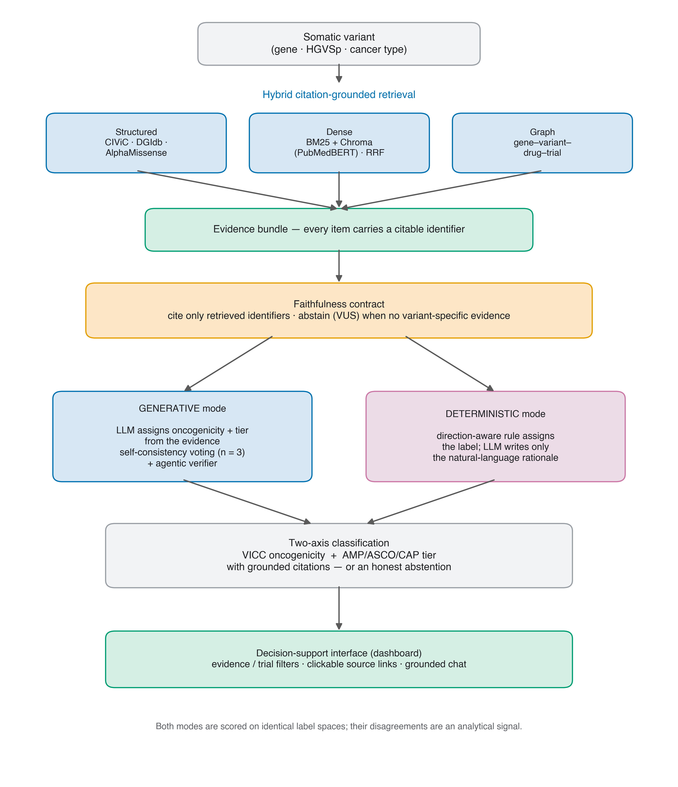
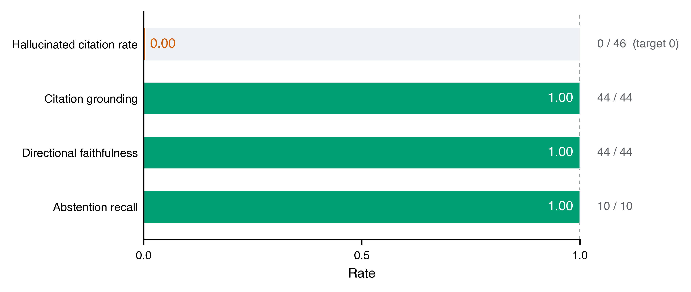
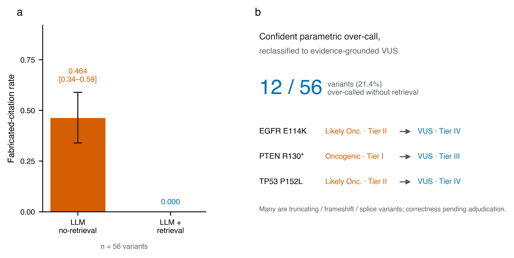
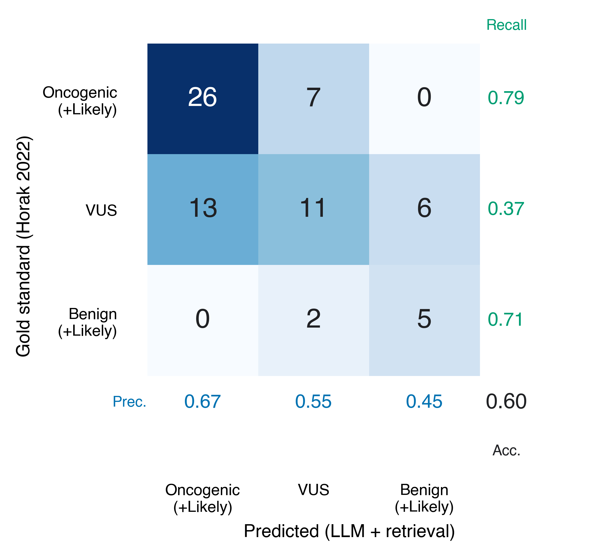
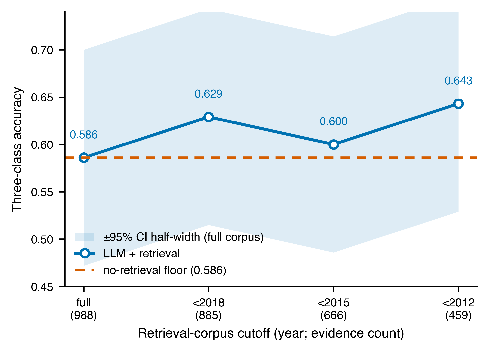
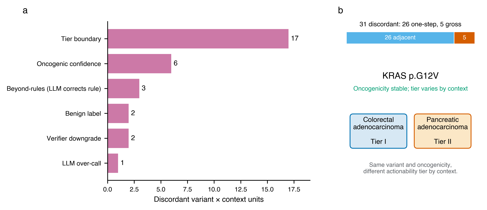
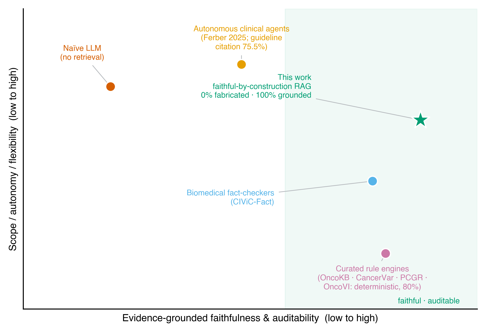
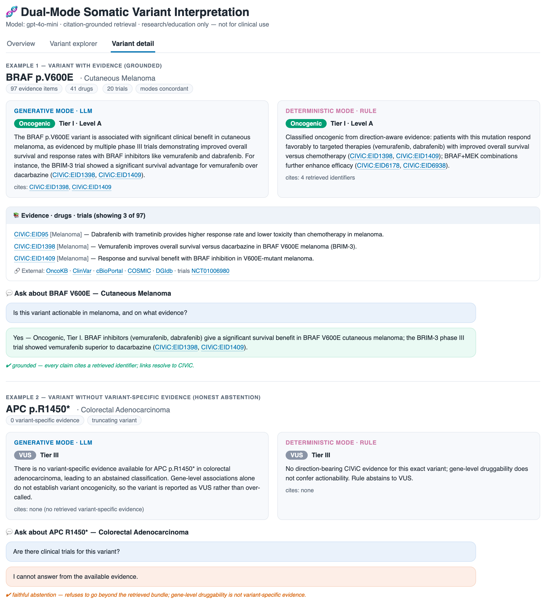

# Citation-grounded retrieval for faithful LLM somatic variant interpretation

**Author:** Ka-Kyung Kim

**Affiliation:** Independent Researcher, Seoul, Republic of Korea

**Correspondence:** kakyung.kim@gmail.com

---

## Abstract

**Objective.** Large language models (LLMs) can draft somatic variant interpretations but show two failure modes that bar clinical use: they fabricate supporting citations, and their judgements can come from parametric memory of well-known variants rather than from auditable evidence. We asked whether retrieval grounding can make LLM interpretation faithful and auditable, and whether any accuracy effect is genuine or a leakage artifact.

**Materials and Methods.** We built a dual-mode somatic variant interpreter that classifies variants on two international standards — ClinGen/CGC/VICC oncogenicity and AMP/ASCO/CAP clinical tier — using hybrid citation-grounded retrieval (structured knowledge bases, dense retrieval over CIViC evidence statements, and a knowledge graph) under a faithfulness contract requiring every assertion to cite a retrieved identifier and to abstain (assign a variant of uncertain significance, VUS) when no variant-specific evidence exists. A **Generative mode** (the LLM assigns the label) was compared with a **Deterministic mode** (a direction-aware rule assigns the label and the LLM only explains it) and with a no-retrieval baseline. Evaluation used a 56-variant five-cancer TCGA cohort and an external, balanced 70-variant expert-classified gold standard (Horak et al. 2022), with leakage-free faithfulness metrics, leakage controls (temporal holdout, leave-own-evidence-out, second model, embedding ablation), bootstrap confidence intervals, and exact McNemar tests.

**Results.** With retrieval, citation fabrication was 0%, versus 46.4% (95% CI 33.9–58.9%) without retrieval, alongside complete citation grounding, directional faithfulness, and abstention recall. Retrieval reclassified 12 of 56 confidently over-called variants (21.4%) to evidence-grounded VUS. On the balanced gold standard, three-class accuracy was non-inferior, not superior (0.600 with retrieval, 0.586 without, 0.557 for the rule; McNemar p = 1.0 and 0.61). Temporal-holdout, leave-own-evidence-out, second-model, and embedding controls left accuracy statistically unchanged, indicating the result is not driven by retrieval-corpus leakage.

**Discussion.** Retrieval grounding makes LLM variant interpretation faithful and auditable and suppresses confident parametric over-calling, but at this scale it does not improve classification accuracy.

**Conclusion.** Faithfulness and auditability — prerequisites for clinical decision support — can be guaranteed by construction; establishing an accuracy benefit would require a larger, powered, leakage-controlled benchmark with expert adjudication, whose design we specify.

**Keywords:** somatic variant interpretation; large language models; retrieval-augmented generation; faithfulness; auditability; clinical decision support; precision oncology.

---

## Background and Significance

Somatic variant interpretation — judging whether a tumour mutation is oncogenic and clinically actionable — is a rate-limiting step in precision oncology. In a molecular tumour board, each classification directs or withholds targeted therapy and trial enrolment, and every assertion that enters the clinical report must be traceable to a primary source for audit, liability, and regulatory review. The task is also a workforce bottleneck: expert curation does not scale to the variant volume of routine tumour sequencing, and rare or under-curated variants — precisely those where help is most needed — are the slowest and least certain to adjudicate. An automated assistant that is both accurate and auditable would therefore have direct clinical value, but only if its outputs can be trusted line by line.

Two community standards structure the task. The ClinGen/CGC/VICC framework defines **oncogenicity** on a five-label point-based system (Oncogenic, Likely Oncogenic, VUS, Likely Benign, Benign) [1], and the AMP/ASCO/CAP framework defines **clinical tier** (Tier I–IV with evidence levels A–D) [2]. Applying either standard means synthesising heterogeneous evidence — curated clinical assertions, drug–gene interactions, computational pathogenicity predictions, and trial status — into a defensible, citable judgement.

A mature ecosystem already operationalises these standards. Expert-curated knowledge bases such as OncoKB [3], COSMIC [4], and the crowdsourced CIViC [5] supply variant- and gene-level clinical assertions, while rule- or model-based platforms such as CancerVar [6], the Cancer Genome Interpreter [7], and the Personal Cancer Genome Reporter [8] map alterations onto tiers and oncogenicity calls. These systems are accurate and auditable but rely on hand-built rule engines and pre-computed lookups; they neither read free-text evidence on demand nor produce natural-language justifications, and their coverage of rare or under-curated variants is bounded by their databases. We treat this work as prior art our system must remain compatible with — our Deterministic mode is a deliberately simplified, direction-aware re-implementation in the same tradition — not as a baseline we claim to beat. Orthogonally, computational variant-effect predictors such as AlphaMissense [9], the protein-language model ESM1b [10], and the evolutionary model EVE [11] supply genome-scale pathogenicity priors; we use AlphaMissense as one evidence arm but treat such scores as gene-agnostic priors that cannot, alone, establish clinical actionability.

LLMs are attractive for this synthesis because they read free text fluently and emit structured prose. Two failure modes, however, make naïve use unsafe in any auditable clinical setting. First, **hallucinated citations**: asked to justify a classification, an LLM readily emits plausible but non-existent PMIDs or database identifiers. In a clinical report, a fabricated reference is a patient-safety and medico-legal hazard, because the assertion it appears to support cannot be checked. Second, **parametric leakage**: because famous driver variants (for example BRAF V600E or KRAS G12D) are heavily represented in pretraining data, an LLM may reproduce the textbook answer from memory rather than from the evidence supplied. This both inflates apparent accuracy on well-known variants and yields confident over-calls on superficially similar but functionally benign ones — an over-call that, in practice, could prompt inappropriate targeted therapy.

Retrieval-augmented generation (RAG) is the natural mitigation: ground the model on retrieved evidence and require it to cite that evidence. Both failure modes are documented outside genomics. The ALCE benchmark [12] formalised automatic evaluation of citation precision and recall and showed that even strong LLMs frequently fail to support their claims, and the MedRAG/MIRAGE study [13] established retrieval as a partial mitigation of hallucination and stale knowledge in medical question answering. Within clinical genomics, recent work has begun to apply LLMs and retrieval to variant interpretation: Lin et al. [14] benchmarked GPT-4o, Llama 3.1, and Qwen 2.5 on cancer-variant classification and reported a systematic tendency to over-classify variants toward higher evidence levels — the same parametric over-calling we observe — while noting that retrieval and prompt engineering helped; Lu and Cosgun [15] integrated roughly 190 million variant annotations into GPT-4o by RAG and fine-tuning and reported high field-level annotation accuracy. These studies emphasise accuracy against expert labels but leave two questions under-examined. First, **is the system actually faithful** — does it cite only retrieved evidence and abstain honestly when evidence is absent — and can faithfulness be measured without an external answer key, as general-domain attribution benchmarks [12] do but the genomics RAG work [14,15] does not? Second, **is any apparent accuracy benefit real or a leakage artifact** — does the system succeed by retrieving recent, answer-stating evidence (corpus leakage) or by parametric recall (model leakage) rather than by evidence-grounded reasoning? To our knowledge, no prior variant-interpretation study reports a leakage-controlled (temporal-holdout and leave-own-evidence-out) accuracy evaluation alongside a leakage-free faithfulness audit. That is the gap this work targets.

## Objective

We address this gap with an applied system and, more centrally, a rigorous evaluation built around faithfulness and leakage rather than headline accuracy. We make three claims, stated with deliberate statistical discipline. First, the system is **faithful by construction and empirically** — zero citation fabrication with complete grounding and abstention, a property the otherwise identical no-retrieval LLM lacks, with a large and statistically robust gap. Second, retrieval **suppresses confident parametric over-calling**, reclassifying several over-called variants to VUS by reading variant-specific evidence (whether each reclassification is correct awaits expert adjudication). Third, on a balanced expert gold standard, retrieval is **non-inferior, not superior, in accuracy**; we explicitly do not claim an accuracy gain, because at n = 70 the differences are not significant. We then subject this behaviour to several leakage controls to show it is robust rather than an artifact of one configuration. The contribution is applied and evaluative — a faithful-by-construction system plus a leakage-aware faithfulness/accuracy evaluation — not a new modelling method or an accuracy advance over established interpretation platforms.

---

## Materials and Methods

Figure 1 summarises the system: a hybrid retrieval layer assembles a citable evidence bundle that feeds two interpretation modes under a faithfulness contract, and the resulting interpretations are surfaced through a decision-support interface.



**Figure 1. System overview.** Each variant passes through a hybrid, citation-grounded retrieval layer (structured, dense, and graph arms) into an evidence bundle in which every item carries a citable identifier. A faithfulness contract requires every assertion to cite only retrieved identifiers and to abstain (assign VUS) when no variant-specific evidence exists. The **Generative mode** has the LLM assign both the oncogenicity and tier labels from the evidence (with self-consistency voting and an agentic verifier); the **Deterministic mode** assigns the labels by a direction-aware rule and uses the LLM only to write the rationale. Outputs are exposed through an auditable decision-support interface.

### Classification standards

Variants were classified on two axes, each enforced as a controlled enumeration. **Oncogenicity** followed the ClinGen/CGC/VICC 2022 point-based standard with five labels (Oncogenic, Likely Oncogenic, VUS, Likely Benign, Benign). **Clinical tier** followed the AMP/ASCO/CAP 2017 standard (Tier I–IV, with evidence levels A–D for Tiers I and II). The ACMG/AMP 2015 germline framework was intentionally not used, as the task is somatic. Unifying both vocabularies as enums let the Generative and Deterministic modes be compared on identical label spaces.

### Datasets

**Cohort (input variants).** Patient variants were drawn from the cBioPortal REST API (TCGA PanCancer Atlas, public) across five cancer types chosen for narrative contrast — lung adenocarcinoma, breast, colorectal, cutaneous melanoma, and pancreatic — at seven samples each (35 samples). Selection was restricted to a 27-gene driver panel and was deterministic, guaranteeing showcase variants such as BRAF V600E appearing in both melanoma and colorectal samples for a context-dependence analysis. After de-duplication by (gene, protein change, cancer) and tiered selection, 56 variant×context units were classified, out of 398 unique candidates.

**Knowledge sources (evidence layer).** Offline snapshots were assembled from CIViC (1,714 panel evidence rows; CC0), DGIdb (2,608 gene–drug interactions over 27 genes), AlphaMissense via Ensembl VEP REST (computational pathogenicity for 352 missense SNVs, mapped to VICC computational codes), and ClinicalTrials.gov v2 (37 trials). CIViC evidence statements were embedded into a persistent dense index.

**External benchmark (ground truth).** The external gold standard was Supplemental Table 3 of Horak et al. (2022), the ClinGen/CGC/VICC oncogenicity standardisation paper: 70 expert-classified somatic variants across nine genes (FLT3, BRAF, IDH1, KRAS, PIK3CA, PTEN, RB1, EZH2, TP53). The label distribution is balanced (VUS 30, Likely Oncogenic 19, Oncogenic 14, Benign 5, Likely Benign 2), making it a discriminating benchmark, unlike CIViC clinical assertions, which are heavily skewed toward a single class. Horak labels were not redistributed; only derived metrics are reported.

### Hybrid, citation-grounded retrieval

For each variant, an evidence bundle was assembled from three arms, every item carrying a citable identifier. The **structured** arm performed exact gene-plus-protein-change lookup in CIViC, gene-level drug lookup in DGIdb, and AlphaMissense lookup by genomic coordinate (yielding a VICC computational code). The **dense** arm used domain embeddings (NeuML/PubMedBERT by default; OpenAI text-embedding-3-small as an ablation) over CIViC statements, fused BM25 and Chroma retrieval by Reciprocal Rank Fusion, and attached only same-variant hits to guard against same-gene topic drift. The **graph** arm used a networkx knowledge graph (gene, variant, disease, drug, trial) to surface related variants via shared drugs. A **faithfulness contract** governed the output: a classification could cite only retrieved identifiers, and the system was required to abstain (assign VUS) when no variant-specific evidence existed; gene-level druggability did not count as variant-specific evidence.

### Dual-mode classification: Generative and Deterministic modes

The two modes embody a deliberate trade-off between flexibility and reproducibility, and the system runs both on every variant. The **Generative mode** lets the LLM itself decide the labels: because a language model can read and weigh free-text evidence that no fixed rule enumerates, this mode suits exploratory interpretation and rare or under-curated variants, at the cost of run-to-run variability and a tendency to over-call. The **Deterministic mode** instead fixes the label with a transparent, direction-aware rule and demotes the LLM to writing only the human-readable rationale; this buys reproducibility and auditability — identical output on every run, in the tradition of curated rule engines — while still gaining fluent natural-language justification, and it never lets the model's parametric priors override the evidence. Running both on the same variants is itself informative: where the flexible reader and the fixed rule disagree localises genuine interpretive uncertainty (Section 3.5), so discordance is treated as a signal rather than a defect.

**Generative mode.** The LLM (gpt-4o-mini) assigned the oncogenicity and tier labels itself, constrained to the enum vocabulary and grounded on the evidence bundle. It was enhanced with self-consistency voting (n = 3; agreement mapped to a confidence score) and an agentic verifier — an adversarial second pass that downgrades over-claims and is skipped on abstentions. **Deterministic mode.** A direction-aware rule assigned the labels from CIViC significance and direction, so that "Unaltered Function" or "Does Not Support" evidence counts against oncogenicity and only Sensitivity/Response evidence confers actionability; here the LLM wrote only the natural-language rationale. A **no-retrieval baseline** ran the Generative prompt with the evidence bundle removed, isolating parametric behaviour.

We used **gpt-4o-mini** as the primary model deliberately: the contribution is the retrieval-and-faithfulness architecture rather than any single model, and an inexpensive model both makes the cohort-scale dual-mode runs and ablations affordable and sets a conservative capability floor — properties demonstrated on a weak model are more likely to hold on a stronger one. **Temperature 0** was used for determinism and reproducibility, with **0.4 only on the self-consistency voting passes** to induce the answer diversity that voting requires. To confirm the findings are not an artifact of model size, we replicated the external benchmark on the stronger **gpt-4o** (Section 3.4, Table 1); we did not exhaustively sweep other proprietary or open models, which we note as a limitation.

### Evaluation and statistics

Three classes of evaluation were run. **Leakage-free faithfulness metrics** required no external truth: hallucinated-citation rate (fraction of variants whose emitted citations are absent from the retrieved bundle), citation grounding, directional faithfulness (whether the assigned label respects the direction of the cited evidence), abstention recall (fraction of no-evidence variants correctly abstained), and inter-mode Cohen's κ. An **ablation** compared the Deterministic mode, the no-retrieval LLM, and the Generative mode with retrieval. The **external benchmark** computed five-class and collapsed three-class accuracy and κ against the Horak gold standard. Leakage controls comprised a **temporal split** (restricting the retrieval corpus to literature published before a cutoff year), a **leave-own-evidence-out (LOVO)** ablation (removing each variant's own curated CIViC evidence before retrieval), a **second-model** replication (gpt-4o), and an **embedding ablation** (PubMedBERT versus MiniLM versus OpenAI, scored by recall@5 of the held-out own-evidence). Eight additional cohort analyses (cross-cancer consistency, sensitivity/resistance, dense recall-lift, AlphaMissense–LLM agreement, calibration, discordance concentration, hotspot-versus-rare, and verifier net-effect) characterised behaviour.

Uncertainty was quantified by nonparametric bootstrap 95% confidence intervals on accuracy and concordance, and paired methods were compared by the exact McNemar test on per-variant correctness; all reported p-values are two-sided. The implementation comprised the pipeline and 90 unit tests, and the system runs offline from committed snapshots for reproducibility.

### Decision-support interface

To make the faithful interpretations usable at the point of decision, the system exposes a browser dashboard. A cohort explorer filters variants by evidence status, drug or trial availability, and inter-mode discordance, and exports the filtered set. A per-variant view shows the Generative and Deterministic calls side by side, with each cited item rendered as a clickable link to its primary source — CIViC evidence items, ClinicalTrials.gov records, and external knowledge bases (OncoKB, ClinVar, cBioPortal, COSMIC, DGIdb). A grounded question-answering chat extends the faithfulness contract to free-text interaction: it answers a question about the selected variant only from that variant's retrieved evidence bundle and abstains ("I cannot answer from the available evidence") when the bundle does not cover the question, treating gene-level druggability as insufficient (Figure 8). The interface is a research and educational demonstrator, not a validated clinical tool.

---

## Results

### Faithfulness (leakage-free) — the headline result

Under the faithfulness contract, the retrieval system was faithful both by construction and empirically (Figure 2). Across the 56-variant cohort, the hallucinated-citation rate was 0.0 (0 of 46 variants that emitted citations), citation grounding was 1.0 (44/44 grounded), directional faithfulness was 1.0 (44/44; no assigned label contradicted the direction of its cited evidence), and abstention recall was 1.0 (10/10 no-evidence variants correctly abstained to VUS). Two further evidence-bearing variants were also conservatively abstained, a conservatism we connect to the VUS over-resolution discussed in the Discussion. The grounding and directional denominators are 44 rather than 46 because, of the 46 variants emitting citations, 2 emitted only non-citable tokens with no resolvable retrieved identifier to check. Inter-mode agreement between the Generative and Deterministic modes was substantial on oncogenicity (Cohen's κ = 0.713) and moderate on tier (κ = 0.417), consistent with the two modes differing mainly at tier boundaries rather than on the oncogenic/benign axis.



**Figure 2. Faithfulness of citation-grounded retrieval (cohort, n = 56).** Hallucinated-citation rate, citation grounding, directional faithfulness, and abstention recall under the faithfulness contract; fractions at right give the supporting counts. Two further evidence-bearing variants were conservatively abstained.

### Ablation — what retrieval contributes

Removing retrieval did not merely degrade faithfulness; it eliminated it (Figure 3). The otherwise identical no-retrieval LLM fabricated citations on 26 of 56 variants (46.4%, 95% CI 33.9–58.9%) — emitting placeholder or invented identifiers such as fabricated PMIDs ("PMID: 12345678") and ungrounded database tokens — whereas the retrieval system fabricated none (0%). Because the 95% CI for the no-retrieval fabrication rate excludes zero, this faithfulness gap is statistically robust, and it is the study's strongest quantitative finding.

Retrieval also suppressed confident parametric over-calling. In total, 12 of the 56 variants (21.4%) were called oncogenic or likely oncogenic by the no-retrieval model but reclassified to VUS by the retrieval system after reading variant-specific evidence. For example, EGFR E114K moved from Likely Oncogenic/Tier II without retrieval to VUS/Tier IV with it; PTEN R130* from Oncogenic/Tier I to VUS/Tier III; and TP53 P152L from Likely Oncogenic/Tier II to VUS/Tier IV. Many of the twelve are truncating, frameshift, or splice-site variants (for example APC R1450*, CDKN2A R58*, BRCA2 N1784Kfs*3) on which the parametric model defaulted to a confident driver call but the retrieval system, finding no variant-specific clinical evidence, abstained. We stress that 21.4% measures behavioural change, not correctness: a retrieval-grounded VUS is not guaranteed to be right for every one of the twelve, since some truncating variants in tumour-suppressor genes may be genuinely oncogenic. Whether each reclassification is an appropriate correction of over-calling or an over-conservative downgrade therefore awaits expert adjudication (see Discussion). The auditable property we claim is only that an over-confident parametric call is replaced by an evidence-grounded abstention. Tier-level agreement between the no-retrieval and retrieval arms was correspondingly low (Cohen's κ = 0.18), confirming that the two arms behave materially differently. In summary, retrieval eliminates citation hallucination and suppresses confident parametric over-calling; both are faithfulness and safety properties, not accuracy claims.



**Figure 3. Ablation.** (a) The no-retrieval LLM fabricated citations on 46.4% of variants (95% CI excludes zero) versus 0% with retrieval. (b) Examples of confident parametric over-calls reclassified to evidence-grounded VUS (correctness pending adjudication).

### External benchmark — accuracy is non-inferior, not superior

On the balanced 70-variant expert gold standard, three-class accuracies were 0.557 for the Deterministic mode (95% CI 0.443–0.671), 0.586 for the no-retrieval LLM (0.471–0.700), and 0.600 for the Generative mode with retrieval (0.486–0.714); Figure 4 reports the corresponding confusion structure. The confidence intervals overlap heavily, and the pairwise differences are not significant: the exact McNemar test gives p = 1.0 for retrieval versus no-retrieval (15 variants favouring retrieval, 14 favouring no-retrieval, of 29 discordant pairs) and p = 0.61 for retrieval versus rule (9 versus 6 of 15 discordant). We therefore explicitly do not claim that retrieval is more accurate; the appropriate claim is non-inferiority. The retrieval arm did have the highest point estimate and the strongest oncogenic-class recall (0.79), but the hardest class for every method was VUS (recall 0.37), which the LLM tended to over-resolve toward an oncogenicity call. The seven oncogenic variants misclassified as VUS were thin-coverage rare variants — predominantly PTEN and EZH2 (5 of 7: PTEN R130Q, T131I, H123R, P204A and EZH2 R684C), plus BRAF G469A and EZH2 V626M (the latter with zero retrieved evidence) — carrying a mean of only 1.0 evidence item, versus 2.2 across all 70. Their misses therefore reflect evidence sparsity rather than reasoning failure, and they strengthen the abstention-is-correct narrative: with almost no variant-specific evidence the system honestly defaulted to VUS rather than guessing. Five-class accuracy was modest for all methods (0.357–0.457), consistent with the intrinsic difficulty of the five-class VICC task at this scale.



**Figure 4. Horak three-class confusion (Generative + retrieval vs gold, n = 70).** Accuracy 0.600 and oncogenic recall 0.79; VUS is the hardest class. The result is non-inferior, not superior (McNemar p = 1.0 versus no-retrieval, 0.61 versus rule).

### Leakage controls and robustness

Because any apparent retrieval benefit could in principle reflect leakage — the corpus containing recent answer-stating evidence, or the model recalling famous variants — we ran several controls (Figure 5 and Table 1).

**Temporal corpus holdout.** Restricting the retrieval corpus to literature published before successive cutoffs did not degrade three-class accuracy: the full corpus (988 evidence items) gave 0.586; pre-2018 (885 items) 0.629; pre-2015 (666 items) 0.600; and pre-2012 (459 items, fewer than half, a decade before the 2022 gold standard) gave 0.643. The temporal sweep is a separate run that re-embeds and re-indexes the time-filtered corpus, so its full-corpus point (0.586) differs marginally from the primary pipeline's retrieval accuracy (0.600); the two are not the same run, and both lie well within the ±0.11-wide full-corpus confidence interval. All these point estimates sit within that interval, so the small upward drift is not significant and is not claimed as an improvement; the correct reading is that performance does not depend on retrieving recent answer-stating evidence — the corpus-leakage channel is not driving results. The no-retrieval parametric floor (0.586) is plotted alongside as a reference.

**Leave-own-evidence-out (LOVO).** Removing each variant's own curated CIViC evidence before retrieval — the strongest corpus-leakage control — left three-class accuracy statistically unchanged (0.614 versus 0.600 full; McNemar p = 1.0). Performance does not depend on retrieving the variant's own answer-evidence.

**Second model.** Replicating with gpt-4o raised the point estimates (three-class accuracy 0.70 [95% CI 0.60–0.80], κ 0.51, versus gpt-4o-mini 0.60/0.33), but the difference was not significant (McNemar p = 0.21, n = 70). Notably, gpt-4o reached the same oncogenic recall as the primary configuration (0.79); its higher point accuracy came entirely from the VUS/benign axis (more correct VUS and benign calls), so the shared 0.79 recall is not a source of any gpt-4o advantage. The findings are thus not an artifact of the smaller model and do not worsen with a stronger one — not that gpt-4o is better.

**Embedding ablation.** Recall@5 of the held-out own-evidence was similar across embedders (PubMedBERT 0.243, MiniLM 0.229, OpenAI 0.229), so the embedding model is not a sensitive factor — at most a small domain-model edge.

These controls quantify the corpus-leakage channel and show it is not driving results. They do not control the LLM's own parametric leakage, which remains uncontrolled and is quantified only by the no-retrieval floor.



**Figure 5. Temporal corpus holdout (Horak gold, n = 70).** Three-class accuracy under successively older retrieval corpora, plotted against the no-retrieval parametric floor; restricting to pre-2012 literature does not degrade accuracy. Differences are within noise — leakage-controlled robustness, not an accuracy gain.

### Dual-mode discordance as an analytical signal

Across the 56-variant cohort, oncogenicity concordance between the Generative and Deterministic modes was 0.786 (95% CI 0.679–0.893) and tier concordance 0.571 (0.446–0.696), with 31 discordant cases. The disagreement was overwhelmingly fine-grained: 26 of 31 discordances were adjacent (one step), and only 5 were gross (Figure 6). By type, 17 were tier-boundary disagreements, 6 oncogenic-confidence (Oncogenic versus Likely Oncogenic), 3 "beyond-rules" corrections (the rule over-calls a driver while the LLM reads the evidence to a non-driver: PIK3CA R88Q, PTEN R130*, ESR1 E247K), 2 benign-label, 2 verifier downgrades, and 1 LLM over-call. Discordance concentrated in TP53 (all seven TP53 variants discordant) and was a property of tier boundaries rather than of rare variants (hotspot discordance 0.54 versus non-hotspot 0.56).

A representative context-dependence case illustrates why this signal is interpretable. KRAS G12V received a stable oncogenicity call across cancers but a context-dependent tier — Tier I in colorectal adenocarcinoma versus Tier II in pancreatic adenocarcinoma — reflecting genuine differences in the strength of clinical actionability evidence between tumour types, exactly the distinction a flat rule misses (Figure 6). Across all four multi-cancer variants, oncogenicity was stable while only KRAS G12V's tier varied. Supporting analyses found AlphaMissense–LLM oncogenicity agreement of 0.944 (17/18), a dense-arm recall-lift that recovered CIViC evidence exact matching missed (decisive for PIK3CA H1047R), and a net-positive verifier (it changed 10 tiers, 6 toward and 4 away from the rule, raising tier concordance from 0.518 to 0.571), with voting confidence behaving as a calibrated signal once the verifier-cap confound was removed.



**Figure 6. Dual-mode discordance.** (a) Discordances by type (26 of 31 adjacent, 5 gross). (b) KRAS G12V context-dependence: stable oncogenicity but Tier I in colorectal versus Tier II in pancreatic adenocarcinoma.

### Table 1. Accuracy and leakage-control summary (Horak gold standard, n = 70, three-class).

| Configuration | 3-class accuracy | κ (3-class) | Oncogenic recall | Test vs LLM+RAG |
|---|---|---|---|---|
| Deterministic (rule) | 0.557 [0.443–0.671] | 0.274 | — | McNemar p = 0.61 |
| Generative, no-retrieval (parametric floor) | 0.586 [0.471–0.700] | 0.254 | — | McNemar p = 1.0 |
| **Generative + retrieval (primary, gpt-4o-mini)** | **0.600 [0.486–0.714]** | **0.332** | **0.79** | — |
| Generative + retrieval, corpus < 2012 (temporal sweep) | 0.643 † | 0.413 | 0.85 | within CI |
| Generative + retrieval, LOVO (own evidence removed) | 0.614 [0.500–0.729] | 0.366 | 0.82 | McNemar p = 1.0 |
| Generative + retrieval, gpt-4o | 0.700 [0.600–0.800] | 0.506 | 0.79 | McNemar p = 0.21 |

All differences from the primary configuration are non-significant; intervals are nonparametric bootstrap 95% CIs (the LOVO and gpt-4o CIs were recomputed from per-variant three-class correctness with the same bootstrap as the primary rows). No configuration establishes an accuracy improvement. † The temporal-sweep rows are descriptive single runs in which the retrieval *corpus*, not the test set, varies; no bootstrap CI or McNemar test is computed for them, and the full temporal sweep is reported above and in Figure 5.

---

## Discussion

### Principal findings and clinical implications

This study makes one robust claim and two carefully bounded ones. The robust claim is faithfulness: with retrieval, the system fabricated no citations and grounded, directionally respected, and abstained on every checkable case, whereas an otherwise identical no-retrieval LLM fabricated citations on 46.4% of variants. For clinical decision support this matters more than a marginal accuracy gain. In a molecular tumour board, the unit of trust is the individual assertion and its source: a classification a clinician can audit line by line is usable even when uncertain, whereas a confident classification supported by an invented PMID is unusable regardless of whether it happens to be right. The faithfulness contract converts this requirement into a guarantee — the system cites only retrieved identifiers and abstains when evidence is absent — making its outputs auditable by construction rather than by inspection after the fact. The two bounded claims follow the same safety logic. Retrieval reclassified 21.4% of confidently over-called variants to evidence-grounded VUS, replacing an unaccountable driver call with an honest abstention; and accuracy was non-inferior, not superior, which we state plainly rather than over-read from overlapping intervals. The clinical reading is that grounding buys auditability and a reduction in confident over-calling at no accuracy cost — a favourable trade for a setting where an unaccountable error is worse than an acknowledged uncertainty.

### Comparison with prior work

The concept of retrieval faithfulness is not ours: ALCE [12] formalised automatic citation precision and recall, RAGAS and the medical citation line of MedCite [20] automated faithfulness and verifiable-citation scoring, and deterministic guardrails with abstention are established in general clinical retrieval-augmented generation. Our contribution is the application and the guarantee, on three counts. First, we report faithfulness — hallucinated-citation rate, citation grounding, a *directional* faithfulness metric, and abstention recall — as a primary axis evaluated *alongside* accuracy for the two standardised classification tasks that drive oncology reports (ClinGen/CGC/VICC oncogenicity and AMP/ASCO/CAP tier), a subfield whose established tools [6,7,8,19] report accuracy or concordance and never hallucination or abstention. Second, we make faithfulness a worst-case guarantee *by construction* — zero out-of-bundle citations and forced abstention on absent or contradictory evidence — rather than the measured-and-mitigated property prior frameworks provide. Third, we show this behaviour is not a leakage artifact through temporal-holdout and leave-own-evidence-out controls that no prior LLM-for-variants study reports. We explicitly do not claim a citable rule engine as itself novel — OncoVI [19] already maps each VICC criterion to its evidence source — only the faithfulness reporting and the by-construction guarantee layered on the two-mode design.

Relative to the established rule-based ecosystem [6,7,8], the distinguishing contribution is on-demand, evidence-grounded, natural-language justification with honest abstention, not improved tier accuracy; our Deterministic mode is a simplified member of that ecosystem rather than a competitor. Relative to recent LLM-for-variants work [14,15], the distinguishing contributions are the leakage-free faithfulness audit — in the spirit of ALCE [12] but on database identifiers rather than passages — and the leakage controls. Our observation that the no-retrieval model over-calls variants toward higher confidence independently reproduces the over-classification tendency reported by Lin et al. [14], and shows that retrieval grounding suppresses it.

Two concurrent works are the closest neighbours and warrant explicit differentiation. CIViC-Fact [16] builds a CIViC-derived benchmark linking cancer-variant claims to sentence-level supporting or refuting evidence and fine-tunes a verifier for fact-checking; our task is different — generative two-axis classification (VICC oncogenicity and AMP/ASCO/CAP tier) under a citation-grounding contract, evaluated with leakage controls — but its faithfulness-for-variants framing is adjacent, and evaluating our system on it is a natural extension. Precision Grounding [17] likewise grounds a variant LLM in curated databases to cut hallucination, but targets free-text summarisation rather than standardised classification. Among rule-based comparators, OncoVI [19] is a full ClinGen/CGC/VICC implementation reaching 80% on the 93-variant guideline gold set — a stronger deterministic baseline than our deliberately simplified rule mode, and the obvious head-to-head for a future benchmark. Relative to autonomous clinical agents such as Ferber et al. [18], which reach high decision accuracy but cite guidelines correctly only 75.5% of the time, our contribution is precisely the faithfulness guarantee rather than agentic breadth. Our attribution metric follows the medical citation-evaluation line of MedCite [20], and our leakage controls are motivated by the benchmark-contamination literature [21]. Figure 7 places these approaches on two axes — evidence-grounded faithfulness and auditability against scope and autonomy — locating this work in the high-faithfulness region that autonomous agents and naïve LLMs do not reach, while retaining more flexibility than fixed rule engines.



**Figure 7. Where faithful-by-construction interpretation sits.** Approaches are placed by evidence-grounded faithfulness and auditability (x) against scope and autonomy (y). This work occupies the high-faithfulness region — 0% fabricated citations, 100% grounding — with more flexibility than deterministic rule engines and stronger attribution than autonomous clinical agents (e.g. Ferber et al. [18] cite guidelines correctly 75.5% of the time) or a naïve no-retrieval LLM. Positions are conceptual; the reported values come from each cited study on its own task and data, not a head-to-head on identical inputs.

### From faithful classifications to a decision-support interface

Faithfulness is most useful when it reaches the person making the decision. The dashboard operationalises the contract at the point of use (Figure 8): every interpretation is shown beside its primary sources as clickable links, so a user can verify each assertion in a single step, and the grounded chat refuses to answer beyond the retrieved evidence rather than improvising. Two real cases illustrate the contrast. For **BRAF V600E in cutaneous melanoma**, both modes return Oncogenic / Tier I and each claim links to its CIViC source (EID1398, EID1409, the BRIM-3 vemurafenib evidence); asked whether the variant is actionable, the chat answers from that bundle with the identifiers attached. For the truncating variant **APC R1450\*** in colorectal adenocarcinoma, for which no variant-specific evidence is retrieved, both modes report VUS and the chat answers "I cannot answer from the available evidence" rather than over-calling a driver — the same grounded-versus-abstain behaviour quantified in Sections 3.1–3.2, now visible at the point of use. In a molecular tumour board, this is the behaviour that separates a usable assistant from a hazardous one: an auditable, source-linked answer, or an explicit acknowledgement that the evidence is insufficient, supports the human decision instead of substituting an unaccountable judgement for it. We stress that the interface is a demonstrator for research and education; it is not validated for clinical deployment, and any clinical use would require the prospective evaluation outlined below.



**Figure 8. The decision-support dashboard (representative variant-detail view, rendered from real cohort data).** For BRAF V600E in cutaneous melanoma the Generative and Deterministic modes agree (Oncogenic, Tier I) and every statement links to its CIViC source (e.g. EID1398, EID1409); the grounded chat answers only from the retrieved bundle. For the truncating variant APC R1450\* (no variant-specific evidence) both modes report VUS and the chat abstains ("I cannot answer from the available evidence") rather than over-calling a driver. Evidence identifiers and external-database links (OncoKB, ClinVar, cBioPortal, COSMIC, DGIdb, ClinicalTrials.gov) are clickable in the live application.

### Toward a powered accuracy evaluation

We did not claim an accuracy advantage because, at n = 70, none of the observed differences (retrieval versus no-retrieval, +0.014; versus rule, +0.043) is statistically significant. Establishing such a claim is a question of study design, not rewording, and would require the following, which we specify so that it can be executed directly. (i) **A pre-specified effect of interest and a power analysis.** For a paired McNemar comparison with a discordant-pair fraction near 0.4, detecting an absolute three-class accuracy gain of about 0.05 at 80% power needs on the order of several hundred variants, and a 0.03 gain roughly a thousand; the target n should be fixed from this calculation rather than from data availability. (ii) **A larger, class-balanced, leakage-controlled benchmark.** Assemble at least several hundred expert-classified somatic variants stratified across genes and all five VICC classes, drawn from sources independent of the retrieval corpus and post-dating the model's training cutoff, so that corpus and parametric leakage are neutralised in the same design rather than in separate controls. (iii) **Ordinal, per-class endpoints.** Report per-class precision, recall, and F1 with full confusion matrices, and adopt macro-F1 and quadratic-weighted κ as primary endpoints, which suit the ordinal five-class task better than flat accuracy. (iv) **Variance characterisation.** Run at least five seeds and temperature settings and voting sizes n ∈ {1, 3, 5}, reporting mean ± SD; the present single-run estimates cannot support a significance claim in either direction. (v) **A pre-registered analysis.** Pre-register a non-inferiority margin and, only if it is exceeded, a superiority test, with multiplicity control across the two classification axes. (vi) **Expert adjudication.** Convert the 21.4% over-call suppression and the beyond-rules corrections from behavioural signals into correctness claims by having a blinded panel of board-certified molecular pathologists label each VUS reclassification as an appropriate correction or an over-conservative downgrade. Only with these elements in place would a defensible accuracy claim — and, separately, a validated clinical-utility claim — be warranted.

Concretely, three additions would deliver this richer, leakage-controlled evaluation. First, **extend the gold set** from the 70-variant Horak subset to the full 93-variant ClinGen/CGC/VICC guideline set, enabling a head-to-head against the OncoVI rule engine [19] on identical variants. Second, **add a clean temporal holdout** from ClinVar's somatic-oncogenicity submissions (opened 2024), which post-date most pretraining corpora and carry native VICC labels, neutralising the corpus and parametric leakage channels in one design. Third, **cross-evaluate faithfulness** on the CIViC-Fact benchmark [16] (CC0, committable) to test whether our citation grounding transfers to an independent attribution task. An orthogonal functional check — correlating oncogenicity calls with deep-mutational-scanning fitness scores from MaveDB and ProteinGym — would add construct validity without requiring further expert labels. The evaluation should also span **multiple model families** — including open-weights models such as Llama 3.1 and Mixtral alongside the proprietary GPT series, as in prior LLM-for-variants benchmarks [14] — to establish that the faithfulness architecture and its accuracy behaviour generalise beyond one vendor rather than reflecting a single model's idiosyncrasies; cross-model agreement could additionally serve as a calibrated confidence and abstention signal. These are scoped as future work; none is run here.

Beyond evaluation, these elements point to a concrete method that advances on autonomous clinical agents precisely where they are weakest. Such agents drive tool use with a single strong model; as Ferber et al. [18] report, open-weights models (Llama-3 70B, Mixtral) are unreliable in that driver role and their citation accuracy is human-judged at 75.5%. A faithfulness-first alternative inverts this design. Rather than letting open models *drive* retrieval, several models — gpt-4o-mini and gpt-4o alongside open-weights Llama 3.1 and Mixtral — are run as independent *raters over a single fixed retrieved evidence set*, where tool-calling reliability is irrelevant, and cross-model agreement on both the call and the cited evidence identifiers becomes a calibrated confidence that routes disagreement to abstention. Coupling this with a claim-level attribution check — verifying by entailment that each asserted claim is supported by its cited passage — replaces a single human-judged citation score with an automatic, reproducible citation-faithfulness metric; a risk–coverage curve under the temporal and leave-own-evidence-out holdouts then quantifies the safety gained per unit of abstention. This package reuses the exact open models that fail as agent drivers, but repurposes them as a faithfulness signal, and is runnable offline. We present it as the next methodological step, not as a result reported here.

### Limitations

Several limitations bound the present claims. Absolute accuracy is modest — five-class accuracy 0.36–0.46 and three-class near 0.60 — reflecting the intrinsic difficulty of the five-class VICC task at this scale; the contribution is faithfulness, not accuracy. VUS calibration is a genuine weakness: the LLM over-resolves uncertain variants toward an oncogenicity call (VUS recall 0.37). Rare-variant coverage is thin: the oncogenic-to-VUS misses are variants with few evidence items, so the honest-abstention behaviour correctly fires but at the cost of recall, motivating broader evidence sources and stronger weighting of foundation-model priors. LLM parametric leakage is not controlled by any of our experiments; the temporal and LOVO controls govern only the retrieval-corpus channel, and the no-retrieval floor is the sole quantification of the parametric channel. The study is single-sample, at the gene/protein-change level, with a 70-variant external set and a single primary model (gpt-4o-mini); the gpt-4o replication mitigates but does not remove single-model dependence. The Deterministic baseline is simplified — direction-aware, and therefore not a strawman, but not guideline-certified. Finally, cohort selection caps AlphaMissense-only and no-evidence variants per cancer, so 56 of 398 unique variants were classified for cost control. These constraints, with the non-significant accuracy comparisons, are why we frame the work as faithful and non-inferior rather than more accurate.

---

## Conclusion

We present a faithful-by-construction somatic variant interpreter and a leakage-aware evaluation showing that citation-grounded retrieval guarantees auditability and suppresses confident parametric over-calling while leaving classification accuracy non-inferior at the current scale. For clinical decision support, faithfulness and auditability are not secondary to accuracy but prerequisites for it to be trusted: a system that may be uncertain but is never unaccountable is safer in a molecular tumour board than one that is occasionally right for reasons no one can check. The route to an accuracy claim is a larger, powered, leakage-controlled benchmark with expert adjudication, whose design we have specified, and which is the natural next step toward prospective clinical validation. All code and data snapshots are released for reproduction.

---

## Data and Code Availability

All source code, reproduction scripts, committed data snapshots, and figure-generation code are available at the project repository (`https://github.com/<USERNAME>/<REPO>`, released on publication); every result, figure, and table is reproducible from the committed data using the scripts there. The system runs offline from committed snapshots, with network access confined to the data-fetch scripts. Large or licence-restricted artifacts — the persistent Chroma dense index, the full AlphaMissense TSV (CC BY-NC-SA), and the Horak supplementary table — are not committed and are reproduced via the repository scripts; Horak expert labels are not redistributed. Secrets are referenced by environment-variable name only (`OPENAI_API_KEY`); no keys, proprietary logic, or patient data are included. Licensing is respected throughout: CIViC is CC0, ClinicalTrials.gov and ClinVar are public, the TCGA open-access tier is cited, AlphaMissense is CC BY-NC-SA (not committed), and Horak labels are not redistributed.

*Disclaimer: this system is for research and educational use only and is not validated for clinical decision-making; all inputs derive from public TCGA cohorts and knowledge bases.*

---

## References

1. Horak P, Griffith M, Danos AM, et al. Standards for the classification of pathogenicity of somatic variants in cancer (oncogenicity): Joint recommendations of Clinical Genome Resource (ClinGen), Cancer Genomics Consortium (CGC), and Variant Interpretation for Cancer Consortium (VICC). *Genet Med* 2022;24(5):986–998. doi:10.1016/j.gim.2022.01.001
2. Li MM, Datto M, Duncavage EJ, et al. Standards and Guidelines for the Interpretation and Reporting of Sequence Variants in Cancer: A Joint Consensus Recommendation of the Association for Molecular Pathology, American Society of Clinical Oncology, and College of American Pathologists. *J Mol Diagn* 2017;19(1):4–23. doi:10.1016/j.jmoldx.2016.10.002
3. Chakravarty D, Gao J, Phillips S, et al. OncoKB: A Precision Oncology Knowledge Base. *JCO Precis Oncol* 2017;1:1–16. doi:10.1200/PO.17.00011
4. Tate JG, Bamford S, Jubb HC, et al. COSMIC: the Catalogue Of Somatic Mutations In Cancer. *Nucleic Acids Res* 2019;47(D1):D941–D947. doi:10.1093/nar/gky1015
5. Griffith M, Spies NC, Krysiak K, et al. CIViC is a community knowledgebase for expert crowdsourcing the clinical interpretation of variants in cancer. *Nat Genet* 2017;49(2):170–174. doi:10.1038/ng.3774
6. Li Q, Ren Z, Cao K, Li MM, Wang K, Zhou Y. CancerVar: An artificial intelligence–empowered platform for clinical interpretation of somatic mutations in cancer. *Sci Adv* 2022;8(18):eabj1624. doi:10.1126/sciadv.abj1624
7. Tamborero D, Rubio-Perez C, Deu-Pons J, et al. Cancer Genome Interpreter annotates the biological and clinical relevance of tumor alterations. *Genome Med* 2018;10(1):25. doi:10.1186/s13073-018-0531-8
8. Nakken S, Fournous G, Vodák D, et al. Personal Cancer Genome Reporter: variant interpretation report for precision oncology. *Bioinformatics* 2018;34(10):1778–1780. doi:10.1093/bioinformatics/btx817
9. Cheng J, Novati G, Pan J, et al. Accurate proteome-wide missense variant effect prediction with AlphaMissense. *Science* 2023;381(6664):eadg7492. doi:10.1126/science.adg7492
10. Brandes N, Goldman G, Wang CH, et al. Genome-wide prediction of disease variant effects with a deep protein language model. *Nat Genet* 2023;55(9):1512–1522. doi:10.1038/s41588-023-01465-0
11. Frazer J, Notin P, Dias M, et al. Disease variant prediction with deep generative models of evolutionary data. *Nature* 2021;599(7883):91–95. doi:10.1038/s41586-021-04043-8
12. Gao T, Yen H, Yu J, et al. Enabling Large Language Models to Generate Text with Citations. *Proceedings of the 2023 Conference on Empirical Methods in Natural Language Processing (EMNLP)* 2023:6465–6488. doi:10.18653/v1/2023.emnlp-main.398
13. Xiong G, Jin Q, Lu Z, et al. Benchmarking Retrieval-Augmented Generation for Medicine. *Findings of the Association for Computational Linguistics: ACL 2024* 2024:6233–6251. doi:10.18653/v1/2024.findings-acl.372
14. Lin K-H, Kao T-H, Wang L-C, et al. Benchmarking large language models GPT-4o, Llama 3.1, and Qwen 2.5 for cancer genetic variant classification. *npj Precis Oncol* 2025;9(1):141. doi:10.1038/s41698-025-00935-4

15. Lu S, Cosgun E. Boosting GPT models for genomics analysis: generating trusted genetic variant annotations and interpretations through RAG and Fine-tuning. *Bioinform Adv* 2025;5(1):vbaf019. doi:10.1093/bioadv/vbaf019
16. Reisle C, Grisdale CJ, Krysiak K, et al. Evaluating Language Models for Biomedical Fact-Checking: A Benchmark Dataset for Cancer Variant Interpretation Verification (CIViC-Fact). *bioRxiv* 2025;2025.09.10.675443. doi:10.1101/2025.09.10.675443
17. Du X, Nagy A, Oates MF, et al. Precision Grounding: Augmenting Large Language Models with Evidence-Based Databases for Trustworthy Genetic Variant Summarization. *medRxiv* 2025;2025.06.09.25329279. doi:10.1101/2025.06.09.25329279
18. Ferber D, et al. Development and validation of an autonomous artificial intelligence agent for clinical decision-making in oncology. *Nat Cancer* 2025. doi:10.1038/s43018-025-00991-6
19. Carta MG, Tögel L, Hölsken A, et al. Oncogenicity Variant Interpreter (OncoVI): oncogenicity guidelines implementation to support somatic variants interpretation in precision oncology. *medRxiv* 2024;2024.10.10.24315072. doi:10.1101/2024.10.10.24315072
20. Wang X, Tan M, Jin Q, et al. MedCite: Can Language Models Generate Verifiable Text for Medicine? *Findings of the Association for Computational Linguistics: ACL 2025* 2025:18891–18913.
21. Xu C, Guan S, Greene D, et al. Benchmark Data Contamination of Large Language Models: A Survey. *arXiv* 2024;arXiv:2406.04244.

> *Note on references:* all entries were verified against CrossRef/the publisher record (title, authors, year, venue, DOI) during literature scouting; DOIs resolve to the cited articles. The original draft's "Lin et al. 2025, *Retrieval-augmented generation for clinical variant interpretation*" could **not** be verified as written (no such paper was found). It has been replaced by two verified, closely related works: Lin et al. 2025 (ref. 14, a benchmark of LLMs for cancer-variant classification in *npj Precision Oncology* — the first-author/year match the draft, but the title and scope differ) and Lu & Cosgun 2025 (ref. 15, the RAG-for-variant-annotation paper). If the draft intended a different "Lin" paper, ref. 14 should be re-confirmed before submission.

### BibTeX

```bibtex
@article{Horak2022, title={Standards for the classification of pathogenicity of somatic variants in cancer (oncogenicity): Joint recommendations of Clinical Genome Resource (ClinGen), Cancer Genomics Consortium (CGC), and Variant Interpretation for Cancer Consortium (VICC)}, author={Horak, Peter and Griffith, Malachi and Danos, Arpad M. and Pitel, Beth A. and Madhavan, Subha and Liu, Xuelu and Chow, Cynthia and Williams, Heather and Carmody, Leigh and Barrow-Laing, Lisa and Rieke, Damian and Kreutzfeldt, Simon and Stenzinger, Albrecht and Tamborero, David and Benary, Manuela and Rajagopal, Padma Sheila and Ida, Cristiane M. and Lesmana, Harry and Satgunaseelan, Laveniya and Merker, Jason D. and Tolstorukov, Michael Y. and Campregher, Paulo Vidal and Warner, Jeremy L. and Rao, Shruti and Natesan, Maya and Shen, Haolin and Venstrom, Jeffrey and Roy, Somak and Tao, Kayoko and Kanagal-Shamanna, Rashmi and Xu, Xinjie and Ritter, Deborah I. and Pagel, Kym and Krysiak, Kilannin and Dubuc, Adrian and Akkari, Yassmine M. and Li, Xuan Shirley and Lee, Jennifer and King, Ian and Raca, Gordana and Wagner, Alex H. and Li, Marylin M. and Plon, Sharon E. and Kulkarni, Shashikant and Griffith, Obi L. and Chakravarty, Debyani and Sonkin, Dmitriy}, journal={Genetics in Medicine}, volume={24}, number={5}, pages={986--998}, year={2022}, doi={10.1016/j.gim.2022.01.001} }

@article{Li2017, title={Standards and Guidelines for the Interpretation and Reporting of Sequence Variants in Cancer: A Joint Consensus Recommendation of the Association for Molecular Pathology, American Society of Clinical Oncology, and College of American Pathologists}, author={Li, Marilyn M. and Datto, Michael and Duncavage, Eric J. and Kulkarni, Shashikant and Lindeman, Neal I. and Roy, Somak and Tsimberidou, Apostolia M. and Vnencak-Jones, Cindy L. and Wolff, Daynna J. and Younes, Anas and Nikiforova, Marina N.}, journal={The Journal of Molecular Diagnostics}, volume={19}, number={1}, pages={4--23}, year={2017}, doi={10.1016/j.jmoldx.2016.10.002} }

@article{Chakravarty2017, title={OncoKB: A Precision Oncology Knowledge Base}, author={Chakravarty, Debyani and Gao, Jianjiong and Phillips, Sarah and Kundra, Ritika and Zhang, Hongxin and Wang, Jiaojiao and others}, journal={JCO Precision Oncology}, volume={1}, pages={1--16}, year={2017}, doi={10.1200/PO.17.00011} }

@article{Tate2019, title={COSMIC: the Catalogue Of Somatic Mutations In Cancer}, author={Tate, John G. and Bamford, Sally and Jubb, Harry C. and Sondka, Zbyslaw and Beare, David M. and Bindal, Nidhi and others}, journal={Nucleic Acids Research}, volume={47}, number={D1}, pages={D941--D947}, year={2019}, doi={10.1093/nar/gky1015} }

@article{Griffith2017, title={CIViC is a community knowledgebase for expert crowdsourcing the clinical interpretation of variants in cancer}, author={Griffith, Malachi and Spies, Nicholas C. and Krysiak, Kilannin and McMichael, Joshua F. and Coffman, Adam C. and Danos, Arpad M. and others}, journal={Nature Genetics}, volume={49}, number={2}, pages={170--174}, year={2017}, doi={10.1038/ng.3774} }

@article{Li2022CancerVar, title={CancerVar: An artificial intelligence--empowered platform for clinical interpretation of somatic mutations in cancer}, author={Li, Quan and Ren, Zilin and Cao, Kajia and Li, Marilyn M. and Wang, Kai and Zhou, Yunyun}, journal={Science Advances}, volume={8}, number={18}, pages={eabj1624}, year={2022}, doi={10.1126/sciadv.abj1624} }

@article{Tamborero2018, title={Cancer Genome Interpreter annotates the biological and clinical relevance of tumor alterations}, author={Tamborero, David and Rubio-Perez, Carlota and Deu-Pons, Jordi and Schroeder, Michael P. and Vivancos, Ana and Rovira, Ana and Tusquets, Ignasi and Albanell, Joan and Rodon, Jordi and Tabernero, Josep and de Torres, Carmen and Dienstmann, Rodrigo and Gonzalez-Perez, Abel and Lopez-Bigas, Nuria}, journal={Genome Medicine}, volume={10}, number={1}, pages={25}, year={2018}, doi={10.1186/s13073-018-0531-8} }

@article{Nakken2018, title={Personal Cancer Genome Reporter: variant interpretation report for precision oncology}, author={Nakken, Sigve and Fournous, Ghislain and Vod{\'a}k, Daniel and Aasheim, Lars Birger and Myklebost, Ola and Hovig, Eivind}, journal={Bioinformatics}, volume={34}, number={10}, pages={1778--1780}, year={2018}, doi={10.1093/bioinformatics/btx817} }

@article{Cheng2023, title={Accurate proteome-wide missense variant effect prediction with AlphaMissense}, author={Cheng, Jun and Novati, Guido and Pan, Joshua and Bycroft, Clare and {\v{Z}}emgulyt{\.e}, Akvil{\.e} and Applebaum, Taylor and Pritzel, Alexander and Wong, Lai Hong and Zielinski, Michal and Sargeant, Tobias and Schneider, Rosalia G. and Senior, Andrew W. and Jumper, John and Hassabis, Demis and Kohli, Pushmeet and Avsec, {\v{Z}}iga}, journal={Science}, volume={381}, number={6664}, pages={eadg7492}, year={2023}, doi={10.1126/science.adg7492} }

@article{Brandes2023, title={Genome-wide prediction of disease variant effects with a deep protein language model}, author={Brandes, Nadav and Goldman, Grant and Wang, Charlotte H. and Ye, Chun Jimmie and Ntranos, Vasilis}, journal={Nature Genetics}, volume={55}, number={9}, pages={1512--1522}, year={2023}, doi={10.1038/s41588-023-01465-0} }

@article{Frazer2021, title={Disease variant prediction with deep generative models of evolutionary data}, author={Frazer, Jonathan and Notin, Pascal and Dias, Mafalda and Gomez, Aidan and Min, Joseph K. and Brock, Kelly and Gal, Yarin and Marks, Debora S.}, journal={Nature}, volume={599}, number={7883}, pages={91--95}, year={2021}, doi={10.1038/s41586-021-04043-8} }

@inproceedings{Gao2023, title={Enabling Large Language Models to Generate Text with Citations}, author={Gao, Tianyu and Yen, Howard and Yu, Jiatong and Chen, Danqi}, booktitle={Proceedings of the 2023 Conference on Empirical Methods in Natural Language Processing}, pages={6465--6488}, year={2023}, doi={10.18653/v1/2023.emnlp-main.398} }

@inproceedings{Xiong2024, title={Benchmarking Retrieval-Augmented Generation for Medicine}, author={Xiong, Guangzhi and Jin, Qiao and Lu, Zhiyong and Zhang, Aidong}, booktitle={Findings of the Association for Computational Linguistics: ACL 2024}, pages={6233--6251}, year={2024}, doi={10.18653/v1/2024.findings-acl.372} }

@article{Lin2025, title={Benchmarking large language models GPT-4o, Llama 3.1, and Qwen 2.5 for cancer genetic variant classification}, author={Lin, Kuan-Hsun and Kao, Tzu-Hang and Wang, Lei-Chi and Kuo, Chen-Tsung and Chen, Paul Chih-Hsueh and Chu, Yuan-Chia and Yeh, Yi-Chen}, journal={npj Precision Oncology}, volume={9}, number={1}, pages={141}, year={2025}, doi={10.1038/s41698-025-00935-4} }

@article{Lu2025, title={Boosting GPT models for genomics analysis: generating trusted genetic variant annotations and interpretations through RAG and Fine-tuning}, author={Lu, Shuangjia and Cosgun, Erdal}, journal={Bioinformatics Advances}, volume={5}, number={1}, pages={vbaf019}, year={2025}, doi={10.1093/bioadv/vbaf019} }
```
