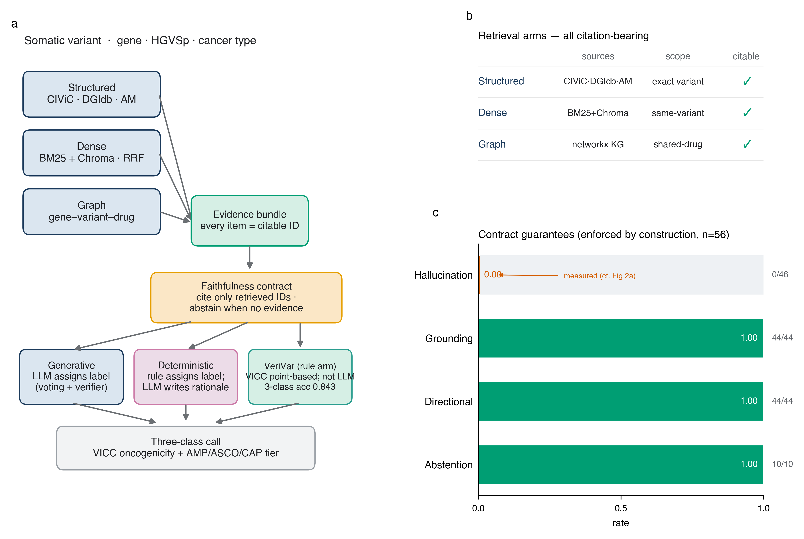
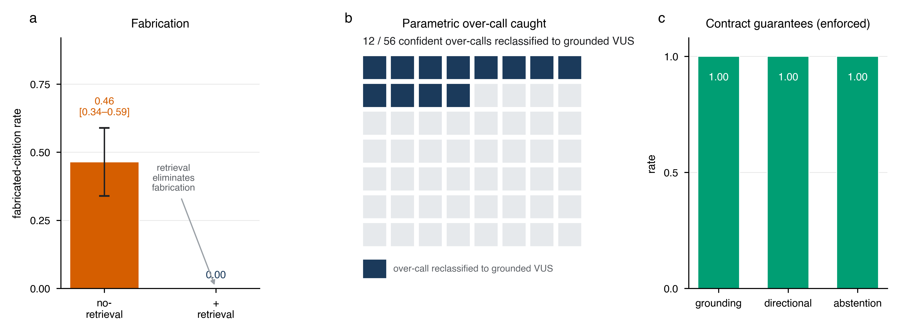
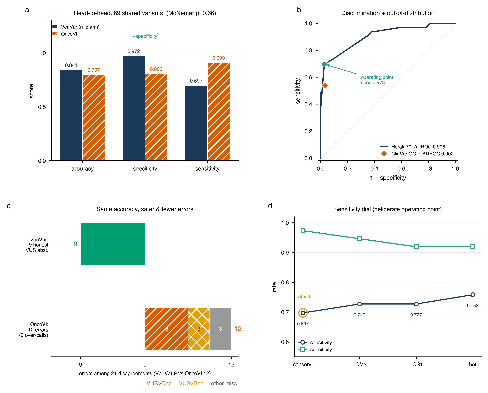
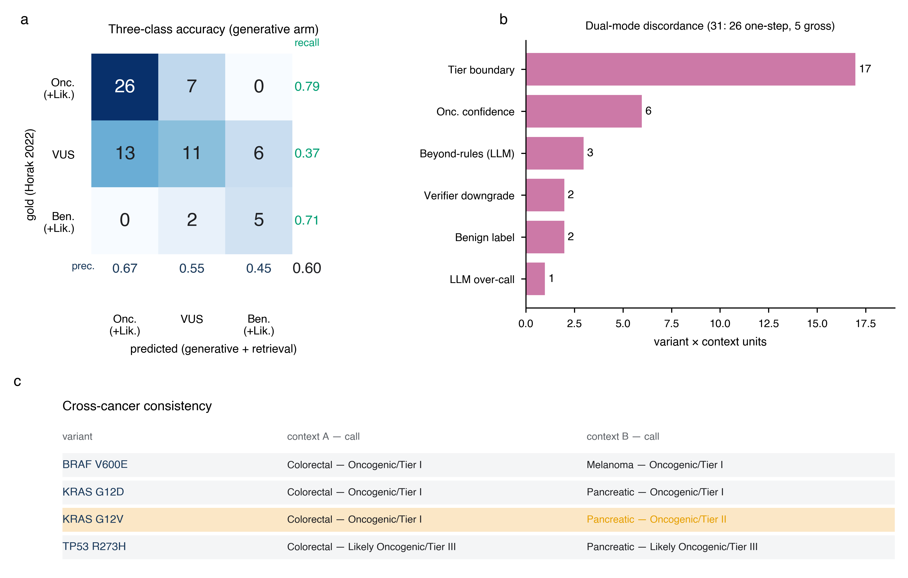
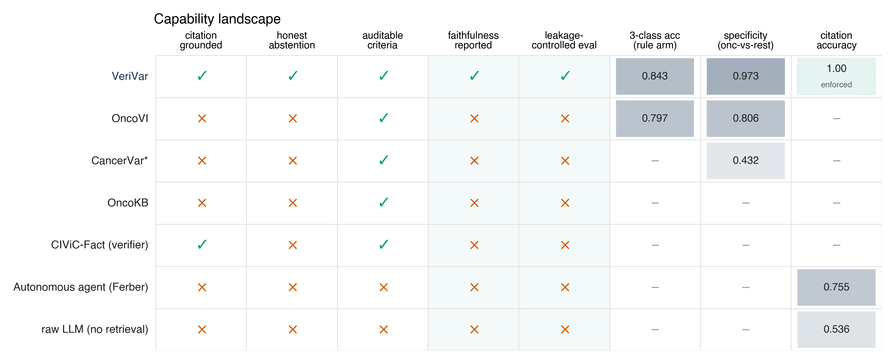
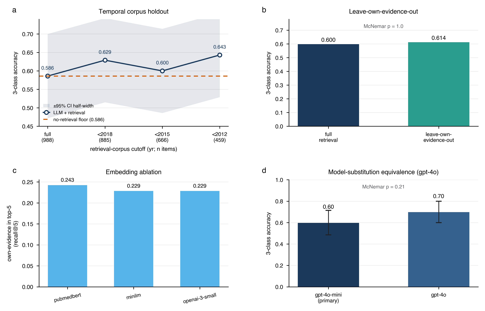
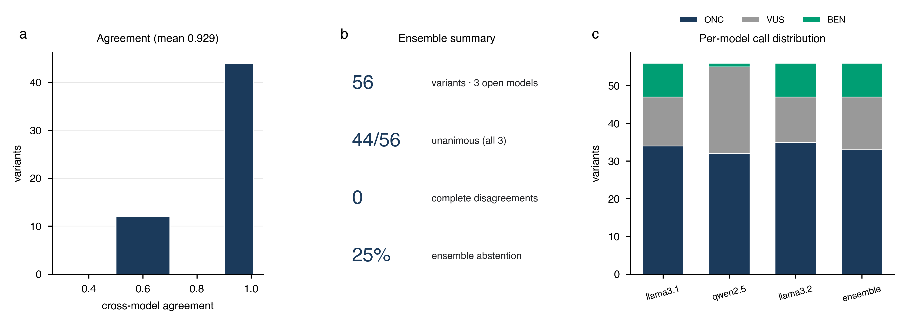
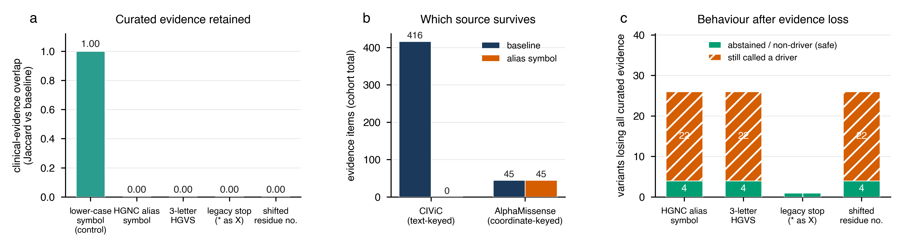

# Citation-grounded retrieval for faithful LLM somatic variant interpretation

**Author:** Ka-Kyung Kim

**Affiliation:** [to confirm]

**Correspondence:** kakyung.kim@gmail.com

---

## Abstract

**Objective.** Somatic variant interpretation feeds patient-facing oncology reports, where each oncogenicity and AMP/ASCO/CAP tier call directs or withholds targeted therapy; a large language model (LLM) that fabricates a supporting citation or confidently over-calls a variant is therefore clinically unusable, regardless of whether the call happens to be right. A usable decision-support draft must instead be auditable line by line and must abstain rather than fabricate. LLMs, however, show exactly the opposite two failure modes that bar such use: they fabricate supporting citations, and their judgements can come from parametric memory of well-known variants rather than from auditable evidence. We asked whether retrieval grounding can make LLM interpretation faithful and auditable, and whether any accuracy effect is genuine or a leakage artifact.

**Materials and Methods.** We built a dual-mode somatic variant interpreter that classifies variants on two international standards — ClinGen/CGC/VICC oncogenicity and AMP/ASCO/CAP clinical tier — using hybrid citation-grounded retrieval (structured knowledge bases, dense retrieval over CIViC evidence statements, and a knowledge graph) under a faithfulness contract requiring every assertion to cite a retrieved identifier and to abstain (assign a variant of uncertain significance, VUS) when no variant-specific evidence exists. A **Generative mode** (the LLM assigns the label) was compared with a **Deterministic mode** (a direction-aware rule assigns the label and the LLM only explains it) and with a no-retrieval baseline. Evaluation used a 56-variant five-cancer TCGA cohort and an external, balanced 70-variant expert-classified gold standard (Horak et al. 2022), with leakage-free faithfulness metrics, leakage controls (temporal holdout, leave-own-evidence-out, second model, embedding ablation), bootstrap confidence intervals, and exact McNemar tests.

**Results.** The empirical faithfulness finding is the *pre-gate* retrieval behaviour: with a populated evidence bundle the LLM emitted 106 citations across 56 variants, **0 of which were absent from the bundle** (no fabricated evidence), whereas the otherwise identical no-retrieval arm fabricated citations on 26 of 56 variants (0.464, 95% CI 0.339–0.589, a confidence interval that excludes zero). The honest measured residual is citation imprecision: 20 of the 106 retrieval-arm citations (18.9%) named only the source category rather than the exact variant-level identifier (imprecision, not fabrication — no item was absent from the bundle). The faithfulness gate then *enforces* the contract end-to-end, so the post-gate scorecard — hallucination 0, citation grounding 1.0, directional faithfulness 1.0, abstention recall 1.0 — reports the **guarantees the contract enforces by construction, not measured emergent outcomes**. Retrieval reclassified 12 of 56 confidently over-called variants (21.4%) to evidence-grounded VUS (a behavioural change, not verified correctness). The two interpretation arms have distinct accuracy profiles. For the **generative** arm, three-class accuracy was not significantly different from either baseline (0.600 with retrieval, 0.586 without, 0.557 for the simplified rule; McNemar p = 1.0 and 0.61, overlapping CIs), so faithfulness, not accuracy, is its contribution. Separately, **VeriVar's rule arm — a citable VICC point-based implementation, a deterministic rule engine, not the LLM, and not claimed as a novel classifier** — reached three-class accuracy 0.843 (95% CI 0.757–0.929) on Horak-70 (specificity 0.973, AUROC 0.906) and, head-to-head against the open-source ClinGen/CGC/VICC guideline engine OncoVI on 69 shared variants, was statistically indistinguishable in accuracy (0.841, 95% CI 0.754–0.928 vs 0.797, 95% CI 0.696–0.884; McNemar p = 0.66) at markedly higher specificity (0.972 vs 0.806), trading 9 of OncoVI's confident over-calls for honest abstentions; both head-to-head values are on the 69 shared variants (OncoVI's published full-93-set accuracy is 0.80). Temporal-holdout, leave-own-evidence-out, model-substitution, and embedding controls left generative-arm accuracy statistically unchanged, showing that the faithfulness behaviour and the *absence* of a generative accuracy effect are not artifacts of retrieval-corpus leakage; these controls do not, however, govern the model's own parametric channel, which remains uncontrolled and is quantified only by the no-retrieval floor. A further ablation perturbing only *how the variant is written* exposes a real limit of the contract: every one of 66 HGNC alias-symbol tests, and every three-letter HGVS rewrite, removed all curated clinical evidence for the affected variants (416 items to 0 cohort-wide), and 22 of the 26 affected variants were nonetheless still called Oncogenic or Likely Oncogenic on the coordinate-keyed computational prior alone. No citation was fabricated anywhere in that ablation (0 of 228), so the contract's guarantee holds as written while failing to guarantee what matters clinically — that a driver call rests on curated clinical evidence.

**Discussion.** Retrieval grounding makes the generative interpreter faithful and auditable and suppresses confident parametric over-calling, though at this scale it does not raise that arm's accuracy; the separate deterministic VICC rule arm, by contrast, reaches accuracy indistinguishable from the open state-of-the-art engine at substantially higher specificity within the same auditable framework.

**Conclusion.** Faithfulness and auditability — prerequisites for trustworthy clinical decision support — can be guaranteed by construction, but the guarantee must be specified carefully: ours holds citations to retrieved identifiers without requiring that a driver call rest on clinical evidence, and an input-context ablation shows that gap is reachable by something as ordinary as a legacy gene symbol. Establishing an accuracy benefit would require a larger, powered, leakage-controlled benchmark with expert adjudication, whose design we specify. We measure citation faithfulness, auditability, and classification accuracy only; clinical utility is motivated, not measured (no patient outcomes, no prospective use), and the system is for research and education, not clinical care.

**Keywords:** somatic variant interpretation; large language models; retrieval-augmented generation; faithfulness; auditability; clinical decision support; precision oncology.

---

## Background and Significance

Somatic variant interpretation — judging whether a tumour mutation is oncogenic and clinically actionable — is a rate-limiting step in precision oncology. In a molecular tumour board, a pathologist drafts an oncogenicity call and an AMP/ASCO/CAP clinical tier for each variant, and each such classification directs or withholds targeted therapy and trial enrolment. The draft is consequential precisely at the level of its individual assertions: a hallucinated rationale — a plausible but non-existent citation under a confident call — invites a clinician to act on evidence that does not exist, and a silent over-call of a benign variant can prompt inappropriate targeted therapy, so every assertion that enters the clinical report must be traceable to a primary source for audit, liability, and regulatory review. The task is also a workforce bottleneck: expert curation does not scale to the variant volume of routine tumour sequencing, and rare or under-curated variants — precisely those where help is most needed — are the slowest and least certain to adjudicate. An automated assistant could therefore have direct clinical value, but only if its draft can be trusted line by line: it must be auditable, and it must declare uncertainty rather than fabricate it away.

Two community standards structure the task. The ClinGen/CGC/VICC framework defines **oncogenicity** on a five-label point-based system (Oncogenic, Likely Oncogenic, VUS, Likely Benign, Benign) [1], and the AMP/ASCO/CAP framework defines **clinical tier** (Tier I–IV with evidence levels A–D) [2]. Applying either standard means synthesising heterogeneous evidence — curated clinical assertions, drug–gene interactions, computational pathogenicity predictions, and trial status — into a defensible, citable judgement.

A mature ecosystem already operationalises these standards. Expert-curated knowledge bases such as OncoKB [3], COSMIC [4], and the crowdsourced CIViC [5] supply variant- and gene-level clinical assertions, while rule- or model-based platforms such as CancerVar [6], the Cancer Genome Interpreter [7], and the Personal Cancer Genome Reporter [8] map alterations onto tiers and oncogenicity calls. These systems are accurate and auditable but rely on hand-built rule engines and pre-computed lookups; they neither read free-text evidence on demand nor produce natural-language justifications, and their coverage of rare or under-curated variants is bounded by their databases. We treat this work as prior art our system must remain compatible with — our Deterministic mode is a deliberately simplified, direction-aware re-implementation in the same tradition — not as a baseline we claim to beat. Orthogonally, computational variant-effect predictors such as AlphaMissense [9], the protein-language model ESM1b [10], and the evolutionary model EVE [11] supply genome-scale pathogenicity priors; we use AlphaMissense as one evidence arm but treat such scores as gene-agnostic priors that cannot, alone, establish clinical actionability.

LLMs are attractive for this synthesis because they read free text fluently and emit structured prose. Two failure modes, however, make naïve use unsafe in any auditable clinical setting. First, **hallucinated citations**: asked to justify a classification, an LLM readily emits plausible but non-existent PMIDs or database identifiers. In a clinical report, a fabricated reference is a patient-safety and medico-legal hazard, because the assertion it appears to support cannot be checked. Second, **parametric leakage**: because famous driver variants (for example BRAF V600E or KRAS G12D) are heavily represented in pretraining data, an LLM may reproduce the textbook answer from memory rather than from the evidence supplied. This both inflates apparent accuracy on well-known variants and yields confident over-calls on superficially similar but functionally benign ones — an over-call that, in practice, could prompt inappropriate targeted therapy.

Retrieval-augmented generation (RAG) is the natural mitigation: ground the model on retrieved evidence and require it to cite that evidence. Both failure modes are documented outside genomics. The ALCE benchmark [12] formalised automatic evaluation of citation precision and recall and showed that even strong LLMs frequently fail to support their claims, and the MedRAG/MIRAGE study [13] established retrieval as a partial mitigation of hallucination and stale knowledge in medical question answering. Within clinical genomics, recent work has begun to apply LLMs and retrieval to variant interpretation: Lin et al. [14] benchmarked GPT-4o, Llama 3.1, and Qwen 2.5 on cancer-variant classification and reported a systematic tendency to over-classify variants toward higher evidence levels — the same parametric over-calling we observe — while noting that retrieval and prompt engineering helped; Lu and Cosgun [15] integrated roughly 190 million variant annotations into GPT-4o by RAG and fine-tuning and reported high field-level annotation accuracy. These studies emphasise accuracy against expert labels but leave two questions under-examined. First, **is the system actually faithful** — does it cite only retrieved evidence and abstain honestly when evidence is absent — and can faithfulness be measured without an external answer key, as general-domain attribution benchmarks [12] do but the genomics RAG work [14,15] does not? Second, **is any apparent accuracy benefit real or a leakage artifact** — does the system succeed by retrieving recent, answer-stating evidence (corpus leakage) or by parametric recall (model leakage) rather than by evidence-grounded reasoning? To our knowledge, no prior variant-interpretation study reports a leakage-controlled (temporal-holdout and leave-own-evidence-out) accuracy evaluation alongside a leakage-free faithfulness audit. That is the gap this work targets.

## Objective

We address this gap with an applied system and, more centrally, a rigorous evaluation built around faithfulness and leakage rather than headline accuracy. We make three claims, stated with deliberate statistical discipline. First, the system is **faithful by construction and empirically** — zero citation fabrication with complete grounding and abstention, a property the otherwise identical no-retrieval LLM lacks, with a large and statistically robust gap. Second, retrieval **suppresses confident parametric over-calling**, reclassifying several over-called variants to VUS by reading variant-specific evidence (whether each reclassification is correct awaits expert adjudication). Third, the generative arm's accuracy on a balanced expert gold standard is **not significantly different (absence of evidence of a difference at n = 70, not evidence of equivalence)** from both a no-retrieval LLM and a simplified rule, with no claim of a generative accuracy gain (the n = 70 differences are not significant; we report this as overlapping CIs and non-significant McNemar tests rather than a formal non-inferiority test, as no non-inferiority margin was pre-specified); separately, a citable VICC point-based rule arm — a deterministic rule engine, not the LLM — reaches accuracy indistinguishable from the open state-of-the-art at higher specificity within the same auditable framework, showing the approach need not trade accuracy for faithfulness. We then subject this behaviour to several leakage controls to show it is robust rather than an artifact of one configuration. The contribution is applied and evaluative — a faithful-by-construction system plus a leakage-aware faithfulness/accuracy evaluation — not a new modelling method or an accuracy advance over established interpretation platforms.

---

## Materials and Methods

Figure 1 summarises the system, which we refer to as VeriVar: a hybrid retrieval layer assembles a citable evidence bundle that feeds two interpretation modes under a faithfulness contract, and the resulting interpretations are surfaced through a decision-support interface.



**Figure 1. System overview and citation grounding.** (a) Each variant passes through a hybrid, citation-grounded retrieval layer (structured, dense, and graph arms) into an evidence bundle in which every item carries a citable identifier; a faithfulness contract requires every assertion to cite only retrieved identifiers and to abstain (assign VUS) when no variant-specific evidence exists. Three interpretation arms follow: a **Generative mode** (the LLM assigns labels with self-consistency voting and an agentic verifier), a **Deterministic mode** (a direction-aware rule assigns the label, the LLM writes only the rationale), and **VeriVar's rule arm** (a citable VICC point-based implementation; the 3-class accuracy 0.843 shown on this arm is the deterministic rule, benchmarked against OncoVI, not the LLM; §3.3, Figure 3a). (b) The three retrieval arms, each citation-bearing. (c) Contract guarantees (enforced by construction) on the 56-variant cohort: hallucination 0, grounding 1.0, directional faithfulness 1.0, abstention recall 1.0. The 1.0 values are guarantees the gate enforces, not measured emergent outcomes; the measured, falsifiable finding is the 0.00 hallucination bar (46.4% without retrieval, panel 2a).

### Classification standards

Variants were classified on two axes, each enforced as a controlled enumeration. **Oncogenicity** followed the ClinGen/CGC/VICC 2022 point-based standard with five labels (Oncogenic, Likely Oncogenic, VUS, Likely Benign, Benign). **Clinical tier** followed the AMP/ASCO/CAP 2017 standard (Tier I–IV, with evidence levels A–D for Tiers I and II). The ACMG/AMP 2015 germline framework was intentionally not used, as the task is somatic. Unifying both vocabularies as enums let the Generative and Deterministic modes be compared on identical label spaces.

### Datasets

**Cohort (input variants).** Patient variants were drawn from the cBioPortal REST API (TCGA PanCancer Atlas, public) across five cancer types chosen for narrative contrast — lung adenocarcinoma, breast, colorectal, cutaneous melanoma, and pancreatic — at seven samples each (35 samples). Selection was restricted to a 27-gene driver panel and was deterministic, guaranteeing showcase variants such as BRAF V600E appearing in both melanoma and colorectal samples for a context-dependence analysis. After de-duplication by (gene, protein change, cancer) and tiered selection, 56 variant×context units were classified, out of 398 unique candidates.

**Knowledge sources (evidence layer).** Offline snapshots were assembled from CIViC (1,714 panel evidence rows; CC0), DGIdb (2,608 gene–drug interactions over 27 genes), AlphaMissense via Ensembl VEP REST (computational pathogenicity for 352 missense SNVs, mapped to VICC computational codes), and ClinicalTrials.gov v2 (37 trials). CIViC evidence statements were embedded into a persistent dense index.

**Data resources, versions, and genome build.** All upstream resources, their snapshot/version, and coordinate provenance are listed in Table M0 (compiled from the committed resource manifest `docs/RESOURCES.md` / `data/knowledge/resources.json`); where no formal upstream version is published, the resource is recorded as a dated access snapshot. The **primary genome build is GRCh37 (hg19)** — the TCGA cohort coordinates, the AlphaMissense per-variant coordinate lookups for the cohort, and the Horak coordinates used in our pipeline are all GRCh37; because AlphaMissense is build-aware and protein-level (scores are keyed by protein change with no liftover), the build does not affect protein-change-keyed evidence. CancerVar predictions were obtained separately on GRCh38 (hg38, the Horak b38 coordinates) as a cross-axis comparator (§2.5).

**Table M0. Data resources, versions, and genome build.**

| Resource | Version/Snapshot | Genome build | Source | Access date | License/Notes |
|---|---|---|---|---|---|
| TCGA PanCancer Atlas 2018 cohort (via cBioPortal) | cBioPortal snapshot (5 studies, 7 samples/study) | GRCh37 (hg19) | cBioPortal REST API | 2026-05-30 | TCGA open-access somatic mutations; 27-gene driver panel |
| CIViC (clinical evidence + assertions) | nightly snapshot 2026-05-30 | n/a (gene/variant-level) | civicdb.org nightly TSV | 2026-05-30 | CC0 1.0; 1,714 evidence rows; 35 assertions |
| DGIdb (drug–gene interactions) | API snapshot 2026-05-30 | n/a (gene-level) | dgidb.org GraphQL API | 2026-05-30 | 2,608 gene-level interactions; not variant-specific evidence |
| AlphaMissense (computational pathogenicity) | model 2023 (Cheng et al., Science 2023; Zenodo 8208688), via Ensembl VEP REST | build-aware, protein-level (no liftover) | Ensembl VEP REST (AlphaMissense=1) | 2026-05-30 | 352 missense SNVs; thresholds pathogenic≥0.564, benign≤0.34; CC-BY-NC |
| ClinicalTrials.gov | REST API v2 snapshot | n/a | clinicaltrials.gov API v2 | 2026-05-30 | 37 trials linked from CIViC NCT ids |
| UniProt protein domains | snapshot (no upstream version recorded) | n/a (protein/UniProt residue numbering) | rest.uniprot.org | snapshot | CC-BY 4.0; domain spans for 9 genes |
| Horak et al. 2022 (external gold standard) | 70 expert-classified variants (ClinGen/CGC/VICC) | GRCh37 (b37) + GRCh38 (b38) both committed | PMC9081216 | snapshot | Genet Med 2022;24(5):986–998; VICC point-based oncogenicity standard |
| CancerVar (cross-axis AMP/ASCO/CAP comparator) | web server snapshot 2026-06-14 (hg38_update) | GRCh38 (hg38; Horak b38 coordinates) | cancervar.wglab.org | 2026-06-14 | Li et al., Sci Adv 2022;8(18):eabj1624; tiers parsed verbatim |
| Ensembl VEP REST mirrors | REST endpoints (per-variant snapshot, local caches) | GRCh37 (grch37.rest.ensembl.org) · GRCh38 (rest.ensembl.org) | rest.ensembl.org | 2026-05-30 | VCF annotation + AlphaMissense lookups; cached for offline reproducibility |
| LLM — gpt-4o-mini (primary) + gpt-4o (replication) | gpt-4o-mini (primary); gpt-4o second-model replication | n/a | api.openai.com | 2026-05-30 | Self-consistency n=3 + agentic verifier; offline mock fallback when unset |

**External benchmark (ground truth).** The external gold standard was Supplemental Table 3 of Horak et al. (2022), the ClinGen/CGC/VICC oncogenicity standardisation paper: 70 expert-classified somatic variants across nine genes (FLT3, BRAF, IDH1, KRAS, PIK3CA, PTEN, RB1, EZH2, TP53). The label distribution is balanced (VUS 30, Likely Oncogenic 19, Oncogenic 14, Benign 5, Likely Benign 2), making it a discriminating benchmark, unlike CIViC clinical assertions, which are heavily skewed toward a single class. Horak labels were not redistributed; only derived metrics are reported.

### Hybrid, citation-grounded retrieval

For each variant, an evidence bundle was assembled from three arms, every item carrying a citable identifier. The **structured** arm performed exact gene-plus-protein-change lookup in CIViC, gene-level drug lookup in DGIdb, and AlphaMissense lookup by genomic coordinate (yielding a VICC computational code). The **dense** arm used domain embeddings (NeuML/PubMedBERT by default; OpenAI text-embedding-3-small as an ablation) over CIViC statements, fused BM25 and Chroma retrieval by Reciprocal Rank Fusion, and attached only same-variant hits to guard against same-gene topic drift. The **graph** arm used a networkx knowledge graph (gene, variant, disease, drug, trial) to surface related variants via shared drugs. A **faithfulness contract** governed the output: a classification could cite only retrieved identifiers, and the system was required to abstain (assign VUS) when no variant-specific evidence existed; gene-level druggability did not count as variant-specific evidence.

### Dual-mode classification: Generative and Deterministic modes

The two modes embody a deliberate trade-off between flexibility and reproducibility, and the system runs both on every variant. The **Generative mode** lets the LLM itself decide the labels: because a language model can read and weigh free-text evidence that no fixed rule enumerates, this mode suits exploratory interpretation and rare or under-curated variants, at the cost of run-to-run variability and a tendency to over-call. The **Deterministic mode** instead fixes the label with a transparent, direction-aware rule and demotes the LLM to writing only the human-readable rationale; this buys reproducibility and auditability — identical output on every run, in the tradition of curated rule engines — while still gaining fluent natural-language justification, and it never lets the model's parametric priors override the evidence. Running both on the same variants is itself informative: where the flexible reader and the fixed rule disagree localises genuine interpretive uncertainty (Section 3.5), so discordance is treated as a signal rather than a defect.

**Generative mode.** The LLM (gpt-4o-mini) assigned the oncogenicity and tier labels itself, constrained to the enum vocabulary and grounded on the evidence bundle. It was enhanced with self-consistency voting (n = 3; agreement mapped to a confidence score) and an agentic verifier — an adversarial second pass that downgrades over-claims and is skipped on abstentions. **Deterministic mode.** A direction-aware rule assigned the labels from CIViC significance and direction, so that "Unaltered Function" or "Does Not Support" evidence counts against oncogenicity and only Sensitivity/Response evidence confers actionability; here the LLM wrote only the natural-language rationale. A **no-retrieval baseline** ran the Generative prompt with the evidence bundle removed, isolating parametric behaviour.

We used **gpt-4o-mini** as the primary model deliberately: the contribution is the retrieval-and-faithfulness architecture rather than any single model, and an inexpensive model both makes the cohort-scale dual-mode runs and ablations affordable and sets a conservative capability floor — properties demonstrated on a weak model are more likely to hold on a stronger one. **Temperature 0** was used for determinism and reproducibility, with **0.4 only on the self-consistency voting passes** to induce the answer diversity that voting requires. To confirm the findings are not an artifact of model size, we replicated the external benchmark on the stronger **gpt-4o** (Section 3.4, Table 1); we did not exhaustively sweep other proprietary or open models, which we note as a limitation.

### Evaluation and statistics

Three classes of evaluation were run. **Leakage-free faithfulness metrics** required no external truth: hallucinated-citation rate (fraction of variants whose emitted citations are absent from the retrieved bundle), citation grounding, directional faithfulness (whether the assigned label respects the direction of the cited evidence), abstention recall (fraction of no-evidence variants correctly abstained), and inter-mode Cohen's κ. An **ablation** compared the Deterministic mode, the no-retrieval LLM, and the Generative mode with retrieval. The **external benchmark** computed five-class and collapsed three-class accuracy and κ against the Horak gold standard. Leakage controls comprised a **temporal split** (restricting the retrieval corpus to literature published before a cutoff year), a **leave-own-evidence-out (LOVO)** ablation (removing each variant's own curated CIViC evidence before retrieval), a **second-model** replication (gpt-4o), and an **embedding ablation** (PubMedBERT versus MiniLM versus OpenAI, scored by recall@5 of the held-out own-evidence). Eight additional cohort analyses (cross-cancer consistency, sensitivity/resistance, dense recall-lift, AlphaMissense–LLM agreement, calibration, discordance concentration, hotspot-versus-rare, and verifier net-effect) characterised behaviour.

Uncertainty was quantified by nonparametric bootstrap 95% confidence intervals on accuracy and concordance, and paired methods were compared by the exact McNemar test on per-variant correctness; all reported p-values are two-sided. The implementation comprised the pipeline and 200 unit tests, and the system runs offline from committed snapshots for reproducibility.

### Input-context ablation

A variant enters this system as a gene symbol plus a protein change, and both are written differently by different sources. A legacy pathology report says HER2 where HGNC says ERBB2; one annotation pipeline emits `p.Val600Glu` where another emits `p.V600E`; pre-HGVS tools write `p.R130X` for what is now `p.R130*`; and the same genomic change annotated against a different transcript lands on a different residue number. The first three are alternative spellings of the same variant and must not change the interpretation. The fourth denotes a different residue and must not be silently accepted. Because every structured lookup in the retrieval layer keys on the uppercased (symbol, protein-change) pair, and the dense arm additionally requires the retrieved document's gene symbol to match the query's exactly, this is a place where the system could fail quietly, so we measured it rather than assuming it (`scripts/run_context_ablation.py`).

Each perturbation was applied to the input of all 56 cohort variants and the pipeline re-run. **Alias** replaces the symbol with an HGNC alternative, taken from the HGNC REST record for each cohort gene rather than chosen by us (`scripts/fetch_gene_aliases.py`; withdrawn previous symbols preferred, then current aliases). **Three-letter** rewrites the protein change in three-letter HGVS. **Legacy stop** rewrites a nonsense variant's terminator as `X`. **Shifted residue** adds a fixed offset of 12 to the residue number; this arm is explicitly synthetic, emulating a different transcript's numbering rather than re-annotating against real alternative transcripts, and it tests whether a wrong residue number is caught rather than how often one arises. A fifth arm lower-cases the gene symbol and serves as a **negative control**: lookups upper-case their keys, so this arm must show no change at all. The control is what makes the rest interpretable, since a run in which every arm collapses would otherwise be indistinguishable from a broken harness.

Two things were measured. Retrieval was swept exhaustively and deterministically: every variant was re-retrieved under *every* HGNC alternative symbol for its gene, at no model cost, scoring the Jaccard overlap of retrieved evidence identifiers against baseline. That sweep is scored on curated clinical evidence (CIViC) specifically, because the AlphaMissense annotator is keyed on genomic coordinates that no perturbation touches and therefore survives every arm by construction; counting it would mask the loss that matters. Classification was then run for one deterministic perturbation per arm, in Generative mode at temperature 0 with a single pass, to answer the question retrieval cannot: once the curated evidence is gone, does the system abstain, or does it fall back on parametric knowledge and assert a driver anyway? That distinction is the safety-relevant one. A terminology mismatch that yields an honest abstention costs recall; one that yields a confident oncogenic call on evidence the system no longer retrieved is a faithfulness failure, and a far more serious one.

### Reporting

We report this study against two complementary instruments. Because the system is a prediction model, we follow **TRIPOD-AI** (transparent reporting of AI prediction models) for model specification, sample-size justification, and subgroup reporting; because the external evaluations (Horak-70 and the ClinVar holdout) are accuracy studies against an expert reference standard, we additionally apply a **STARD** diagnostic-accuracy lens for the participant/variant flow, reference-standard specification, and handling of indeterminate results. Indeterminate outputs (VUS/abstentions) are treated as a reported class rather than excluded — a STARD "intermediate result" handling decision that is clinically appropriate for an abstention-first design. The primary study is single-run and not powered for an accuracy claim; this sample-size limitation is stated up front (see Discussion, "Toward a powered accuracy evaluation") in line with TRIPOD-AI's expectation that it be declared rather than implied.

**Variant flow (STARD).** The cohort flow was: 398 unique candidate variants drawn from the cBioPortal TCGA PanCancer Atlas across the 27-gene driver panel and five cancer types → after de-duplication by (gene, protein change, cancer) and tiered selection (capping AlphaMissense-only and no-evidence variants per cancer for cost control), 56 variant×context units classified in dual mode. The external accuracy benchmark used all 70 expert-classified variants from Horak et al. 2022 Supplemental Table 3 (the Horak-70 gold standard); the head-to-head against OncoVI (Carta et al. [19], an open-source implementation of the full ClinGen/CGC/VICC oncogenicity guideline that publishes per-variant predictions, used here as the strongest open deterministic comparator for this task) was restricted to the 69 variants shared with OncoVI's published predictions; the independent generalisation set comprised 458 ClinVar somatic-oncogenicity records. No variant with a coordinate and retrievable status was excluded from the external sets after entry; the Horak label distribution was not redistributed.

**CancerVar predictions (cross-axis comparator).** CancerVar AMP/ASCO/CAP tier predictions were obtained from the official CancerVar web server (cancervar.wglab.org; endpoint `results_new.php`) for all 70 Horak variants, queried by GRCh38 position (chr/pos/ref/alt, build hg38_update, the same b38 coordinates as the Horak gold) with `cancer_types = All_types`; tiers were parsed verbatim from the returned result pages (clinical-significance field `Tier_X` with the criteria point total), so no tier was computed or assigned by our pipeline (fetched 2026-06-14 UTC; raw per-variant HTML responses are archived under `data/benchmark/cancervar/raw/` and the parsed predictions in `cancervar_predictions.json` for provenance). Because CancerVar reports clinical-actionability tiers rather than VICC oncogenicity, we mapped Tier_I/II→Oncogenic, Tier_III→VUS, and Tier_IV→Benign solely to score it on the VICC oncogenicity gold; this mapping is a reporting convenience for a cross-axis comparison (§3.6) and favours neither tool.

**Model card (TRIPOD-AI).** The classification model and its evaluation configuration are summarised in Table M1.

**Table M1. Model card.**

| Item | Specification |
|---|---|
| Primary model | gpt-4o-mini (OpenAI), via `langchain-openai` structured output |
| Substitution model | gpt-4o (model-substitution equivalence test, Section 3.4) |
| Multi-model POC raters | Llama 3.1 8B, Qwen 2.5 3B, Llama 3.2 3B (Ollama, offline) |
| Temperature | 0 for classification (determinism); 0.4 only on self-consistency voting passes |
| Self-consistency voting | n = 3 (agreement mapped to a confidence score) |
| Agentic verifier | adversarial second pass; on/off ablated; skipped on abstentions |
| Output space | enforced enums — VICC oncogenicity (5 labels) and AMP/ASCO/CAP tier (I–IV) |
| Knowledge snapshots | CIViC (1,714 rows, CC0); DGIdb (2,608 interactions); AlphaMissense (352 missense SNVs); ClinicalTrials.gov v2 (37 trials); offline, committed |
| Embedding (dense arm) | NeuML/PubMedBERT (default); OpenAI text-embedding-3-small (ablation) |
| Recorded provenance | per-run digests of all five system prompts, sampling temperatures, voting size, faithfulness-contract version, git revision |
| Change control | 12-variant golden-set regression snapshot (`scripts/run_golden_regression.py`), built live; configuration check runs offline |
| Reproducibility | runs offline from committed snapshots; bootstrap seed fixed (0); 200 unit tests |

A **per-gene accuracy and abstention breakdown** (Supplementary Table S1) surfaces the thin-coverage subgroups (notably EZH2 and PTEN) so that the rare-variant weakness is auditable.

### Decision-support interface

To make the faithful interpretations usable at the point of decision, the system exposes a browser dashboard. A cohort explorer filters variants by evidence status, drug or trial availability, and inter-mode discordance, and exports the filtered set. A per-variant view shows the Generative and Deterministic calls side by side, with each cited item rendered as a clickable link to its primary source — CIViC evidence items, ClinicalTrials.gov records, and external knowledge bases (OncoKB, ClinVar, cBioPortal, COSMIC, DGIdb). A grounded question-answering chat extends the faithfulness contract to free-text interaction: it answers a question about the selected variant only from that variant's retrieved evidence bundle and abstains ("I cannot answer from the available evidence") when the bundle does not cover the question, treating gene-level druggability as insufficient (Supplementary Figure S3). Beyond the committed cohort, the dashboard also accepts a user-supplied VCF: variants are annotated through the Ensembl VEP REST API (genome build auto-detected, GRCh37 or GRCh38) and passed through the same dual-mode interpretation and faithfulness contract, with the annotated calls exportable as a VEP-annotation table, a combined interpretation table, or an annotated VCF. The interface is a research and educational demonstrator, not a validated clinical tool.

### Change control: run provenance and a golden-set regression check

A system built on a hosted model API carries a dependency it does not control, since the provider can alter the model behind a stable identifier without the application seeing either the change or its timing. Two mechanisms in the released code address this, described here because they are part of what makes the artifact reproducible rather than incidental engineering.

**Run provenance.** Every output records the configuration that fixes the model's behaviour, not merely the model name and a timestamp. The system prompts for all five call types — Generative-mode classification, the no-retrieval baseline, the Deterministic-mode rule explanation, the grounded chat, and the adversarial verifier — are held as named constants and hashed, individually and in combination, into each run's provenance record, together with the sampling temperatures, the self-consistency sample count, the version of the faithfulness contract in force, and the short git revision of the tree that produced the run, marked as modified when uncommitted changes were present. A prompt edit or a guardrail change consequently surfaces in the output rather than only in the source history, which is what lets a later behavioural difference be attributed instead of guessed at.

**Golden-set regression.** Twelve variants are pinned as a fixed reference set (`scripts/run_golden_regression.py`), chosen to span the behaviours this study depends on: two canonical strongly evidenced calls (BRAF V600E in melanoma, EGFR L858R in lung adenocarcinoma); the same variant scored in a second tumour type, for BRAF V600E and for KRAS G12V, which exercises context dependence; the case in which the dense arm supplies the decisive evidence (PIK3CA H1047R); the three beyond-rules discordances (PIK3CA R88Q, PTEN R130\*, ESR1 E247K); an abstention case with no variant-specific evidence (APC R1450\*); the discordance-heavy gene (TP53 R175H); and a computational-prior-only missense (ALK G1121D). For each variant and each mode the snapshot records the two classification axes, the abstention flag, and the cited evidence identifiers. The free-text rationale is excluded from comparison, since it varies without the classification having changed and would generate noise rather than signal. The check re-runs the pinned set under a deliberately deterministic configuration — temperature 0, single pass, no self-consistency voting — and exits non-zero on a difference, printing the configuration drift that would explain it.

What counts as a difference has to account for the classifier not reproducing itself. The repeatability measurement reported below with the input-context ablation puts the pairwise disagreement from an identical prompt at 17.3% across the compared fields, most of it the exact citation set at 10.1%; twelve pinned variants compared strictly against a single stored draw would therefore differ in most runs for reasons that have nothing to do with drift, which is what we observed when the check was first run. Three things follow, and all three are implemented. The deterministic rule mode is compared exactly, because it is code and anything that moves there is real. The generative mode is drawn seven times when the snapshot is built and three times when it is checked, with labels pinned at the majority across draws and a pinned label counted as reproduced if any draw returns it. Citations are pinned at the identifiers every build draw produced, and the test is that each pinned identifier reappears in at least one check draw; identifiers seen but not pinned are recorded beside the entry and never cause a failure. Against the committed snapshot, 21 identifiers are pinned across the twelve variants and a further 14 were observed without being stable enough to pin. A configuration-only form of the check, comparing the tree's prompt and guardrail digests against the snapshot's, runs in the offline test suite without API access. The committed snapshot was built live against gpt-4o-mini from seven draws per variant and reproduces the qualitative behaviours reported below, including abstention on APC R1450\* and all three beyond-rules discordances; because it uses the deterministic single-pass configuration rather than the voting-plus-verifier configuration of the primary run, its per-variant tiers are not expected to match the primary cohort output element for element. Rebuilding it on this basis also had to absorb one change that was not sampling. KRAS G12V in pancreatic adenocarcinoma was Oncogenic at Tier I in draws taken on the morning of 8 August 2026 and Likely Oncogenic at Tier II in eighteen draws taken that afternoon and evening, under the same prompt digest and the same thirteen-item evidence bundle. Across all 56 cohort variants it was the only one whose morning label failed to reappear in any afternoon draw, so the change is narrow rather than model-wide, and these data cannot say whether the hosted model or its serving configuration moved. The current snapshot pins the later behaviour. We present this as a reproducibility artifact rather than a result. It is the operational form of the expectation, in change-management frameworks for AI-enabled software, that a planned modification be verified against acceptance criteria fixed in advance [23], applied here to the one modification a system on a hosted model cannot avoid.

---

## Results

### Faithfulness (leakage-free) — the headline result

We distinguish two things the faithfulness contract delivers: an **empirical, falsifiable** property of the retrieval arm that the gate did not impose, and a set of **gate-enforced guarantees** that hold by construction. We lead with the empirical result. With a populated evidence bundle, gpt-4o-mini emitted 106 citations across the 56-variant cohort, of which **0 were absent from the evidence bundle** — that is, the retrieval arm fabricated no evidence even before the gate ran (contrast the no-retrieval arm's 46.4% fabrication rate, §3.2). The honest measured residual is citation *imprecision*: 20 of the 106 citations (18.9%) named only the source-category ("AlphaMissense") rather than the specific variant-level identifier. This is the most informative faithfulness number we have, because it is the one behaviour the model got partly wrong and the gate then corrected: no item was missing from the bundle (so not fabrication), but the emitted token was less precise than the retrieved identifier.

Given that pre-gate behaviour, the post-gate scorecard (Figure 1c) reports the guarantees the contract **enforces by construction**, not emergent properties the model discovered: the faithfulness gate enforces exact-identifier matching and forced abstention, so across the cohort the hallucinated-citation rate is 0.0 (0 of 46 variants that emitted citations), citation grounding is 1.0 (44/44), directional faithfulness is 1.0 (44/44; no assigned label contradicted the direction of its cited evidence), and abstention recall is 1.0 (10/10 no-evidence variants correctly abstained to VUS). A system that refuses to emit any non-retrieved identifier will score 0 fabrication and 1.0 grounding *by definition*; these numbers are therefore a statement about what the contract guarantees, and the 18.9% source-category imprecision above (reduced to 0% by the gate's exact-identifier matching) is the corresponding measured residual. Two further evidence-bearing variants were also conservatively abstained, a conservatism we connect to the VUS over-resolution discussed in the Discussion. The grounding and directional denominators are 44 rather than 46 because, of the 46 variants emitting citations, 2 emitted only non-citable tokens with no resolvable retrieved identifier to check. In the Deterministic mode, citation faithfulness is 0% by construction: no LLM call is made for the classification, and all citable codes reference the open evidence source that fired them.

Inter-mode agreement between the Generative and Deterministic modes was substantial on oncogenicity (Cohen's κ = 0.713) and moderate on tier (κ = 0.417), consistent with the two modes differing mainly at tier boundaries rather than on the oncogenic/benign axis.

### Ablation — faithfulness is enforced, not emergent

Removing retrieval did not merely degrade faithfulness; it eliminated it (Figure 2). The otherwise identical no-retrieval LLM fabricated citations on 26 of 56 variants (46.4%, 95% CI 33.9–58.9%) — emitting placeholder or invented identifiers such as fabricated PMIDs ("PMID: 12345678") and ungrounded database tokens — whereas the retrieval system fabricated none (0%). Because the 95% CI for the no-retrieval fabrication rate excludes zero, this faithfulness gap is statistically robust, and it is the study's strongest quantitative finding.

Retrieval also suppressed confident parametric over-calling. In total, 12 of the 56 variants (21.4%) were called oncogenic or likely oncogenic by the no-retrieval model but reclassified to VUS by the retrieval system after reading variant-specific evidence. For example, EGFR E114K moved from Likely Oncogenic/Tier II without retrieval to VUS/Tier IV with it; PTEN R130* from Oncogenic/Tier I to VUS/Tier III; and TP53 P152L from Likely Oncogenic/Tier II to VUS/Tier IV. Many of the twelve are truncating, frameshift, or splice-site variants (for example APC R1450*, CDKN2A R58*, BRCA2 N1784Kfs*3) on which the parametric model defaulted to a confident driver call but the retrieval system, finding no variant-specific clinical evidence, abstained. We stress that 21.4% measures behavioural change, not correctness: a retrieval-grounded VUS is not guaranteed to be right for every one of the twelve, since some truncating variants in tumour-suppressor genes may be genuinely oncogenic. Whether each reclassification is an appropriate correction of over-calling or an over-conservative downgrade therefore awaits expert adjudication (see Discussion). The auditable property we claim is only that an over-confident parametric call is replaced by an evidence-grounded abstention. A *provisional*, evidence-grounded review (AI-assisted, and explicitly **not signed by a board-certified molecular pathologist**) of the three "beyond-rules" discordances — the subset where the rule calls a driver and the LLM abstains — found the rule to be the more defensible call on 2 of 3: PTEN R130* (a truncating variant the LLM over-abstained, where the VICC null criterion OVS1 would apply) and PIK3CA R88Q (an experimentally activating variant for which the retrieval snapshot held only predictive, not oncogenicity, evidence), while ESR1 E247K — a computational-prior-only over-call — favoured the LLM's abstention. The direction of this provisional finding therefore suggests that several of the 12 over-call→VUS reclassifications are over-conservative abstentions rather than corrections, consistent with the VUS over-resolution weakness documented below; it is offered to orient a future expert panel, not as adjudicated correctness. Tier-level agreement between the no-retrieval and retrieval arms was correspondingly low (Cohen's κ = 0.18), confirming that the two arms behave materially differently. In summary, retrieval eliminates citation hallucination and suppresses confident parametric over-calling; both are faithfulness and safety properties, not accuracy claims.



**Figure 2. Faithfulness is enforced, not emergent (cohort, n = 56).** (a) The no-retrieval LLM fabricated citations on 46.4% of variants (95% CI excludes zero) versus 0% with retrieval. (b) Of 56 candidate variants, 12 confident parametric over-calls were reclassified to evidence-grounded VUS by reading variant-specific evidence (correctness pending adjudication). (c) Contract guarantees (enforced) — citation grounding, directional faithfulness, and abstention recall — all 1.0. The 1.0 values are guarantees the gate enforces, not measured emergent outcomes; the measured, falsifiable finding is the panel-(a) contrast between the 46.4% pre-gate out-of-bundle/fabrication rate without retrieval and 0.00 with retrieval.

### Accuracy on the external gold standard

Consistent with the faithfulness-first framing, the generative arm's result is reported first as a deliberately bounded, not-significantly-different claim; a separate **deterministic** VICC rule engine — *not the LLM* — then demonstrates that the same auditable framework need not trade accuracy for faithfulness.

**Generative arm (the system whose contribution is faithfulness).** On the balanced 70-variant expert gold standard, three-class accuracies were 0.557 for the Deterministic mode (95% CI 0.443–0.671), 0.586 for the no-retrieval LLM (0.471–0.700), and 0.600 for the Generative mode with retrieval (0.486–0.714); Figure 4a reports the corresponding confusion structure. The confidence intervals overlap heavily and the pairwise differences are not significant: the exact McNemar test gives p = 1.0 for retrieval versus no-retrieval (15 variants favouring retrieval, 14 favouring no-retrieval, of 29 discordant pairs) and p = 0.61 for retrieval versus rule (9 versus 6 of 15 discordant). For the generative arm we therefore claim only that its accuracy is *not significantly different* from the baselines (absence of evidence of a difference at n = 70, not evidence of equivalence), with no accuracy gain — its contribution is faithfulness. The retrieval arm did have the highest point estimate and the strongest oncogenic-class recall (0.79), but the hardest class for every method was VUS (recall 0.37), which the LLM tended to over-resolve toward an oncogenicity call. The seven oncogenic variants misclassified as VUS were thin-coverage rare variants — predominantly PTEN and EZH2 (5 of 7: PTEN R130Q, T131I, H123R, P204A and EZH2 R684C), plus BRAF G469A and EZH2 V626M (the latter with zero retrieved evidence) — carrying a mean of only 1.0 evidence item, versus 2.2 across all 70. Their misses therefore reflect evidence sparsity rather than reasoning failure, and they strengthen the abstention-is-correct narrative: with almost no variant-specific evidence the system honestly defaulted to VUS rather than guessing. Five-class accuracy was modest for all methods (0.357–0.457), consistent with the intrinsic difficulty of the five-class VICC task at this scale.

**VeriVar's rule arm (a citable VICC point-based implementation) — a deterministic rule engine, not the LLM, and not claimed as a novel classifier.** Separately from the generative pipeline, this citable, open-data ClinGen/CGC/VICC point-based classifier (`src/classify/vicc_rules.py`) was evaluated against the Horak-70 gold standard. This arm fires deterministic guideline criteria over open evidence sources; it is included to show the auditable framework can be accuracy-competitive, and its 0.843 must not be attributed to the LLM system. OncoVI already maps each VICC criterion to its evidence source, so we do not claim a citable rule engine as itself novel. The classifier fires named criteria (OVS1, OS1–OS3, OM1–OM4, OP1–OP4, SBS1–SBS2, SBP1, SBVS1) over open evidence sources — cancerhotspots.org, exact-variant CIViC evidence (crediting only the queried substitution, not a neighbouring same-residue variant), UniProt functional domains, gnomAD population frequency via Ensembl VEP, MaveDB deep-mutational scanning, and AlphaMissense — emitting every fired criterion as a citable record (VICC code, points, supporting statement, data source). All cutoffs were anchored to assay-internal controls, not to the Horak labels.

On Horak-70, the citable rule arm reached three-class accuracy **0.843** (95% bootstrap CI 0.757–0.929; specificity 0.973, sensitivity 0.697, AUROC 0.906; Figure 3), compared to 0.557 (CI 0.443–0.671) for the paper's simplified Deterministic rule and 0.600 (CI 0.486–0.714) for the Generative mode; the rule-arm CI is wide at n = 70 and overlaps the OncoVI interval (below), so 0.843 is a point estimate with substantial uncertainty, not a precise figure. The incremental trajectory from 0.814 to 0.843 followed two precision improvements: (i) exact-variant CIViC matching — crediting only the queried substitution rather than any same-residue variant — raised specificity to 0.973 by eliminating neighbour-inheritance over-calls (e.g. PIK3CA H1047Q no longer inheriting H1047R credit); (ii) a lone-SBS2 guard — a single benign functional line without populational support is too weak for Likely Benign, keeping the classification at VUS — closed a further false-call gap. The remaining ten misses are honest VUS abstentions on EZH2, RB1, and FLT3 variants for which MaveDB hosts no deep-mutational-scanning data and cancerhotspots shows no statistical recurrence; this is an open-data gap, not a tunable parameter.

**Head-to-head against OncoVI.** OncoVI (Carta et al. [19]) is an open-source implementation of the full ClinGen/CGC/VICC oncogenicity guideline that publishes its per-variant predictions. We chose it as the comparator here because it is the strongest open, published deterministic engine for this exact VICC oncogenicity task, and because those released per-variant predictions are what make a paired, variant-matched (McNemar) head-to-head against VeriVar's rule arm possible. We matched OncoVI's own published per-variant predictions (`SOP_table_union_OncoVI_prediction.xlsx`) to the Horak gold by gene and protein change, scoring both engines on the **69 shared variants** (`scripts/run_oncovi_headtohead.py`; Figure 3a,c). Our engine reached accuracy 0.841 (95% CI 0.754–0.928) / specificity 0.972 / sensitivity 0.697; OncoVI reached 0.797 (95% CI 0.696–0.884) / 0.806 / 0.909, on the **69 shared variants** (OncoVI's published full-93-variant accuracy is 0.80, a different set). Our engine's accuracy is **statistically indistinguishable from OncoVI's** (paired exact McNemar p = 0.66; 12 variants our-engine-only-correct versus 9 OncoVI-only-correct; overlapping CIs) while achieving **markedly higher specificity (0.972 vs 0.806)** and a categorically safer error profile. The error counts themselves are asymmetric: our engine made 9 errors among the 21 disagreements, every one an honest abstention on a true-oncogenic variant (Oncogenic→VUS), whereas OncoVI made 12 errors, of which 9 were confident over-calls on gold-VUS variants — 6 called Oncogenic (KRAS S65I, PIK3CA H1065Y/E418K, RB1 S567L, EZH2 S695L/Y731H) and 3 called Benign — plus 3 miss-type errors. Our engine made no over-call at all. The errors are not clinically equivalent: a false "oncogenic" judgement can prompt inappropriate targeted therapy, whereas an honest VUS abstention is a declared uncertainty. At statistically indistinguishable accuracy against the strongest open engine, an abstention-first engine that almost never false-calls oncogenic is the safer instrument — though "safer" here is conditioned on over-treatment being costlier than under-detection in a draft-and-review workflow, which is plausible but not universal: each abstained true-oncogenic variant is a patient who may miss an available targeted therapy. We note this comparison scores OncoVI on Horak-70, OncoVI's own home set, so it favours neither engine but should be read as a head-to-head on identical variants rather than an independent benchmark.

**CancerVar (cross-axis comparison — read as an error-profile contrast, not an accuracy benchmark).** A critical caveat governs this comparison and must precede any number: CancerVar (Li et al. [6]) emits AMP/ASCO/CAP clinical-*actionability* tiers (Tier I–IV), not VICC *oncogenicity* labels. To score its predictions against our VICC oncogenicity gold at all, we mapped tiers (Tier_I/II→Oncogenic, Tier_III→VUS, Tier_IV→Benign); this is a cross-axis exercise — CancerVar is being asked an actionability question and graded on an oncogenicity key — so a direct accuracy comparison is not apples-to-apples and we do not present it as one (`scripts/run_cancervar_headtohead.py`, `cancervar_headtohead.json`). The defensible signal is not an accuracy verdict but the *error profile* on the 70 shared variants. CancerVar never emitted a Tier_IV (benign) call on this set — its three-class predictions were 54 Oncogenic and 16 VUS, no Benign — so against the oncogenicity gold its oncogenic *sensitivity* was 1.0 (95% CI 1.0–1.0) but its oncogenic *specificity* was 0.432 (95% CI 0.278–0.600), versus our rule arm's 0.973 (95% CI 0.914–1.0). The error decomposition is correspondingly one-sided: our rule arm made 10 misses and a single over-call, whereas CancerVar made 21 over-calls (gold-VUS or gold-Benign variants raised to a Tier I/II actionable call) and zero misses. This asymmetry is by design, not deficiency: CancerVar is an actionability classifier built to avoid missing a potentially actionable variant, so a high-sensitivity / low-specificity profile under an oncogenicity re-grading is the expected behaviour of a tool optimised for a different question. Read only as such, the comparison reinforces the same point as the OncoVI head-to-head — the rule arm's conservative, high-specificity, over-call-averse error profile now stands against two published tools, OncoVI on the native VICC axis and CancerVar on the actionability axis with the stated mapping caveat — without claiming any oncogenicity-accuracy superiority. The 3-class accuracy figures that result from the tier mapping (0.843 ours, 95% CI 0.757–0.929, vs 0.614, 95% CI 0.500–0.729; paired exact McNemar p = 0.011) are reported for completeness only and are an artifact of the cross-axis mismatch, not a measure of which tool better answers its own question.

**Independent generalisation (oncogenic detection).** On an approximately balanced ClinVar somatic-oncogenicity holdout (n = 458; 155 Oncogenic / 180 Benign / 123 Uncertain, independent of Horak; Figure 3b), the engine reproduced its Horak discrimination: oncogenic-versus-rest AUROC 0.902 (Horak AUROC 0.906), specificity 0.967, sensitivity 0.537. We report this as validation of **oncogenic detection specifically, not full three-class classification**: like any VICC engine, calling Benign requires population-frequency evidence (SBVS1/SBS1), so a rare benign missense correctly abstains to VUS rather than Benign — on this set the engine predicts no Benign label (three-class benign recall 0, balanced three-class accuracy 0.505), and the 0.902 AUROC must be read as oncogenic-versus-rest discrimination, not balanced three-class skill. Equal out-of-distribution AUROC confirms that threshold-free oncogenic ranking generalises; the lower operating-point sensitivity reflects 34 of 57 missed oncogenic variants stalling within two points of the oncogenic threshold, with 93.9% of true positives carrying a strong citable code — the engine asserts "oncogenic" only when auditable strong evidence fires.

**Sensitivity dial.** Two levers — residue-level hotspot credit (OM3, the faithful Horak definition) and OS1 from ClinVar oncogenicity labels — dial sensitivity from 0.697 to 0.758 while maintaining accuracy 0.843 and specificity 0.919 (Figure 3d, Table 2). We report the full dial rather than the most favourable operating point; closing the remaining gap to OncoVI's 0.909 oncogenic recall (on the 69 shared variants) would require OncoKB-licensed curation not available as open data. The conservative default is the principled headline: at equal three-class accuracy, an abstention-first engine with 9 honest VUS calls is safer than one with 9 over-calls.



**Figure 3. VeriVar's rule arm (a citable VICC point-based implementation).** (a) Head-to-head versus OncoVI on 69 shared variants: accuracy parity (0.841 vs 0.797, McNemar p = 0.66) at markedly higher specificity (0.972 vs 0.806). (b) Oncogenic-versus-rest ROC on Horak-70 (AUROC 0.906) with the class-balanced ClinVar out-of-distribution operating point (AUROC 0.902); the marked point is the conservative default (specificity 0.973). (c) Error-type asymmetry among the 21 OncoVI disagreements: VeriVar's rule arm makes 9 errors, all honest VUS abstentions on true-oncogenic variants and no over-call, versus OncoVI's 12 errors of which 9 are confident over-calls on gold-VUS (6 →Oncogenic, 3 →Benign) plus 3 miss-type errors — asymmetric in both count and clinical risk (counts read from `oncovi_headtohead.json`). (d) Sensitivity dial across four operating points (0.697 to 0.758), holding three-class accuracy at 0.843.

**Table 2. Sensitivity dial — citable VICC rule arm vs OncoVI (Horak-70 or 69 shared variants, three-class).**

| Operating point | acc 3-class | sensitivity | specificity |
|---|---|---|---|
| 1. Conservative (default) | 0.843 [0.757–0.929] | 0.697 | 0.973 |
| 2. + residue-level OM3 | 0.843 | 0.727 | 0.946 |
| 3. + OS1 from ClinVar | 0.829 | 0.727 | 0.919 |
| 4. + both (most aggressive) | **0.843** | **0.758** | 0.919 |
| *OncoVI (reference, 69 shared)* | *0.797 [0.696–0.884]* | *0.909* | *0.806* |



**Figure 4. Three-class classification and dual-mode discordance.** (a) Horak three-class confusion for the generative arm (accuracy 0.600, oncogenic recall 0.79; VUS the hardest class; not significantly different from either baseline, McNemar p = 1.0 versus no-retrieval, 0.61 versus rule). (b) Generative–Deterministic discordances by type (31 total; 26 one-step, 5 gross). (c) Cross-cancer consistency: oncogenicity stable across all four multi-cancer variants; only KRAS G12V's tier shifts with context (Tier I to II).

### Leakage controls and robustness

Because any apparent retrieval benefit could in principle reflect leakage — the corpus containing recent answer-stating evidence, or the model recalling famous variants — we ran several controls (Supplementary Figure S1 and Table 1).

**Temporal corpus holdout.** Restricting the retrieval corpus to literature published before successive cutoffs did not degrade three-class accuracy: the full corpus (988 evidence items) gave 0.586; pre-2018 (885 items) 0.629; pre-2015 (666 items) 0.600; and pre-2012 (459 items, fewer than half, a decade before the 2022 gold standard) gave 0.643. The temporal sweep is a separate run that re-embeds and re-indexes the time-filtered corpus, so its full-corpus point (0.586) differs marginally from the primary pipeline's retrieval accuracy (0.600); the two are not the same run, and both lie well within the ±0.11-wide full-corpus confidence interval. All these point estimates sit within that interval, so the small upward drift is not significant and is not claimed as an improvement; the correct reading is that performance does not depend on retrieving recent answer-stating evidence — the corpus-leakage channel is not driving results. The no-retrieval parametric floor (0.586) is plotted alongside as a reference.

**Leave-own-evidence-out (LOVO).** Removing each variant's own curated CIViC evidence before retrieval — the strongest corpus-leakage control — left three-class accuracy statistically unchanged (0.614 versus 0.600 full; McNemar p = 1.0). Performance does not depend on retrieving the variant's own answer-evidence.

**Model-substitution equivalence test.** Substituting the underlying model — gpt-4o in place of the primary gpt-4o-mini, with the retrieval corpus, prompts, and faithfulness gate held fixed — raised the point estimates (three-class accuracy 0.70 [95% CI 0.60–0.80], κ 0.51, versus 0.60/0.33) with no significant difference (McNemar p = 0.21, n = 70). gpt-4o reached the same oncogenic recall as the primary configuration (0.79); its higher point accuracy came entirely from the VUS/benign axis (more correct VUS and benign calls), so the shared 0.79 recall is not a source of any gpt-4o advantage. Read as a robustness check, this shows the findings are not an artifact of the smaller model and do not worsen with a stronger one, which is a weaker statement than gpt-4o being better. Read as a change-control exercise, it is a prototype of a test any deployed version would have to repeat, because substituting the underlying model is the one modification a system built on a third-party API cannot avoid, and because the burden of detecting the resulting performance change falls on the application rather than on the model provider [25]. Change-management frameworks for AI-enabled software ask exactly this of a planned modification: that its verification be specified in advance and evaluated against pre-defined acceptance criteria [23]. The operational form of that test in this repository is the golden-set regression check described in Methods.

**Embedding ablation.** Recall@5 of the held-out own-evidence was similar across embedders (PubMedBERT 0.243, MiniLM 0.229, OpenAI 0.229), so the embedding model is not a sensitive factor — at most a small domain-model edge.

These controls quantify the corpus-leakage channel and show it is not driving results. They do not control the LLM's own parametric leakage, which remains uncontrolled and is quantified only by the no-retrieval floor. The temporal sweep, leave-own-evidence-out, embedding ablation, and model-substitution equivalence test are shown together in Supplementary Figure S1.

### Input-context misrecognition: where the abstention contract does not hold

The leakage controls above vary the evidence. This ablation instead varies how the variant is *written*, holding the variant itself fixed, and it is the one place where the system's behaviour is not defensible (Supplementary Figure S4).

**Retrieval is not robust to the symbol or the notation.** Of the 56 cohort variants, 26 carry curated clinical (CIViC) evidence at baseline. Sweeping every HGNC alternative symbol for every one of those genes — 66 symbol tests in total, the alternatives taken from HGNC rather than chosen by us — **all 66 lost every curated clinical evidence item** (clinical-evidence Jaccard 0.00). Rewriting the protein change in three-letter HGVS did the same on all 26. Across the cohort this is a fall from 416 curated evidence items to 0. The coordinate-keyed AlphaMissense annotator was unaffected, as expected by construction, holding at 45 items before and after. The negative control behaved exactly as it must: lower-casing the gene symbol left retrieval bit-identical (Jaccard 1.00, no evidence lost), which is what makes the other arms interpretable rather than a symptom of a broken harness. Only the legacy nonsense notation was largely inert, because it applies to just 7 variants and only 1 of those had curated evidence to lose.

**The label did not follow the evidence down.** This is the finding that matters. Among the 26 variants that lost every curated clinical evidence item under an alias symbol, **22 (84.6%) were still called Oncogenic or Likely Oncogenic**, and only 4 moved to a non-driver call or abstained. Three-letter notation and the shifted residue number produced exactly the same 22-versus-4 split, down to the same four variants. Those 4 are weaker evidence of safe behaviour than the split suggests, because three of them (EGFR p.E114K, PTEN p.R130\*, TP53 p.P152L) were already VUS at baseline and merely stayed there rather than stepping back when their support disappeared. Cross-tabulating baseline against perturbed status separates the two: of the 22 variants carrying a driver call at baseline, 21 kept it after losing every curated item, and exactly one (PIK3CA p.H1047R) fell to VUS. One variant moved in the opposite direction. PIK3CA p.R88Q was VUS at Tier III at baseline, citing two CIViC items; once the alias symbol removed both, it was promoted to Likely Oncogenic at Tier II on the AlphaMissense prior alone, so the system became more confident, and more actionable, as its evidence disappeared. That promotion is a single event, and the 2.4% oncogenicity floor measured below predicts roughly 0.6 spurious changes across these 26 comparisons, so we report it as an illustration of the failure mode rather than as an established effect. In every one of those 22 cases the model's sole citation was a single AlphaMissense identifier — the computational missense prior — with no clinical evidence behind the call at all. The shifted-residue arm is the sharpest version: there, the cited coordinate-keyed record describes the *original* residue while the prompt asks about a different one, and the system issued a driver call on that internally inconsistent input 22 times without flagging the mismatch.

**The citation contract itself held.** Across all 228 citations generated under perturbation, **zero were outside the retrieved bundle**. Nothing was fabricated. The failure is therefore not the one the faithfulness contract was built to prevent, and it is not caught by any metric we report elsewhere: the contract's abstention trigger fires when *no variant-specific evidence* is retrieved, and a coordinate-keyed computational prior satisfies that trigger even when every piece of curated clinical evidence has vanished. The system consequently degrades from clinically grounded to prior-only *silently*, keeping both its label and its confident tone, and an auditor reading the output would see a cited, contract-compliant driver call. Two changes follow directly and neither is speculative: the contract should require curated clinical evidence, not merely any evidence, before permitting a driver call; and cited evidence should be cross-checked against the queried residue so that a coordinate record for a different position cannot support the call. We report this as an open weakness of the present system rather than something we have fixed.

One caveat bounds the label-flip counts. The negative control leaves the retrieved bundle bit-identical but not the prompt, because the gene symbol is rendered into the prompt text, so its 2 flips in 56 variants cannot on their own separate sampling nondeterminism from sensitivity to symbol case. We measured the floor directly instead, classifying all 56 variants three times from a completely identical prompt at temperature 0 (`scripts/run_baseline_repeatability.py`; no response cache and no seed are configured, so the replicates are independent requests). The model is not reproducible under those conditions. Across the 168 pairwise comparisons the oncogenicity call differed in 2.4%, the tier in 2.4%, the abstention flag in 4.8%, and the exact citation set in 10.1%, with 6 of 56 variants disagreeing on some label. The control's 2 of 56 is the same order as that floor and rests on two events, so the ablation gives no evidence of a case-sensitivity effect beyond sampling noise, and the flip counts in the other arms should be read against the measured floor rather than against the control. Driver retention is the one result that clears it comfortably: 21 of the 26 collapsed variants held a baseline driver call unchanged, where a 2.4% oncogenicity floor predicts well under one spurious change across 26 comparisons.

### Dual-mode discordance as an analytical signal

Across the 56-variant cohort, oncogenicity concordance between the Generative and Deterministic modes was 0.786 (95% CI 0.679–0.893) and tier concordance 0.571 (0.446–0.696), with 31 discordant cases. The disagreement was overwhelmingly fine-grained: 26 of 31 discordances were adjacent (one step), and only 5 were gross (Figure 4b). By type, 17 were tier-boundary disagreements, 6 oncogenic-confidence (Oncogenic versus Likely Oncogenic), 3 "beyond-rules" corrections (the rule over-calls a driver while the LLM reads the evidence to a non-driver: PIK3CA R88Q, PTEN R130*, ESR1 E247K), 2 benign-label, 2 verifier downgrades, and 1 LLM over-call. Discordance concentrated in TP53 (all seven TP53 variants discordant) and was a property of tier boundaries rather than of rare variants (hotspot discordance 0.54 versus non-hotspot 0.56).

A representative context-dependence case illustrates why this signal is interpretable. KRAS G12V received a stable oncogenicity call across cancers but a context-dependent tier — Tier I in colorectal adenocarcinoma versus Tier II in pancreatic adenocarcinoma — reflecting genuine differences in the strength of clinical actionability evidence between tumour types, exactly the distinction a flat rule misses (Figure 4c). Across all four multi-cancer variants, oncogenicity was stable while only KRAS G12V's tier varied. Supporting analyses found AlphaMissense–LLM oncogenicity agreement of 0.944 (17/18), a dense-arm recall-lift that recovered CIViC evidence exact matching missed (decisive for PIK3CA H1047R), and a net-positive verifier (it changed 10 tiers, 6 toward and 4 away from the rule, raising tier concordance from 0.518 to 0.571), with voting confidence behaving as a calibrated signal once the verifier-cap confound was removed.

The discordance breakdown and the cross-cancer consistency case are shown in Figure 4b,c.

### Table 1. Accuracy and leakage-control summary (Horak gold standard, n = 70, three-class).

| Configuration | 3-class accuracy | κ (3-class) | Oncogenic recall | Test vs LLM+RAG |
|---|---|---|---|---|
| Citable VICC rule arm (open data; *deterministic, not the LLM*) | 0.843 [0.757–0.929] [Horak-70] | — | 0.697 | vs OncoVI: McNemar p = 0.66 (n = 69) |
| Deterministic (simplified rule) | 0.557 [0.443–0.671] | 0.274 | — | McNemar p = 0.61 |
| Generative, no-retrieval (parametric floor) | 0.586 [0.471–0.700] | 0.254 | — | McNemar p = 1.0 |
| **Generative + retrieval (primary, gpt-4o-mini)** | **0.600 [0.486–0.714]** | **0.332** | **0.79** | — |
| Generative + retrieval, corpus < 2012 (temporal sweep) | 0.643 † | 0.413 | 0.85 | within CI |
| Generative + retrieval, LOVO (own evidence removed) | 0.614 [0.500–0.729] | 0.366 | 0.82 | McNemar p = 1.0 |
| Generative + retrieval, gpt-4o | 0.700 [0.600–0.800] | 0.506 | 0.79 | McNemar p = 0.21 |

Per-class precision, recall, and F1 with macro-F1 and quadratic-weighted κ for the same configurations are given in Supplementary Table S2; they show that the ranking by flat accuracy inverts under ordinal, class-balanced endpoints. All differences from the primary configuration are non-significant; intervals are nonparametric bootstrap 95% CIs (the LOVO and gpt-4o CIs were recomputed from per-variant three-class correctness with the same bootstrap as the primary rows). No configuration establishes an accuracy improvement. † The temporal-sweep rows are descriptive single runs in which the retrieval *corpus*, not the test set, varies; no bootstrap CI or McNemar test is computed for them, and the full temporal sweep is reported above and in Supplementary Figure S1.

---

## Discussion

### Principal findings and clinical implications

This study makes one robust claim and two carefully bounded ones. The robust claim is faithfulness: with retrieval, the system fabricated no citations and grounded, directionally respected, and abstained on every checkable case, whereas an otherwise identical no-retrieval LLM fabricated citations on 46.4% of variants. For clinical decision support this matters more than a marginal accuracy gain. In a molecular tumour board, the unit of trust is the individual assertion and its source: a classification a clinician can audit line by line is usable even when uncertain, whereas a confident classification supported by an invented PMID is unusable regardless of whether it happens to be right. The faithfulness contract converts this requirement into a guarantee — the system cites only retrieved identifiers and abstains when evidence is absent — making its outputs auditable by construction rather than by inspection after the fact. The two bounded claims follow the same safety logic. First, retrieval reclassified 21.4% of confidently over-called variants to evidence-grounded VUS, replacing an unaccountable driver call with an honest abstention. Second, accuracy must be read per arm rather than as a single verdict: the generative arm's accuracy is not significantly different from either baseline (faithfulness, not accuracy, is its contribution), whereas the separate deterministic VICC rule arm — *not the LLM* — reaches 0.843 (CI 0.757–0.929) and is statistically indistinguishable from the strongest open engine, OncoVI, at substantially higher specificity (0.973 vs 0.806) and a safer error profile. The clinical reading is that grounding buys auditability and a reduction in confident over-calling without degrading accuracy in the generative arm, while the rule arm shows the same auditable framework can also reach accuracy comparable to the open state-of-the-art — a favourable trade for a setting where an unaccountable error is worse than an acknowledged uncertainty. This is where faithfulness connects to clinical purpose: an auditable draft whose every assertion is traceable to a primary source, and which abstains when evidence is absent rather than inventing it, is precisely the artifact a human expert can verify line by line and then safely act on — faithfulness is the mechanism, and a trustworthy, expert-verifiable decision-support draft is the purpose it serves. We are careful, however, to keep that purpose as motivation rather than result: this study measures citation faithfulness, auditability, and classification accuracy, not clinical utility — there are no patient outcomes, no diagnostic or treatment endpoints, and no prospective deployment here, and the system is for research and education only. This "safer" reading is conditioned on over-treatment being costlier than under-detection in a draft-and-review workflow, which is plausible but not universal: each abstained true-oncogenic variant is a patient who may miss an available targeted therapy, so the abstention-first stance is a deliberate operating choice rather than a universal optimum.

### Comparison with prior work

The concept of retrieval faithfulness is not ours: ALCE [12] formalised automatic citation precision and recall, RAGAS and the medical citation line of MedCite [20] automated faithfulness and verifiable-citation scoring, and deterministic guardrails with abstention are established in general clinical retrieval-augmented generation. Our contribution is the application and the guarantee, on three counts. First, we report faithfulness — hallucinated-citation rate, citation grounding, a *directional* faithfulness metric, and abstention recall — as a primary axis evaluated *alongside* accuracy for the two standardised classification tasks that drive oncology reports (ClinGen/CGC/VICC oncogenicity and AMP/ASCO/CAP tier), a subfield whose established tools [6,7,8,19] report accuracy or concordance and never hallucination or abstention. Second, we make faithfulness a worst-case guarantee *by construction* — zero out-of-bundle citations and forced abstention on absent or contradictory evidence — rather than the measured-and-mitigated property prior frameworks provide. Third, we show this behaviour is not a leakage artifact through temporal-holdout and leave-own-evidence-out controls that no prior LLM-for-variants study reports. We explicitly do not claim a citable rule engine as itself novel — OncoVI [19] already maps each VICC criterion to its evidence source — only the faithfulness reporting and the by-construction guarantee layered on the two-mode design.

Relative to the established rule-based ecosystem [6,7,8], the distinguishing contribution is on-demand, evidence-grounded, natural-language justification with honest abstention, not improved tier accuracy; our Deterministic mode is a simplified member of that ecosystem rather than a competitor. Relative to recent LLM-for-variants work [14,15], the distinguishing contributions are the leakage-free faithfulness audit — in the spirit of ALCE [12] but on database identifiers rather than passages — and the leakage controls. Our observation that the no-retrieval model over-calls variants toward higher confidence independently reproduces the over-classification tendency reported by Lin et al. [14], and shows that retrieval grounding suppresses it.

Two concurrent works are the closest neighbours and warrant explicit differentiation. CIViC-Fact [16] builds a CIViC-derived benchmark linking cancer-variant claims to sentence-level supporting or refuting evidence and fine-tunes a verifier for fact-checking; our task is different — generative two-axis classification (VICC oncogenicity and AMP/ASCO/CAP tier) under a citation-grounding contract, evaluated with leakage controls — but its faithfulness-for-variants framing is adjacent, and evaluating our system on it is a natural extension. Precision Grounding [17] likewise grounds a variant LLM in curated databases to cut hallucination, but targets free-text summarisation rather than standardised classification. Among rule-based comparators, OncoVI [19] — the open-source full ClinGen/CGC/VICC implementation used as our head-to-head comparator above (§3.3) — reaches 80% on the 93-variant guideline gold set, a stronger deterministic baseline than our deliberately simplified rule mode, and the obvious target for extending the head-to-head in a future benchmark. Relative to autonomous clinical agents such as Ferber et al. [18], which reach high decision accuracy but cite guidelines correctly only 75.5% of the time, our contribution is precisely the faithfulness guarantee rather than agentic breadth. Our attribution metric follows the medical citation-evaluation line of MedCite [20], and our leakage controls are motivated by the benchmark-contamination literature [21]. Figure 5 places these approaches as a capability landscape — citation grounding, honest abstention, auditable criteria, whether faithfulness is reported, whether the evaluation is leakage-controlled, and the measured accuracy / specificity / citation accuracy — making explicit that only this work reports faithfulness alongside a leakage-controlled evaluation, while remaining accuracy-competitive.



**Figure 5. Capability landscape.** Rows are approaches (this work, OncoVI, CancerVar, OncoKB, CIViC-Fact, an autonomous clinical agent, a raw no-retrieval LLM); columns are capabilities. Only this work reports faithfulness AND a leakage-controlled evaluation (shaded columns). Most numeric cells are measured — three-class accuracy and specificity (each taken from its own source study), the human-judged citation-accuracy score in the comparator row (OncoVI/Ferber et al. [18] 0.755), and the raw-LLM citation-accuracy 0.536, which is this work's own no-retrieval arm (1 − 0.464 fabrication rate, §3.2, `stats_report.json`). The specificity column reports oncogenic-versus-rest specificity. *The **CancerVar** row (marked `*`) is deliberately left without a three-class-accuracy cell: CancerVar emits AMP/ASCO/CAP actionability tiers, not VICC oncogenicity, so its accuracy under the tier→oncogenicity mapping (§3.6) would be a cross-axis artifact rather than a comparable accuracy; only its measured oncogenic-versus-rest specificity (0.432, re-graded on the VICC gold) is shown, to make the over-call-prone error profile visible without implying an oncogenicity-accuracy comparison.* The other exception is the **citation-accuracy cell for this work, marked `1.00 (enforced)` (dashed teal): it is a by-construction contract guarantee imposed by the faithfulness gate, not a measured precision, and is therefore not comparable to the human-judged citation-accuracy scores in the other rows.** Checks/crosses mark capability presence. Positions are not a head-to-head on identical inputs.

### From faithful classifications to a decision-support interface

Faithfulness is most useful when it reaches the person making the decision. The dashboard operationalises the contract at the point of use (Supplementary Figure S3): every interpretation is shown beside its primary sources as clickable links, so a user can verify each assertion in a single step, and the grounded chat refuses to answer beyond the retrieved evidence rather than improvising. Two real cases illustrate the contrast. For **BRAF V600E in cutaneous melanoma**, both modes return Oncogenic / Tier I and each claim links to its CIViC source (EID1398, EID1409, the BRIM-3 vemurafenib evidence); asked whether the variant is actionable, the chat answers from that bundle with the identifiers attached. For the truncating variant **APC R1450\*** in colorectal adenocarcinoma, for which no variant-specific evidence is retrieved, both modes report VUS and the chat answers "I cannot answer from the available evidence" rather than over-calling a driver — the same grounded-versus-abstain behaviour quantified in Sections 3.1–3.2, now visible at the point of use. In a molecular tumour board, this is the behaviour that separates a usable assistant from a hazardous one: an auditable, source-linked answer, or an explicit acknowledgement that the evidence is insufficient, supports the human decision instead of substituting an unaccountable judgement for it. We stress that the interface is a demonstrator for research and education; it is not validated for clinical deployment, and any clinical use would require the prospective evaluation outlined below.

The dashboard view is shown in Supplementary Figure S3.

### Regulatory framing of the endpoints and the two modes

Two design decisions in this study — reporting faithfulness as the primary axis, and running two classification modes over one evidence bundle — were taken on scientific grounds, but each corresponds to a criterion that device regulators have already articulated for AI- and LLM-enabled clinical software. Setting that correspondence out serves two purposes: it supplies a rationale for endpoint selection that is external to our own results, and it identifies which of our measurements a regulatory reading would find missing. We make no determination about the regulatory status of this system. It is a research and education artifact, is not offered for clinical use, and has not been submitted to any regulator; the documents cited below are non-binding recommendations, and we use them as a source of evaluation criteria rather than as a claim of compliance.

**Endpoint selection.** A standing criticism of LLM evaluations in medicine is that endpoints are chosen after the fact to flatter the system. Regulatory thinking has converged on the opposite expectation, that metrics follow from the intended use rather than from a general leaderboard. The FDA materials prepared for its Digital Health Advisory Committee on generative AI-enabled devices put the point directly, noting that performance metrics will typically vary with device intended use and listing functional measures such as the frequency and type of errors alongside conventional generative-text metrics [25]. TRIPOD-LLM, the reporting guideline for studies using large language models in health, makes the same expectation a reporting requirement, emphasising transparency, human oversight, and task-specific performance reporting [27]. Our endpoint structure follows that logic. For a system whose stated purpose is an auditable draft for expert verification, the quantities that determine fitness for purpose are whether each assertion is traceable to a retrieved source and whether the system declines when evidence is absent — hallucinated-citation rate, citation grounding, directional faithfulness, and abstention recall — with three-class accuracy reported alongside as a non-inferiority check rather than as the primary endpoint. The statistical argument for that choice, developed in the next section, is that no comparison at n = 70 is powered to support a superiority claim; the two arguments are independent and point the same way.

**The two modes.** The generative and deterministic modes were introduced as an internal contrast between exploratory reach and reproducibility, but the distinction between them is also the distinction on which the clearest existing criteria turn. Under section 520(o)(1)(E) of the US Federal Food, Drug, and Cosmetic Act, as interpreted in the FDA's current clinical decision support guidance, one of four criteria for a software function to fall outside the device definition is that it be intended to enable a health care professional to independently review the basis for the recommendations the software presents, so that the professional is not intended to rely primarily on those recommendations [22]. The guidance elaborates that meeting this criterion calls for, among other things, a plain-language account of the algorithm's development and validation, and outputs whose underlying sources are identified to the intended user, including published literature and practice guidelines with their date or version [22]. This describes closely what the faithfulness contract enforces mechanically: every assertion carries a retrieved identifier, and the interface surfaces those identifiers as the user-facing basis of the call (Supplementary Figure S3). The same guidance treats automation bias — the propensity to over-rely on an automated suggestion, producing errors of commission or of omission — as the reason this criterion exists at all [22]. Where the two modes diverge is in the origin of the label: the model assigns it in the generative mode, whereas a fixed rule assigns it and the model supplies only the narrative in the deterministic mode, so that in the deterministic mode the label is reproducible by inspection while only its justification is generated. We do not try to settle where either mode would fall, and note only that a dual-mode architecture turns that boundary into an explicit design parameter rather than an emergent property of one prompt, which is useful whether or not a particular deployment is regulated as a device.

### Toward a powered accuracy evaluation

We did not claim an accuracy advantage because, at n = 70, none of the observed differences (retrieval versus no-retrieval, +0.014; versus rule, +0.043) is statistically significant. Establishing such a claim is a question of study design, not rewording, and would require the following, which we specify so that it can be executed directly. (i) **A pre-specified effect of interest and a power analysis.** For a paired McNemar comparison with a discordant-pair fraction near 0.4, detecting an absolute three-class accuracy gain of about 0.05 at 80% power needs on the order of several hundred variants, and a 0.03 gain roughly a thousand; the target n should be fixed from this calculation rather than from data availability. (ii) **A larger, class-balanced, leakage-controlled benchmark.** Assemble at least several hundred expert-classified somatic variants stratified across genes and all five VICC classes, drawn from sources independent of the retrieval corpus and post-dating the model's training cutoff, so that corpus and parametric leakage are neutralised in the same design rather than in separate controls. (iii) **Ordinal, per-class endpoints.** Report per-class precision, recall, and F1 with full confusion matrices, and adopt macro-F1 and quadratic-weighted κ as primary endpoints, which suit the ordinal five-class task better than flat accuracy. These endpoints are now reported on the present cohort in Supplementary Table S2, where the no-retrieval configuration's accuracy advantage reverses under macro-F1 and quadratic κ; at n = 70 they are descriptive rather than confirmatory, and the powered version remains as specified here. (iv) **Variance characterisation.** Run at least five seeds and temperature settings and voting sizes n ∈ {1, 3, 5}, reporting mean ± SD; the present single-run estimates cannot support a significance claim in either direction. (v) **A pre-registered analysis.** Pre-register a non-inferiority margin and, only if it is exceeded, a superiority test, with multiplicity control across the two classification axes. (vi) **Expert adjudication.** Convert the 21.4% over-call suppression and the beyond-rules corrections from behavioural signals into correctness claims by having a blinded panel of board-certified molecular pathologists label each VUS reclassification as an appropriate correction or an over-conservative downgrade. Only with these elements in place would a defensible accuracy claim — and, separately, a validated clinical-utility claim — be warranted.

Concretely, three additions would deliver this richer, leakage-controlled evaluation. First, **extend the Horak-70 / OncoVI head-to-head** from 69 shared variants (completed in Section 3.6: statistically indistinguishable accuracy at p = 0.66, higher specificity 0.972 vs 0.806) to the full 93-variant ClinGen/CGC/VICC guideline set, and add a second independent benchmarker — the evaluation in Section 3.6 is already a head-to-head on identical variants, but on Horak-70 (OncoVI's home set); an independent benchmark would be the stronger test. Second, **add a clean temporal holdout** from ClinVar's somatic-oncogenicity submissions (opened 2024), which post-date most pretraining corpora and carry native VICC labels, neutralising the corpus and parametric leakage channels in one design. Third, **cross-evaluate faithfulness** on the CIViC-Fact benchmark [16] (CC0, committable) to test whether our citation grounding transfers to an independent attribution task. An orthogonal functional check — correlating oncogenicity calls with deep-mutational-scanning fitness scores from MaveDB and ProteinGym — would add construct validity without requiring further expert labels. The evaluation should also span **multiple model families** — including open-weights models such as Llama 3.1 and Mixtral alongside the proprietary GPT series, as in prior LLM-for-variants benchmarks [14] — to establish that the faithfulness architecture and its accuracy behaviour generalise beyond one vendor rather than reflecting a single model's idiosyncrasies; cross-model agreement could additionally serve as a calibrated confidence and abstention signal. These are scoped as future work; none is run here.

Beyond evaluation, these elements point to a concrete method that advances on autonomous clinical agents precisely where they are weakest. Such agents drive tool use with a single strong model; as Ferber et al. [18] report, open-weights models (Llama-3 70B, Mixtral) are unreliable in that driver role and their citation accuracy is human-judged at 75.5%. A faithfulness-first alternative inverts this design. Rather than letting open models *drive* retrieval, several models — gpt-4o-mini and gpt-4o alongside open-weights Llama 3.1 and Mixtral — are run as independent *raters over a single fixed retrieved evidence set*, where tool-calling reliability is irrelevant, and cross-model agreement on both the call and the cited evidence identifiers becomes a calibrated confidence that routes disagreement to abstention. Coupling this with a claim-level attribution check — verifying by entailment that each asserted claim is supported by its cited passage — replaces a single human-judged citation score with an automatic, reproducible citation-faithfulness metric; a risk–coverage curve under the temporal and leave-own-evidence-out holdouts then quantifies the safety gained per unit of abstention. This package reuses the exact open models that fail as agent drivers, but repurposes them as a faithfulness signal, and is runnable offline.

A preliminary proof-of-concept supports this framing. Running three open-weights models — Llama 3.1 8B, Qwen 2.5 3B, and Llama 3.2 3B — as independent raters over the same 56-variant cohort evidence bundles (no NLI gate; `scripts/run_multimodel_faithfulness.py`) yielded mean cross-model agreement 0.929, with 44 of 56 variants (78.6%) unanimous across all three models, the remaining 12 showing partial disagreement, and zero variants in complete disagreement (Supplementary Figure S2). These two counts (44 unanimous, 12 partial) describe agreement; the abstention count is separate. Applying the ensemble abstention rule — abstain when the cross-model agreement score falls below 0.66 — abstained on 14 of 56 variants (a 25.0% abstention rate), which is not identical to the 12 partial-disagreement cases because the threshold abstains on the most divided variants rather than on every variant with any disagreement. The abstained variants concentrated on borderline cases (ALK missense, PTEN truncating) where abstention is independently appropriate, and the 25.0% ensemble abstention rate is comparable to gpt-4o-mini's 32.1% VUS rate on the same cohort. These numbers establish that small open models, repurposed as raters over a fixed evidence bundle, produce consistent calls on well-evidenced variants and meaningful calibrated uncertainty on genuinely ambiguous ones — exactly the signal needed to convert cross-model disagreement into a reliable abstention trigger. The full multi-model faithfulness evaluation (larger rater models, NLI attribution gate, and risk–coverage curve on a gold-labelled holdout) is deferred to future work as the models required exceed the capacity of the development environment.

### Limitations

Several limitations bound the present claims. For the generative arm, absolute accuracy is modest — five-class accuracy 0.36–0.46 and three-class near 0.60 — reflecting the intrinsic difficulty of the five-class VICC task at this scale, and that arm's contribution is faithfulness rather than accuracy (the citable rule arm carries the accuracy result, at 0.843 three-class). VUS calibration is a genuine weakness: the LLM over-resolves uncertain variants toward an oncogenicity call (VUS recall 0.37). Rare-variant coverage is thin: the oncogenic-to-VUS misses are variants with few evidence items, so the honest-abstention behaviour correctly fires but at the cost of recall, motivating broader evidence sources and stronger weighting of foundation-model priors. LLM parametric leakage is not controlled by any of our experiments; the temporal and LOVO controls govern only the retrieval-corpus channel, and the no-retrieval floor is the sole quantification of the parametric channel. The faithfulness guarantee is narrower than it first appears, and the input-context ablation shows where: it guarantees that citations are real and that the system abstains when *nothing* variant-specific is retrieved, but it does not guarantee that a driver call rests on curated clinical evidence. When an alias symbol or an alternative HGVS spelling silently removes every curated evidence item and leaves only the coordinate-keyed computational prior, 22 of 26 affected variants ended with a driver call, correctly cited, with no clinical support behind it, and one of those had not carried a driver call before the perturbation. Every structured lookup in the retrieval layer keys on an exact uppercased symbol and protein-change string, so the system as built assumes an input normalisation step it does not perform; gene-symbol and HGVS normalisation, an evidence-sufficiency condition on driver calls, and a residue-consistency check between the query and its cited evidence are the corresponding fixes, none of which is implemented here. The study is single-sample, at the gene/protein-change level, with a 70-variant external set and a single primary model (gpt-4o-mini); the model-substitution test with gpt-4o mitigates but does not remove single-model dependence. Every arm reported here measures the model in isolation, and the most consequential gap follows from that: we did not measure the performance of the human–AI team. No reader study compares an expert working with one of these drafts against the same expert working without one, so the effect of these outputs on expert accuracy, on time to decision, and on automation bias is unmeasured. This is substantive rather than formal, because the stated purpose of the system is a draft that an expert verifies, and the verification step is precisely what goes unevaluated; a faithful draft that is nonetheless deferred to uncritically would defeat the design intent, and nothing here would detect that. It is also the gap that external frameworks single out. The tri-agency good machine learning practice principles direct that evaluation focus on the performance of the human–AI team rather than on the model in isolation [26], and the independent-review criterion in the FDA's clinical decision support guidance is grounded explicitly in automation bias, the propensity to over-rely on an automated suggestion [22]. Closing the gap requires a blinded reader study in which molecular pathologists classify variants with and without the system's draft, with concordance against the gold standard, decision time, and the rate at which experts accept an erroneous draft assertion as the endpoints; the discordant cases documented in this study, which remain provisional pending molecular-pathologist sign-off, are the natural starting set for it. The Deterministic baseline is simplified — direction-aware, and therefore not a strawman, but not guideline-certified. The CancerVar comparison (§3.6) is cross-axis — CancerVar outputs AMP/ASCO/CAP actionability tiers that we re-graded onto the VICC oncogenicity gold — so it should be read as an error-profile contrast (specificity and over-call asymmetry), not as an oncogenicity-accuracy benchmark, and the resulting accuracy gap is largely an artifact of that mismatch. A third tool, the Cancer Genome Interpreter (CGI), was also considered as a near-axis (driver/oncogenicity) comparator, but obtaining its per-variant predictions requires a registration-gated authentication token that was not available within this study's scope, so CGI was deferred; extending the head-to-head to CGI is left as future work. Finally, cohort selection caps AlphaMissense-only and no-evidence variants per cancer, so 56 of 398 unique variants were classified for cost control. These constraints, with the non-significant generative-arm accuracy comparisons, are why we frame the generative arm as faithful and not significantly different (absence of evidence of a difference at n = 70, not evidence of equivalence), rather than more accurate, while presenting the citable rule arm as the accuracy-competitive, higher-specificity member of the same auditable framework.

---

## Conclusion

We present a faithful-by-construction somatic variant interpreter and a leakage-aware evaluation showing that citation-grounded retrieval guarantees auditability and suppresses confident parametric over-calling while leaving the generative arm's classification accuracy not significantly different from the baselines at the current scale. For clinical decision support, faithfulness and auditability are not secondary to accuracy but prerequisites for it to be trusted: a system that may be uncertain but is never unaccountable is safer in a molecular tumour board than one that is occasionally right for reasons no one can check. The route to an accuracy claim is a larger, powered, leakage-controlled benchmark with expert adjudication, whose design we have specified, and which is the natural next step toward prospective clinical validation. All code and data snapshots are released for reproduction.

---

## Supplementary Figures



**Supplementary Figure S1. Leakage controls and robustness (Horak gold, n = 70).** (a) Temporal corpus holdout: three-class accuracy under successively older retrieval corpora versus the no-retrieval parametric floor; restricting to pre-2012 literature does not degrade accuracy. Note: the temporal-sweep full-corpus value (0.586) is a separate run that re-embeds and re-indexes the time-filtered corpus, so it is not the same run as — and should not be read against — Table 1's primary retrieval accuracy (0.600); both lie well within the primary configuration's 95% CI. (b) Leave-own-evidence-out: removing each variant's own curated CIViC evidence leaves accuracy unchanged (0.614 vs 0.600; McNemar p = 1.0). (c) Embedding ablation: own-evidence recall@5 is similar across embedders. (d) Model-substitution equivalence test: gpt-4o in place of the primary gpt-4o-mini (0.70 vs 0.60; McNemar p = 0.21, not significant). Differences are within noise — leakage-controlled robustness, not an accuracy gain.



**Supplementary Figure S2. Multi-model faithfulness ensemble (proof-of-concept).** Three open-weights models (Llama 3.1 8B, Qwen 2.5 3B, Llama 3.2 3B) run as independent raters over the same 56-variant evidence bundles. (a) Cross-model agreement distribution (mean 0.929). (b) Summary: 44/56 unanimous and 12 partial-disagreement (agreement counts), zero complete disagreements; the separate ensemble abstention rule (agreement < 0.66) abstained on 14/56 (25%). (c) Per-model oncogenicity-call distribution versus the ensemble. Preliminary; the full evaluation (NLI attribution gate, larger raters, risk–coverage) is future work.


**Supplementary Figure S3. The VeriVar decision-support dashboard (representative variant-detail view, rendered from real cohort data).** For BRAF V600E in cutaneous melanoma the Generative and Deterministic modes agree (Oncogenic, Tier I), the citable VICC rule arm scores it Oncogenic from public records, and every statement links to its CIViC source (e.g. EID1398, EID1409); the faithfulness-gate audit shows citations validated with none fabricated, and the grounded chat answers only from the retrieved bundle. For the truncating variant APC R1450\* (no variant-specific evidence) all arms report VUS and the gate enforces abstention ("I cannot answer from the available evidence") rather than over-calling a driver. Evidence identifiers and external-database links (OncoKB, ClinVar, cBioPortal, COSMIC, DGIdb, ClinicalTrials.gov) are clickable in the live application.



**Supplementary Figure S4. Input-context ablation (cohort, n = 56).** The variant is held fixed and only its written form is perturbed. (a) Curated clinical (CIViC) evidence retained, as Jaccard overlap with baseline. The lower-case-symbol negative control is bit-identical (1.00); every HGNC alias, three-letter HGVS rewrite, and shifted residue number retains nothing (0.00). (b) Which source survives, summed over the cohort: text-keyed CIViC collapses from 416 items to 0 under an alias symbol, while coordinate-keyed AlphaMissense is untouched at 45 — by construction, since no perturbation alters the genomic coordinates. (c) What the system did for the 26 variants that lost all curated clinical evidence: 22 were still called Oncogenic or Likely Oncogenic, each citing only the AlphaMissense prior, and 4 abstained or moved to a non-driver call. Three of those 4 were already VUS at baseline, and one variant (PIK3CA p.R88Q) moved the other way, from VUS at Tier III to Likely Oncogenic at Tier II. The legacy-stop arm applies to only 7 variants, of which 1 had curated evidence to lose. No citation anywhere in the ablation was outside the retrieved bundle (0 of 228), so this is a failure of the abstention trigger's sufficiency criterion, not of citation grounding.

### Supplementary Table S1. Per-gene accuracy and abstention (Horak gold standard, n = 70, three-class).

Computed from `horak_results.json` (generative arm) and `horak_vicc.json` (citable VICC rule arm). The generative arm's misses and high VUS-abstention rates concentrate in the thin-coverage genes EZH2 and PTEN, making the rare-variant weakness auditable; the deterministic VICC rule arm carries the accuracy result. The six PTEN generative misses (0.00 accuracy, n = 6; VUS rate 0.67) are not random error but the over-abstention pattern: thin-coverage variants the generative arm defaults to VUS rather than calling, the same VUS-over-resolution weakness discussed in the Limitations — the citable rule arm recovers four of them (0.67).

| Gene | n | Generative-arm 3-class accuracy | Generative-arm VUS rate | VICC rule-arm 3-class accuracy |
|---|---|---|---|---|
| BRAF | 7 | 0.43 | 0.14 | 1.00 |
| EZH2 | 12 | 0.58 | 0.42 | 0.67 |
| FLT3 | 9 | 0.67 | 0.00 | 0.67 |
| IDH1 | 8 | 0.88 | 0.25 | 1.00 |
| KRAS | 4 | 1.00 | 0.50 | 1.00 |
| PIK3CA | 9 | 0.44 | 0.22 | 1.00 |
| PTEN | 6 | 0.00 | 0.67 | 0.67 |
| RB1 | 6 | 0.67 | 0.50 | 0.83 |
| TP53 | 9 | 0.78 | 0.11 | 0.89 |

### Supplementary Table S2. Per-class precision, recall, and F1 with macro-F1 and quadratic-weighted κ (Horak gold standard, n = 70, five-class).

Reported in response to the ordinal, per-class endpoints specified in Discussion §"Toward a powered accuracy evaluation" (iii). Computed directly from the committed per-variant predictions in `data/benchmark/horak_results.json` and `data/benchmark/horak_vicc.json` by `scripts/eval_precision_recall.py` (standard library only; deterministic). Quadratic-weighted κ penalises disagreements by squared ordinal distance and is therefore the appropriate agreement statistic for this five-class scale.

| Configuration | Accuracy | macro-F1 | Quadratic κ |
|---|---|---|---|
| Citable VICC rule arm | 0.643 | **0.565** | **0.806** |
| Deterministic (simplified rule) | 0.357 | 0.279 | 0.614 |
| Generative + retrieval (primary) | 0.357 | 0.253 | 0.568 |
| Generative, no-retrieval (parametric floor) | **0.457** | **0.238** | **0.320** |

Per-class detail (precision / recall / F1; support in parentheses):

| Class (support) | VICC rule arm | Simplified rule | Gen + retrieval | Gen, no-retrieval |
|---|---|---|---|---|
| Benign (5) | 1.000 / 0.400 / 0.571 | **0.000 / 0.000 / 0.000** | **0.000 / 0.000 / 0.000** | **0.000 / 0.000 / 0.000** |
| Likely Benign (2) | 0.400 / 1.000 / 0.571 | 0.133 / 1.000 / 0.235 | 0.182 / 1.000 / 0.308 | 0.000 / 0.000 / 0.000 |
| VUS (30) | 0.744 / 0.967 / 0.841 | 0.667 / 0.067 / 0.121 | 0.550 / 0.367 / 0.440 | 0.523 / 0.767 / 0.622 |
| Likely Oncogenic (19) | 0.421 / 0.421 / 0.421 | 0.333 / 0.684 / 0.448 | 0.306 / 0.579 / 0.400 | 0.304 / 0.368 / 0.333 |
| Oncogenic (14) | 0.800 / 0.286 / 0.421 | 0.615 / 0.571 / 0.593 | 0.333 / 0.071 / 0.118 | 0.667 / 0.143 / 0.235 |

Two observations follow that flat accuracy conceals. First, **the no-retrieval configuration has the highest five-class accuracy (0.457) but the lowest macro-F1 (0.238) and by far the lowest quadratic κ (0.320)**: it concentrates predictions on VUS, the majority class (30/70), so accuracy rewards a behaviour that ordinal agreement penalises. This is the quantitative form of the VUS over-resolution discussed in Limitations, and it is the reason we do not treat flat accuracy as the primary endpoint. Second, **the Benign class is never predicted by any generative or simplified-rule configuration** (recall 0.000 across all three, n = 5); only the citable VICC rule arm recovers it (recall 0.400, precision 1.000). Benign calls in this scale require explicit benign-supporting criteria that the retrieval bundle rarely carries, so the failure is a coverage limitation of the evidence layer rather than of the classifier.

These per-class endpoints are reported for transparency on the present n = 70 and do not constitute the powered evaluation specified in the Discussion; class supports of 2 and 5 cannot sustain stable per-class estimates.

## Data and Code Availability

All source code, reproduction scripts, committed data snapshots, and figure-generation code are available at the project repository ([repository URL — to be released on posting]); every result, figure, and table is reproducible from the committed data using the scripts there. The system runs offline from committed snapshots, with network access confined to the data-fetch scripts. Large or licence-restricted artifacts — the persistent Chroma dense index, the full AlphaMissense TSV (CC BY-NC-SA), and the Horak supplementary table — are not committed and are reproduced via the repository scripts; Horak expert labels are not redistributed. The golden-set regression snapshot (`data/golden/golden_set.json`) and the script that builds and checks it are committed, so the change-control check described in Methods can be re-run against the current state of the hosted model. Secrets are referenced by environment-variable name only (`OPENAI_API_KEY`); no keys, proprietary logic, or patient data are included. Licensing is respected throughout: CIViC is CC0, ClinicalTrials.gov and ClinVar are public, the TCGA open-access tier is cited, AlphaMissense is CC BY-NC-SA (not committed), and Horak labels are not redistributed.

*Disclaimer: this system is for research and educational use only and is not validated for clinical decision-making; all inputs derive from public TCGA cohorts and knowledge bases.*

---

## References

1. Horak P, Griffith M, Danos AM, et al. Standards for the classification of pathogenicity of somatic variants in cancer (oncogenicity): Joint recommendations of Clinical Genome Resource (ClinGen), Cancer Genomics Consortium (CGC), and Variant Interpretation for Cancer Consortium (VICC). *Genet Med* 2022;24(5):986–998. doi:10.1016/j.gim.2022.01.001
2. Li MM, Datto M, Duncavage EJ, et al. Standards and Guidelines for the Interpretation and Reporting of Sequence Variants in Cancer: A Joint Consensus Recommendation of the Association for Molecular Pathology, American Society of Clinical Oncology, and College of American Pathologists. *J Mol Diagn* 2017;19(1):4–23. doi:10.1016/j.jmoldx.2016.10.002
3. Chakravarty D, Gao J, Phillips S, et al. OncoKB: A Precision Oncology Knowledge Base. *JCO Precis Oncol* 2017;1:1–16. doi:10.1200/PO.17.00011
4. Tate JG, Bamford S, Jubb HC, et al. COSMIC: the Catalogue Of Somatic Mutations In Cancer. *Nucleic Acids Res* 2019;47(D1):D941–D947. doi:10.1093/nar/gky1015
5. Griffith M, Spies NC, Krysiak K, et al. CIViC is a community knowledgebase for expert crowdsourcing the clinical interpretation of variants in cancer. *Nat Genet* 2017;49(2):170–174. doi:10.1038/ng.3774
6. Li Q, Ren Z, Cao K, Li MM, Wang K, Zhou Y. CancerVar: An artificial intelligence–empowered platform for clinical interpretation of somatic mutations in cancer. *Sci Adv* 2022;8(18):eabj1624. doi:10.1126/sciadv.abj1624
7. Tamborero D, Rubio-Perez C, Deu-Pons J, et al. Cancer Genome Interpreter annotates the biological and clinical relevance of tumor alterations. *Genome Med* 2018;10(1):25. doi:10.1186/s13073-018-0531-8
8. Nakken S, Fournous G, Vodák D, et al. Personal Cancer Genome Reporter: variant interpretation report for precision oncology. *Bioinformatics* 2018;34(10):1778–1780. doi:10.1093/bioinformatics/btx817
9. Cheng J, Novati G, Pan J, et al. Accurate proteome-wide missense variant effect prediction with AlphaMissense. *Science* 2023;381(6664):eadg7492. doi:10.1126/science.adg7492
10. Brandes N, Goldman G, Wang CH, et al. Genome-wide prediction of disease variant effects with a deep protein language model. *Nat Genet* 2023;55(9):1512–1522. doi:10.1038/s41588-023-01465-0
11. Frazer J, Notin P, Dias M, et al. Disease variant prediction with deep generative models of evolutionary data. *Nature* 2021;599(7883):91–95. doi:10.1038/s41586-021-04043-8
12. Gao T, Yen H, Yu J, et al. Enabling Large Language Models to Generate Text with Citations. *Proceedings of the 2023 Conference on Empirical Methods in Natural Language Processing (EMNLP)* 2023:6465–6488. doi:10.18653/v1/2023.emnlp-main.398
13. Xiong G, Jin Q, Lu Z, et al. Benchmarking Retrieval-Augmented Generation for Medicine. *Findings of the Association for Computational Linguistics: ACL 2024* 2024:6233–6251. doi:10.18653/v1/2024.findings-acl.372
14. Lin K-H, Kao T-H, Wang L-C, et al. Benchmarking large language models GPT-4o, Llama 3.1, and Qwen 2.5 for cancer genetic variant classification. *npj Precis Oncol* 2025;9(1):141. doi:10.1038/s41698-025-00935-4

15. Lu S, Cosgun E. Boosting GPT models for genomics analysis: generating trusted genetic variant annotations and interpretations through RAG and Fine-tuning. *Bioinform Adv* 2025;5(1):vbaf019. doi:10.1093/bioadv/vbaf019
16. Reisle C, Grisdale CJ, Krysiak K, et al. Evaluating Language Models for Biomedical Fact-Checking: A Benchmark Dataset for Cancer Variant Interpretation Verification (CIViC-Fact). *bioRxiv* 2025;2025.09.10.675443. doi:10.1101/2025.09.10.675443
17. Du X, Nagy A, Oates MF, et al. Precision Grounding: Augmenting Large Language Models with Evidence-Based Databases for Trustworthy Genetic Variant Summarization. *medRxiv* 2025;2025.06.09.25329279. doi:10.1101/2025.06.09.25329279
18. Ferber D, et al. Development and validation of an autonomous artificial intelligence agent for clinical decision-making in oncology. *Nat Cancer* 2025;6(8):1337-1349. doi:10.1038/s43018-025-00991-6
19. Carta MG, Tögel L, Hölsken A, et al. Oncogenicity Variant Interpreter (OncoVI): oncogenicity guidelines implementation to support somatic variants interpretation in precision oncology. *medRxiv* 2024;2024.10.10.24315072. doi:10.1101/2024.10.10.24315072
20. Wang X, Tan M, Jin Q, et al. MedCite: Can Language Models Generate Verifiable Text for Medicine? *Findings of the Association for Computational Linguistics: ACL 2025* 2025:18891–18913.
21. Xu C, Guan S, Greene D, et al. Benchmark Data Contamination of Large Language Models: A Survey. *arXiv* 2024;arXiv:2406.04244.
22. U.S. Food and Drug Administration. *Clinical Decision Support Software: Guidance for Industry and Food and Drug Administration Staff.* Issued January 29, 2026 (superseding the issue of January 6, 2026). Docket FDA-2017-D-6569. https://www.fda.gov/media/109618/download (accessed August 8, 2026).
23. U.S. Food and Drug Administration. *Marketing Submission Recommendations for a Predetermined Change Control Plan for Artificial Intelligence-Enabled Device Software Functions: Guidance for Industry and Food and Drug Administration Staff.* Issued August 18, 2025 (originally issued December 4, 2024). https://www.fda.gov/media/166704/download (accessed August 8, 2026).
24. U.S. Food and Drug Administration. *Artificial Intelligence-Enabled Device Software Functions: Lifecycle Management and Marketing Submission Recommendations.* Draft guidance, January 7, 2025 (not final at the time of writing). https://www.fda.gov/media/184856/download (accessed August 8, 2026).
25. U.S. Food and Drug Administration. *Total Product Lifecycle Considerations for Generative AI-Enabled Devices.* Executive summary for the Digital Health Advisory Committee meeting, November 20–21, 2024. https://www.fda.gov/media/182871/download (accessed August 8, 2026).
26. U.S. Food and Drug Administration, Health Canada, Medicines and Healthcare products Regulatory Agency. *Good Machine Learning Practice for Medical Device Development: Guiding Principles.* October 2021. https://www.fda.gov/media/153486/download (accessed August 8, 2026).
27. Gallifant J, Afshar M, Ameen S, et al. The TRIPOD-LLM reporting guideline for studies using large language models. *Nat Med* 2025;31(1):60–69. doi:10.1038/s41591-024-03425-5

### BibTeX

```bibtex
@article{Horak2022, title={Standards for the classification of pathogenicity of somatic variants in cancer (oncogenicity): Joint recommendations of Clinical Genome Resource (ClinGen), Cancer Genomics Consortium (CGC), and Variant Interpretation for Cancer Consortium (VICC)}, author={Horak, Peter and Griffith, Malachi and Danos, Arpad M. and Pitel, Beth A. and Madhavan, Subha and Liu, Xuelu and Chow, Cynthia and Williams, Heather and Carmody, Leigh and Barrow-Laing, Lisa and Rieke, Damian and Kreutzfeldt, Simon and Stenzinger, Albrecht and Tamborero, David and Benary, Manuela and Rajagopal, Padma Sheila and Ida, Cristiane M. and Lesmana, Harry and Satgunaseelan, Laveniya and Merker, Jason D. and Tolstorukov, Michael Y. and Campregher, Paulo Vidal and Warner, Jeremy L. and Rao, Shruti and Natesan, Maya and Shen, Haolin and Venstrom, Jeffrey and Roy, Somak and Tao, Kayoko and Kanagal-Shamanna, Rashmi and Xu, Xinjie and Ritter, Deborah I. and Pagel, Kym and Krysiak, Kilannin and Dubuc, Adrian and Akkari, Yassmine M. and Li, Xuan Shirley and Lee, Jennifer and King, Ian and Raca, Gordana and Wagner, Alex H. and Li, Marylin M. and Plon, Sharon E. and Kulkarni, Shashikant and Griffith, Obi L. and Chakravarty, Debyani and Sonkin, Dmitriy}, journal={Genetics in Medicine}, volume={24}, number={5}, pages={986--998}, year={2022}, doi={10.1016/j.gim.2022.01.001} }

@article{Li2017, title={Standards and Guidelines for the Interpretation and Reporting of Sequence Variants in Cancer: A Joint Consensus Recommendation of the Association for Molecular Pathology, American Society of Clinical Oncology, and College of American Pathologists}, author={Li, Marilyn M. and Datto, Michael and Duncavage, Eric J. and Kulkarni, Shashikant and Lindeman, Neal I. and Roy, Somak and Tsimberidou, Apostolia M. and Vnencak-Jones, Cindy L. and Wolff, Daynna J. and Younes, Anas and Nikiforova, Marina N.}, journal={The Journal of Molecular Diagnostics}, volume={19}, number={1}, pages={4--23}, year={2017}, doi={10.1016/j.jmoldx.2016.10.002} }

@article{Chakravarty2017, title={OncoKB: A Precision Oncology Knowledge Base}, author={Chakravarty, Debyani and Gao, Jianjiong and Phillips, Sarah and Kundra, Ritika and Zhang, Hongxin and Wang, Jiaojiao and others}, journal={JCO Precision Oncology}, volume={1}, pages={1--16}, year={2017}, doi={10.1200/PO.17.00011} }

@article{Tate2019, title={COSMIC: the Catalogue Of Somatic Mutations In Cancer}, author={Tate, John G. and Bamford, Sally and Jubb, Harry C. and Sondka, Zbyslaw and Beare, David M. and Bindal, Nidhi and others}, journal={Nucleic Acids Research}, volume={47}, number={D1}, pages={D941--D947}, year={2019}, doi={10.1093/nar/gky1015} }

@article{Griffith2017, title={CIViC is a community knowledgebase for expert crowdsourcing the clinical interpretation of variants in cancer}, author={Griffith, Malachi and Spies, Nicholas C. and Krysiak, Kilannin and McMichael, Joshua F. and Coffman, Adam C. and Danos, Arpad M. and others}, journal={Nature Genetics}, volume={49}, number={2}, pages={170--174}, year={2017}, doi={10.1038/ng.3774} }

@article{Li2022CancerVar, title={CancerVar: An artificial intelligence--empowered platform for clinical interpretation of somatic mutations in cancer}, author={Li, Quan and Ren, Zilin and Cao, Kajia and Li, Marilyn M. and Wang, Kai and Zhou, Yunyun}, journal={Science Advances}, volume={8}, number={18}, pages={eabj1624}, year={2022}, doi={10.1126/sciadv.abj1624} }

@article{Tamborero2018, title={Cancer Genome Interpreter annotates the biological and clinical relevance of tumor alterations}, author={Tamborero, David and Rubio-Perez, Carlota and Deu-Pons, Jordi and Schroeder, Michael P. and Vivancos, Ana and Rovira, Ana and Tusquets, Ignasi and Albanell, Joan and Rodon, Jordi and Tabernero, Josep and de Torres, Carmen and Dienstmann, Rodrigo and Gonzalez-Perez, Abel and Lopez-Bigas, Nuria}, journal={Genome Medicine}, volume={10}, number={1}, pages={25}, year={2018}, doi={10.1186/s13073-018-0531-8} }

@article{Nakken2018, title={Personal Cancer Genome Reporter: variant interpretation report for precision oncology}, author={Nakken, Sigve and Fournous, Ghislain and Vod{\'a}k, Daniel and Aasheim, Lars Birger and Myklebost, Ola and Hovig, Eivind}, journal={Bioinformatics}, volume={34}, number={10}, pages={1778--1780}, year={2018}, doi={10.1093/bioinformatics/btx817} }

@article{Cheng2023, title={Accurate proteome-wide missense variant effect prediction with AlphaMissense}, author={Cheng, Jun and Novati, Guido and Pan, Joshua and Bycroft, Clare and {\v{Z}}emgulyt{\.e}, Akvil{\.e} and Applebaum, Taylor and Pritzel, Alexander and Wong, Lai Hong and Zielinski, Michal and Sargeant, Tobias and Schneider, Rosalia G. and Senior, Andrew W. and Jumper, John and Hassabis, Demis and Kohli, Pushmeet and Avsec, {\v{Z}}iga}, journal={Science}, volume={381}, number={6664}, pages={eadg7492}, year={2023}, doi={10.1126/science.adg7492} }

@article{Brandes2023, title={Genome-wide prediction of disease variant effects with a deep protein language model}, author={Brandes, Nadav and Goldman, Grant and Wang, Charlotte H. and Ye, Chun Jimmie and Ntranos, Vasilis}, journal={Nature Genetics}, volume={55}, number={9}, pages={1512--1522}, year={2023}, doi={10.1038/s41588-023-01465-0} }

@article{Frazer2021, title={Disease variant prediction with deep generative models of evolutionary data}, author={Frazer, Jonathan and Notin, Pascal and Dias, Mafalda and Gomez, Aidan and Min, Joseph K. and Brock, Kelly and Gal, Yarin and Marks, Debora S.}, journal={Nature}, volume={599}, number={7883}, pages={91--95}, year={2021}, doi={10.1038/s41586-021-04043-8} }

@inproceedings{Gao2023, title={Enabling Large Language Models to Generate Text with Citations}, author={Gao, Tianyu and Yen, Howard and Yu, Jiatong and Chen, Danqi}, booktitle={Proceedings of the 2023 Conference on Empirical Methods in Natural Language Processing}, pages={6465--6488}, year={2023}, doi={10.18653/v1/2023.emnlp-main.398} }

@inproceedings{Xiong2024, title={Benchmarking Retrieval-Augmented Generation for Medicine}, author={Xiong, Guangzhi and Jin, Qiao and Lu, Zhiyong and Zhang, Aidong}, booktitle={Findings of the Association for Computational Linguistics: ACL 2024}, pages={6233--6251}, year={2024}, doi={10.18653/v1/2024.findings-acl.372} }

@article{Lin2025, title={Benchmarking large language models GPT-4o, Llama 3.1, and Qwen 2.5 for cancer genetic variant classification}, author={Lin, Kuan-Hsun and Kao, Tzu-Hang and Wang, Lei-Chi and Kuo, Chen-Tsung and Chen, Paul Chih-Hsueh and Chu, Yuan-Chia and Yeh, Yi-Chen}, journal={npj Precision Oncology}, volume={9}, number={1}, pages={141}, year={2025}, doi={10.1038/s41698-025-00935-4} }

@article{Lu2025, title={Boosting GPT models for genomics analysis: generating trusted genetic variant annotations and interpretations through RAG and Fine-tuning}, author={Lu, Shuangjia and Cosgun, Erdal}, journal={Bioinformatics Advances}, volume={5}, number={1}, pages={vbaf019}, year={2025}, doi={10.1093/bioadv/vbaf019} }

@techreport{FDA2026CDS, title={Clinical Decision Support Software: Guidance for Industry and Food and Drug Administration Staff}, institution={U.S. Food and Drug Administration}, year={2026}, month={1}, note={Issued January 29, 2026, superseding the issue of January 6, 2026. Docket FDA-2017-D-6569}, url={https://www.fda.gov/media/109618/download} }

@techreport{FDA2025PCCP, title={Marketing Submission Recommendations for a Predetermined Change Control Plan for Artificial Intelligence-Enabled Device Software Functions: Guidance for Industry and Food and Drug Administration Staff}, institution={U.S. Food and Drug Administration}, year={2025}, month={8}, note={Issued August 18, 2025; originally issued December 4, 2024}, url={https://www.fda.gov/media/166704/download} }

@techreport{FDA2025Lifecycle, title={Artificial Intelligence-Enabled Device Software Functions: Lifecycle Management and Marketing Submission Recommendations}, institution={U.S. Food and Drug Administration}, year={2025}, month={1}, note={Draft guidance, January 7, 2025}, url={https://www.fda.gov/media/184856/download} }

@techreport{FDA2024GenAI, title={Total Product Lifecycle Considerations for Generative AI-Enabled Devices}, institution={U.S. Food and Drug Administration}, year={2024}, month={11}, note={Executive summary for the Digital Health Advisory Committee meeting, November 20--21, 2024}, url={https://www.fda.gov/media/182871/download} }

@techreport{GMLP2021, title={Good Machine Learning Practice for Medical Device Development: Guiding Principles}, institution={U.S. Food and Drug Administration, Health Canada, and Medicines and Healthcare products Regulatory Agency}, year={2021}, month={10}, url={https://www.fda.gov/media/153486/download} }

@article{Gallifant2025, title={The TRIPOD-LLM reporting guideline for studies using large language models}, author={Gallifant, Jack and Afshar, Majid and Ameen, Saleem and Aphinyanaphongs, Yindalon and Chen, Shan and Cacciamani, Giovanni and Demner-Fushman, Dina and Dligach, Dmitriy and Daneshjou, Roxana and Fernandes, Chrystinne and Hansen, Lasse Hyldig and Landman, Adam and Lehmann, Lisa and McCoy, Liam G. and Miller, Timothy and Moreno, Amy and Munch, Nikolaj and Restrepo, David and Savova, Guergana and Umeton, Renato and Gichoya, Judy Wawira and Collins, Gary S. and Moons, Karel G. M. and Celi, Leo Anthony and Bitterman, Danielle S.}, journal={Nature Medicine}, volume={31}, number={1}, pages={60--69}, year={2025}, doi={10.1038/s41591-024-03425-5} }
```
