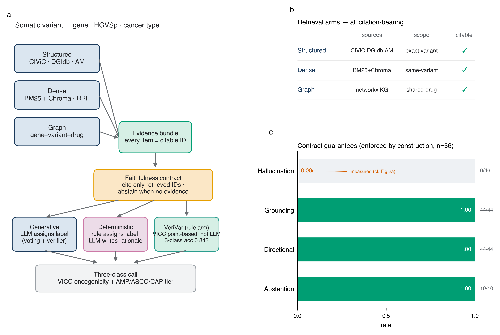
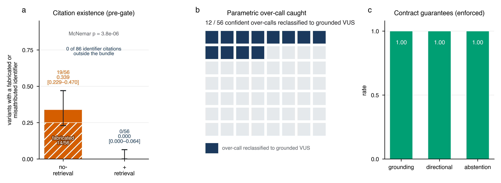
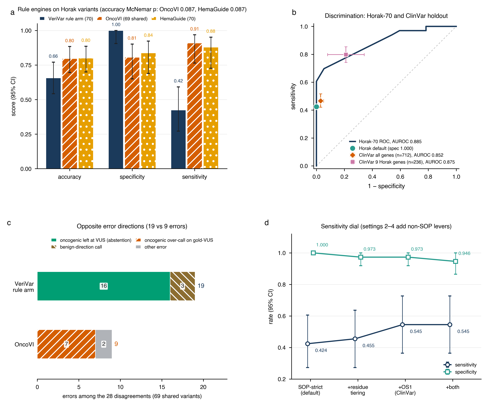
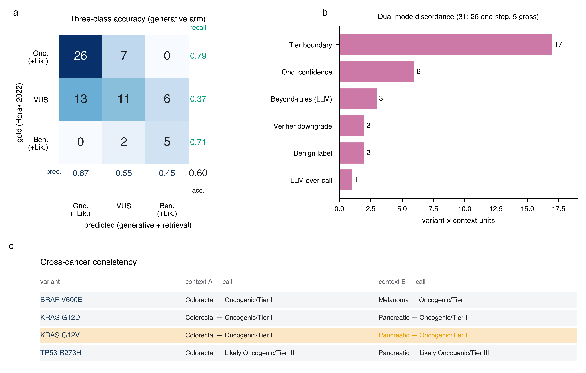
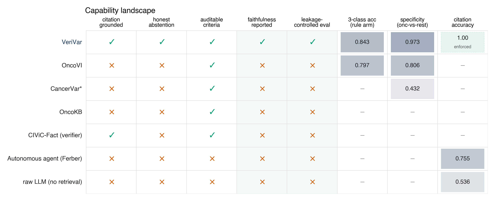
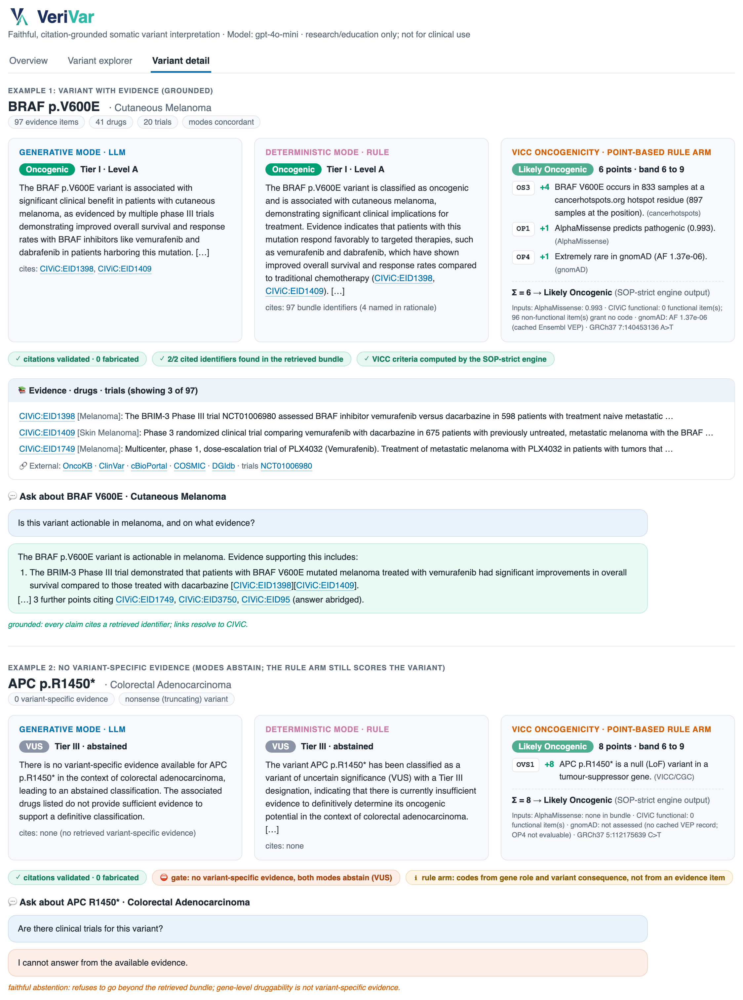
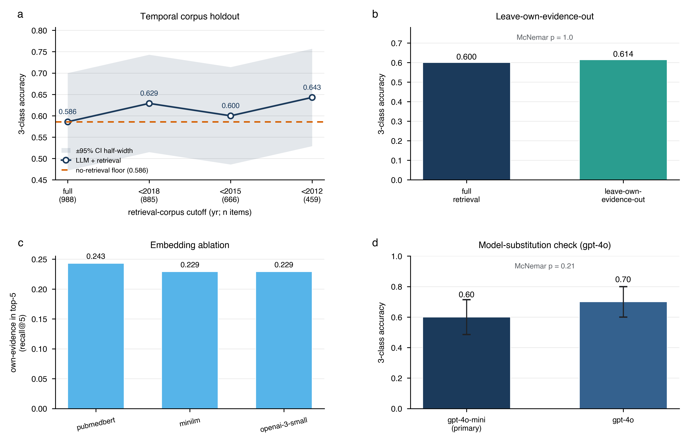
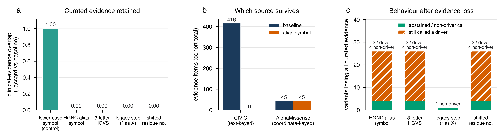
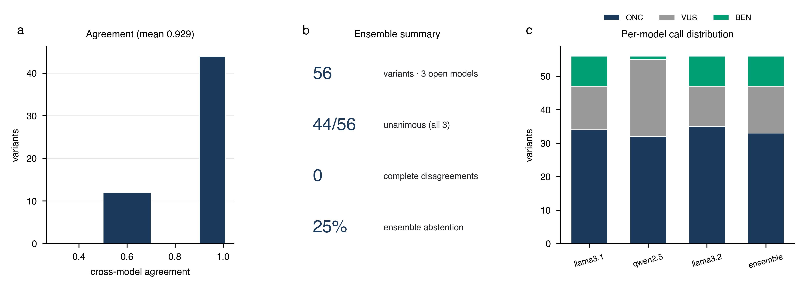

# 근거 인용에 기반한 충실한 LLM 체세포 변이 해석
(Citation-grounded retrieval for faithful LLM somatic variant interpretation)

**저자:** Ka-Kyung Kim (김가경)

**소속:** Independent Researcher, Seoul, Republic of Korea

**교신:** kakyung.kim@gmail.com

---

## 초록

**목적(Objective).** 체세포 변이 해석은 환자 대면 종양학 보고서로 이어지며, 각 oncogenicity 및 AMP/ASCO/CAP tier 판정은 표적 치료를 지시하거나 보류한다. 따라서 근거 인용을 조작하거나 변이를 자신만만하게 과대 판정하는 대규모 언어모델(large language models, LLM)은 그 판정이 우연히 옳더라도 임상적으로 사용할 수 없다. 사용 가능한 의사결정 지원 초안은 한 줄 한 줄 감사 가능(auditable)해야 하며, 조작하기보다 판단을 보류(abstain)해야 한다. 그러나 LLM은 정확히 이와 반대되는, 임상 활용을 가로막는 두 가지 실패 양상을 보인다. 근거 인용을 조작(fabricate)하며, 감사 가능한 근거가 아니라 잘 알려진 변이에 대한 파라메트릭 기억(parametric memory)에 의존한다는 점이다. 본 연구는 검색 정초(retrieval grounding)가 LLM 해석을 충실하고 감사 가능하게 만들 수 있는지 살펴보고자 했다. 이때 검색된 근거에 없는 인용과, 실재하지만 주장을 뒷받침하지 않는 더 어려운 경우의 인용을 나누어 보았고, 정확도 효과가 실재하는지 아니면 누출(leakage) 산물인지도 함께 물었다.

**방법(Materials and Methods).** ClinGen/CGC/VICC oncogenicity와 AMP/ASCO/CAP 임상 tier라는 두 국제 표준으로 변이를 분류하는 이중 모드 체세포 변이 해석기를 구축하였다. 시스템은 하이브리드 인용 근거 기반 검색(구조화된 지식베이스, CIViC 근거 진술에 대한 밀집 검색(dense retrieval), 지식 그래프)을 사용하며, 모든 주장이 검색된 식별자를 인용하고 변이 특이적 근거가 없을 때 판단을 보류(abstain, VUS 지정)하도록 요구하는 충실성 계약(faithfulness contract) 아래에서 작동한다. **생성(Generative) 모드**(LLM이 라벨을 부여)를 **결정론적(Deterministic) 모드**(방향성 인식 규칙이 라벨을 부여하고 LLM은 설명만 작성) 및 무검색 기준선과 비교하였다. 이와 별도로, 공개 데이터가 허용하는 범위에서 표준의 문언 그대로 구현한 인용 가능한 ClinGen/CGC/VICC 점수 기반 규칙 arm을 두 공개 엔진(OncoVI, HemaGuide의 분자 모드)과 비교하였다. 평가에는 56개 변이, 5개 암종 TCGA 코호트, 외부의 균형 잡힌 70개 변이 전문가 골드 스탠다드(Horak et al. 2022), 그리고 규칙 arm에 한해 ClinVar 체세포 oncogenicity 분류가 있는 missense 변이 712개를 사용하였다. 모든 arm에 동일하게 적용한 하나의 인용 분류 체계로 채점한 누출 없는 충실성 지표, 인용된 기록이 주장을 뒷받침하는지에 대한 함의(NLI) 감사, 누출 통제(시간적 홀드아웃, 자기 근거 제외, 두 번째 모델, 임베딩 제거 실험), 부트스트랩 신뢰구간, 정확(exact) McNemar 검정을 보고한다.

**결과(Results).** 측정된 충실성 발견은 충실성 게이트 적용 전의 인용 존재 여부에 관한 것이며, 모든 arm에 같은 규칙으로 채점했다. 근거 번들이 채워진 게이트 적용 전 실행에서 식별자 인용 86개 가운데 **번들 밖 기록을 가리킨 것은 없었다**(단측 95% 상한 3.4%). 이와 별도로 토큰 20개(출처명 "AlphaMissense"만 적은 15개, 숫자 1, 2, 3, 5와 기준 코드 "OP1" 같은 식별자가 아닌 5개)는 부정확으로 집계했다. 증거 번들도, 목록의 식별자만 인용하라는 지시도 받지 않은 무검색 arm은 **56개 변이 중 19개(0.339, Wilson 95% CI 0.229–0.470)**에서 조작되거나 잘못 귀속된 식별자를 인용했고, 조작된 식별자만 보면 56개 중 14개(0.250)였으며, 검색 arm은 56개 중 0개였다(짝지은 정확 McNemar p = 3.8 × 10⁻⁶). 실재하는 인용이 주장을 뒷받침하는지는 더 어려운 질문이며 일부만 답할 수 있었다. 게이트를 적용한 별도의 주 파이프라인 실행에서 자동 함의 감사는 인용된 기록이 그 인용을 단 근거 서술을 뒷받침하는 비율을 인용 90개 중 0.444(95% CI 0.344–0.544)로 판정했으며, 이는 잡음이 큰 하한값이다. 뒷받침되지 않은 인라인 인용을 직접 검토한 결과 실제 불일치는 3건이었다. 그 실행의 게이트 적용 후 스코어카드(환각 0, 인용 근거화 1.0, 방향성 충실성 1.0, 보류 재현율 1.0)는 **계약이 구조적으로 강제하는 보장값이며 측정된 발현 결과가 아니다**. 검색은 자신만만하게 과대 판정된 56개 중 12개(21.4%) 변이를 근거 정초 VUS로 재분류했다(정답이 아니라 행동 변화). **생성** arm의 3분류 정확도는 두 기준선과 유의하게 다르지 않았다(검색 0.600, 무검색 0.586, 단순화 규칙 0.557; McNemar p = 1.0 및 0.61, 겹치는 CI). 따라서 이 arm의 기여는 정확도가 아니라 충실성이다. **LLM이 아닌 결정론적 엔진인 VeriVar의 규칙 arm**은 Horak-70에서 3분류 정확도 0.657(95% CI 0.543–0.771), 특이도 1.000(Wilson 95% CI 0.906–1.000), 민감도 0.424, AUROC 0.885를 보였다. oncogenic 과대 판정은 한 건도 없었으나 oncogenic 변이 대부분을 VUS로 남겼고, 정확도는 점추정으로 OncoVI(69개 공유 변이에서 0.652 대 0.797)와 HemaGuide(0.657 대 0.800)보다 낮았으며 두 차이 모두 유의하지 않았다(McNemar p 모두 0.087). ClinVar 홀드아웃에서는 특이도 0.970(0.949–0.986), 민감도 0.466(0.421–0.517), AUROC 0.852로 oncogenic을 판정했다. 시간적 홀드아웃, 자기 근거 제외, 모델 교체, 임베딩 통제는 생성 arm 정확도를 통계적으로 바꾸지 않았으므로, 이 정확도는 검색 코퍼스 누출에 의존하지 않는다. 다만 이 통제들은 모델 자체의 파라메트릭 채널을 다루지 않으며, 이 채널은 여전히 통제되지 않고 무검색 하한으로만 정량화된다. **변이의 표기만** 교란한 제거 실험은 계약의 실제 한계를 드러낸다. HGNC 별칭 심볼 시험 66회 전부와 세 글자 HGVS 표기 전부가 해당 변이의 큐레이션 임상 근거를 모두 걷어냈고(코호트 전체 416건이 0건), 그럼에도 영향을 받은 변이 26개 중 22개가 좌표 기반 계산 사전 확률 하나만으로 여전히 Oncogenic 또는 Likely Oncogenic으로 판정되었다. 이 제거 실험에서 검색 번들 밖 인용은 없었으므로(228건 중 0건), 계약은 문언대로 지켜지면서도 임상적으로 중요한 것, 곧 driver 판정이 큐레이션 임상 근거 위에 서 있다는 점은 보장하지 못한다.

**고찰(Discussion).** 검색 정초는 생성 해석기의 인용을 실재하고 감사 가능한 것으로 만들고 자신만만한 파라메트릭 과대 판정을 억제한다. 다만 이 규모에서는 그 arm의 정확도를 높이지 못하며, 각 인용이 주장을 뒷받침하는지는 근사적으로만 측정된다. 결정론적 VICC 규칙 arm은 모든 기준 코드를 인용할 수 있고 전문가 세트에서 oncogenic 과대 판정이 없는 보류 우선 엔진이며, n = 70에서 공개 엔진과 정확도로 경쟁하지는 못한다.

**결론(Conclusion).** 신뢰할 수 있는 임상 의사결정 지원의 전제인 충실성과 감사가능성은 인용의 존재에 대해서는 구조적으로 보장할 수 있으나 인용의 뒷받침에 대해서는 아직 그렇지 못하며, 보장의 범위를 신중하게 정해야 한다. 본 시스템의 보장은 인용을 검색된 식별자로 묶을 뿐 driver 판정이 임상 근거 위에 서도록 요구하지 않으며, 입력 맥락 제거 실험은 오래된 유전자 심볼 같은 평범한 입력으로도 그 틈에 닿을 수 있음을 보여 준다. 정확도 이득을 확립하려면 더 크고 검정력 있으며 누출이 통제된 전문가 판정 벤치마크가 필요하며, 본 연구는 그 설계를 제시하고자 한다. 본 연구는 인용 충실성, 감사가능성, 분류 정확도만을 측정한다. 임상적 유용성은 동기일 뿐 측정하지 않았고(환자 결과 없음, 전향적 사용 없음), 시스템은 임상 진료가 아니라 연구와 교육용이다.

**키워드:** 체세포 변이 해석; 대규모 언어모델; 검색 증강 생성; 충실성; 감사가능성; 임상 의사결정 지원; 정밀 종양학.

---

## 배경 및 의의

체세포 변이 해석, 즉 종양 변이가 oncogenic하고 임상적으로 실행 가능(actionable)한지 판단하는 일은 정밀 종양학의 율속 단계다. 분자종양위원회(molecular tumour board)에서 병리의사는 각 변이에 대해 oncogenicity 판정과 AMP/ASCO/CAP 임상 tier 초안을 작성하며, 이러한 각 분류는 표적 치료와 임상시험 등록을 지시하거나 보류한다. 그 초안은 바로 개별 주장 수준에서 결정적이다: 환각된 근거(자신만만한 판정 아래의 그럴듯하지만 존재하지 않는 인용)는 임상의로 하여금 존재하지 않는 근거에 따라 행동하게 만들고, benign 변이의 조용한 과대 판정은 부적절한 표적 치료를 촉발할 수 있으므로, 임상 보고서에 들어가는 모든 주장은 감사·책임·규제 검토를 위해 1차 출처로 추적 가능해야 한다. 이는 지향이 아니라 이미 통용되는 관행이다. 상용 종양-정상 전장유전체 검사의 공개 예시 리포트는 유전자 설명과 약물 설명마다 PMID를 달고 규제 관련 서술에는 FDA 출처를 붙인다 [1]. 주장 단위 출처 표기는 생성형 해석기가 근사할 대상이 아니라 맞춰야 할 기준이다. 이 과제는 인력 병목이기도 하다. 전문가 큐레이션은 일상적 종양 시퀀싱의 변이 물량을 따라가지 못하며, 도움이 가장 필요한 희귀하거나 큐레이션이 부족한 변이가 판정이 가장 느리고 불확실하다. 따라서 자동화된 보조 도구는 직접적 임상 가치를 가질 수 있으나, 그 초안이 한 줄 한 줄 신뢰될 수 있을 때에만 그러하다: 감사 가능해야 하고, 불확실성을 조작해 없애기보다 그것을 선언해야 한다.

두 커뮤니티 표준이 이 과제를 구조화한다. ClinGen/CGC/VICC 프레임워크는 **oncogenicity**를 다섯 라벨 점수 기반 시스템(Oncogenic, Likely Oncogenic, VUS, Likely Benign, Benign)으로 정의하고 [2], AMP/ASCO/CAP 프레임워크는 **임상 tier**(Tier I–IV, 근거 수준 A–D)를 정의한다 [3]. 어느 표준이든 적용하려면 이질적 근거(큐레이션된 임상 주장, 약물–유전자 상호작용, 계산적 병원성 예측, 임상시험 현황)를 변호 가능하고 인용 가능한 판단으로 종합해야 한다.

이미 성숙한 생태계가 이 표준들을 운용한다. OncoKB [4], COSMIC [5], 크라우드소싱 CIViC [6] 같은 전문가 큐레이션 지식베이스는 변이 및 유전자 수준 임상 주장을 제공하며, CancerVar [7], Cancer Genome Interpreter [8], Personal Cancer Genome Reporter [9] 같은 규칙·모델 기반 플랫폼은 변이를 tier와 oncogenicity 판정에 매핑한다. 이 시스템들은 정확하고 감사 가능하지만 손으로 구축한 규칙 엔진과 사전 계산된 조회에 의존한다. 즉 자유 텍스트 근거를 즉석에서 읽지도, 자연어 정당화를 생성하지도 않으며, 희귀하거나 큐레이션이 부족한 변이 커버리지는 기반 데이터베이스에 의해 제한된다. 본 연구는 이 선행 연구를 우리 시스템이 양립해야 할 기존 기술로 취급한다. 우리의 결정론적 모드는 같은 전통을 의도적으로 단순화하여 방향성을 인식하도록(direction-aware) 재구현한 것이며, 우리가 능가한다고 주장하는 기준선으로 보지 않는다. 직교적으로, 계산적 변이 효과 예측기 AlphaMissense [10], 단백질 언어모델 ESM1b [11], 진화 모델 EVE [12] 는 유전체 규모의 병원성 사전 확률을 제공한다. 본 연구는 AlphaMissense를 하나의 근거 축으로 사용하되, 이러한 점수를 그 자체로는 임상적 실행 가능성을 확립할 수 없는 유전자 비특이적 사전 확률로 취급한다.

LLM은 자유 텍스트를 유창하게 읽고 구조화된 산문을 생성하므로 이러한 종합에 매력적이다. 그러나 두 실패 양상이 감사 가능한 임상 환경에서 순진한 사용을 안전하지 않게 만든다. 첫째, **인용 환각(hallucinated citations)**: 분류 정당화를 요청받은 LLM은 그럴듯하지만 존재하지 않는 PMID나 데이터베이스 식별자를 거리낌 없이 생성한다. 임상 보고서에서 조작된 참고문헌은 환자 안전 및 법적 위해 요인인데, 그것이 뒷받침하는 듯한 주장을 확인할 수 없기 때문이다. 둘째, **파라메트릭 누출(parametric leakage)**: 유명한 driver 변이(예: BRAF V600E, KRAS G12D)가 사전학습 데이터에 과다 표현되어 있어, LLM은 제공된 근거가 아니라 기억에서 교과서적 답을 재현할 수 있다. 이는 잘 알려진 변이의 외견상 정확도를 부풀리는 동시에, 표면적으로 유사하지만 기능적으로 benign한 변이에 자신만만한 과대 판정을 낳는다. 실제로 benign 변이를 oncogenic으로 과대 판정하면 부적절한 표적 치료를 촉발할 수 있다.

검색 증강 생성(retrieval-augmented generation, RAG)은 자연스러운 완화책이다. 모델을 검색된 근거에 정초시키고 그 근거를 인용하도록 요구하는 것이다. 두 실패 양상 모두 유전체학 밖에서 잘 기록되어 있다. Gao et al. [13]의 ALCE 벤치마크는 인용 정밀도·재현율의 자동 평가를 정형화하고 강력한 LLM조차 자신의 주장을 빈번히 뒷받침하지 못함을 보였으며, Xiong et al. [14]의 MedRAG/MIRAGE 연구는 의학 질의응답에서 환각과 오래된 지식의 부분적 완화책으로 검색을 확립했다. 임상 유전체학 영역에서도 최근 연구가 LLM과 검색을 변이 해석에 적용하기 시작했다. Lin et al. [15]은 암 변이 분류에서 GPT-4o, Llama 3.1, Qwen 2.5를 벤치마킹하여 변이를 더 높은 근거 수준으로 과대 분류하는 체계적 경향(우리가 관찰한 것과 동일한 파라메트릭 과대 판정)을 보고하면서 검색과 프롬프트 엔지니어링이 도움이 되었음을 언급했고, Lu와 Cosgun [16]은 약 1억 9천만 개 변이 주석을 RAG와 미세조정으로 GPT-4o에 통합하여 높은 필드 수준 주석 정확도를 보고했다. 그러나 이 연구들은 전문가 라벨 대비 정확도를 강조하면서 두 질문을 충분히 검토하지 않았다. 첫째, **시스템이 실제로 충실한가**(검색된 근거만 인용하고 근거가 없을 때 정직하게 보류하는가), 그리고 일반 도메인 귀속 벤치마크 [13]가 하듯 외부 정답 키 없이 충실성을 측정할 수 있는가(유전체학 RAG 연구 [15,16]는 하지 않는다)? 둘째, **외견상의 정확도 이득이 실재하는가 아니면 누출 산물인가**, 즉 시스템이 최근의 정답 진술 근거를 검색하여(코퍼스 누출) 또는 파라메트릭 회상으로(모델 누출) 성공하는가, 아니면 진정한 근거 정초 추론으로 성공하는가?

2026년에 발표된 임상 규모 시스템 두 편은 첫째 질문의 범위를 좁혔지만 답을 닫지는 않았다. OLIVE는 명시적인 유전자별 지침 파일로 언어모델을 제약하며, 연속 200건의 종양 시퀀싱 증례에서 나온 변이 관측 1,437건에 대해 검사실의 과거 판정과 평균 97.5% 일치했다. 이 일치도는 두 표준 척도가 아니라 보고 대상 대 VUS의 이진 기준으로 평가되었고, 참조 표준은 같은 검사실의 과거 판정이다 [17]. HemaGuide는 지침 흐름도와 2,000건이 넘는 종양위원회 증례 기억에 정초한 로컬 배포형 에이전트로, 평가한 664건 중 2건에서 환각(입력 자료에 근거가 없는 약물, 임상 사실, 치료 이력)을 보고했다. 이 시스템의 변이 모듈은 점수 기반 ClinGen/CGC/VICC 엔진이며, 본 연구가 쓰는 Horak 70개 missense 변이와 같은 세트에서 56개가 참조 판정과 일치했다 [18]. 환각 지표는 불일치 분석 안의 증례 단위 범주이고 검색된 근거와 인용을 하나씩 대조한 값이 아니며, 증거 코퍼스의 시간적 홀드아웃이나 변이 자체 근거 제거 같은 변이 분류용 누출 통제도 보고하지 않는다. 한편 인용 무결성 문헌은 하나의 조작률에 섞여 있던 두 실패 양상을 구분해 왔다. 존재하지 않는 식별자를 인용하는 경우와, 실재하는 식별자를 그것이 뒷받침하지 않는 주장에 붙이는 경우다. 희귀질환 유전자 큐레이션에서 유도 없는 모델은 두 번째 유형을 95.9%(Claude Sonnet), 81–87%(공개 가중치 모델 3종) 비율로 만들었고, 인용된 PMID를 실제로 가져와 주장과 대조하는 게이트만이 출력 전에 두 유형을 모두 제거했다 [19]. 임상 지침 질의응답의 주장 단위 감사에서는 한 최신 모델(claude-opus-5)이 주장의 98.0%에 원문 인용을 붙였으나 완전히 뒷받침한 것은 37.1%에 그쳤다 [20]. 인접 연구는 인구집단 변이 데이터베이스 질의응답 [21], 정밀종양학 치료 추천 [22], 변이 문헌 마이닝 [23,24]에 검색이나 언어모델을 적용하지만 표준화된 oncogenicity나 tier 판정은 내지 않는다.

시간적 홀드아웃 자체에는 선례가 있다. 생식세포 벤치마크인 ClawBench는 초록에서 보고하듯 시험한 모든 모델의 학습 컷오프 이후에 라벨이 생긴, 시간적으로 눈가림된 ClinVar 참값 집합을 기준으로 출처와 안전성을 채점했다 [25]. 해당되는 경우 AMP/ASCO/CAP 범주를 내는 임상 유전체 에이전트는 비교 모델의 지식 컷오프 이후에 공개된 증례 223건으로 평가되었고, 눈가림 전문가가 인용 정확도와 조작된 내용을 평가했으나 코드는 공개되어 있지 않다 [26]. 우리가 아는 한, 누출이 통제된 정확도 평가(시간적 코퍼스 홀드아웃과 자기 근거 제외)를, 식별자 수준의 인용 존재와 인용 뒷받침을 따로 보고하는 충실성 감사와 함께, 완전히 공개되고 오프라인으로 재현 가능하며 코드가 공개된 근거 스택 위에서 결합한 변이 해석 연구는 없다. 본 연구는 이 공백을 다루고자 한다.

## 목적

본 연구는 응용 시스템과, 더 중심적으로는 헤드라인 정확도가 아니라 충실성과 누출을 중심에 둔 엄밀한 평가로 그 공백을 다룬다. 통계적 절제를 의도적으로 지켜 세 가지 주장을 제시한다. 첫째, **인용의 존재**에 관해 시스템은 게이트 적용 후에는 구조적으로 충실하며 게이트 적용 전에도 충실한 것으로 측정되었다. 검색된 번들 밖 식별자는 없었던 반면, 증거도, 목록의 식별자만 인용하라는 지시도 받지 않은 무검색 LLM은 변이의 약 3분의 1에서 조작되거나 잘못 귀속된 식별자를 인용했으며, 두 arm은 하나의 규칙으로 채점했다(짝지은 정확 McNemar p = 3.8 × 10⁻⁶). 실재하는 각 인용이 주장을 뒷받침하는지라는 더 어려운 속성은 따로, 근사적으로만 측정한다. 둘째, 검색은 **자신만만한 파라메트릭 과대 판정을 억제**해, 변이 특이적 근거를 읽음으로써 과대 판정된 여러 변이를 VUS로 재분류한다(각 재분류의 정답 여부는 전문가 판정을 기다린다). 셋째, 균형 잡힌 전문가 골드 스탠다드에서 생성 arm의 정확도는 무검색 LLM 및 단순화 규칙과 **유의하게 다르지 않다(n = 70에서 차이가 있다는 증거가 없다는 뜻이며, 동등하다는 증거는 아니다)**. 생성 arm의 정확도 이득은 주장하지 않으며, n = 70에서 차이가 유의하지 않은 점을 사전 지정된 비열등성 마진이 없으므로 정식 비열등성 검정이 아니라 겹치는 CI와 비유의 McNemar 검정으로 보고한다. 별도로, 표준의 문언대로 구현한 결정론적 엔진(LLM이 아님)인 인용 가능한 VICC 점수 기반 규칙 arm은 정확도가 아니라 오류 양상으로 보고한다. 이 arm은 전문가 골드 스탠다드에서 oncogenic 과대 판정을 하지 않는 대신 민감도가 낮고, n = 70에서 정확도는 공개 엔진과 경쟁할 수준이 아니다. 이어서 생성 arm의 정확도가 검색 코퍼스 누출에 의존하는지를 여러 누출 통제로 시험한다. 본 연구의 기여는 새로운 모델링 방법이나 기존 해석 플랫폼에 대한 정확도 향상이 아니라 응용과 평가에 있다. 구조적으로 충실한 시스템과 누출을 고려한 충실성/정확도 평가를 제시한다.

---

## 방법

그림 1은 우리가 VeriVar라 부르는 시스템을 요약한다. 하이브리드 검색 계층이 인용 가능한 근거 번들을 구성하여 충실성 계약 하의 두 해석 모드에 공급하고, 그 결과는 의사결정 지원 인터페이스로 표출된다.



**그림 1. 시스템 개요와 인용 근거화.** (a) 각 변이는 하이브리드 인용 근거 기반 검색 계층(구조화, 밀집, 그래프 arm)을 거쳐 모든 항목이 인용 가능한 식별자를 지닌 근거 번들로 변환되며, 충실성 계약은 모든 주장이 검색된 식별자만 인용하고 변이 특이적 근거가 없을 때 보류(VUS 지정)하도록 요구한다. 번들에서 두 해석 모드가 이어진다. **생성(Generative) 모드**는 LLM이 자기일관성 투표와 에이전트형 검증기로 라벨을 부여하고, **결정론적(Deterministic) 모드**는 방향성 인식 규칙이 라벨을 부여하며 LLM은 근거 서술만 작성한다. 두 모드는 각각 VICC oncogenicity 판정과 AMP/ASCO/CAP tier를 낸다. **VeriVar의 규칙 arm**은 변이에서 갈라지는 병렬 가지로 실행된다. 자체 공개 출처(cancerhotspots.org, gnomAD, MaveDB, UniProt, 정확 변이 CIViC 기능 근거, AlphaMissense)를 쓰는 인용 가능한 SOP 엄격 VICC 점수 기반 구현이며, LLM 호출이 없고 oncogenicity 판정만 낸다. (b) 인용 정보를 지닌 세 검색 arm. (c) 56개 변이 코호트에서 게이트를 적용한 주 실행의 계약 보장값: 환각 0, 근거화 1.0, 방향성 충실성 1.0, 보류 재현율 1.0. 네 값은 모두 게이트가 구조적으로 강제하는 보장값이며 측정된 결과가 아니다. 측정된 인용 존재 결과는 게이트를 적용하기 전의 별도 실행에서 나왔으며 그림 2a에 제시한다.

### 분류 표준

변이는 각각 통제된 열거형(enumeration)으로 강제된 두 축에서 분류되었다. **Oncogenicity**는 다섯 라벨(Oncogenic, Likely Oncogenic, VUS, Likely Benign, Benign)을 갖는 ClinGen/CGC/VICC 2022 점수 기반 표준을 따랐다. **임상 tier**는 AMP/ASCO/CAP 2017 표준(Tier I–IV, Tier I/II에 근거 수준 A–D)을 따랐다. ACMG/AMP 2015 생식세포 프레임워크는 과제가 체세포이므로 의도적으로 사용하지 않았다. 두 어휘를 enum으로 통일함으로써 생성 모드와 결정론적 모드를 동일한 라벨 공간에서 비교할 수 있었다.

### 데이터셋

**코호트(입력 변이).** 환자 변이는 cBioPortal REST API(TCGA PanCancer Atlas, 공개)에서 서사적 대비를 위해 선택된 다섯 암종(폐선암(NSCLC), 유방암, 대장암, 피부 흑색종, 췌장암)에 걸쳐 각 7개 샘플(35개 샘플)로 추출되었다. 선택은 27개 유전자 driver 패널로 제한되고 결정론적이었으며, BRAF V600E 같은 쇼케이스 변이가 흑색종과 대장암 샘플 모두에 등장하도록 보장하여 맥락 의존성 분석을 가능케 했다. (유전자, 단백질 변화, 암종)으로 중복 제거하고 단계적으로 선택한 후 **56개 변이×맥락 단위**가 분류되었다(398개 고유 후보 중).

**지식 출처(근거 계층).** 오프라인 스냅샷은 CIViC(1,714개 패널 근거 행; CC0), DGIdb(27개 유전자에 걸친 2,608개 유전자–약물 상호작용), Ensembl VEP REST를 통한 AlphaMissense(352개 missense SNV에 대한 계산적 병원성, VICC 계산 코드로 매핑), ClinicalTrials.gov v2(37개 임상시험)로부터 구성되었다. CIViC 근거 진술은 검색을 위해 영속적 밀집 인덱스에 임베딩되었다.

**데이터 자원, 버전, 유전체 빌드.** 모든 상류(upstream) 자원과 그 스냅샷/버전 및 좌표 출처는 표 M0에 정리한다(커밋된 자원 매니페스트 `docs/reference/RESOURCES.md` / `data/knowledge/resources.json`로부터 작성; 공식 상류 버전이 공개되지 않은 경우 접근 일자가 기록된 스냅샷으로 표기). **주 유전체 빌드는 GRCh37(hg19)** 이며, TCGA 코호트 좌표, 코호트에 대한 AlphaMissense 변이별 좌표 조회, 그리고 본 파이프라인에서 사용한 Horak 좌표가 모두 GRCh37이다. AlphaMissense는 빌드 인식형이며 단백질 수준(점수가 단백질 변화로 색인되고 liftover가 없음)이므로, 빌드는 단백질 변화로 색인되는 근거에 영향을 주지 않는다. CancerVar 예측은 교차 축(cross-axis) 비교자로서 GRCh38(hg38, Horak b38 좌표) 상에서 별도로 획득하였다(보고 절 참조).

**표 M0. 데이터 자원, 버전, 유전체 빌드.**

| 자원 | 버전/스냅샷 | 유전체 빌드 | 출처 | 접근 일자 | 라이선스/비고 |
|---|---|---|---|---|---|
| TCGA PanCancer Atlas 2018 코호트(cBioPortal 경유) | cBioPortal 스냅샷(5개 study, study당 7개 샘플) | GRCh37 (hg19) | cBioPortal REST API | 2026-05-30 | TCGA open-access 체세포 변이; 27-유전자 driver 패널 |
| CIViC(임상 근거 + assertion) | nightly 스냅샷 2026-05-30 | n/a(유전자/변이 수준) | civicdb.org nightly TSV | 2026-05-30 | CC0 1.0; 근거 1,714행; assertion 35개 |
| DGIdb(약물–유전자 상호작용) | API 스냅샷 2026-05-30 | n/a(유전자 수준) | dgidb.org GraphQL API | 2026-05-30 | 2,608개 유전자 수준 상호작용; 변이 특이적 근거 아님 |
| AlphaMissense(계산적 병원성) | model 2023(Cheng et al., Science 2023), Ensembl VEP REST 경유 | 빌드 인식형, 단백질 수준(liftover 없음) | Ensembl VEP REST (AlphaMissense=1) | 2026-05-30 | 352개 missense SNV; 임계값 pathogenic≥0.564, benign≤0.34; 예측값 CC BY 4.0(현행 Zenodo 배포본, record 10813168; 최초 배포본은 CC BY-NC-SA 4.0) |
| ClinicalTrials.gov | REST API v2 스냅샷 | n/a | clinicaltrials.gov API v2 | 2026-05-30 | CIViC NCT id로 연결된 37개 임상시험 |
| UniProt 단백질 도메인 | 스냅샷(상류 버전 미기록) | n/a(단백질/UniProt 잔기 번호) | rest.uniprot.org | snapshot | CC-BY 4.0; 9개 유전자 도메인 스팬 |
| Horak et al. 2022(외부 골드 스탠다드) | 70개 전문가 분류 변이(ClinGen/CGC/VICC) | GRCh37(b37) + GRCh38(b38) 모두 커밋 | PMC9081216 | snapshot | Genet Med 2022;24(5):986–998; VICC 점수 기반 oncogenicity 표준 |
| CancerVar(교차 축 AMP/ASCO/CAP 비교자) | 웹서버 스냅샷 2026-06-14(hg38_update) | GRCh38(hg38; Horak b38 좌표) | cancervar.wglab.org | 2026-06-14 | Li et al., Sci Adv 2022;8(18):eabj1624; tier 원문 그대로 파싱 |
| ClinVar 체세포 oncogenicity(규칙 arm 홀드아웃) | FTP `variant_summary.txt.gz`(Last-Modified 2026-09-14), `submission_summary.txt.gz`(2026-09-13) | GRCh38 | ftp.ncbi.nlm.nih.gov/pub/clinvar | 2026-09-24 | 집계 Oncogenicity 필드, 검토 상태 "criteria provided"; missense 737행; 공개(NCBI) |
| cancerhotspots.org(규칙 arm, OS3/OM3/OP3) | hotspots v2 집계 | n/a(단백질 잔기) | cancerhotspots.org | snapshot | ODbL 1.0 |
| MaveDB 심층 돌연변이 스캐닝(규칙 arm, OS2/SBS2) | score set 3개(TP53, PTEN) | n/a(단백질 잔기) | mavedb.org API | snapshot | CC0 1.0 |
| gnomAD 대립유전자 빈도(규칙 arm, OP4/SBS1/SBVS1) | Ensembl VEP colocated 기록 경유 | GRCh37(Horak), GRCh38(ClinVar) | Ensembl VEP REST | snapshot | 전체 max(exome, genome) AF; 공개 |
| OncoVI 공개 예측(비교 대상) | `SOP_table_union_OncoVI_prediction.xlsx` | n/a(유전자 + 단백질 변화) | OncoVI GitHub 저장소 | snapshot | MIT |
| HemaGuide 보충 표 6(비교 대상) | 분자 모드 변이별 판정 70개 | n/a(유전자 + 단백질 변화) | Nat Med 2026 보충 자료 | 2026-09-24 | CC BY 4.0 |
| Ensembl VEP REST 미러 | REST 엔드포인트(변이별 스냅샷, 로컬 캐시) | GRCh37(grch37.rest.ensembl.org) · GRCh38(rest.ensembl.org) | rest.ensembl.org | 2026-05-30 | VCF 주석 + AlphaMissense 조회; 오프라인 재현용 캐시 |
| LLM — gpt-4o-mini(주) + gpt-4o(교체 시험) | gpt-4o-mini(주); gpt-4o 모델 교체 점검 | n/a | api.openai.com | 2026-05-30 | self-consistency n=3 + agentic verifier; 키 미설정 시 오프라인 mock fallback |

**외부 벤치마크(정답).** 외부 골드 스탠다드는 ClinGen/CGC/VICC oncogenicity 표준화 논문인 Horak et al. (2022)의 Supplemental Table 3으로, 9개 유전자(FLT3, BRAF, IDH1, KRAS, PIK3CA, PTEN, RB1, EZH2, TP53)에 걸친 70개 전문가 분류 체세포 변이였다. 결정적으로 라벨 분포가 균형(VUS 30, Likely Oncogenic 19, Oncogenic 14, Benign 5, Likely Benign 2)되어 있어, 단일 클래스로 심하게 치우친 CIViC 임상 주장과 달리 변별력 있는 벤치마크가 된다. Horak 참조 분류는 파생 표 형태로 저장소에 포함되며, Horak et al.과 이를 CC BY 4.0으로 재게재한 HemaGuide 보충 표 6을 출처로 밝힌다(데이터 및 코드 가용성 참조).

**ClinVar oncogenicity 홀드아웃(규칙 arm 전용).** 두 번째 외부 세트는 2026년 9월 14일 ClinVar FTP 배포본으로 구축했다(`scripts/fetch_clinvar_oncogenicity.py`). 집계 Oncogenicity 필드에 분류가 있고 검토 상태가 "criteria provided"로 시작하는 GRCh38 기록 중 단일 염기 missense 변화만 남겼다(737행). 라벨은 검색어가 아니라 이 필드에서 직접 읽었다. 집계 충돌 2건과 Horak-70 변이 16개를 빼고 유전자와 단백질 변화 기준으로 중복을 제거하니 714개 변이가 남았고, 같은 변이 안의 라벨 충돌은 없었다. benign 변이 2개는 따로 두어, 191개 유전자에 걸친 oncogenic(Oncogenic 또는 Likely oncogenic, 416개) 대 불확실(296개) 과제가 되었다. 이 변이들의 AlphaMissense 점수와 gnomAD 빈도는 Ensembl VEP(GRCh38)에서 한 번 받아 스냅샷과 함께 저장했다. ClinVar에서 오는 OS1 레버는 껐고, 엔진은 다른 ClinVar 필드도 읽지 않았다(`scripts/run_clinvar_onc_holdout.py`). 생성 arm은 이 세트에서 실행하지 않았다.

**공개 비교 엔진의 예측.** OncoVI의 변이별 예측은 공개된 출력 파일에서, HemaGuide의 예측은 논문 보충 표 6(CC BY 4.0; `scripts/fetch_hemaguide.py`)에서 가져왔다. 둘 다 유전자와 단백질 변화로 Horak 골드에 대응시켰다. OncoVI와는 69개, HemaGuide와는 70개 전부가 겹치며, HemaGuide의 참조 판정과 점수는 모든 변이에서 Horak 골드와 같다. 두 공개 엔진은 모두 점수 기반 규칙 엔진이므로 생성 arm이 아니라 본 연구의 규칙 arm과 비교한다.

### 하이브리드 인용 근거 기반 검색

각 변이에 대해 세 축에서 근거 번들이 구성되었으며, 모든 항목은 인용 가능한 식별자를 지녔다. **구조화** 축은 CIViC에서 유전자 + 단백질 변화의 정확 조회, DGIdb에서 유전자 수준 약물 조회, 유전체 좌표에 의한 AlphaMissense 조회(VICC 계산 코드 산출)를 수행했다. **밀집(dense)** 축은 CIViC 진술에 대해 도메인 임베딩(기본값 NeuML/PubMedBERT; 제거 실험으로 OpenAI text-embedding-3-small)을 사용하고, BM25와 Chroma 검색을 상호 순위 융합(Reciprocal Rank Fusion)으로 융합했으며, 동일 유전자 주제 표류를 방지하기 위해 동일 변이 적중만 부착했다. 임베딩 유사도는 변이를 안정적으로 구분하지 못하므로 이 제한이 필요하다. 변이 쌍 9개를 분석한 연구에서, CIViC 정보로 임상적으로 다르다고 판단한 변이 쌍 모두가 PubMedBERT와 MedCPT 양쪽에서 코사인 유사도 0.95 이상을 보였다 [27](저자가 이해상충을 밝힌 단독 저자 프리프린트). 이웃 변이에 대한 밀집 검색 적중이 질의한 변이를 설명한다고 믿을 수 없다. **그래프** 축은 networkx 지식 그래프(유전자·변이·질환·약물·임상시험)를 사용해 공유 약물을 통해 관련 변이를 드러냈다. 출력을 지배한 **충실성 계약**은 다음과 같다: 분류는 검색된 식별자만 인용할 수 있고, 변이 특이적 근거가 없을 때 시스템은 보류(VUS 지정)해야 했다(유전자 수준의 약물 적용 가능성은 변이 특이적 근거로 인정되지 않았다).

### 이중 모드 분류: 생성 모드와 결정론적 모드

두 모드는 유연성과 재현성 사이의 의도적 절충을 구현하며, 시스템은 모든 변이에 대해 둘을 함께 실행한다. **생성(Generative) 모드**는 LLM이 직접 라벨을 결정하게 한다: 언어모델은 어떤 고정 규칙도 열거하지 못하는 자유 텍스트 근거를 읽고 가중할 수 있으므로, 이 모드는 탐색적 해석과 희귀하거나 큐레이션이 부족한 변이에 적합하나 실행 간 변동성과 과대 판정 경향을 대가로 한다. 반면 **결정론적(Deterministic) 모드**는 투명하고 방향성을 인식하는 규칙으로 라벨을 고정하고 LLM을 사람이 읽을 수 있는 근거 서술 작성으로만 강등한다; 이는 재현성과 감사가능성(매 실행마다 동일한 출력, 큐레이션된 규칙 엔진의 전통)을 사면서도 유창한 자연어 정당화를 얻고, 모델의 파라메트릭 사전 확률이 근거를 압도하지 못하게 한다. 동일한 변이에 둘을 모두 실행하는 것 자체가 유의미하다: 유연한 독해자와 고정된 규칙이 불일치하는 지점이 진정한 해석적 불확실성을 국소화하므로(결과의 이중 모드 불일치 참조), 불일치는 결함이 아니라 신호로 취급된다.

**생성(Generative) 모드.** LLM(gpt-4o-mini)이 enum 어휘로 제한되고 근거 번들에 정초된 상태로 oncogenicity와 tier 라벨을 직접 부여했다. 자기일관성 투표(n = 3; 합의를 신뢰도 점수로 매핑)와 에이전트형 검증기(과대 주장을 하향 판정하는 적대적 2차 통과로, 보류 시 건너뜀)로 강화되었다. **결정론적(Deterministic) 모드.** 방향성 인식 규칙이 CIViC 유의성과 방향으로부터 라벨을 부여했다(따라서 "Unaltered Function" 또는 "Does Not Support" 근거는 oncogenicity에 반하여 계산되고, Sensitivity/Response 근거만 실행 가능성을 부여한다); 여기서 LLM은 자연어 근거 서술만 작성했다. **무검색 기준선**은 같은 모델에 증거 번들도, 목록의 식별자만 인용하라는 지시도 없이 같은 변이에 대한 자체 평가를 요청하여 파라메트릭 거동을 포착했다(`SYSTEM_PARAMETRIC`, `src/classify/llm.py`). 따라서 결과의 인용 존재 비교는 이 arm을 번들을 제공하고 그 식별자로만 인용하도록 제한하는 프롬프트(`scripts/run_multimodel_faithfulness.py`)의 근거 정초 arm과 대비한 것이며, 증거 가용성과 인용 지시가 함께 변하고 본 연구는 이 둘을 분리하지 않는다.

우리는 **gpt-4o-mini**를 의도적으로 주모델로 사용했다: 본 연구의 기여는 특정 모델이 아니라 검색·충실성 아키텍처이며, 저렴한 모델은 코호트 규모의 이중 모드 실행과 제거 실험을 감당 가능하게 만들고 보수적인 능력 하한을 설정한다. 약한 모델에서 입증된 속성은 더 강한 모델에서도 성립할 가능성이 높다. **온도 0**은 결정성과 재현성을 위해 사용했으며, 투표에 필요한 답의 다양성을 유도하기 위해 **자기일관성 투표 통과에만 0.4**를 사용했다. 발견이 모델 크기의 산물이 아님을 확인하기 위해 더 강한 **gpt-4o**로 외부 벤치마크를 복제했고(결과의 모델 교체 시험, 표 1), 다른 독점 또는 공개 모델을 광범위하게 스윕하지는 않았으며 이를 한계로 명시한다.

### 인용 가능한 VICC 규칙 arm(SOP 엄격 구현)

두 모드와 별도로, 결정론적 ClinGen/CGC/VICC 점수 기반 분류기(`src/classify/vicc_rules.py`)가 공개 근거 출처(cancerhotspots.org, 정확 변이 CIViC 근거, UniProt 잔기 특성, Ensembl VEP를 통한 gnomAD 집단 빈도, MaveDB 심층 돌연변이 스캐닝, AlphaMissense) 위에서 이름 붙은 기준을 발화하고, 발화한 기준마다 인용 가능한 기록(VICC 코드, 점수, 근거 진술, 데이터 출처)을 남긴다. LLM 호출은 없다. 규칙 arm은 SOP(Horak et al. 2022, 표 2–3과 그림 1) [2]를 공개 데이터가 허용하는 범위에서 문언 그대로 구현하며, 모든 결합 규칙을 포함한다. OS3은 cancerhotspots.org에서 해당 잔기에 50개 이상 표본, 같은 아미노산 변화에 10개 이상 표본을 요구하고, OM3은 잔기 50개 미만과 같은 변화 10개 이상, OP3은 같은 변화 10개 미만을 요구한다. OM1은 OS1이나 OS3과, OM3은 OM1이나 OM4와, OS3과 OS2는 OS1과, OM2는 OVS1과 함께 적용하지 않는다. OM1은 UniProt 잔기 수준의 활성 부위와 결합 부위로 한정한다("a critical and well-established part of a functional domain"). OP4는 gnomAD에 없거나 대립유전자 빈도가 10⁻⁴ 미만일 것을 요구한다. VEP 동반 변이 기록에 해당 대립유전자의 gnomAD 빈도가 없으면 gnomAD에 없는 것으로 처리해 OP4를 부여한다(Horak 변이 70개 중 40개, ClinVar 변이 714개 중 509개). 해당 부위의 자료 커버리지는 확인하지 않는다. OS2와 SBS2는 기능 근거(CIViC Functional 항목, 전임상 수준 D의 CIViC Oncogenic 항목, TP53과 PTEN의 MaveDB 심층 돌연변이 스캐닝 판정)만 사용하고, 예측, 예후, 진단, 소인 CIViC 근거는 어떤 코드도 주지 않는다. 네 기준은 공개 데이터로 평가할 수 없어 부여하지 않는다. OS1과 OM4는 SOP로 이미 분류된 변이의 참조 목록이 필요한데 유일한 공개 출처인 ClinVar oncogenicity가 홀드아웃 라벨이기도 하고, OP2는 종양 유형이, SBP2는 스플라이스 예측과 보존도가 필요하다. 다섯 기준은 근사하며 이를 밝힌다. OP1과 SBP1은 단일 예측기(AlphaMissense)에 기대고, SBVS1과 SBS1은 대륙별 최대값이 아닌 전체 gnomAD 빈도를 쓰며, OP4는 위에서 설명한 대로 누락된 gnomAD 빈도를 부재로 취급한다. 점수 합계는 SOP 구간(Benign ≤ −7, Likely Benign −6~−1, VUS 0~5, Likely Oncogenic 6~9, Oncogenic ≥ 10)으로 클래스에 대응하며 추가 보호 규칙은 없다. oncogenic 대 나머지 지표의 작동점인 6점 이상은 SOP의 Likely Oncogenic 경계이며 조정하지 않았다. 구현 선택은 모두 SOP 문언을 따랐고 벤치마크 성능으로 고르지 않았으며, 이전 구성에서 바꾼 사항은 모두 Horak-70 정확도를 낮췄다. 요소별 설명과 OM1을 도메인 수준으로 읽는 대안(0.671)은 정정 노트에 보고한다. 근사 세 가지를 없애려 한 사전 지정 라운드는 결과에서 민감도 분석으로 보고한다. SOP 밖의 두 레버(잔기 총수 hotspot 등급, ClinVar oncogenicity 라벨에서 온 OS1)는 민감도 다이얼로만 보고하고, 엔진의 이전 두 구성은 결과의 정정 노트에서 민감도 분석으로 보고한다. 결정론적 모드의 단순화 규칙(`src/classify/rules.py`)은 별개의 엔진이며 바꾸지 않았다.

### 평가 및 통계

세 부류의 평가가 수행되었다. **누출 없는 충실성 지표**는 외부 정답을 필요로 하지 않았다: 환각 인용률(생성된 인용이 검색 번들에 없는 변이의 비율), 인용 근거화, 방향성 충실성(부여된 라벨이 인용 근거의 방향을 존중하는가), 보류 재현율(근거 없는 변이 중 올바르게 보류된 비율), 모드 간 Cohen's κ. **제거 실험(ablation)**은 결정론적 모드, 무검색 LLM, 검색을 갖춘 생성 모드를 비교했다. **외부 벤치마크**는 Horak 골드 스탠다드에 대해 5분류 및 축약 3분류 정확도와 κ를 계산했다. 누출 통제는 **시간적 분할**(검색 코퍼스를 컷오프 연도 이전 문헌으로 제한), **자기 근거 제외(leave-own-evidence-out, LOVO)** 제거 실험(검색 전에 각 변이 자체의 큐레이션 CIViC 근거 제거), **두 번째 모델** 복제(gpt-4o), **임베딩 제거 실험**(PubMedBERT 대 MiniLM 대 OpenAI, 보류된 자기 근거의 recall@5로 채점)으로 구성되었다. 여덟 가지 추가 코호트 분석(암종 간 일관성, 민감성/내성, 밀집 검색 회수 향상, AlphaMissense–LLM 일치, 보정, 불일치 집중, hotspot 대 희귀, 검증기 순효과)이 거동을 특성화했다.

**모든 arm에 하나의 인용 분류 체계.** 발화된 인용 토큰은 어느 arm이 만들었는지와 무관한 단일 규칙 집합으로 분류했다(`src/eval/citation_taxonomy.py`, `scripts/run_citation_taxonomy.py`로 실행, 출력 `data/outputs/citation_taxonomy.json`). 토큰이 PMID, ClinVar accession, CIViC 근거 식별자, NCT 번호, 유전체 좌표 중 하나에 맞거나, 맨 숫자 식별자를 발급하지 않는 네임스페이스 아래의 숫자(예: "ClinGen: 123456")이면 식별자를 지닌 토큰이다. 나머지, 곧 "AlphaMissense" 같은 출처명만 있는 경우, 출처명에 유전자를 붙인 경우, 맨 숫자나 "OP1" 같은 기준 코드는 식별자가 아닌 토큰이며 모든 arm에서 부정확으로 집계한다. 식별자를 지닌 토큰이 검색된 식별자나 검색된 항목에 붙은 PMID와 일치하면 번들 안에 있다고 본다. 번들 밖일 때는, 어떤 기록도 가리킬 수 없거나(식별자 체계 없음) 자리표시자 패턴(예: 12345678, 87654321)을 따르거나 NCBI 기록이 반환되지 않으면 *조작*, 기록은 존재하지만 제목과 초록이 해당 변이의 유전자를 언급하지 않으면 *잘못 귀속*으로 분류했다(NCBI E-utilities, 캐시된 조회). 이 규칙은 모듈이 개수를 산출하기 전에 작성했으나 검토자가 무검색 인용을 수작업으로 분해한 결과를 안 뒤에 작성했으므로, 눈가림이 아니라 사전 지정된 규칙이다. 무검색 arm에는 번들이 없으므로 규칙을 빈 번들에 대해, 그리고 따로 같은 변이에 저장된 검색 번들에 대해 적용했으며, 두 결과의 개수는 같았다. 변이 수준 비율에는 Wilson 95% 구간을, 개수가 0이면 단측 정확(Clopper-Pearson) 95% 상한을 붙였고, arm 간 비교는 짝지은 변이별 지표에 대한 정확 McNemar 검정으로 했다.

**인용 뒷받침 감사.** 번들 소속은 인용이 존재한다는 것을 보여 줄 뿐 주장을 뒷받침한다는 것을 보여 주지 않는다. 그래서 언어모델 API 호출 없이 자연어 추론(NLI) 모델로 뒷받침 여부를 채점했다(`scripts/run_nli_attribution.py`). 주 파이프라인 실행의 인용 각각(46개 변이에 걸친 90개, 모두 번들 안)에 대해, 전제는 인용된 근거 기록(유전자, 변이, 질환, 근거 유형, 방향, 유의성 필드와 진술)으로, 가설은 그 기록을 인용한 근거 서술 문장으로 두었다. 해당 항목을 인라인으로 인용한 문장이 있으면 그 문장을 쓰고(37개), 없으면 함의 점수가 가장 높은 근거 서술 문장을 썼다(53개, 낙관적 정렬). DeBERTa-v3-large NLI 모델(`MoritzLaurer/DeBERTa-v3-large-mnli-fever-anli-ling-wanli`, 고정 리비전)은 최대 함의 확률이 0.5 이상이면 뒷받침, 그렇지 않고 최대 모순 확률이 0.5 이상이면 모순, 나머지는 중립으로 판정했으며, 이 규칙은 채점 전에 정했다. 더 작은 NLI 모델과 진술만 쓴 전제를 민감도 분석으로 두었다. 인용 106개 실행은 근거 서술 없이 식별자만 기록하므로, 이 실행에서는 고정 템플릿("GENE PROTEIN is an oncogenic mutation")으로 옮긴 출력 라벨만 시험할 수 있었고, 이 라벨 수준 결과를 부정확 척도와 교차표로 비교했다. 뒷받침되지 않거나 모순으로 판정된 행은 사람이 직접 읽었다(저자가 AI 도움을 받아 검토했으며 전문가 판정은 아니다).

불확실성은 정확도와 일치도에 대한 비모수 부트스트랩 95% 신뢰구간(백분위수 방법, `src/eval/stats.py`, 고정 시드로 5,000회 재표본; CancerVar 비교 스크립트는 자체 부트스트랩 2,000회; 인용 뒷받침 감사는 변이 단위 군집 부트스트랩을 민감도 분석으로 추가; ClinVar AUROC 구간은 클래스 층화 부트스트랩 2,000회)으로 정량화했고, 쌍을 이룬 방법은 변이별 정답 여부에 대한 정확 McNemar 검정으로 비교했다. 보고한 모든 p값은 양측 검정이다. 비율이 0이나 1이면 백분위수 부트스트랩은 폭이 0인 구간으로 무너지므로, Horak-70의 민감도와 특이도(표 2, 그림 3)와 본문의 이런 경계 비율에는 Wilson 점수 구간을 보고한다. 다중 비교 보정은 적용하지 않았다. 본 연구는 정확도에 대한 짝지은 McNemar 검정을 약 12건 수행하며(생성 arm 대 두 기준선, 자기 근거 제외와 gpt-4o, 규칙 arm 대 공개 엔진 세 개, 표 3의 구성들), 어느 것도 정확도 차이 주장을 뒷받침하는 데 쓰지 않으므로 표 3의 p값을 포함해 이 p값들은 기술적이다. 주장을 뒷받침하는 데 쓴 유일한 검정인 짝지은 인용 존재 대비(p = 3.8 × 10⁻⁶)는 보고한 모든 검정에 대해 Bonferroni 보정을 적용해도 0.05보다 훨씬 낮게 유지된다. 구현은 파이프라인과 295개 자동 테스트로 구성되며, 시스템은 재현성을 위해 커밋된 스냅샷에서 오프라인으로 실행된다.

### 입력 맥락 제거 실험

변이는 유전자 심볼과 단백질 변화의 짝으로 시스템에 들어오는데, 출처에 따라 표기가 제각각이다. 오래된 병리 보고서는 HGNC가 ERBB2라 부르는 것을 HER2로 적고, 어떤 주석 파이프라인은 `p.V600E`를 내는 자리에서 다른 파이프라인은 `p.Val600Glu`를 내며, HGVS 이전 도구는 지금의 `p.R130*`를 `p.R130X`로 쓴다. 같은 유전체 변화라도 다른 전사체를 기준으로 주석하면 잔기 번호가 달라진다. 앞의 셋은 같은 변이를 달리 적은 것이므로 해석이 달라져서는 안 되고, 넷째는 다른 잔기를 가리키므로 조용히 받아들여져서는 안 된다. 검색 계층의 모든 구조화 조회가 대문자화한 (심볼, 단백질 변화) 짝을 키로 쓰고 밀집 축은 검색된 문서의 유전자 심볼이 질의와 정확히 일치할 것을 추가로 요구하므로, 여기는 시스템이 조용히 실패할 수 있는 지점이다. 그래서 가정하지 않고 측정했다(`scripts/run_context_ablation.py`).

각 교란을 코호트 56개 변이의 입력에 적용하고 파이프라인을 다시 돌렸다. **별칭(alias)**은 심볼을 HGNC 대체 심볼로 바꾸며, 우리가 고르지 않고 코호트 각 유전자의 HGNC REST 레코드에서 가져왔다(`scripts/fetch_gene_aliases.py`. 폐기된 이전 심볼을 먼저, 없으면 현행 별칭을 쓴다). **3문자 표기**는 단백질 변화를 세 글자 HGVS로 다시 적는다. **구식 종결 표기**는 넌센스 변이의 종결 기호를 `X`로 바꾼다. **잔기 번호 이동**은 잔기 번호에 12를 더하는데, 이 arm은 실제 대체 전사체로 재주석한 것이 아니라 다른 전사체의 번호 체계를 흉내 낸 합성 교란임을 분명히 밝힌다. 잘못된 잔기 번호가 걸러지는지를 보는 것이지 그런 일이 얼마나 자주 생기는지를 재는 것이 아니다. 다섯째 arm은 유전자 심볼을 소문자로 바꾸는 **음성 대조군**이다. 조회 키가 대문자화되므로 이 arm은 아무 변화도 없어야 한다. 대조군이 나머지를 해석 가능하게 만드는데, 모든 arm이 무너진 결과만 놓고 보면 하네스가 고장 난 경우와 구별되지 않기 때문이다.

측정한 것은 두 가지다. 검색은 모델 비용 없이 결정론적으로 전수 조사했다. 모든 변이를 해당 유전자의 **모든** HGNC 대체 심볼로 다시 검색해 검색된 근거 식별자의 Jaccard 중첩을 기준 대비로 채점했다. 이 스윕은 큐레이션 임상 근거(CIViC)만으로 채점하는데, AlphaMissense 주석기는 어떤 교란도 건드리지 않는 유전체 좌표를 키로 쓰므로 모든 arm에서 구조적으로 살아남기 때문이다. 이를 함께 세면 정작 중요한 손실이 가려진다. 이어서 arm마다 결정론적 교란 하나를 골라 생성 모드 온도 0 단일 통과로 분류를 돌렸다. 검색만으로는 답할 수 없는 질문, 곧 큐레이션 근거가 사라진 뒤 시스템이 기권하는지 아니면 파라메트릭 지식으로 되돌아가 driver를 단정하는지를 보기 위해서다. 안전 측면에서 갈리는 지점이 여기다. 용어 불일치가 정직한 기권으로 이어지면 재현율을 잃는 데 그치지만, 더는 검색되지도 않은 근거 위에서 자신만만한 oncogenic 판정을 내면 충실성 실패이고 훨씬 심각하다.

### 보고(Reporting)

본 연구는 두 가지 상보적 지침에 비추어 보고한다. 시스템이 LLM 기반 예측 모델이므로 모델 명세, 표본 크기 정당화, 하위집단 보고에 대해 대규모 언어모델 연구의 보고 지침인 **TRIPOD-LLM** [28]을 따르고; 외부 평가(Horak-70 및 ClinVar 홀드아웃)가 전문가 참조 표준 대비 정확도 연구이므로 변이 흐름·참조 표준 명세·불확정 결과 처리에 대해 **STARD** [29] 진단 정확도 관점을 추가로 적용한다. 불확정 출력(VUS/보류)은 제외하지 않고 보고된 클래스로 취급하며, 이는 기권 우선 설계에 임상적으로 적절한 STARD "중간 결과" 처리 결정이다. 주 연구는 단일 실행이며 정확도 주장을 위한 검정력을 갖추지 않았다; 이 표본 크기 한계는 TRIPOD-LLM의 기대대로 암시가 아니라 명시적으로 앞서 진술한다(고찰의 "정확도 주장을 위한 검정력 있는 평가를 향하여" 참조).

**변이 흐름(STARD).** 코호트 흐름: cBioPortal TCGA PanCancer Atlas에서 27개 유전자 driver 패널과 다섯 암종에 걸쳐 추출한 398개 고유 후보 변이 → (유전자, 단백질 변화, 암종) 중복 제거 및 단계적 선택(비용 통제를 위해 암종당 AlphaMissense 전용·근거 없는 변이 수 제한) 후 56개 변이×맥락 단위를 이중 모드로 분류. 외부 정확도 벤치마크는 Horak et al. 2022 Supplemental Table 3의 전문가 분류 변이 70개 전부(Horak-70 골드 스탠다드)를 사용했다. 규칙 arm의 정면 비교는 변이별 예측이 공개된 변이로 한정했다. OncoVI(Carta et al. [30], ClinGen/CGC/VICC oncogenicity 가이드라인의 오픈소스 구현)와는 69개, HemaGuide 분자 모드 [18]와는 70개 전부다. ClinVar 홀드아웃 흐름: criteria provided GRCh38 missense 기록 737개 → 집계 충돌 2건과 Horak-70 중복 16개 제거, 유전자와 단백질 변화 기준 중복 제거 → 변이 714개 → benign 변이 2개 제외 → 규칙 arm이 채점한 변이 712개(oncogenic 416, 불확실 296). 외부 세트 진입 후 좌표와 검색 가능 상태를 가진 변이는 제외하지 않았다.

**CancerVar 예측(교차 축 비교 대상).** CancerVar의 AMP/ASCO/CAP tier 예측은 공식 CancerVar 웹 서버(cancervar.wglab.org; 엔드포인트 `results_new.php`)에서 Horak 70개 변이 전부에 대해, GRCh38 위치(chr/pos/ref/alt, 빌드 hg38_update, Horak 골드와 동일한 b38 좌표)로 `cancer_types = All_types` 조건으로 질의해 얻었다; tier는 반환된 결과 페이지에서 그대로 파싱했으며(임상적 유의성 필드 `Tier_X`와 기준 점수 합계) 따라서 어떤 tier도 우리 파이프라인이 계산하거나 부여하지 않았다(2026-06-14 UTC 취득; 파싱된 예측은 `cancervar_predictions.json`으로 공개하며, 변이별 원본 HTML 응답은 로컬에 보관하고 재배포하지 않으며 `scripts/fetch_cancervar.py`로 다시 받을 수 있다). CancerVar는 VICC oncogenicity가 아니라 임상 실행 가능성 tier를 보고하므로, 오직 VICC oncogenicity 골드에 채점하기 위해 Tier_I/II→Oncogenic, Tier_III→VUS, Tier_IV→Benign으로 매핑했다; 이 매핑은 교차 축 비교(결과 참조)를 위한 보고상의 편의이며 어느 도구에도 유리하지 않다.

**모델 카드(TRIPOD-LLM).** 분류 모델과 평가 구성을 표 M1에 요약한다.

**표 M1. 모델 카드.**

| 항목 | 명세 |
|---|---|
| 주모델 | gpt-4o-mini (OpenAI), `langchain-openai` 구조화 출력 |
| 교체 모델 | gpt-4o (모델 교체 점검, 결과 참조) |
| 다모델 POC 평가자 | Llama 3.1 8B, Qwen 2.5 3B, Llama 3.2 3B (Ollama, 오프라인) |
| 온도 | 분류는 0(결정성); 자기일관성 투표 통과에만 0.4 |
| 자기일관성 투표 | n = 3 (합의를 신뢰도 점수로 매핑) |
| 에이전트형 검증기 | 적대적 2차 통과; on/off 제거 실험; 보류 시 건너뜀 |
| 출력 공간 | 강제 enum — VICC oncogenicity(5라벨)와 AMP/ASCO/CAP tier(I–IV) |
| 지식 스냅샷 | CIViC(1,714행, CC0); DGIdb(2,608 상호작용); AlphaMissense(352 missense SNV); ClinicalTrials.gov v2(37 임상시험); 오프라인, 커밋됨 |
| 임베딩(밀집 축) | NeuML/PubMedBERT(기본); OpenAI text-embedding-3-small(제거 실험) |
| 기록된 provenance | 시스템 프롬프트 5종의 실행별 해시, 샘플링 온도, 투표 수, 충실성 계약 버전, git 리비전 |
| 변경관리 | 12개 변이 골든 세트 회귀 스냅샷(`scripts/run_golden_regression.py`), 라이브로 생성; 구성 점검은 오프라인 실행 |
| 재현성 | 커밋된 스냅샷에서 오프라인 실행; 부트스트랩 시드 고정(0); 295개 자동 테스트 |

**유전자별 정확도·보류 분해**(보충 표 S1)는 커버리지가 얕은 하위집단(특히 EZH2, PTEN)을 드러내어 희귀 변이 약점을 감사 가능하게 한다.

### 의사결정 지원 인터페이스

충실한 해석을 의사결정 시점에 사용 가능하게 만들기 위해, 시스템은 브라우저 대시보드를 제공한다. 코호트 탐색기는 근거 상태, 약물 또는 임상시험 가용성, 모드 간 불일치로 변이를 필터링하고 필터링된 집합을 내보낸다. 변이별 보기는 생성 모드와 결정론적 모드의 판정을 나란히 보여준다. 인용된 각 항목(CIViC 근거 항목, ClinicalTrials.gov 기록, 외부 지식베이스인 OncoKB, ClinVar, cBioPortal, COSMIC, DGIdb)은 1차 출처로 가는 클릭 가능한 링크로 렌더링된다. 근거 정초 질의응답 채팅은 충실성 계약을 자유 텍스트 상호작용으로 확장한다: 선택된 변이에 대한 질문에 그 변이의 검색 번들로부터만 답하고, 번들이 질문을 다루지 못할 때는 보류("I cannot answer from the available evidence")하며 유전자 수준의 약물 적용 가능성을 불충분한 것으로 취급한다(보충 그림 S1). 커밋된 코호트 외에도, 대시보드는 사용자가 제공한 VCF를 입력으로 받는다: 변이는 Ensembl VEP REST API를 통해 주석되고(유전체 빌드 자동 감지, GRCh37 또는 GRCh38) 동일한 이중 모드 해석과 충실성 계약을 거치며, 주석된 판정은 VEP 주석 표, 통합 해석 표, 또는 주석된 VCF로 내보낼 수 있다. 이 인터페이스는 연구·교육용 데모이며 검증된 임상 도구가 아니다.

### 변경관리: 실행 provenance와 골든 세트 회귀 점검

호스팅형 모델 API 위에 올린 시스템은 스스로 통제하지 못하는 의존성을 안고 간다. 제공자가 동일한 모델 식별자 뒤의 모델을 바꿔도 응용은 그 변경도, 시점도 볼 수 없다. 공개 코드에는 이를 다루는 장치 두 가지가 들어 있고, 부수적 엔지니어링이 아니라 산출물의 재현성을 이루는 요소이므로 여기에 기술한다.

**실행 provenance.** 모든 출력은 모델 이름과 시각만이 아니라 모델의 거동을 실제로 고정하는 구성을 함께 기록한다. 생성 모드 분류, 무검색 기준선, 결정론적 모드 규칙 설명, 근거 정초 채팅, 적대적 검증기의 시스템 프롬프트 5종을 이름 붙은 상수로 두고 개별 해시와 전체 해시를 실행별 provenance에 남기며, 샘플링 온도와 자기일관성 표본 수, 적용 중인 충실성 계약 버전, 실행을 만든 트리의 짧은 git 리비전(커밋되지 않은 변경이 있으면 수정됨으로 표시)을 함께 담는다. 그 결과 프롬프트 수정이나 가드레일 변경이 소스 이력에만 남지 않고 출력에 드러나므로, 나중에 생긴 거동 차이를 추측하지 않고 귀속시킬 수 있다. 분석 버전을 산출물 자체에 적어 두는 것은 현장에서 이미 쓰는 방식이다. 앞서 인용한 예시 리포트는 시료 추적번호, 분석 식별자, 파이프라인 버전, 서식 개정번호를 리포트 본문에 함께 싣는다 [1]. 여기의 provenance 기록은 버전 번호가 움직이지 않아도 거동이 바뀔 수 있는 구성요소에 대해 같은 역할을 한다.

**골든 세트 회귀.** 변이 12개를 고정 기준 집합으로 못박았다(`scripts/run_golden_regression.py`). 본 연구가 기대는 거동을 고루 담도록 골랐다. 근거가 두터운 대표 판정 둘(흑색종의 BRAF V600E, 폐선암의 EGFR L858R), 같은 변이를 두 번째 종양형에서 채점해 맥락 의존성을 확인하는 BRAF V600E와 KRAS G12V, 밀집 검색이 결정적 근거를 공급하는 사례(PIK3CA H1047R), beyond-rules 불일치 3건(PIK3CA R88Q, PTEN R130\*, ESR1 E247K), 변이 특이적 근거가 없는 보류 사례(APC R1450\*), 불일치가 집중된 유전자(TP53 R175H), 계산 사전 확률만 있는 missense(ALK G1121D)다. 스냅샷은 변이마다 두 모드 각각에 대해 두 분류 축과 보류 플래그, 인용한 근거 식별자를 기록한다. 자유 텍스트 근거 서술은 분류가 바뀌지 않아도 달라져 신호가 아니라 잡음을 만들므로 비교에서 제외한다. 점검은 고정 집합을 의도적으로 결정론적인 구성(온도 0, 단일 통과, 자기일관성 투표 없음)으로 다시 실행하고, 차이가 나면 0이 아닌 코드로 종료하면서 그것을 설명할 구성 변화를 함께 출력한다.

무엇을 차이로 볼지는 분류기가 스스로를 재현하지 못한다는 사실을 감안해 정해야 한다. 아래 입력 맥락 제거 실험과 함께 보고한 재현성 측정에서, 동일한 프롬프트로도 비교 대상 필드의 쌍대 불일치가 17.3%였고 대부분이 인용 집합(10.1%)이었다. 고정 변이 12건을 저장된 단일 draw와 엄격 비교하면 움직임과 무관한 이유로 대부분의 실행에서 차이가 나며, 실제로 점검을 처음 돌렸을 때 그렇게 나왔다. 임상 유전체 에이전트에 대해 87.9–93.7%의 반복 일관성이 보고되었는데 [26], 이 점수는 세 번의 실행에서 정확도 점수가 일치하는 항목을 세므로 여기의 17.3%가 세는 필드 수준의 쌍대 불일치와 척도가 같지 않다. 여기서 세 가지가 따라오고 모두 구현했다. 결정론적 규칙 모드는 코드이므로 엄격 비교를 유지했고, 거기서 움직이는 것은 실제 변화다. 생성 모드는 스냅샷을 만들 때 7회, 점검할 때 3회 뽑아 라벨을 다수결로 고정하고, 고정 라벨이 어느 draw에서든 나오면 재현된 것으로 본다. 인용은 생성 시 모든 draw에 공통으로 나온 식별자만 고정하고, 점검에서는 고정된 식별자가 적어도 한 draw에 다시 나오는지만 본다. 관측됐으나 고정되지 않은 식별자는 항목 옆에 기록하고 실패로 삼지 않는다. 커밋된 스냅샷에서는 변이 12개에 걸쳐 식별자 21개를 고정했고, 14개는 관측됐으나 고정할 만큼 안정적이지 않았다. 트리의 프롬프트·가드레일 해시를 스냅샷의 것과 대조하는 구성 전용 점검은 API 없이 오프라인 테스트에서 돌아간다. 커밋된 스냅샷은 gpt-4o-mini에 라이브로 변이당 7회씩 뽑아 생성했고, APC R1450\*의 보류와 beyond-rules 불일치 3건을 포함해 아래에 보고한 정성적 거동을 재현한다. 다만 주 실행의 투표·검증기 구성이 아니라 결정론적 단일 통과 구성을 쓰므로 변이별 tier가 주 코호트 출력과 항목마다 일치할 것으로 기대하지는 않는다. 이 방식으로 다시 만들면서 샘플링으로 볼 수 없는 변화 하나도 함께 받아들였다. 췌장선암의 KRAS G12V는 2026년 8월 8일 오전에 뽑은 draw에서 Oncogenic, Tier I이었고, 같은 날 오후와 저녁에 뽑은 18회에서는 Likely Oncogenic, Tier II였다. 프롬프트 해시도 근거 번들 13건도 같았다. 코호트 56개 변이 가운데 오전 라벨이 오후 draw에 한 번도 다시 나오지 않은 것은 이 변이뿐이므로 모델 전반이 아니라 좁은 범위의 변화이며, 호스팅 모델이 움직였는지 서빙 구성이 움직였는지는 이 자료로 가릴 수 없다. 현재 스냅샷은 나중 거동을 고정하고 있다. 이는 결과가 아니라 재현성 산출물로 제시한다. AI 기반 소프트웨어의 변경관리 틀이 계획된 변경에 대해 사전에 확정한 수용 기준으로 검증할 것을 요구하는데 [31], 호스팅형 모델 위의 시스템이 피할 수 없는 그 한 가지 변경에 이를 적용한 운용 형태가 이 점검이다.

---

## 결과

### 게이트 적용 전에 측정하고 적용 후에 강제하는 인용 존재

인용은 두 가지 방식으로 실패할 수 있으며 본 연구는 둘을 따로 보고한다. 하나는 검색된 번들에 없는 근거를 대는 경우로, 인용 무결성 문헌이 Type I 오류, 곧 존재하지 않는 식별자 인용이라 부르는 것에 대응한다 [19]. 다른 하나는 실재하고 검색된 기록을 대지만 그 기록이 붙은 주장을 뒷받침하지 않는 경우(Type II)다. 충실성 계약은 구조적으로 첫째만 다루므로, 경험적 Type I 결과를 먼저 제시하고 Type II는 측정 가능한 범위에서 살펴보고자 한다.

**인용의 존재(Type I).** 모든 arm을 같은 인용 분류 체계로 채점했다(방법). 근거 번들이 채워지고 인용 게이트가 없는 게이트 적용 전 실행(gpt-4o-mini, 단일 평가자)에서 모델은 코호트 56개 변이 중 39개에 대해 인용 토큰 106개를 냈다. 식별자를 지닌 토큰 86개 가운데 **번들 밖 기록을 가리킨 것은 없었고**(86개 중 0개; 단측 95% 상한 3.4%), 조작되거나 잘못 귀속된 식별자를 지닌 변이도 없었다(56개 중 0개; Wilson 95% CI 0–0.064). 나머지 토큰 20개(106개 중 18.9퍼센트)는 식별자가 아니었다. 15개는 출처명("AlphaMissense")만 적었고 5개는 숫자 1, 2, 3, 5나 기준 코드 "OP1"이었다. 공통 규칙 아래에서 이들은 무검색 arm을 포함한 모든 arm에서 부정확으로 집계되며, 게이트의 정확 식별자 매칭이 이를 제거한다. 이 106개 토큰 실행은 주 파이프라인 실행(자기일관성 투표, 검증기, 게이트 적용; 46개 변이에 걸친 인용 90개)과 별개의 실행이다. 주 실행이 아래의 게이트 적용 후 스코어카드와 인용 뒷받침 감사를 제공하므로, 둘을 게이트 적용 전후의 한 순서로 읽어서는 안 된다.

주 실행의 게이트 적용 후 스코어카드(그림 1c)는 모델이 발견한 발현 속성이 아니라 계약이 **구조적으로 강제하는** 보장값을 보고한다. 충실성 게이트가 정확한 식별자 매칭과 강제 보류를 부과하므로, 코호트 전반에서 환각 인용률은 0.0(인용을 낸 46개 변이 중 0개), 인용 근거화는 1.0(44/44), 방향성 충실성은 1.0(44/44; 부여된 어떤 라벨도 인용 근거의 방향과 모순되지 않음), 보류 재현율은 1.0(근거 없는 변이 10/10이 올바르게 VUS로 보류됨)이다. 검색되지 않은 식별자를 내지 않는 시스템은 *정의상* 조작 0과 근거화 1.0을 받는다. 따라서 이 수치는 계약이 무엇을 보장하는지에 관한 진술이고, 위의 게이트 적용 전 실행이 그에 대응하는 측정값이다. 근거를 지닌 2개 변이도 보수적으로 보류되었으며, 이 보수성은 고찰에서 논의하는 VUS 과대 재분류와 연결된다. 근거화와 방향성의 분모가 46이 아니라 44인 이유는, 인용을 낸 46개 변이 중 2개가 확인할 검색 식별자가 없는 인용 불가능한 토큰만 냈기 때문이다. 결정론적 모드는 분류에 LLM을 호출하지 않으므로 조작될 생성 인용이 없고, 발화된 모든 코드는 그 코드를 낸 공개 근거 출처를 가리킨다.

**인용의 뒷받침(Type II)은 근사적으로만 측정된다.** 주 파이프라인 실행에서 NLI 감사는 인용 90개 중 40개를 뒷받침(0.444, 95% CI 0.344–0.544; 변이 군집 CI 0.348–0.543), 43개를 중립(0.478), 7개를 모순(0.078, 0.033–0.133)으로 판정했다. 변이 단위로는 인용한 46개 변이 중 14개에서 모든 인용이 뒷받침되었다. 직접 검토에서 NLI 판정이 뒷받침 쪽에 불리하게 치우쳐 있었으므로, 0.444는 Type II 비율이 아니라 뒷받침의 잡음이 큰 하한값으로 읽는다. 두 실행에서 모순으로 판정된 20개 행 가운데 실제 모순은 없었다. 13개는 모델이 "AlphaMissense가 이 변이를 병원성으로 예측한다"를 "이 변이는 oncogenic 돌연변이다"와 모순으로 채점한 경우였고, 나머지는 공동 인용된 두 항목을 합친 문장이거나 인용 항목과 무관한 문장이었다. 중립으로 판정된 인라인 인용 18개 중 약 9개는 NLI 위음성, 5개는 부분 뒷받침, 1개는 경계 사례, 3개는 실제 불일치였다. 세 불일치는 체외 regorafenib 내성 항목(CIViC EID3710)을 KRAS G12A의 cetuximab과 gefitinib 반응 저하 근거로 인용한 경우, 같은 계열의 regorafenib 항목(EID3946)을 KRAS G12D의 항EGFR 내성 근거로 인용한 경우, capivasertib과 trastuzumab 이종이식 연구(EID1505)를 PIK3CA H1047R의 후향적 생존 주장 근거로 인용한 경우다. 어떤 항목도 말하지 않은 추론을 덧붙이거나 두 항목의 사실을 합친 근거 서술도 함의 점수를 낮춘다. 출력 라벨만 시험할 수 있었던 인용 106개 실행에서는 시험 가능한 99개 중 64개가 뒷받침되었고(0.646, 0.556–0.737; CIViC 항목 76개 중 59개, AlphaMissense 항목 23개 중 5개), 이 라벨 수준 NLI 결과와 부정확 척도의 일치는 약했다(Cohen's κ 0.238, 일치율 0.697, n = 99). 더 작은 NLI 모델이나 진술만 쓴 전제로는 주 실행의 뒷받침 비율이 0.367과 0.322였다. NLI 척도는 표준 자체의 근거 의미론보다도 관대하다. 주제가 맞으면 기록이 뒷받침한다고 채점하는데, 라벨 수준 실행에서 CIViC 인용 76개 중 59개가 oncogenicity 라벨을 뒷받침하는 것으로 채점되었으나 그중 다수는 예측, 예후, 내성 근거다. 예를 들어 동질유전자 세포와 이종이식에서 본 cetuximab 내성 항목(CIViC EID136)이 "KRAS G12V는 oncogenic 돌연변이다"의 근거로 인용된다. SOP는 이런 근거를 oncogenicity에 인정하지 않고 규칙 arm도 더는 이를 인정하지 않지만(정정 노트) 생성 arm은 여전히 인용하므로, 측정된 뒷받침의 일부는 NLI 감사가 보지 못하는 Type II 실패다. 따라서 Type II 충실성은 계약에서 아직 열려 있는 부분이다. 게이트는 모든 인용이 실재하고 검색된 것임을 보장할 뿐, 그 인용이 근거 서술의 주장을 말하고 있음을 보장하지 않는다.

생성 모드와 결정론적 모드 간 일치는 oncogenicity에서 상당했고(Cohen's κ = 0.713) tier에서 중간이었으며(κ = 0.417), 이는 두 모드가 oncogenic/benign 축보다는 주로 tier 경계에서 차이를 보임과 일치한다.

### 제거 실험: 검색이 없을 때의 인용 존재와 과대 판정

검색을 제거하자 인용 행동이 크게 바뀌었다(그림 2). 검색 arm과 같은 규칙으로 채점하면 무검색 LLM은 **56개 변이 중 19개(0.339, Wilson 95% CI 0.229–0.470)**에서 조작되거나 잘못 귀속된 식별자를 인용했고, 게이트 적용 전 검색 실행에서는 56개 중 0개였다(짝지은 정확 McNemar p = 3.8 × 10⁻⁶; 불일치 변이 19개 모두 같은 방향). 56개 중 14개 변이(0.250, 0.155–0.377)에서는 적어도 하나의 식별자가 완전히 조작되었다. "PMID: 12345678", "PMID: 87654321", "ClinVar: VCV000123456" 같은 자리표시자 번호, 식별자를 발급하지 않는 체계 아래의 번호("ClinGen: 123456", "CGC: 789012"), 기록이 없는 PMID가 그 예다. 또 인용 13건은 제목과 초록에 해당 변이의 유전자가 언급되지 않는 실재 PubMed 기록을 가리켰는데(예: 경동맥 성형술 후 뇌 관류 연구가 BRAF V600E의 근거로 인용됨), 이는 파라메트릭 arm에서 확인된 Type II 오류다. 인용한 나머지 변이 7개는 출처명이나 맨 숫자("ClinGen", "CGC", "123")만 인용했으며, 이는 검색 arm에서와 마찬가지로 여기서도 부정확으로 집계한다. 번들이 없는 arm은 번들 안을 인용할 수 없으므로 인용을 하나라도 내는 변이의 비율은 구성상 번들 밖 비율이며 종점으로 쓰지 않는다(정정 노트). 두 arm 사이에는 다른 점이 둘 있고 이 대비는 둘을 분리하지 않는다. 무검색 arm에는 증거 번들이 없고, 프롬프트도 목록의 식별자만 인용하라는 지시 없이 모델 자체의 평가를 요청한다. 반면 검색 arm의 프롬프트는 번들 식별자를 나열하고 인용을 그것으로 제한한다. 따라서 이 비교는 근거 없이 지시도 받지 않은 모델이 내는 것과 근거를 갖추고 지시를 받은 모델이 내는 것을 대비하며, 이는 관심 있는 배포 대비이기는 해도 단일 요인 조작은 아니다. 이 대비는 본 연구에서 가장 강력한 정량적 발견이다.



**그림 2. 게이트 적용 전에 측정하고 적용 후에 강제하는 인용 존재(코호트, n = 56).** (a) 두 arm을 하나의 인용 분류 체계로 채점해 조작되거나 잘못 귀속된 식별자를 인용한 변이의 비율. 무검색 arm은 56개 중 19개(0.339, Wilson 95% CI 0.229–0.470; 빗금 부분인 56개 중 14개 = 0.250은 식별자가 완전히 조작된 부분집합), 게이트 적용 전 검색 실행은 56개 중 0개(Wilson 95% CI 0–0.064)이며, 짝지은 정확 McNemar p = 3.8 × 10⁻⁶이다. 식별자가 아닌 토큰(출처명, 맨 숫자, 기준 코드)은 두 arm 모두에서 부정확으로 집계하며 여기에는 포함하지 않았다. (b) 후보 변이 56개 중 12개의 자신만만한 파라메트릭 과대 판정이 변이 특이적 근거를 읽어 근거 정초 VUS로 재분류되었다(정답 여부는 판정 대기). (c) 게이트를 적용한 주 실행의 계약 보장값(인용 근거화, 방향성 충실성, 보류 재현율)은 모두 1.0이며 구성상 강제된 값이지 측정된 결과가 아니다. 패널 (a)와 (c)는 서로 다른 실행에서 나왔다.

검색은 또한 **자신만만한 파라메트릭 과대 판정을 억제**했다. 총 56개 변이 중 12개(21.4%)가 무검색 모델에 의해 oncogenic 또는 likely oncogenic으로 판정되었으나 검색 시스템이 변이 특이적 근거를 읽은 후 VUS로 재분류되었다. 예를 들어 EGFR E114K는 무검색 Likely Oncogenic/Tier II에서 검색 시 VUS/Tier IV로, PTEN R130\*는 Oncogenic/Tier I에서 VUS/Tier III로, TP53 P152L은 Likely Oncogenic/Tier II에서 VUS/Tier IV로 이동했다. 이 열두 개 중 다수는 절단형(truncating), 프레임시프트, 스플라이스 부위 변이(예: APC R1450\*, CDKN2A R58\*, BRCA2 N1784Kfs\*3)로, 파라메트릭 모델은 자신만만한 driver 판정으로 기본 설정되었으나 검색 시스템은 변이 특이적 임상 근거를 찾지 못해 보류했다. 우리는 이 21.4%가 정답 여부가 아니라 행동 변화의 측정임을 강조한다: 검색 정초 VUS가 열두 개 모두에 대해 옳다는 보장은 없으며(종양억제 유전자의 일부 절단형 변이는 실제로 진정 oncogenic할 수 있다), 따라서 각 재분류가 과대 판정의 적절한 교정인지 과도하게 보수적인 하향 판정인지는 전문가 판정을 기다린다(고찰 참조). 여기서 주장하는 감사 가능한 속성은 단지 과신된 파라메트릭 판정이 근거 정초 보류로 대체된다는 것뿐이다. 세 "규칙을 넘는(beyond-rules)" 불일치(규칙은 driver로 판정하고 LLM은 보류하는 하위집합)에 대한 *예비적* 근거 정초 검토(AI 보조이며, **인증 분자병리 전문가의 서명을 받지 않음**)는 3건 중 2건에서 규칙이 더 변호 가능한 판정임을 발견했다: PTEN R130*(LLM이 과도하게 보류한 절단형 변이로, VICC 널 기준 OVS1이 적용될 사례)와 PIK3CA R88Q(실험적으로 활성화하는 변이이나 검색 스냅샷에는 예측적 근거만 있고 oncogenicity 근거가 없던 사례)는 규칙 쪽으로, ESR1 E247K(계산적 사전 확률만으로 한 과대 판정)는 LLM의 보류 쪽으로 기울었다. 따라서 이 예비 발견의 방향은 12개 과대 판정→VUS 재분류 중 여럿이 교정이 아니라 과도하게 보수적인 보류임을 시사하며, 이는 아래에 기록된 VUS 과대 재분류 약점과 일치한다; 이는 향후 전문가 패널의 방향을 잡기 위한 것이지 판정된 정답으로 제시하는 것이 아니다. 무검색 모드와 검색 모드 간 tier 수준 일치는 그에 상응하여 낮았으며(Cohen's κ = 0.18), 두 축이 실질적으로 다르게 거동함을 확인했다. 요약하면, 검색이 없을 때는 변이의 약 3분의 1에서 조작되거나 잘못 귀속된 식별자가 나왔고 검색이 있을 때는 하나도 없었으며, 검색은 자신만만한 파라메트릭 과대 판정도 억제했다. 둘 다 정확도 주장이 아니라 충실성과 안전성 속성이다.

### 외부 골드 스탠다드에서의 정확도

충실성 우선 틀에 맞추어, 생성 arm의 결과를 의도적으로 한정된 "유의하게 다르지 않음" 주장으로 먼저 보고한다. 이어서 *LLM이 아닌* 별도의 **결정론적** VICC 규칙 엔진을 오류 양상 중심으로 보고하고, 그 정확도를 공개 규칙 엔진 두 개와 비교한다.

**생성 arm(기여가 충실성인 시스템).** 균형 잡힌 70개 변이 전문가 골드 스탠다드에서 3분류 정확도는 결정론적 모드 0.557(95% CI 0.443–0.671), 무검색 LLM 0.586(0.471–0.700), 검색을 갖춘 생성 모드 0.600(0.486–0.714)이었다; 그림 4a는 대응하는 혼동 구조를 보고한다. 신뢰구간이 크게 겹치며 쌍별 차이가 유의하지 않다: 정확 McNemar 검정은 검색-대-무검색에서 p = 1.0(불일치 쌍 29개 중 검색 우위 15개, 무검색 우위 14개), 검색-대-규칙에서 p = 0.61(불일치 15개 중 9 대 6)을 준다. 따라서 생성 arm에 대해서는 정확도 이득 없이 그 정확도가 기준선과 *유의하게 다르지 않다(n = 70에서 차이가 있다는 증거가 없다는 뜻이며, 동등하다는 증거는 아니다)*고만 주장한다. 기여는 충실성이다. 검색 축은 가장 높은 점추정치와 가장 강한 oncogenic 클래스 재현율(0.79)을 보였으나, 모든 방법에서 가장 어려운 클래스는 VUS였고(재현율 0.37) LLM은 이를 oncogenicity 판정으로 과대 재분류하는 경향이 있었다. VUS로 오분류된 일곱 개의 oncogenic 변이는 커버리지가 얕은 희귀 변이였으며, 주로 PTEN과 EZH2(7개 중 5개: PTEN R130Q, T131I, H123R, P204A 및 EZH2 R684C), 추가로 BRAF G469A와 EZH2 V626M(후자는 검색 근거 0개)이 있었고, 이들은 70개 전체 평균 2.2개 대비 평균 1.0개의 근거 항목만 지녔다. 따라서 이들의 누락은 추론 실패가 아니라 근거 희소성을 반영하며, 보류-가-옳다는 서사를 강화한다. 5분류 정확도는 모든 방법에서 적당했으며(0.357–0.457), 이 규모에서 5분류 VICC 과제의 본질적 난이도와 일치한다.

**표 1. 정확도와 누출 통제 요약(Horak 골드 스탠다드, n = 70, 3분류).**

| 구성 | 3분류 정확도 | κ (3분류) | Oncogenic 재현율 | LLM+RAG 대비 검정 |
|---|---|---|---|---|
| 인용 가능한 VICC 규칙 arm (SOP 엄격, 공개 데이터; *LLM이 아닌 결정론적 엔진*) | 0.657 [0.543–0.771] | 미산출 ‡ | 0.424 | OncoVI 대비: McNemar p = 0.087 (n = 69); HemaGuide 대비: p = 0.087 (n = 70) |
| 결정론적(단순화 규칙) | 0.557 [0.443–0.671] | 0.274 | 0.939 | McNemar p = 0.61 |
| 생성, 무검색(파라메트릭 하한) | 0.586 [0.471–0.700] | 0.254 | 0.545 | McNemar p = 1.0 |
| **생성 + 검색(주, gpt-4o-mini)** | **0.600 [0.486–0.714]** | **0.332** | **0.79** | — |
| 생성 + 검색, 코퍼스 < 2012 (시간적 스윕) | 0.643 † | 0.413 | 0.85 | 구간 내 |
| 생성 + 검색, LOVO (자기 근거 제거) | 0.614 [0.500–0.729] | 0.366 | 0.82 | McNemar p = 1.0 |
| 생성 + 검색, gpt-4o | 0.700 [0.600–0.800] | 0.506 | 0.79 | McNemar p = 0.21 |

동일 구성의 클래스별 정밀도, 재현율, F1과 macro-F1, quadratic-weighted κ는 보충 표 S2에 있으며, 단순 정확도의 순위가 순서형이고 클래스 균형을 반영한 종점에서는 뒤집힌다는 점을 보여 준다. 주 구성과의 모든 차이는 유의하지 않으며(규칙 arm 행은 두 공개 규칙 엔진과의 검정을 보고한다), 구간은 비모수 부트스트랩 95% CI이다(LOVO 및 gpt-4o CI는 주 행과 동일한 부트스트랩으로 변이별 3분류 정확성에서 재계산했다). 어떤 구성도 정확도 향상을 확립하지 않는다. † 시간적 스윕 행은 테스트 세트가 아니라 검색 *코퍼스*가 변하는 기술적 단일 실행이며, 이들에 대해서는 부트스트랩 CI나 McNemar 검정을 계산하지 않았다. 전체 시간적 스윕은 아래와 보충 그림 S2에 보고한다. ‡ 규칙 arm의 비가중 3분류 κ는 산출하지 않았으며, 5분류 quadratic-weighted κ(0.635)는 보충 표 S2에 있다. Oncogenic 재현율은 골드 oncogenic 변이 33개 중 Oncogenic 또는 Likely Oncogenic으로 판정된 비율이다(`horak_known_novel.json`). 무검색 모델은 이 중 더 적게 oncogenic으로 판정했으므로(검색 시 0.79 대 0.545), 코호트에서의 과대 판정(그림 2b)이 Horak-70에서 더 높은 oncogenic 재현율로 이어지지는 않았다.

**VeriVar의 규칙 arm(SOP 엄격 VICC 구현): LLM이 아닌 결정론적 엔진이며 새로운 분류기로 주장하지 않음.** 생성 파이프라인과 별도로, 방법에서 설명한 인용 가능한 ClinGen/CGC/VICC 점수 기반 분류기를 Horak-70 골드 스탠다드로 평가했다. 이 arm은 감사가능성과 오류 양상을 보이기 위해 포함했으며 그 수치를 LLM 시스템에 귀속해서는 안 된다. OncoVI가 이미 각 VICC 기준을 근거 출처에 매핑하므로, 인용 가능한 규칙 엔진 자체를 새롭다고 주장하지 않는다. Horak-70에서 규칙 arm은 3분류 정확도 **0.657**(95% 부트스트랩 CI 0.543–0.771), 5분류 정확도 0.500, oncogenic 민감도 0.424(Wilson 95% CI 0.272–0.592), 특이도 1.000(37개 중 37개; Wilson 95% CI 0.906–1.000), AUROC 0.885를 보였다(그림 3). 이 구간은 생성 모드(0.600, CI 0.486–0.714)와 단순화 결정론적 규칙(0.557, CI 0.443–0.671)의 구간과 겹친다. 엔진은 14개 변이를 oncogenic, 43개를 VUS, 13개를 benign으로 판정했다. oncogenic 판정은 모두 맞았으므로 oncogenic 과대 판정은 없었지만, oncogenic 변이 33개 중 18개를 VUS로 남겼고 benign 방향 오류가 6건 있었다. oncogenic 변이 1개(TP53 A347D)와 gold-VUS 변이 5개가 Likely Benign이나 Benign으로 판정된 경우다. 이 6건 중 5건은 AlphaMissense에 기댄 −1점짜리 SBP1 한 줄에서 나왔고, SOP 구간은 이를 Likely Benign으로 대응시킨다. 조정된 임계값이 아니라 방법에서 밝힌 단일 예측기 근사에서 온 결과다. 그 5건 중 하나인 KRAS R164Q는 SOP 자체가 SBS2의 작업 예시로 드는 변이이고, 엔진이 이 변이에 쓰는 CIViC 기능 항목은 같은 연구에서 유래했을 수 있다. 엔진은 이 변이를 −1점(중간 강도 SBS2 −2점에 OP4 +1점)으로 채점해 gold VUS에 대해 Likely Benign으로 판정한다. 더 일반적으로 CIViC와 SOP는 큐레이터를 공유하므로, 규칙 arm의 CIViC 유래 OS2와 SBS2 코드는 자기 근거 제외가 생성 arm의 근거를 골드와 독립으로 만드는 것과 같은 방식으로는 골드 스탠다드와 독립이 아니다. 작동 임계값 6점은 SOP의 Likely Oncogenic 경계이며 조정하지 않았다. Horak-70 ROC(그림 3b)는 더 낮은 기준을 쓰면 이 세트에서 위양성을 더하지 않고 민감도가 올라갔을 것임을 보여 주는데, 이를 채택할 임계값이 아니라 공개 데이터 근거가 얼마나 보수적인지를 보여 주는 척도로 읽는다. 유전자별 정확도는 FLT3(0.33), BRAF(0.57), EZH2(0.58)에서 가장 낮았다(보충 표 S1). 이전 구성과 가장 크게 달라진 기준은 OM1이다. 잔기 수준 활성 부위와 결합 부위로 한정하고 OS1이나 OS3이 적용되면 제외하자, 이전의 도메인 수준 해석에서 42개였던 발화가 70개 중 1개로 줄어들었다(아래 정정 노트).

**OncoVI와의 정면 비교.** OncoVI(Carta et al. [30])는 ClinGen/CGC/VICC oncogenicity 가이드라인의 오픈소스 구현으로 변이별 예측을 공개하며, 이 공개 예측 덕분에 변이를 짝지은(McNemar) 비교가 가능하다. OncoVI의 공개 예측(`SOP_table_union_OncoVI_prediction.xlsx`)을 유전자와 단백질 변화로 Horak 골드에 대응시키고 두 엔진을 **69개 공유 변이**에서 채점했다(`scripts/run_oncovi_headtohead.py`; 그림 3a, c). 본 엔진은 정확도 0.652(95% CI 0.536–0.754), 특이도 1.000(36개 중 36개; Wilson 95% CI 0.904–1.000), 민감도 0.424였고, OncoVI는 0.797(95% CI 0.696–0.884), 0.806, 0.909였다(OncoVI가 발표한 전체 93개 세트 정확도는 80%로 [30], 다른 세트다). OncoVI가 점추정으로 높고, 차이는 유의하지 않다(짝지은 정확 McNemar p = 0.087; 본 엔진만 맞힌 변이 9개, OncoVI만 맞힌 변이 19개). 두 엔진은 반대 방향으로 틀린다. 불일치 28건에서 본 엔진의 오류 19건은 VUS로 남긴 oncogenic 변이 16개, benign으로 판정한 gold-VUS 변이 2개, benign으로 판정한 oncogenic 변이 1개였다. OncoVI의 오류 9건은 oncogenic으로 판정한 gold-VUS 변이 7개(FLT3 F691L, KRAS S65I, PIK3CA H1065Y와 E418K, RB1 S567L, EZH2 S695L과 Y731H), VUS로 남긴 oncogenic 변이 1개, VUS로 판정한 likely benign 변이 1개였다. 보류 우선 엔진은 민감도를 내주고 oncogenic 과대 판정이 없는 쪽을 택한다. 이 교환이 나은지는 초안 작성 후 검토하는 흐름에서 과잉 치료가 과소 검출보다 더 비싼지에 달려 있다. 그럴 법하지만 보편적이지는 않은데, 보류된 oncogenic 변이 하나하나가 쓸 수 있는 표적 치료를 놓칠 수 있는 환자이기 때문이다. 이 비교는 OncoVI의 홈 세트인 Horak-70을 쓰므로 독립 벤치마크가 아니라 동일 변이에 대한 정면 비교로 읽어야 한다. 상용 소프트웨어는 이 비교 밖에 있다. QIAGEN Clinical Insight Interpret은 oncogenic과 likely oncogenic 변이에서 ClinGen/CGC/VICC 평가와 97.2% 일치를 보고했는데, 공개 데이터와 Mayo Clinic 데이터를 합친 세트에서 체세포 평가용으로 수정한 ACMG/AMP 체계를 썼고 저자 일부가 QIAGEN 소속이다 [32]. 세트와 체계가 달라 Horak-70과 비교할 수 없다.

**HemaGuide 분자 모드와의 정면 비교.** HemaGuide의 변이 모듈 [18]은 공개 코드로 배포된 점수 기반 ClinGen/CGC/VICC 규칙 엔진이며, 같은 Horak missense 변이 70개로 벤치마크되었다. 변이별 판정은 논문 보충 표 6(CC BY 4.0)에 공개되어 있고, 그 참조 판정과 점수는 70개 모두 본 연구의 골드와 일치한다(`scripts/run_hemaguide_headtohead.py`). 규칙 엔진이므로 생성 arm이 아니라 규칙 arm과 비교한다. HemaGuide는 정확도 0.800(70개 중 56개; 95% CI 0.700–0.886), 민감도 0.879, 특이도 0.838로 논문 보고값 0.88, 0.84와 같았고, 본 엔진은 0.657(0.543–0.771), 0.424, 1.000이었다. 정확도 차이는 유의하지 않다(정확 McNemar p = 0.087; 본 엔진만 맞힌 변이 9개, HemaGuide만 맞힌 변이 19개). 오류 형태도 반대 방향이다. HemaGuide는 gold-VUS 변이에 대한 oncogenic 과대 판정 6건, oncogenic 누락 4건, VUS로 판정한 benign 변이 4건을 냈고, 본 엔진은 과대 판정 0건, oncogenic 누락 19건(VUS 18, benign 1), benign으로 판정한 gold-VUS 변이 5건을 냈다.

**CancerVar(교차 기준 비교이며 정확도 벤치마크가 아니라 오류 양상 대조로 읽을 것).** 이 비교에는 어떤 숫자보다 먼저 와야 할 단서가 있다. CancerVar(Li et al. [7])는 VICC *oncogenicity* 라벨이 아니라 AMP/ASCO/CAP 임상 *실행 가능성* tier(Tier I–IV)를 낸다. 그 예측을 VICC oncogenicity 골드로 채점하려고 tier를 대응시켰다(Tier_I/II→Oncogenic, Tier_III→VUS, Tier_IV→Benign). CancerVar에게 실행 가능성을 묻고 oncogenicity 답안지로 채점하게 되므로 정확도를 직접 비교할 수 없고, 그렇게 제시하지도 않는다(`scripts/run_cancervar_headtohead.py`, `cancervar_headtohead.json`). 변호할 수 있는 신호는 70개 공유 변이에서의 *오류 양상*이다. CancerVar는 이 세트에서 Tier_IV(benign) 판정을 한 번도 내지 않았고 3분류 예측은 Oncogenic 54개, VUS 16개였다. 따라서 oncogenicity 골드 대비 oncogenic *민감도*는 1.000(33개 중 33개; Wilson 95% CI 0.896–1.000), oncogenic *특이도*는 0.432(Wilson 95% CI 0.287–0.591)였고, 규칙 arm은 민감도 0.424(0.272–0.592), 특이도 1.000(0.906–1.000)이었다. 오류 분해도 한쪽으로 치우친다. CancerVar는 과대 판정 21건(gold-VUS나 gold-Benign 변이를 Tier I/II 실행 가능 판정으로 올림)과 oncogenic 누락 0건을 냈고, 규칙 arm은 과대 판정 0건과 누락 19건을 냈다. 이 비대칭은 결함이라기보다 예상된 결과다. CancerVar는 실행 가능할 수 있는 변이를 놓치지 않도록 만든 실행 가능성 분류기이므로, oncogenicity로 다시 채점하면 민감도가 높고 특이도가 낮게 나오는 것이 자연스럽다. tier 대응에서 나온 3분류 정확도(본 엔진 0.657 대 0.614; 짝지은 정확 McNemar p = 0.771)는 완전성을 위해서만 보고한다.

**독립 일반화(ClinVar 홀드아웃에서의 oncogenic 검출).** ClinVar 변이 712개(oncogenic 416, 불확실 296; 191개 유전자; 방법 참조)에서 SOP 엄격 엔진은 특이도 0.970(95% CI 0.949–0.986), 민감도 0.466(0.421–0.517), AUROC 0.852(0.826–0.880), 양성 예측도 0.956으로 oncogenic을 판정했다(그림 3b). 엔진의 근거가 모두 갖춰진 Horak 유전자 패널(n = 236; oncogenic 198, 불확실 38; FLT3는 oncogenic이나 불확실 기록이 없으므로 9개 유전자 중 8개가 포함됨)에서는 민감도 0.798(0.742–0.854), 특이도 0.789(0.658–0.921), AUROC 0.875(0.820–0.925)였다. 이 부분집합은 TP53(130개)이 대부분을 차지하며, 여기서는 심층 돌연변이 스캐닝 근거(OS2)가 참양성과 위양성을 함께 만든다. DMS 근거를 끄면 TP53 민감도가 0.974에서 0.487로, PTEN 민감도가 0.645에서 0.032로 떨어지고 패널 부분집합의 위양성 8건(TP53 6, PTEN 2)이 모두 사라지며, 이 부분집합의 특이도는 불확실 변이 38개에만 기대고 있다. 임계값 없는 순위 판별력은 Horak-70(AUROC 0.885)과 비슷하게 유지되고, 작동점은 유전자별로 쓸 수 있는 근거에 따라 움직인다. 이 결과는 **3분류 분류가 아니라 oncogenic 검출에 대한 검증**으로 읽는다. ClinVar oncogenicity에는 benign 라벨이 거의 없어(714개 중 2개) benign 재현율을 측정할 수 없고, 골드의 "불확실"은 benign이 아니라 근거 부족을 뜻하므로 여기서의 특이도는 보수적 보류와의 일치 정도를 나타낸다. 한계가 두 가지 더 있다. 712개 중 678개를 한 검사실(Center for Genomic Medicine, Rigshospitalet)이 분류했으므로 이 세트는 다기관 합의가 아닌 단일 검사실 외부 세트다(그 검사실 변이만으로는 민감도 0.474, 특이도 0.968). 또 714개 중 712개의 최종 평가 연도가 2025년이다. 그 검사실이 같은 공개 기능 자료(예: DMS)를 썼다면 라벨과 엔진은 완전히 독립적이지 않고, 위의 PTEN 수치는 엔진의 판정이 DMS에 얼마나 기대는지를 보여 주며, 해당 검사실의 방법은 확인하지 못했다. ClinVar 검색으로 만든 이전 홀드아웃은 철회했다(아래 정정 노트).

**민감도 다이얼.** SOP 밖의 두 레버가 민감도를 올린다. 하나는 같은 아미노산 변화 10개 이상이라는 SOP 요건 없이 hotspot 재발을 인정하는 잔기 총수 hotspot 등급이고, 다른 하나는 ClinVar oncogenicity 라벨에서 온 OS1인데, 이 라벨이 같은 표준으로 큐레이션되므로 Horak-70에서는 부분적으로 순환적이다. SOP 엄격 엔진에서 두 레버는 민감도를 0.424에서 최대 0.545로 올리며, 이때 특이도는 0.973 또는 0.946, 3분류 정확도는 0.657–0.700이다(그림 3d, 표 2). 어느 설정도 OncoVI와 HemaGuide의 정확도와 민감도에 미치지 못한다. 가장 유리한 작동점만 고르지 않고 다이얼 전체를 보고하며, 헤드라인은 SOP 엄격 기본값으로 둔다.

**사전 지정 개선 라운드(민감도 분석).** 사전 지정한 라운드에서 밝힌 근사 세 가지를 없애려 했다. OP1과 SBP1에 ClinGen으로 보정한 임계값의 모든 예측기 합의를 쓰는 것, SBVS1과 SBS1에 대륙별 최대 gnomAD 빈도를 쓰는 것, 더 새로운 CIViC와 MaveDB 입력을 쓰는 세 가지다. Horak-70 정확도는 달라지지 않았으나(0.657) ClinVar 홀드아웃의 oncogenic 민감도가 유의하게 떨어졌으므로, 사전 지정한 결정 규칙에 따라 주 엔진은 SOP 엄격으로 남긴다(보충 표 S3).



**그림 3. VeriVar의 규칙 arm(SOP 엄격 VICC 구현; LLM이 아닌 결정론적 엔진).** (a) 동일한 Horak 변이에서 OncoVI(69개 공유)와 HemaGuide 분자 모드(70개)를 비교한 결과로, 정확도는 95% 부트스트랩 CI, 특이도와 민감도는 Wilson 95% CI를 함께 표시했다. 두 정확도 차이 모두 유의하지 않다(정확 McNemar p 모두 0.087). (b) Horak-70의 oncogenic 대 나머지 ROC(AUROC 0.885; 표시한 점은 SOP 엄격 기본값, 특이도 1.000)와 ClinVar oncogenicity 홀드아웃 작동점 및 95% CI(전체 유전자 n = 712, AUROC 0.852; Horak 유전자 패널 n = 236, AUROC 0.875). (c) OncoVI와의 불일치 28건에서의 오류 유형. 규칙 arm의 오류 19건은 VUS로 남긴 oncogenic 변이 16개와 benign 방향 판정 3개이고, OncoVI의 오류 9건은 gold-VUS 변이에 대한 oncogenic 과대 판정 7개와 기타 오류 2개다(`oncovi_headtohead.json`에서 산출). (d) SOP 엄격 기본값과 SOP 밖 레버를 더한 세 설정의 민감도 다이얼(사후, 탐색적)과 Wilson 95% CI. 특이도가 1.000에서 0.946으로 내려가는 동안 민감도는 0.424에서 0.545로 오른다.

**표 2. 인용 가능한 VICC 규칙 arm의 민감도 다이얼(사후, 탐색적)과 참조용 공개 규칙 엔진 두 개(Horak-70 3분류; OncoVI는 69개 공유 변이).** 정확도 구간은 95% 부트스트랩 CI이고, 민감도와 특이도 구간은 Wilson 95% 점수 구간이다.

| 작동점 | 3분류 정확도 [95% CI] | 민감도 [95% CI] | 특이도 [95% CI] |
|---|---|---|---|
| 1. SOP 엄격(기본값) | **0.657** [0.543–0.771] | 0.424 [0.272–0.592] | **1.000** [0.906–1.000] |
| 2. + 잔기 총수 hotspot 등급(SOP 밖) | 0.657 [0.543–0.771] | 0.455 [0.298–0.620] | 0.973 [0.862–0.995] |
| 3. + ClinVar OS1(부분 순환) | 0.700 [0.586–0.800] | 0.545 [0.380–0.702] | 0.973 [0.862–0.995] |
| 4. + 둘 다 | 0.686 [0.571–0.800] | 0.545 [0.380–0.702] | 0.946 [0.823–0.985] |
| *OncoVI(참조, 69개 공유)* | *0.797 [0.696–0.884]* | *0.909 [0.764–0.969]* | *0.806 [0.650–0.902]* |
| *HemaGuide 분자 모드(참조, 70개)* | *0.800 [0.700–0.886]* | *0.879 [0.727–0.952]* | *0.838 [0.689–0.923]* |

### 누출 통제 및 견고성

외견상의 검색 이득은 원칙적으로 누출(코퍼스가 최근의 정답 진술 근거를 포함하거나, 모델이 유명 변이를 회상함)을 반영할 수 있으므로, 우리는 여러 통제를 수행했다(보충 그림 S2 및 표 1).

**시간적 코퍼스 홀드아웃.** 검색 코퍼스를 연속적 컷오프 이전 문헌으로 제한해도 3분류 정확도가 저하되지 않았다: 전체 코퍼스(988개 근거 항목) 0.586; 2018년 이전(885개) 0.629; 2015년 이전(666개) 0.600; 2012년 이전(459개 항목, 절반 미만이며 2022년 골드 스탠다드보다 10년 앞섬) 0.643. 시간적 스윕은 시간 필터링된 코퍼스를 재임베딩·재인덱싱하는 별도 실행이므로 그 전체 코퍼스 지점(0.586)은 주 파이프라인의 검색 정확도(0.600)와 미미하게 다르다; 둘은 같은 실행이 아니며 모두 ±0.11 폭의 전체 코퍼스 신뢰구간 내에 충분히 위치한다. 이 모든 점추정치가 그 구간 내에 있으므로 작은 상향 표류는 유의하지 않으며 향상으로 주장되지 않는다; 따라서 성능은 최근의 정답 진술 근거 검색에 의존하지 않으며, 코퍼스 누출 채널은 결과를 추동하지 않는다. 무검색 파라메트릭 하한(0.586)이 참조로 함께 표시된다.

**자기 근거 제외(LOVO).** 검색 전에 각 변이 자체의 큐레이션 CIViC 근거를 제거하는 것(가장 강력한 코퍼스 누출 통제)은 3분류 정확도를 통계적으로 변화시키지 않았다(0.614 대 전체 0.600; McNemar p = 1.0). 성능은 변이 자체의 정답 근거 검색에 의존하지 않는다.

**모델 교체 점검.** 검색 코퍼스와 프롬프트, 충실성 게이트를 고정한 채 기반 모델만 주 모델 gpt-4o-mini에서 gpt-4o로 교체하자 점추정치가 올랐으나(3분류 정확도 0.70 [95% CI 0.60–0.80], κ 0.51, 대 0.60/0.33) 그 차이는 유의하지 않았다(McNemar p = 0.21, n = 70). gpt-4o는 주 구성과 동일한 oncogenic 재현율(0.79)에 도달했고, 더 높은 점 정확도는 전적으로 VUS/benign 축에서 나왔으므로(더 정확한 VUS 및 benign 판정) 공유된 0.79 재현율은 gpt-4o 우위의 원천이 아니다. 견고성 검사로 읽으면 이 결과는 발견이 더 작은 모델의 산물이 아니고 더 강한 모델에서도 악화되지 않음을 보이며, 이는 gpt-4o가 더 낫다는 것보다 약한 진술이다. 변경관리 연습으로 읽으면 배포본이 반복해야 할 시험의 원형이 된다. 기반 모델 교체는 외부 API 위에 올린 시스템이 피할 수 없는 유일한 변경이고, 그로 인한 성능 변화를 알아채는 부담은 모델 제공자가 아니라 응용에 남기 때문이다 [33]. AI 기반 소프트웨어의 변경관리 틀은 계획된 변경에 대해 바로 이것을 요구한다. 검증 절차를 사전에 정하고 미리 확정한 수용 기준으로 평가하라는 것이다 [31]. 이 시험을 저장소에서 실제로 구현한 형태가 방법에 기술한 골든 세트 회귀 점검이다.

**임베딩 제거 실험.** 보류된 자기 근거의 recall@5는 임베더 간에 유사했으며(PubMedBERT 0.243, MiniLM 0.229, OpenAI 0.229), 따라서 임베딩 모델은 민감한 요인이 아니며, 기껏해야 소폭의 도메인 모델 우위만 존재한다.

이 통제들은 코퍼스 누출 채널을 정량화하고 그것이 결과를 추동하지 않음을 보인다. 이들은 LLM 자체의 파라메트릭 누출을 통제하지 않으며, 이는 여전히 통제되지 않은 채 무검색 하한으로만 정량화된다. 이 채널을 다루는 설계는 존재한다. ClinGeX [26]는 비교 대상 모델의 지식 컷오프 이후에 공개된 증례 223건으로 채점된다. Horak-70은 여기서 쓴 모든 모델보다 앞서 공개되었으므로 이 설계를 쓸 수 없었고, 따라서 골드 스탠다드 자체의 파라메트릭 누출은 여기서 통제되지 않았으며, 무검색 하한(0.586)은 모델이 이 변이들에 대해 이미 아는 것을 한정하지 않고 포함한다. 시간적 스윕, 자기 근거 제외, 임베딩 제거, 모델 교체 점검은 보충 그림 S2에 함께 제시된다.

### 입력 맥락 오인식: 기권 계약이 성립하지 않는 지점

앞의 누출 통제는 근거를 바꾼다. 이 제거 실험은 변이 자체는 고정한 채 **표기만** 바꾸며, 시스템의 거동을 변호하기 어려운 유일한 지점을 드러낸다(보충 그림 S3).

**검색은 심볼과 표기에 견고하지 않다.** 코호트 56개 변이 중 26개가 기준 상태에서 큐레이션 임상 근거(CIViC)를 지닌다. 해당 유전자들의 HGNC 대체 심볼을 전수로 훑은 66회 심볼 시험에서, 대체 심볼은 우리가 고른 것이 아니라 HGNC에서 가져왔는데도 **66회 전부가 큐레이션 임상 근거를 한 건도 남기지 못했다**(임상 근거 Jaccard 0.00). 단백질 변화를 세 글자 HGVS로 다시 적은 경우도 26개 전부에서 같았다. 코호트 전체로 보면 큐레이션 근거 416건이 0건으로 떨어진다. 좌표를 키로 쓰는 AlphaMissense 주석기는 설계대로 영향을 받지 않아 전후 모두 45건을 유지했다. 음성 대조군은 마땅히 그래야 할 대로 움직였다. 유전자 심볼을 소문자로 바꾼 경우 검색 결과가 비트 단위로 같았고(Jaccard 1.00, 근거 손실 없음), 이것이 나머지 arm의 결과를 하네스 고장이 아니라 실제 거동으로 읽게 해 준다. 구식 넌센스 표기만 대체로 무해했는데, 해당 변이가 7개뿐이고 그중 잃을 큐레이션 근거가 있던 것은 1개였기 때문이다.

**라벨은 근거를 따라 내려가지 않았다.** 중요한 발견은 이것이다. 별칭 심볼에서 큐레이션 임상 근거를 전부 잃은 변이 26개 가운데 **22개(84.6%)가 여전히 Oncogenic 또는 Likely Oncogenic으로 판정되었고**, 비-driver 판정이나 기권으로 옮겨간 것은 4개뿐이었다. 세 글자 표기와 잔기 번호 이동도 똑같이 22 대 4로 갈렸고, 갈라진 변이 네 개까지 같았다. 다만 이 4개를 안전한 대응으로 읽으면 실제보다 후하다. 그중 셋(EGFR p.E114K, PTEN p.R130\*, TP53 p.P152L)은 기준선에서 이미 VUS였다. 근거를 잃고 물러선 사례로 보기 어렵고, 원래 자리에 그대로 남았다. 기준선과 교란 후를 교차해 보면 움직임이 분명해진다. 기준선에서 driver 판정을 받은 22개 가운데 21개가 큐레이션 근거를 전부 잃고도 판정을 유지했고, VUS로 내려온 것은 PIK3CA p.H1047R 하나뿐이었다. 반대 방향으로 움직인 것도 하나 있다. PIK3CA p.R88Q는 기준선에서 CIViC 근거 2건을 인용한 VUS, Tier III였는데, 별칭 심볼이 그 2건을 걷어내자 AlphaMissense 사전 확률만 남은 상태에서 Likely Oncogenic, Tier II로 올라갔다. 근거가 사라지자 판정은 오히려 더 확신에 찼고 tier도 함께 올라갔다. 다만 이 승격은 한 건이고, 아래에서 측정한 oncogenicity 하한 2.4%면 26회 비교에서 우연한 변화가 0.6건쯤 기대되므로, 확립된 효과라기보다 실패 양상을 보여 주는 사례로 읽어야 한다. 그 22개 전부에서 모델이 인용한 것은 AlphaMissense 식별자 하나, 곧 계산 기반 missense 사전 확률뿐이었고 판정을 뒷받침하는 임상 근거는 전혀 없었다. 잔기 번호를 옮긴 arm이 가장 날카롭다. 여기서는 인용된 좌표 기반 기록이 **원래** 잔기를 서술하는데 프롬프트는 다른 잔기를 묻고 있었고, 시스템은 그 모순된 입력 위에서 22번 driver 판정을 내리면서 불일치를 한 번도 지적하지 않았다.

**인용 계약 자체는 지켜졌다.** 교란 조건에서 생성된 인용 228건 가운데 **검색 번들 밖의 것은 0건이었다.** 조작은 없었다. 따라서 이 실패는 충실성 계약이 막으려던 종류가 아니고, 우리가 다른 곳에서 보고하는 어떤 지표로도 잡히지 않는다. 계약의 기권 방아쇠는 *변이 특이적 근거가 하나도* 검색되지 않을 때 당겨지는데, 좌표를 키로 쓰는 계산 사전 확률은 큐레이션 임상 근거가 모두 사라진 뒤에도 그 조건을 충족시킨다. 그래서 시스템은 임상 근거에 정초된 상태에서 사전 확률만 남은 상태로 **조용히** 내려앉으면서 라벨과 자신만만한 어조를 그대로 유지하고, 출력을 감사하는 사람에게는 인용이 붙은 계약 준수 driver 판정으로 보인다. 여기서 곧바로 두 가지 수정이 따라 나오며 어느 것도 추측이 아니다. 계약이 driver 판정을 허용하기 전에 아무 근거가 아니라 큐레이션 임상 근거를 요구해야 하고, 인용된 근거를 질의한 잔기와 대조해 다른 위치의 좌표 기록이 판정을 뒷받침하지 못하게 해야 한다. 우리는 이를 해결한 것이 아니라 현재 시스템의 미해결 약점으로 보고한다.

라벨 변화 수치에는 단서가 하나 붙는다. 음성 대조군은 검색된 근거를 비트 단위로 그대로 두지만 프롬프트까지 같지는 않다. 유전자 심볼이 프롬프트 문장에 그대로 들어가기 때문이다. 그래서 56개 중 2개라는 대조군의 변화만으로는 샘플링 비결정성과 심볼 대소문자 민감성을 가를 수 없다. 하한은 따로 측정했다. 프롬프트를 완전히 동일하게 둔 채 56개 변이를 온도 0에서 세 번씩 분류했다(`scripts/run_baseline_repeatability.py`). 응답 캐시도 seed도 설정하지 않았으므로 세 번은 서로 독립된 요청이다. 이 조건에서 모델은 재현되지 않았다. 쌍대 비교 168쌍에서 oncogenicity 판정이 2.4%, tier가 2.4%, 기권 플래그가 4.8%, 인용 집합이 10.1% 어긋났고, 56개 중 6개가 라벨 어딘가에서 갈렸다. 대조군의 2/56은 이 하한과 같은 수준이고 사건 두 건에 기대고 있으므로, 이번 실험은 샘플링 잡음을 넘어서는 대소문자 민감성의 증거를 주지 않는다. 다른 arm의 변화 수치도 대조군이 아니라 측정된 하한에 견주어 읽어야 한다. 이 하한을 넉넉히 넘는 결과는 driver 유지다. 근거를 잃은 26개 중 21개가 기준선의 driver 판정을 그대로 지켰는데, oncogenicity 하한 2.4%로는 26회 비교에서 우연한 변화가 한 건도 채 기대되지 않는다.

### 분석 신호로서의 이중 모드 불일치

56개 변이 코호트 전반에서 생성 모드와 결정론적 모드 간 oncogenicity 일치도는 0.786(95% CI 0.679–0.893), tier 일치도는 0.571(0.446–0.696)이었고, 불일치 사례는 31개였다. 불일치는 압도적으로 미세했다: 31개 불일치 중 26개가 인접(한 단계)했고 단 5개만이 큰(gross) 불일치였다(그림 4b). 유형별로는 17개가 tier 경계 불일치, 6개가 oncogenic 확신도(Oncogenic 대 Likely Oncogenic), 3개가 "규칙을 넘는(beyond-rules)" 교정(규칙은 driver로 과대 판정하나 LLM은 근거를 읽어 비driver로 판정: PIK3CA R88Q, PTEN R130\*, ESR1 E247K), 2개가 benign 라벨, 2개가 검증기 하향 판정, 1개가 LLM 과대 판정이었다. 불일치는 TP53에 집중되었고(7개 TP53 변이 모두 불일치) 희귀 변이보다는 tier 경계의 속성이었다(hotspot 불일치 0.54 대 비hotspot 0.56).

대표적인 맥락 의존성 사례가 이 신호가 해석 가능한 이유를 보여준다. KRAS G12V는 암종 전반에서 안정적인 oncogenicity 판정을 받았으나 맥락 의존적 tier를 받았다(대장선암에서 Tier I 대 췌장선암에서 Tier II). 이는 종양 유형 간 임상 실행 가능성 근거 강도의 진정한 차이를 반영하며, 정확히 평면적 규칙이 놓치는 구별이다(그림 4c). 네 개의 다중 암종 변이 전체에서 oncogenicity는 안정적이었고 오직 KRAS G12V의 tier만 변동했다. 보조 분석에서 AlphaMissense–LLM oncogenicity 일치도 0.944(17/18), 정확 매칭이 놓친 CIViC 근거를 회복하는 밀집 축 회수 향상(PIK3CA H1047R에 결정적), 순효과가 양인 검증기(10개 tier를 변경, 6개는 규칙 쪽으로 4개는 반대로, tier 일치도를 0.518에서 0.571로 상승)를 발견했으며, 검증기 상한 교란이 제거되자 투표 신뢰도는 보정된 신호로 거동했다.

불일치 분해와 교차 암종 일관성 사례는 그림 4b, c에 제시된다.



**그림 4. 3분류 분류와 이중 모드 불일치.** (a) 생성 arm의 Horak 3분류 혼동(정확도 0.600, oncogenic 재현율 0.79; VUS가 가장 어려운 클래스; 두 기준선과 유의하게 다르지 않음, McNemar p = 1.0 대 무검색, 0.61 대 규칙). (b) 생성–결정론적 불일치 유형별(총 31개; 26개 인접, 5개 큰 불일치). (c) 교차 암종 일관성: 네 다중암종 변이 모두 oncogenicity 안정, KRAS G12V만 맥락에 따라 tier 변동(Tier I에서 II).

### 정정 노트: 규칙 arm 구성과 ClinVar 홀드아웃(2026년 9월 24일)

게시 전에 규칙 arm을 SOP 원문과 대조한 결과, 이전 초안에서 보고한 엔진이 표준에서 네 가지로 벗어나 있었다. (i) 약물 반응, 내성, 예후, 부작용 근거를 포함해 방향을 지지하는 모든 CIViC 항목을 OS2(수준 A/B)나 OM4로 잘못 이름 붙인 기준으로 인정했다. (ii) SOP 배제 규칙을 적용하지 않아 OM1이 OS3이나 OM3과 함께 쓰였다. (iii) OP4를 다른 oncogenic 근거가 있을 때만 부여했고 집단 자료가 없으면 근사값으로 채웠다. (iv) SOP에 없는 규칙이 benign 근거가 한 줄뿐인 변이를 VUS로 되돌렸다. 민감도 다이얼의 잔기 총수 hotspot 레버도 Horak의 충실한 정의(faithful Horak definition)라고 적었으나, SOP는 같은 아미노산 변화 10개 이상을 추가로 요구하므로 그렇지 않다. 이제 SOP 엄격 구현을 주 결과로 보고하고 이전 구성은 민감도 분석으로 보고한다. *original*(이전 초안 그대로), *OS2 매핑 수정*(원래 엔진에서 CIViC→OS2 매핑만 기능 근거로 한정), *SOP 엄격*이다(표 3). 규칙 arm이 정확도에서 OncoVI와 같거나 앞선다는 서술, 이 틀에서 정확도 경쟁력을 갖춘 구성원이라는 서술, CancerVar와 유의하게 달랐다는 서술(p = 0.011)은 철회한다. 규칙 arm에 남는 것은 감사가능성과 oncogenic 과대 판정이 없다는 점이며, 이제 benign 방향 오류 6건이 생긴다. 이와 별도로, 다이얼 3·4행에 쓰인 OS1 조회가 PIK3CA H1047Q에 H1047R의 ClinVar 기록을 붙여 두었다. 이제 OS1은 ClinVar FTP 파일에서 단백질 변화를 정확히 대조해 다시 만들며, H1047Q에는 더 이상 OS1이 붙지 않는다.

이전 ClinVar 홀드아웃은 철회한다. 이 세트는 Benign과 Uncertain 골드 라벨을 E-utilities 검색어에서 가져왔는데, 그 oncogenicity 한정자가 생식세포 분류까지 잡아 라벨 대부분이 oncogenicity 분류가 아니었다. 기록 458개(n = 458)는 고유 변이 352개로 이루어졌고 그중 65개는 라벨이 서로 달랐으며, 클래스 분포도 잘못 옮겨 적었다(155, 180, 123은 Oncogenic, Benign, Uncertain이 아니라 Benign, Uncertain, Oncogenic의 개수다). 보고했던 값(민감도 0.537, 특이도 0.967, AUROC 0.902)은 쓰지 말아야 한다. 위에 보고한 홀드아웃은 ClinVar FTP 배포본의 집계 Oncogenicity 필드로 다시 만들었다.

**표 3. 규칙 arm 구성: SOP 엄격(주 결과)과 이전 두 구성(민감도 분석).** 모든 값은 `data/benchmark/vicc_config_comparison.json`에서 가져왔고, 별도 표기가 없으면 3분류이며 CI는 95% 부트스트랩 구간이다.

| 지표 | Original(이전 초안) | OS2 매핑 수정 | **SOP 엄격(주 결과)** |
|---|---|---|---|
| Horak-70 정확도 [95% CI] | 0.843 [0.757–0.929] | 0.786 [0.686–0.871] | **0.657 [0.543–0.771]** |
| Horak-70 5분류 정확도 | 0.643 | 0.614 | **0.500** |
| Horak-70 민감도 / 특이도 | 0.697 / 0.973 | 0.545 / 1.000 | **0.424 / 1.000** |
| Horak-70 AUROC | 0.906 | 0.897 | **0.885** |
| 예측 oncogenic / VUS / benign | 24 / 39 / 7 | 18 / 45 / 7 | **14 / 43 / 13** |
| OncoVI 대비(69개 공유): 본 엔진 대 0.797; McNemar p | 0.841; p = 0.664 | 0.783; p = 1.000 | **0.652; p = 0.087** |
| HemaGuide 대비(70개): 본 엔진 대 0.800; McNemar p | 0.843; p = 0.629 | 0.786; p = 1.000 | **0.657; p = 0.087** |
| CancerVar 대비(교차 기준, 70개): McNemar p | 0.011 | 0.088 | **0.771** |
| ClinVar 홀드아웃 전체 712개: 민감도 / 특이도 / AUROC | 0.490 / 0.963 / 0.857 | 0.445 / 0.970 / 0.856 | **0.466 / 0.970 / 0.852** |
| ClinVar 홀드아웃 9개 유전자(236개): 민감도 / 특이도 / AUROC | 0.854 / 0.763 / 0.845 | 0.843 / 0.763 / 0.833 | **0.798 / 0.789 / 0.875** |
| 큐레이션 근거 층(20개): 정확도 / 민감도 | 0.95 / 1.0 | 0.75 / 0.667 | **0.50 / 0.40** |
| 5분류 macro-F1 / quadratic κ(보충 표 S2) | 0.565 / 0.806 | 0.548 / 0.712 | **0.430 / 0.635** |

생성 arm, 단순화 결정론적 규칙, 56개 변이 코호트는 이 엔진을 쓰지 않으므로 영향이 없다. OS2 매핑 수정에서 SOP 엄격으로 넘어가며 생긴 하락의 대부분은 두 요소에서 나왔고, 둘 다 결과를 보기 전에 SOP 문언에서 정했다. 하나는 배제 규칙과 잔기 수준 범위가 겹치는 변이에서 OM1이 빠진 것이고, 다른 하나는 AlphaMissense SBP1 한 줄만 있는 변이 5개를 VUS로 묶어 두던 SOP 밖 보호 규칙을 없앤 것이다. SOP의 OS3 정의만 떼어 적용하면 오히려 정확도가 올랐다. OM1만 도메인 수준 범위로 되돌린 SOP 엄격 변형은 정확도 0.671, 민감도 0.455로, 결론은 OM1 범위 결정에 좌우되지 않는다.

---

## 고찰

### 주요 발견 및 임상적 함의

본 연구는 견고한 주장 하나와 신중히 한정된 두 주장을 제시한다. 견고한 주장은 인용의 존재 수준에서의 충실성이다. 검색을 사용하면 시스템은 검색된 근거 밖의 것을 인용하지 않았고 검사 가능한 모든 사례에서 근거화, 방향 존중, 보류를 지켰으나, 증거도, 목록의 식별자만 인용하라는 지시도 받지 않은 무검색 LLM은 56개 변이 중 19개(0.339)에서 조작되거나 잘못 귀속된 식별자를 인용했다. 각 주장이 인용된 기록으로 뒷받침되는지라는 더 어려운 속성은 보장되지 않으며 근사적으로만 측정했다(NLI 뒷받침 0.444, 잡음이 큰 하한값이며 직접 검토에서 실제 불일치 3건). 임상 의사결정 지원에서 이는 작은 정확도 이득보다 중요하다. 분자종양위원회에서 신뢰의 단위는 개별 주장과 그 출처다. 임상의가 한 줄 한 줄 감사할 수 있는 분류는 불확실해도 쓸 수 있지만, 발명된 PMID로 뒷받침된 자신만만한 분류는 우연히 옳더라도 쓸 수 없다. 충실성 계약은 이 요구의 일부를 보장으로 바꾸어(시스템은 검색된 식별자만 인용하고 근거가 없으면 보류한다) 사후 점검이 아니라 구조적으로 출력을 감사 가능하게 만든다. 인용된 기록이 근거 서술의 주장을 실제로 말하는지는 여전히 읽는 사람이 확인해야 한다. 한정된 두 주장도 같은 안전 논리를 따른다. 첫째, 검색은 자신만만하게 과대 판정된 변이의 21.4%를 근거 정초 VUS로 재분류해 책임질 수 없는 driver 판정을 정직한 보류로 바꾸었다. 둘째, 정확도는 하나의 판정이 아니라 arm별로 읽어야 한다. 생성 arm의 정확도는 두 기준선과 유의하게 다르지 않고(기여는 정확도가 아니라 충실성), SOP 문언대로 구현한 별도의 결정론적 VICC 규칙 arm(*LLM이 아님*)은 0.657(CI 0.543–0.771), 특이도 1.000을 보인다. 이 arm의 정확도는 점추정으로 OncoVI와 HemaGuide보다 낮고 n = 70에서 차이는 유의하지 않으며, 두 엔진의 oncogenic 과대 판정 대신 oncogenic 변이 누락을 택한다. 임상적 해석은 이렇다. 정초는 생성 arm에서 정확도를 떨어뜨리지 않으면서 감사가능성과 자신만만한 과대 판정의 감소를 얻고, 규칙 arm은 정확도 결과라기보다 모든 판정을 인용할 수 있는 보류 우선의 두 번째 의견을 제공한다(전문가 세트에서 oncogenic 과대 판정 0건, ClinVar 홀드아웃 특이도 0.970). 여기서 충실성이 임상적 목적과 이어진다. 모든 주장이 1차 출처로 추적되고 근거가 없을 때 조작하지 않고 보류하는 감사 가능한 초안은 사람 전문가가 한 줄 한 줄 검증한 뒤 안전하게 행동할 수 있는 산물이다. 충실성은 기제이고, 신뢰할 수 있고 전문가가 검증할 수 있는 의사결정 지원 초안은 그 기제가 봉사하는 목적이다. 다만 그 목적은 결과가 아니라 동기로 둔다. 본 연구는 인용 충실성, 감사가능성, 분류 정확도를 측정할 뿐 임상적 유용성은 측정하지 않았다. 환자 결과, 진단이나 치료 종점, 전향적 배치가 없으며 시스템은 연구와 교육용이다. "더 안전하다"는 해석은 초안 작성 후 검토하는 흐름에서 과잉 치료가 과소 검출보다 비싸다는 조건에서 성립하며, 이 조건은 그럴 법하지만 보편적이지 않다. 보류된 oncogenic 변이 하나하나가 쓸 수 있는 표적 치료를 놓칠 수 있는 환자이므로, 보류 우선 입장은 보편적 최적이 아니라 의도적인 작동 선택이다.

### 선행 연구와의 비교

검색 충실성이라는 개념 자체는 우리 것이 아니다. ALCE [13]는 인용 정밀도와 재현율의 자동 평가를 정형화했고, RAGAS와 MedCite [34]의 의학 인용 계열은 충실성과 검증 가능 인용 점수화를 자동화했으며, 보류를 동반한 결정론적 가드레일은 일반 임상 검색 증강 생성에서 이미 확립되어 있다. 예를 들어 RADAR [35]는 영상의학 협진 지원에서 BM25 검색, 근거화 계약, 결정론적 인용 검증기, 보류를 결합했고, 발화된 인용 721건이 모두 검색된 청크로 해소되었다고 보고했다. 이 수치는 검증기가 작동한 뒤에 취한 값이다. 본 연구의 86개 중 0개는 게이트 적용 전에 취한 값이지만 이미 목록의 식별자만 인용하도록 제한한 프롬프트 아래에서 얻었으므로, 두 수치의 차이는 제약 없는 모델이 아니라 강제 단계의 차이다. 존재하지 않는 인용과 존재하지만 주장을 뒷받침하지 않는 인용의 구분도 먼저 제시되었고, 희귀질환 유전자 큐레이션에서는 실시간 PMID 확인이 두 유형을 모두 제거함이 보고되었다 [19]. 본 연구의 기여는 그 적용과 보장이며 세 가지로 요약된다. 첫째, 충실성(환각 인용률, 인용 근거화, *방향성* 충실성 지표, 보류 재현율, NLI로 추정한 인용 뒷받침)을 종양학 보고서를 좌우하는 두 표준 분류 과제(ClinGen/CGC/VICC oncogenicity와 AMP/ASCO/CAP tier)에서 정확도와 *함께* 보고하는 1순위 평가 기준으로 삼는다. 이 분야의 기존 규칙 기반 도구 [7–9,30]는 인용 수준 충실성이 아니라 정확도나 일치도를 보고한다. 둘째, 인용의 존재를 *구조적* 최악 조건 보장으로 만든다. 번들 밖 인용은 0건이고, 근거가 없거나 모순되면 보류를 강제한다. 본 게이트는 내용이 아니라 번들 소속만 확인하므로 [19]의 가져온 기록 대조와 달리 뒷받침은 다루지 못하며, 그 잔차는 따로 측정한다. 셋째, 시간적 코퍼스 홀드아웃과 자기 근거 제외 통제를 결합해 근거 정초 arm의 정확도가 코퍼스 누출에 의존하지 않음을 보인다. 시간적 홀드아웃 자체는 변이 해석에서 선례가 있으나 [25,26], 그 결합이 보고된 것은 찾지 못했다. OncoVI [30]가 이미 각 VICC 기준을 근거 출처에 매핑하므로, 인용 가능한 규칙 엔진 자체를 새롭다고 주장하지 않는다.

기존 규칙 기반 생태계 [7–9]와 비교하면, 구별되는 기여는 tier 정확도 향상이 아니라 정직한 보류를 동반한 즉석의 근거 정초 자연어 정당화이며, 본 연구의 결정론적 모드는 경쟁자가 아니라 그 생태계의 단순화된 일원이다. 최근 LLM 변이 연구 [15,16]와 비교하면, 구별되는 기여는 누출 없는 충실성 감사(ALCE [13]의 취지를 따르되 구절이 아니라 데이터베이스 식별자를 대상으로 함)와 누출 통제다. 56개 변이 코호트에서 무검색 모델은 변이를 더 높은 확신으로 과대 판정했고 검색은 그런 판정 12건을 근거 정초 VUS로 재분류했으며, 이는 Lin et al. [15]이 보고한 과대 분류 경향과 부합한다. 이 방향은 외부 골드 스탠다드로 이어지지 않아, 무검색 arm의 oncogenic 재현율이 오히려 *더 낮았다*(0.545 대 0.788, 표 1). 따라서 이 경향은 모델 일반이 아니라 이 코호트의 근거 구성에 속한다.

2026년의 두 시스템은 본 연구가 닿지 못한 임상 규모에서 작동하며, 이 점은 빼놓지 않고 분명히 밝혀 둔다. OLIVE [17]는 변이 관측 1,437건을, HemaGuide [18]는 의사결정 증례 664건을 평가했고, 본 연구는 56개 변이 코호트와 70개 변이 외부 세트를 썼다. 변이 분류만 놓고 보면 HemaGuide는 같은 Horak 70개 변이를 썼고, 그 분자 모드는 점추정으로 본 연구의 SOP 엄격 규칙 arm을 앞섰다(0.800 대 0.657, p = 0.087). OLIVE는 명시적 유전자별 지침 파일이 최종 판정을 내리는 모델을 제약하는 구조로, 본 연구의 결정론적 모드보다는 규칙으로 제약한 생성 모드에 가깝고, 출력은 검사실 자체의 과거 판정을 기준으로 보고 대상 대 VUS 이진 기준에서 평가된다. 결정론적 계산을 LLM 추론과 분리하고 근거로 주장을 확정할 수 없으면 보류하는 같은 구분은 이후 ARGUS [36]에서 비코딩 단일 염기 변이에 적용되었는데, 이는 본 연구가 채점한 oncogenicity 및 tier 표준 밖의 영역이다. 두 시스템의 임상 규모 수치는 다시 실행하기도 더 어렵다. OLIVE의 분류는 유전자별 지침 파일에 기대고, HemaGuide의 증례 단위 추천은 한 기관의 종양위원회 기록 기억에 정초해 있다. 다만 HemaGuide는 코드와 벤치마크용 구성 증례를 공개했고 그 변이 모듈은 공개 지식베이스만 쓴다. 본 연구에서 보고한 모든 수치는 저장소에 커밋된 파일에서 오프라인으로 다시 계산된다. 공개 지식 스냅샷(CIViC, DGIdb, ClinicalTrials.gov, Ensembl VEP를 통한 AlphaMissense와 gnomAD, cancerhotspots.org, MaveDB, UniProt, ClinVar, TCGA open-access 코호트)과 보고한 모든 모델 실행의 출력 캐시가 여기에 해당하며, 모델 출력은 결정적으로 재생성할 수 없으므로 다시 호출하지 않고 캐시로 커밋했다. 충실성에 관한 주장에서 이는 부수 조건이 아니다. 제3자가 다시 확인할 수 없는 보장은 단언에 그치고, 그 보장을 받치는 누출 통제도 다른 사람이 실행할 수 있을 때에만 의미가 있다.

본 연구의 인용 감사와 가장 가까운 동시기 연구는 두 갈래다. CIViC-Fact [37]는 암 변이 주장을 문장 수준의 지지 또는 반박 근거에 연결하고, 암 변이 해석의 AI 보조 검증을 위해 검증기를 미세조정한다. 본 연구의 과제(인용 근거화 계약 아래의 생성적 두 기준 분류를 누출 통제와 함께 평가)는 다르지만 틀은 인접하며, 그 위에서 본 시스템을 평가하는 것이 자연스러운 확장이다. Precision Grounding [38]도 변이 LLM을 큐레이션된 데이터베이스에 정초시켜 임상적으로 중요한 환각을 줄였으나, 표준화된 분류가 아니라 자유 텍스트 변이 요약을 다룬다. 유전체학 밖에서는 문장 단위 인용 검사가 현재의 평가 기준이 되었다. VeriCite는 의학 질의응답의 각 인용에 DeBERTa-v3-large NLI 모델을 적용해, 검색 깊이 3과 5에서 인용 쌍의 27–41%만 문장 수준에서 뒷받침됨을 보였고 [39], 임상 지침 답변의 주장 단위 감사는 원문 인용과 실질적 뒷받침을 구분한다 [20]. 본 연구의 NLI 감사는 변이 해석에서 그 방향으로 내디딘 첫걸음이며 검증된 게이트는 아니다. 검색 쪽에서는 타입 그래프 논증 [27]이 밀집 검색 적중을 같은 변이로 제한한 설계를 뒷받침하고, CIViC와 DGIdb 관리팀은 두 데이터베이스에 언어모델이 직접 접근하는 Model Context Protocol 서버를 공개했다 [40,41]. 이 서버들은 검색 접근 계층이다. CIViC 서버는 검색 정확도 벤치마크를 보고하지만 두 서버 모두 표준화된 분류를 부여하거나 인용 충실성을 측정하지 않는다. 실제 배포에서 이 서버들은 스냅샷 기반 구조화 검색을 대체할 자연스러운 후보이지만 그 대가로 본 평가가 기대는 오프라인 재현성을 잃는다. 높은 의사결정 정확도에 이르지만 가이드라인을 올바르게 인용하는 비율이 75.5%에 그치는 Ferber et al. [42] 같은 자율 임상 에이전트와 비교하면, 본 연구의 기여는 에이전트의 범위가 아니라 충실성 보장이다. 누출 통제는 벤치마크 오염 문헌 [43]에서 동기를 얻었다. 그림 5는 이 접근들을 역량 지형(인용 근거화, 정직한 보류, 감사 가능한 기준, 충실성 보고 여부, 누출 통제 평가 여부, 측정된 정확도, 특이도, 인용 정확도)으로 배치하며, 본 연구가 충실성을 누출 통제 평가와 함께 보고하는 반면 규칙 arm의 정확도는 공개 규칙 엔진에 뒤진다는 점을 함께 드러낸다.



**그림 5. 역량 지형.** 행은 접근법(본 연구의 생성 arm과 규칙 arm을 별도 행으로, OncoVI, HemaGuide 분자 모드, CancerVar, OncoKB, CIViC-Fact, 자율 임상 에이전트, 무검색 원시 LLM), 열은 역량이다. 이 행들 중 충실성과 누출 통제 평가를 함께 보고하는 것은 본 연구뿐이며(음영 열), 여기서 "누출 통제"는 증거 코퍼스의 시간적 홀드아웃이나 변이 자체 근거 제거를 뜻한다. 숫자 셀은 측정값이다. Horak-70의 3분류 정확도(본 연구의 검색을 갖춘 생성 arm 0.600, 본 연구의 SOP 엄격 규칙 arm 0.657), Horak 변이에 대한 oncogenic 대 나머지 특이도(규칙 arm 1.000; OncoVI는 69개 공유 변이, HemaGuide는 70개로, 둘 다 본 연구에서 같은 골드로 채점), 자율 에이전트의 사람 판정 인용 정확도 점수(Ferber et al. [42], 0.755)다. 무검색 원시 LLM에는 인용 정확도 셀이 없다. 이 모델에서 측정한 값(56개 변이 중 19개에서 조작되거나 잘못 귀속된 식별자, 결과)은 변이 단위이므로 인용 단위의 사람 판정과 비교할 수 없기 때문이며, 3분류 정확도(0.586)는 이에 대한 이득의 부재가 본 연구 결과의 일부이므로 표시했다. "기준별", "주장별", "자체 보고"로 적힌 셀은 각 출처가 자체 기준으로 문서화한 근거화(OncoVI는 기준을 출처에 매핑하고, OncoKB는 주장에 참고문헌을 붙이며, 자율 에이전트는 자체 인용 점수를 보고한다)를 뜻하며 측정된 번들 소속 보장이 아니다. 누출 통제 열은 생성 arm에만 표시했다. 시간적 통제와 자기 근거 제외 통제를 그 arm에서 실행했고 규칙 arm은 시간적 홀드아웃을 하지 않았기 때문이다. "정직한 보류"는 변이 특이적 근거가 없어 강제된 보류(생성 arm에서는 계약의 VUS 규칙, 규칙 arm에서는 점수 부족에 따른 VUS)를 뜻하며, VUS나 Tier III 출력이 그렇게 강제되지 않는 도구는 엑스가 아니라 대시로 표시했고, OncoVI의 기준-출처 매핑은 인용 근거화가 아니라 "기준별"로 표시했다. *`*`로 표시한 **CancerVar** 행에는 3분류 정확도 셀을 일부러 두지 않았다. CancerVar는 VICC oncogenicity가 아니라 AMP/ASCO/CAP 실행 가능성 tier를 내므로 tier에서 oncogenicity로 대응시킨 정확도는 비교 가능한 값이 아니라 교차 기준의 산물이며, VICC 골드로 다시 채점한 oncogenic 대 나머지 특이도(0.432)만 표시한다.* **본 연구의 인용 정확도 셀 `1.00 (enforced)`(점선 청록)는 충실성 게이트가 부과한 인용 존재의 구조적 보장이며 측정된 정밀도가 아니므로 다른 행의 사람 판정 점수와 비교할 수 없다. 측정된 뒷받침은 더 낮다(NLI 0.444, 결과 참조).** HemaGuide는 환각을 인용 단위가 아니라 증례 단위로 보고한다("per case" 셀). 체크와 엑스는 각 출처가 보고한 역량 유무를, 대시는 해당 없음이나 평가하지 않음을 뜻한다. 세 규칙 엔진의 정확도와 특이도 셀을 제외하면 위치는 동일 입력에 대한 정면 비교가 아니다.

### 충실한 분류에서 의사결정 지원 인터페이스로

충실성은 의사결정을 내리는 사람에게 도달할 때 가장 유용하다. 대시보드는 사용 시점에 계약을 운용한다(보충 그림 S1): 모든 해석이 1차 출처와 함께 클릭 가능한 링크로 표시되어 사용자가 각 주장을 한 단계로 검증할 수 있고, 근거 정초 채팅은 즉흥적으로 답하기보다 검색된 근거를 넘어서는 답을 거부한다. 두 실제 사례가 대비를 보여준다. **피부 흑색종의 BRAF V600E**에 대해 두 모드는 모두 Oncogenic / Tier I을 반환하고 각 주장은 그 CIViC 출처(EID1398, EID1409, BRIM-3 vemurafenib 근거)로 연결된다; 변이가 실행 가능한지 물으면 채팅은 식별자를 첨부하여 그 번들로부터 답한다. 변이 특이적 근거가 검색되지 않는 대장선암의 절단형 변이 **APC R1450\***에 대해서는 두 모드 모두 VUS를 보고하고 채팅은 driver로 과대 판정하기보다 "I cannot answer from the available evidence"라고 답한다. 충실성 및 제거 실험 결과에서 정량화된 바로 그 근거 정초-대-보류 거동이 이제 사용 시점에 가시화된다. 분자종양위원회에서 이는 사용 가능한 보조 도구와 위험한 보조 도구를 가르는 거동이다: 감사 가능하고 출처가 연결된 답, 또는 근거가 불충분하다는 명시적 인정이, 책임질 수 없는 판단을 대체하는 것이 아니라 인간의 결정을 뒷받침한다. 이 인터페이스는 연구·교육용 데모이며 임상 배포용으로 검증되지 않았고, 어떤 임상 사용도 아래에 서술한 전향적 평가를 요구한다는 점을 강조한다. 실제 발행되는 리포트가 담는 두 가지 축은 이 시스템의 분류 범위 밖에 있다. 예시 리포트는 약물 매칭마다 예측 반응 유형을 다섯 단계(반응 감소, 예측적 저항, 예측적 감수성, 저항, 감수성)로 매기고, 보고된 진단명 기준으로 허가 범위 안인지 밖인지를 따로 표시한다 [1]. 반면 이 시스템은 oncogenicity와 AMP/ASCO/CAP tier만 낸다. 충실성 계약을 치료 반응의 방향 축과 허가 범위 표시까지 넓혀 각각을 자기 검색 근거에 정초하는 일이 인터페이스의 다음 단계인데, 여기서는 다루지 않았다.

대시보드 보기는 보충 그림 S1에 제시된다.

### 평가변수와 두 모드에 대한 규제적 해석

본 연구의 설계 결정 두 가지, 곧 충실성을 1차 축으로 보고한 것과 하나의 근거 번들 위에서 분류 모드 둘을 함께 돌린 것은 과학적 근거로 내린 판단이나, 각각은 규제기관이 AI·LLM 기반 임상 소프트웨어에 대해 이미 밝혀 둔 기준과 맞물린다. 그 대응을 드러내는 데는 두 가지 쓸모가 있다. 평가변수 선택의 근거를 우리 결과 바깥에서 마련해 주고, 규제적 관점에서 우리 측정에 무엇이 빠졌는지를 짚어 준다. 우리는 이 시스템의 규제 지위를 판정하지 않는다. 연구·교육용 산출물이며 임상 사용을 목적으로 제공하지 않고 어떤 규제기관에도 제출한 바 없다. 아래 인용한 문서들은 법적 구속력이 없는 권고이고, 준수 주장이 아니라 평가 기준의 출처로만 쓴다.

**평가변수 선택.** 의학 분야 LLM 평가에는 시스템에 유리하도록 평가변수를 사후에 고른다는 비판이 늘 따라붙는다. 규제 논의는 그 반대 기대로 모여 왔다. 지표는 일반 순위표가 아니라 사용 목적에서 도출되어야 한다는 것이다. 미국 FDA가 생성형 AI 기반 기기를 다루려 디지털헬스자문위원회에 낸 자료는 성능 지표가 기기의 사용 목적에 따라 달라지는 것이 보통이라고 못박고, 오류의 빈도와 유형 같은 기능 기반 측정을 통상의 생성 텍스트 지표와 함께 든다 [33]. 보건의료 LLM 연구의 보고 지침인 TRIPOD-LLM도 투명성, 사람의 감독, 과제 특이적 성능 보고를 강조하며 같은 기대를 보고 항목으로 만든다 [28]. 우리 평가변수 구성이 이 논리를 따른다. 전문가가 검증할 감사 가능한 초안을 목적으로 내세운 시스템에서 적합성을 가르는 값은 각 주장이 검색된 출처로 추적되는지와 근거가 없을 때 판단을 보류하는지이므로, 환각 인용률과 인용 근거화, 방향성 충실성, 보류 재현율을 1차로 두고 3분류 정확도는 비열등 확인으로 나란히 보고했다. 다음 절에서 전개하는 통계적 근거, 곧 n = 70에서는 어떤 비교도 우월성 주장을 뒷받침할 검정력이 없다는 사실은 이와 독립이면서 같은 방향을 가리킨다.

**두 모드.** 생성 모드와 결정론적 모드는 탐색적 확장성과 재현성 사이의 내부 대비로 도입했지만, 둘을 가르는 구분은 현존하는 기준이 가장 분명하게 갈리는 지점이기도 하다. 미국 연방식품의약품화장품법 520(o)(1)(E)조와 이를 해석한 FDA의 현행 임상의사결정지원 가이던스에 따르면, 소프트웨어 기능이 기기 정의에서 제외되는 네 기준 중 하나는 보건의료 전문가가 소프트웨어가 제시한 권고의 근거를 독립적으로 검토할 수 있게 하여 그 권고에 주로 의존하지 않도록 의도되었을 것이다 [44]. 같은 가이던스는 이 기준을 충족하려면 알고리즘의 개발·검증을 평이한 언어로 설명하고, 출력의 바탕이 된 출처를 발행 문헌이나 진료지침의 날짜·버전과 함께 사용자에게 식별해 제공하는 일 등이 필요하다고 덧붙인다 [44]. 이는 충실성 계약이 기계적으로 강제하는 바를 그대로 서술한 것에 가깝다. 모든 주장이 검색된 식별자를 달고 나오고, 인터페이스가 그 식별자를 판정의 근거로 사용자에게 드러낸다(보충 그림 S1). 같은 가이던스는 자동화 편향, 곧 자동화된 제안에 과도하게 의존하여 작위 오류나 부작위 오류를 낳는 경향을 이 기준이 존재하는 이유로 든다 [44]. 두 모드가 갈리는 지점은 라벨이 어디서 나오는가다. 생성 모드에서는 모델이 라벨을 부여하고, 결정론적 모드에서는 고정 규칙이 라벨을 정하고 모델은 서술만 맡으므로 라벨은 들여다보면 재현되고 그 정당화만 생성된다. 어느 모드가 어디에 놓일지는 판정하지 않는다. 다만 이중 모드 설계가 그 경계를 프롬프트 하나에서 우연히 생기는 성질이 아니라 명시적인 설계 변수로 만든다는 점만 언급하며, 이는 특정 배포가 기기로 규제되는지와 무관하게 쓸모가 있다.

### 정확도 주장을 위한 검정력 있는 평가를 향하여

우리는 정확도 우위를 주장하지 않았는데, n = 70에서 관찰된 어떤 차이(검색 대 무검색 +0.014; 대 규칙 +0.043)도 통계적으로 유의하지 않기 때문이다. 그러한 주장의 확립은 표현의 문제가 아니라 연구 설계의 문제이며, 직접 실행할 수 있도록 다음을 명시한다. (i) **사전 지정된 관심 효과와 검정력 분석.** 불일치 쌍 비율이 약 0.4인 쌍별 McNemar 비교에서 절대 3분류 정확도 이득 약 0.05를 80% 검정력으로 검출하려면 수백 개 수준의 변이가, 0.03 이득에는 대략 천 개가 필요하다; 목표 n은 데이터 가용성이 아니라 이 계산으로부터 고정해야 한다. (ii) **더 크고 클래스 균형이 잡힌 누출 통제 벤치마크.** 유전자와 다섯 VICC 클래스 전반에 걸쳐 층화된, 검색 코퍼스와 독립적이며 모델 학습 컷오프 이후의 출처에서 추출한 최소 수백 개의 전문가 분류 체세포 변이를 모아, 코퍼스 누출과 파라메트릭 누출을 별도 통제가 아니라 같은 설계 안에서 중화한다. (iii) **순서형 클래스별 종단점.** 클래스별 정밀도·재현율·F1과 전체 혼동 행렬을 보고하고, 평면적 정확도보다 순서형 5분류 과제에 더 적합한 macro-F1과 이차 가중 κ를 주 종단점으로 채택한다. 이 종단점은 현재 코호트에서 보충 표 S2에 보고했으며, 무검색 구성의 정확도 우위가 macro-F1과 이차 가중 κ에서는 뒤집힌다. n = 70에서 이는 확증이 아니라 기술적 결과이며, 검정력 있는 버전은 여기서 명시한 대로 남는다. (iv) **변동성 특성화.** 최소 5개의 시드·온도 설정과 투표 크기 n ∈ {1, 3, 5}를 실행하여 평균 ± SD를 보고한다; 현재의 단일 실행 추정치는 어느 방향으로도 유의성 주장을 뒷받침할 수 없다. (v) **사전 등록 분석.** 비열등성 마진을 사전 등록하고, 초과될 때에만 우월성 검정을 두 분류 축에 걸친 다중성 통제와 함께 수행한다. (vi) **전문가 판정.** 21.4% 과대 판정 억제와 규칙을 넘는 교정을, 맹검된 인증 분자병리 전문가 패널이 각 VUS 재분류를 적절한 교정인지 과도하게 보수적인 하향 판정인지 라벨링하게 함으로써, 행동 신호에서 정답 주장으로 전환한다. 이 요소들이 갖춰질 때에만 변호 가능한 정확도 주장, 그리고 별도로 검증된 임상 효용 주장이 정당화된다.

구체적으로, 세 가지를 더하면 이 더 풍부하고 누출이 통제된 평가를 만들 수 있다. 첫째, **규칙 arm의 정면 비교를 Horak-70 너머로 넓힌다.** Horak-70에서는 OncoVI(69개 공유 변이)와 HemaGuide(70개)가 모두 점추정으로 SOP 엄격 엔진을 앞섰다(p 모두 0.087). 이를 전체 93개 ClinGen/CGC/VICC 가이드라인 세트로 확장해야 하며, 두 공개 비교 모두 OncoVI의 홈 세트인 Horak-70을 썼으므로 독립 벤치마크가 더 강한 시험이 된다. 둘째, **ClinVar oncogenicity 홀드아웃에서 생성 arm을 실행한다.** 규칙 arm은 이 세트로 채점했으나(결과 참조) 생성 arm은 아직 실행하지 않았다. 최종 평가가 2025년이고 고유 VICC 클래스를 지닌 세트는, 라벨이 모델 학습 데이터 이후의 것이고 제출 검사실이 한 곳에 몰리지 않도록 넓힌다는 조건에서, 코퍼스 누출과 파라메트릭 누출을 한 설계 안에서 중화할 수 있게 한다. 셋째, 본 연구의 인용 정초가 독립적 귀속 과제로 옮겨 가는지 보기 위해 CIViC-Fact 벤치마크 [37](CC0, 커밋 가능)에서 **충실성을 교차 평가한다.** 직교적 기능 검증(oncogenicity 판정과 MaveDB 및 ProteinGym 심층 돌연변이 스캐닝 적합도 점수의 상관)은 추가 전문가 라벨 없이 구성 타당도를 더한다. 평가는 **여러 모델 계열에 걸쳐야** 한다. 선행 LLM 변이 벤치마크 [15]처럼 독점 GPT 계열과 함께 Llama 3.1, Mixtral 같은 공개 가중치 모델을 포함해, 충실성 아키텍처와 그 정확도 거동이 한 모델의 특이성이 아니라 벤더를 넘어 일반화됨을 보여야 한다. 모델 간 합의가 정확도를 따라간다는 점은 이미 보고되었다. Lin et al.의 FoundationOne 이진 과제(임상적 관련 대 VUS, 각 모델 답은 100회 반복의 최빈값)에서 세 모델이 모두 같은 판정을 낸 변이는 10,506개 중 26.3%였고, 이들의 분류 정확도는 0.9732였다. 다만 CIViC 세트에서는 합의가 정확도를 높이지 않았다 [15]. 남은 질문은 라벨만이 아니라 *인용 근거*에 대한 합의가 보류 신호가 될 수 있는지다. 이들은 향후 과제로 한정하며 여기서는 실행하지 않았다.

평가를 넘어, 이 요소들은 자율 임상 에이전트가 가장 약한 바로 그 지점에서 그들을 능가하는 구체적 방법을 시사한다. 그러한 에이전트는 단일 강력 모델로 도구 사용을 구동하며, Ferber et al. [42]이 보고하듯 공개 가중치 모델(Llama-3 70B, Mixtral)은 그 구동 역할에서 신뢰성이 낮고 인용 정확도는 사람 판정 75.5%에 그친다. 충실성 우선 대안은 이 설계를 뒤집는다. 공개 모델이 검색을 *구동*하게 하는 대신, 여러 모델(gpt-4o-mini, gpt-4o와 공개 가중치 Llama 3.1, Mixtral)을 *단일 고정 검색 근거 집합에 대한 독립적 평가자*로 실행하며(도구 호출 신뢰성은 무관), 판정과 인용된 근거 식별자 양쪽에 대한 모델 간 일치를 보정된 신뢰도로 삼아 불일치를 보류로 라우팅한다. 여기에 각 주장이 인용된 구절에 의해 함의(entailment)되는지 검증하는 주장 수준 귀속 검사를 결합하면, 단일 사람 판정 인용 점수를 자동으로 재현 가능한 인용 충실성 지표로 대체할 수 있다. 본 연구는 그 첫 형태를 실행했으며(결과 참조), 직접 검토한 오류를 보면 일반 도메인 NLI 모델은 아직 게이트로 쓸 만큼 신뢰할 수 없어 도메인에 맞춘 함의 모델이 선행되어야 한다. 이어서 시간적 및 자기 근거 제외 홀드아웃 하의 위험–커버리지 곡선이 보류 단위당 확보되는 안전성을 정량화한다. 이 묶음은 에이전트 구동자로서 실패하는 바로 그 공개 모델을 충실성 신호로 재사용하여 오프라인에서 실행 가능하다.

예비 개념 검증이 이 틀을 뒷받침한다. 세 가지 공개 가중치 모델(Llama 3.1 8B, Qwen 2.5 3B, Llama 3.2 3B)을 동일한 56개 변이 코호트 근거 번들에서 독립 평가자로 실행했을 때(NLI 게이트 없음; `scripts/run_multimodel_faithfulness.py`), 평균 모델 간 합의율 0.929를 보였고 56개 변이 중 44개(78.6%)가 세 모델 모두에서 만장일치, 나머지 12개는 부분 불일치, 완전 불일치는 0개였다(보충 그림 S4). 이런 앙상블이 맞서야 할 방향은 다른 곳에서 이미 기록되어 있다. 생식세포 ClawBench 평가에서 로컬 공개 가중치 모델은 안전성 결과는 재현했으나 구조화 출력과 출처 계약은 최전선 모델보다 훨씬 드물게 충족했다 [25]. 이 두 수치(만장일치 44, 부분 불일치 12)는 합의를 기술하며, 보류 수는 별개다. 앙상블 보류 규칙(모델 간 합의 점수가 0.66 미만이거나 다수 판정이 VUS이면 보류)은 56개 중 14개(25.0%)에서 보류했다. 그러나 작동한 것은 불일치 임계값이 아니었다. 관찰된 최저 합의는 0.667이어서 0.66 기준 아래로 내려간 변이는 없었고, 14건의 보류는 모두 다수 판정이 VUS이면 VUS를 반환하는 규칙의 두 번째 가지에서 나왔다(14건 중 11건은 만장일치, 3건은 부분 일치). 이 코호트에서 불일치 임계값은 한 번도 작동하지 않았으므로, 25.0%는 독립적인 불확실성 신호가 아니라 같은 번들에 대한 gpt-4o-mini 단일 평가자 실행(`multimodel_faithfulness_gpt4o.json`)의 32.1% VUS율과 직접 비교되는 VUS율이다. 이 수치가 입증하는 바는 보정된 불확실성보다 좁다. 고정된 근거 번들에 대한 평가자로 쓴 소형 공개 모델은 근거가 있는 변이에서 서로 일치하고(평균 0.929) 모호한 변이는 VUS로 보낸다. 모델 간 불일치 자체가 유용한 보류 트리거가 될 수 있는지는 임계값에 도달한 적이 없으므로 여기서는 검증되지 않았다. 완전한 다모델 충실성 평가(대형 평가자 모델, NLI 귀속 게이트, 골드 라벨 홀드아웃의 위험–커버리지 곡선)는 개발 환경 용량을 초과하는 모델이 필요하므로 향후 과제로 미룬다.

배포 측면의 함의도 하나 덧붙는다. 로컬 배포 자체는 이미 임상 규모에서 입증되었다. HemaGuide는 1,200억 매개변수 모델을 워크스테이션 한 대에서 증례당 중앙값 39초로 실행하고 [18], 공개 가중치 모델은 2,000달러 미만 장비에서 구현자 역할에 한해 변이 분석 계획 수행의 최전선 정확도를 재현했다 [45]. 본 개념 검증이 더하는 것은 더 좁다. 세 평가자는 모두 8B 이하이고 외부 API 호출 없이 Ollama로 로컬 실행했으며, 이들이 따르는 계약은 생성 모델의 가중치가 아니라 검색과 게이트 계층에서 강제되므로 최전선급 모델을 전제하지 않는다. 환자에서 유래한 변이 데이터는 기관 밖으로 내보내기 어려운 경우가 많아 이 과제에서는 온프레미스 생성이 유일하게 허용되는 배포 형태인 때가 흔하고, 이 결과는 그 경로에서도 충실성 계약을 유지할 수 있음을 시사한다. 다만 입증한 것은 아니다. 모델 간 합의는 정확도가 아니며, 공개 가중치 평가자들의 골드 대비 분류 정확도, 지연 시간, 하드웨어 요구량은 재지 않았다. 이 종점들에 대한 로컬 배포 평가는 향후 과제로 남는다.

### 한계

여러 한계가 현재의 주장을 한정한다. 생성 arm의 절대 정확도는 적당하다(5분류 정확도 0.36–0.46, 3분류 약 0.60). 이는 이 규모에서 5분류 VICC 과제의 본질적 난이도를 반영하며, 그 arm의 기여는 정확도가 아니라 충실성이다. SOP 엄격 규칙 arm도 정확도 결과를 제공하지 않는다. 이 arm의 3분류 정확도(0.657)는 같은 변이에서 점추정으로 OncoVI와 HemaGuide보다 낮고 민감도(0.424)도 낮다. VUS 보정은 진정한 약점이다: LLM은 불확실 변이를 oncogenicity 판정으로 과대 재분류한다(VUS 재현율 0.37). 희귀 변이 커버리지는 얕다: oncogenic-대-VUS 누락은 근거 항목이 적은 변이이므로 정직한 보류 거동이 올바르게 발동하지만 재현율을 대가로 치르며, 이는 더 넓은 근거 출처와 파운데이션 모델 사전 확률의 더 강한 가중을 동기화한다. 외부 세트를 해당 단백질 변화에 큐레이션 CIViC 근거가 검색되었는지로 나누어 보면, SOP 엄격 규칙 arm은 더 이상 큐레이션 근거의 덕을 보지 못한다. 큐레이션 근거가 있는 20개 변이에서 민감도는 0.40, 정확도는 0.50(95% CI 0.25–0.70)으로 이 층의 다수 클래스 기준선 0.75보다 낮고, 근거가 없는 50개에서 민감도는 0.444다. 특이도는 두 층 모두 1.000이며, oncogenic으로 판정하지 못한 oncogenic 변이 19개는 두 층에 9개와 10개로 나뉜다. 이전 구성에서 큐레이션 층의 재현율이 높았던 것은 예측과 예후 CIViC 항목을 기능 근거로 인정했기 때문이며, SOP는 이를 허용하지 않는다. 두 층은 클래스 기저율이 다르고(oncogenic 75% 대 VUS 54%), 이 층화는 사후 기술 분석이다. SOP 엄격 엔진에도 고유한 근사가 있다. 네 기준(OS1, OM4, OP2, SBP2)은 공개 데이터로 평가할 수 없어 부여하지 않고, OP1과 SBP1은 단일 예측기에 기대므로 AlphaMissense benign 점수 하나만으로 Likely Benign이 되며(benign 방향 오류 6건 중 5건), SBVS1과 SBS1은 대륙별이 아닌 전체 gnomAD 빈도를 쓰고, OM1을 잔기 수준 활성 부위와 결합 부위로 한정한 것은 SOP 문구에 대한 해석이다. 결정론적 모드에 관해서도 밝혀 둘 것이 있다. 그 단순화 규칙(`src/classify/rules.py`)은 방향을 지지하는 임상 CIViC 근거를 여전히 oncogenicity 근거로 인정하며 이번 판에서 바꾸지 않았다. 같은 기능 근거 한정을 적용하면 코호트 56개 중 22개의 oncogenicity 라벨이 바뀌고, 그중 4개(PIK3CA H1047R, PTEN R130\*, TP53 P152L, TP53 V272G)는 oncogenic, VUS, benign 경계를 넘는다. 따라서 결정론적 모드의 코호트 결과는 SOP에 맞춘 규칙이 아니라 구현된 그대로의 규칙에 대한 결과로 읽어야 한다. 인용 뒷받침 감사에도 한계가 있다. NLI 모델은 일반 도메인 텍스트로 학습되어 판정이 직접 검토와 양방향으로 어긋나고, 직접 검토는 전문가 패널이 아니라 저자가 AI 도움을 받아 수행했으며, 인용 106개 실행은 라벨 수준에서만 시험할 수 있었다. ClinVar 홀드아웃은 한 제출 검사실이 대부분을 차지하고(712개 중 678개), benign 라벨이 거의 없으며, 규칙 arm으로만 채점했다. LLM 파라메트릭 누출은 우리의 어떤 실험으로도 통제되지 않는다; 시간적 및 LOVO 통제는 검색 코퍼스 채널만 다루며, 무검색 하한이 파라메트릭 채널의 유일한 정량화다. 충실성 보장은 처음 보이는 것보다 좁으며, 입력 맥락 제거 실험이 그 지점을 보여준다. 인용이 실재한다는 것과 변이 특이적 근거가 *하나도* 검색되지 않을 때 기권한다는 것은 보장하지만, driver 판정이 큐레이션 임상 근거 위에 서 있다는 것은 보장하지 않는다. 별칭 심볼이나 다른 HGVS 표기가 큐레이션 근거를 조용히 모두 걷어내고 좌표 기반 계산 사전 확률만 남겼을 때, 영향을 받은 변이 26개 중 22개가 임상적 뒷받침 없이 인용만 올바른 채로 driver 판정을 안고 남았고, 그중 하나는 교란 전에는 driver 판정이 아니었다. 검색 계층의 모든 구조화 조회가 대문자화한 심볼과 단백질 변화 문자열의 정확 일치를 키로 쓰므로, 시스템은 스스로 수행하지 않는 입력 정규화 단계를 전제한다. 유전자 심볼과 HGVS 정규화, driver 판정에 대한 근거 충분성 조건, 질의와 인용 근거 사이의 잔기 일치 확인이 그에 대응하는 수정이며, 어느 것도 여기서 구현하지 않았다. 실제 배포되는 임상 리포트는 그 계층이 있을 때의 모습을 보여 준다. 공개된 예시 리포트는 변이마다 유전자 기호와 단백질 변화 문자열이 아니라 버전이 붙은 transcript accession과 protein accession을 게놈 좌표, exon 번호와 함께 싣는다(NM_001184.4:c.(4413G>A), NP_001175.2:p.(Trp1471Ter), exon 25/47) [1]. 이 시스템이 빠뜨린 정규화는 선택적 개선이 아니라 이 시스템이 겨냥한 현장의 표준 관행이다. 본 연구는 단일 샘플, 유전자/단백질 변화 수준, 70개 변이 외부 세트와 단일 주모델(gpt-4o-mini) 기반이다; gpt-4o 모델 교체 시험은 단일 모델 의존성을 완화하지만 제거하지는 않는다. 여기 보고한 모든 arm이 모델 단독 성능을 재며, 가장 무거운 공백이 여기서 나온다. 우리는 사람과 AI가 함께 낸 성능을 재지 않았다. 전문가가 이 초안을 받아 판단할 때와 초안 없이 판단할 때를 견주는 독자 연구를 수행하지 않았으므로, 이 출력이 전문가의 정확도와 판단 소요 시간, 자동화 편향에 어떤 영향을 주는지는 측정되지 않은 채로 남아 있다. 형식적 흠이 아니라 실질적 공백인데, 시스템이 내세운 목적이 전문가가 검증하는 초안이고 정작 그 검증 단계가 평가에서 빠졌기 때문이다. 충실한 초안이라도 비판 없이 받아들여지면 설계 의도가 무너지는데 지금의 측정으로는 그 상황을 알아챌 수 없다. 외부 기준들이 짚는 공백도 바로 이것이다. 3개국 공동 우수 기계학습 실무 원칙은 평가의 초점을 모델 단독이 아니라 사람과 AI가 함께 낸 성능에 두라고 명시하고 [46], FDA 임상의사결정지원 가이던스의 독립 검토 기준은 자동화된 제안에 과도하게 의존하는 경향, 곧 자동화 편향에 명시적으로 근거를 둔다 [44]. 공백을 메우려면 분자병리 전문가가 시스템 초안을 보고 판단할 때와 보지 않고 판단할 때를 나누어 골드 스탠다드 대비 일치도, 판단 소요 시간, 초안의 잘못된 주장을 전문가가 받아들이는 비율을 평가변수로 삼는 눈가림 독자 연구가 필요하다. 본 연구가 기록한 불일치 사례들은 분자병리 전문가 서명을 기다리는 잠정 상태이며, 그 연구의 출발 집합으로 삼기에 적합하다. 결정론적 기준선은 단순화되어 있다. 방향성을 인식하므로 허수아비는 아니지만 가이드라인 인증을 받지 않았다. CancerVar 비교는 교차 기준 비교다(CancerVar는 AMP/ASCO/CAP 실행 가능성 tier를 출력하며 이를 VICC oncogenicity 골드로 다시 채점했다). 따라서 oncogenicity 정확도 벤치마크가 아니라 오류 양상 대조(특이도와 과대 판정 비대칭)로 읽어야 한다. 세 번째 도구로 Cancer Genome Interpreter(CGI)도 근축(driver/oncogenicity) 비교 대상으로 검토했으나, 변이별 예측을 얻으려면 등록 기반 인증 토큰이 필요해 본 연구 범위에서는 확보하지 못해 보류했다; CGI로의 정면 비교 확장은 향후 과제로 남긴다. 끝으로 코호트 선택은 암종당 AlphaMissense 전용 및 근거 없는 변이의 수를 제한하므로, 비용 통제를 위해 398개 고유 변이 중 56개가 분류되었다. 이러한 제약과 유의하지 않은 생성 arm 정확도 비교가, 우리가 생성 arm을 "더 정확하다"가 아니라 "충실하고 유의하게 다르지 않다(n = 70에서 차이가 있다는 증거가 없다는 뜻이며, 동등하다는 증거는 아니다)"로 틀짓고, 인용 가능한 규칙 arm을 정확도 경쟁력이 아니라 높은 특이도를 지닌 보류 우선의 일원으로 제시하는 이유다.

---

## 결론

본 연구는 구조적으로 충실한 체세포 변이 해석기와 누출을 고려한 평가를 제시한다. 인용 근거 기반 검색은 모든 인용이 실재하고 검색된 것임을 보장하고 자신만만한 파라메트릭 과대 판정을 억제하며, 현재 규모에서 생성 arm의 분류 정확도는 기준선과 유의하게 다르지 않다. 인용된 각 기록이 주장을 뒷받침하는지는 보장되지 않으며, 첫 측정값은 잡음이 큰 하한값이고 이를 게이트로 만드는 일이 다음 단계다. SOP 엄격 규칙 arm은 모든 판정을 인용할 수 있고 전문가 세트에서 oncogenic 과대 판정이 없는 보류 우선의 두 번째 의견을 더하지만, 정확도는 공개 규칙 엔진보다 낮다. 임상 의사결정 지원에서 충실성과 감사가능성은 정확도에 부차적인 것이 아니라 정확도가 신뢰받기 위한 전제 조건이다. 불확실할 수는 있어도 책임질 수 없는 판정을 내지 않는 시스템이, 아무도 확인할 수 없는 이유로 가끔 옳은 시스템보다 분자종양위원회에서 더 안전하다. 정확도 주장으로 가는 길은 본 연구가 설계를 제시한, 더 크고 검정력 있으며 누출이 통제된 전문가 판정 벤치마크이며, 이는 전향적 임상 검증을 향한 자연스러운 다음 단계다. 재현을 위해 모든 코드, 데이터 스냅샷, 모델 출력 캐시를 공개한다.

---

## 보충 그림



**보충 그림 S1. VeriVar 의사결정 지원 대시보드(실제 코호트 데이터로 렌더링한 대표적 변이 보기).** 피부 흑색종 BRAF V600E에 대해 생성 모드와 결정론적 모드가 일치하고(Oncogenic, Tier I), 인용 가능한 VICC 규칙 arm은 공개 기록으로부터 이를 Likely Oncogenic(6점: OS3 hotspot 재발, OP1 AlphaMissense, OP4 gnomAD 희귀성)으로 채점하며, 모든 진술이 CIViC 출처(예: EID1398, EID1409)로 연결된다. 충실성 게이트 감사는 인용이 검증되고 조작이 없음을 보이며, 근거 정초 채팅은 검색 번들로부터만 답한다. 변이 특이적 근거가 없는 절단형 변이 APC R1450\*에 대해서는 두 LLM 모드가 VUS를 보고하고 게이트가 driver 판정 대신 기권을 강제하는("I cannot answer from the available evidence") 반면, 유전자 역할과 변이 결과를 점수화하며 변이 특이적 근거 항목이 필요하지 않은 규칙 arm은 이를 Likely Oncogenic(OVS1, 8점)으로 판정한다. 해당 APC 패널은 이 대립유전자에 캐시된 VEP 기록이 아예 없어 OP4를 평가 불가로 표시하며, 이는 gnomAD 빈도가 없는 기록을 gnomAD에 없는 것으로 세는 방법의 규약과 다르다. 이 대비는 PTEN R130\*에 대해 논의한 규칙 대 LLM의 기권 차이다. 근거 식별자와 외부 DB 링크(OncoKB, ClinVar, cBioPortal, COSMIC, DGIdb, ClinicalTrials.gov)는 실제 앱에서 클릭 가능하다.



**보충 그림 S2. 누출 통제 및 견고성(Horak 골드, n = 70).** (a) 시간적 코퍼스 홀드아웃: 점점 더 오래된 검색 코퍼스에서의 3분류 정확도 대 무검색 파라메트릭 하한; 2012년 이전 문헌으로 제한해도 정확도가 저하되지 않는다. 주의: 시간적 스윕의 전체 코퍼스 값(0.586)은 시간 필터링된 코퍼스를 재임베딩하고 재인덱싱하는 별도 실행이므로 표 1의 주 검색 정확도(0.600)와 같은 실행이 아니며 그것과 비교해 읽어서는 안 된다. 둘 다 주 구성의 95% CI 안에 충분히 들어간다. (b) 자기 근거 제외: 각 변이 자체의 큐레이션 CIViC 근거를 제거해도 정확도가 변하지 않는다(0.614 대 0.600; McNemar p = 1.0). (c) 임베딩 제거 실험: 임베더 간 자기 근거 recall@5가 비슷하다. (d) 모델 교체 점검: 주모델 gpt-4o-mini 대신 gpt-4o(0.70 대 0.60; McNemar p = 0.21, 유의하지 않음). 차이는 잡음 범위 안에 있으며, 정확도 이득이 아니라 누출을 통제한 견고성이다.



**보충 그림 S3. 입력 맥락 제거 실험(코호트, n = 56).** 변이는 고정하고 표기만 교란한다. (a) 기준 대비 Jaccard 중첩으로 본 큐레이션 임상(CIViC) 근거 잔존율. 소문자 심볼 음성 대조군은 비트 단위로 같고(1.00), HGNC 별칭과 세 글자 HGVS, 잔기 번호 이동은 아무것도 남기지 못한다(0.00). (b) 코호트 합계로 본 출처별 생존: 텍스트를 키로 쓰는 CIViC는 별칭 심볼에서 416건이 0건으로 무너지고, 좌표를 키로 쓰는 AlphaMissense는 45건 그대로다. 어떤 교란도 유전체 좌표를 바꾸지 않으므로 설계상 당연한 결과다. (c) 큐레이션 임상 근거를 모두 잃은 변이 26개에 시스템이 한 일: 22개가 여전히 Oncogenic 또는 Likely Oncogenic으로 판정되었고 각각 AlphaMissense 사전 확률만 인용했으며, 4개가 기권하거나 비-driver 판정으로 옮겨갔다. 그 4개 중 셋은 기준선에서 이미 VUS였고, 반대로 한 변이(PIK3CA p.R88Q)는 VUS, Tier III에서 Likely Oncogenic, Tier II로 올라갔다. 구식 종결 표기 arm은 7개 변이에만 해당하고 그중 잃을 큐레이션 근거가 있던 것은 1개다. 이 제거 실험 전체에서 검색 번들 밖 인용은 없었다(228건 중 0건). 따라서 이는 인용 근거화의 실패가 아니라 기권 방아쇠의 충분성 기준이 지닌 실패다.



**보충 그림 S4. 다중 모델 충실성 앙상블(개념 검증).** 세 공개 가중치 모델(Llama 3.1 8B, Qwen 2.5 3B, Llama 3.2 3B)을 동일한 56개 변이 근거 번들에 대한 독립 평가자로 실행했다. (a) 모델 간 합의 분포(평균 0.929). (b) 요약: 44/56 만장일치 및 12개 부분 불일치(합의 수치), 완전 불일치 0건; 별개의 앙상블 보류 규칙은 14/56(25%)에서 보류했으나, 모두 합의 임계값이 아니라 다수 판정이 VUS인 가지를 통해서였고 관찰된 최소 합의가 0.667이어서 임계값은 작동하지 않았다. (c) 모델별 oncogenicity 호출 분포 대 앙상블. 예비 결과이며, 완전한 평가(NLI 귀속 게이트, 대형 평가자, 위험–커버리지)는 향후 과제다.

### 보충 표 S1. 유전자별 정확도 및 보류(Horak 골드 스탠다드, n = 70, 3분류).

`horak_results.json`(생성 arm)과 `horak_vicc.json`(인용 가능한 VICC 규칙 arm, SOP 엄격 구성)으로 계산했다. 생성 arm의 누락과 높은 VUS 보류율은 커버리지가 얕은 유전자 EZH2와 PTEN에 몰려 있어 희귀 변이 약점을 감사할 수 있게 한다. PTEN에서 생성 arm이 놓친 6건(정확도 0.00, n = 6; VUS율 0.67)은 무작위 오류가 아니라 과대 보류 양상이다. 커버리지가 얕은 변이를 생성 arm이 판정하지 않고 VUS로 처리한 것으로, 한계에서 논의하는 VUS 과대 재분류 약점과 같다. 규칙 arm은 PTEN 변이 6개 중 4개를 맞힌다(0.67). 규칙 arm의 유전자별 정확도가 가장 낮은 유전자는 FLT3(0.33), BRAF(0.57), EZH2(0.58)다.

| 유전자 | n | 생성 arm 3분류 정확도 | 생성 arm VUS율 | VICC 규칙 arm 3분류 정확도(SOP 엄격) |
|---|---|---|---|---|
| BRAF | 7 | 0.43 | 0.14 | 0.57 |
| EZH2 | 12 | 0.58 | 0.42 | 0.58 |
| FLT3 | 9 | 0.67 | 0.00 | 0.33 |
| IDH1 | 8 | 0.88 | 0.25 | 0.88 |
| KRAS | 4 | 1.00 | 0.50 | 0.75 |
| PIK3CA | 9 | 0.44 | 0.22 | 0.67 |
| PTEN | 6 | 0.00 | 0.67 | 0.67 |
| RB1 | 6 | 0.67 | 0.50 | 0.83 |
| TP53 | 9 | 0.78 | 0.11 | 0.78 |

### 보충 표 S2. 클래스별 정밀도, 재현율, F1과 macro-F1, quadratic-weighted κ(Horak 골드 스탠다드, n = 70, 5분류).

고찰의 "정확도 주장을 위한 검정력 있는 평가를 향하여" (iii)에서 제시한 순서형 클래스별 평가변수에 따라 보고한다. 저장소와 함께 공개하는 변이별 예측 `data/benchmark/horak_results.json`과 `data/benchmark/horak_vicc.json`(SOP 엄격 구성)에서 `scripts/eval_precision_recall.py`로 계산했다(표준 라이브러리만 사용, 결정적 계산, 출력은 `docs/manuscript/precision_recall_report.json`). Quadratic-weighted κ는 순서 거리의 제곱으로 불일치에 벌점을 주므로 이 5분류 척도에 맞는 일치 통계량이다.

| 구성 | 정확도 | macro-F1 | Quadratic κ |
|---|---|---|---|
| 인용 가능한 VICC 규칙 arm(SOP 엄격) | **0.500** | **0.430** | **0.635** |
| 결정론적(단순화 규칙) | 0.357 | 0.279 | 0.614 |
| 생성 + 검색(주) | 0.357 | 0.253 | 0.568 |
| 생성, 무검색(파라메트릭 하한) | 0.457 | 0.238 | 0.320 |

클래스별 세부(정밀도 / 재현율 / F1; 괄호 안은 지지 수):

| 클래스(지지 수) | VICC 규칙 arm | 단순화 규칙 | 생성 + 검색 | 생성, 무검색 |
|---|---|---|---|---|
| Benign (5) | **1.000 / 0.600 / 0.750** | 0.000 / 0.000 / 0.000 | 0.000 / 0.000 / 0.000 | 0.000 / 0.000 / 0.000 |
| Likely Benign (2) | 0.200 / 1.000 / 0.333 | 0.133 / 1.000 / 0.235 | 0.182 / 1.000 / 0.308 | 0.000 / 0.000 / 0.000 |
| VUS (30) | 0.581 / 0.833 / 0.685 | 0.667 / 0.067 / 0.121 | 0.550 / 0.367 / 0.440 | 0.523 / 0.767 / 0.622 |
| Likely Oncogenic (19) | 0.308 / 0.211 / 0.250 | 0.333 / 0.684 / 0.448 | 0.306 / 0.579 / 0.400 | 0.304 / 0.368 / 0.333 |
| Oncogenic (14) | 1.000 / 0.071 / 0.133 | 0.615 / 0.571 / 0.593 | 0.333 / 0.071 / 0.118 | 0.667 / 0.143 / 0.235 |

단순 정확도가 가리는 점이 두 가지 있다. 첫째, **생성과 단순화 규칙 세 구성 가운데 무검색 구성은 5분류 정확도가 가장 높지만(0.457) macro-F1은 가장 낮고(0.238) quadratic κ는 크게 가장 낮다(0.320)**. 예측이 다수 클래스인 VUS(70개 중 30개)에 몰려 있어, 정확도는 보상하고 순서형 일치도는 벌점을 주는 거동이다. 이는 한계에서 논의한 VUS 과대 재분류의 정량적 형태이며, 단순 정확도를 주 평가변수로 두지 않는 이유다. 둘째, **Benign 클래스는 생성 구성이나 단순화 규칙 구성에서 한 번도 예측되지 않았다**(세 구성 모두 재현율 0.000, n = 5). 인용 가능한 VICC 규칙 arm만 이를 회복한다(재현율 0.600, 정밀도 1.000). 규칙 arm은 네 구성 중 macro-F1과 quadratic κ가 가장 높지만, 단순화 규칙과의 κ 차이는 작고(0.635 대 0.614) Oncogenic 클래스 재현율은 0.071이다. 이 척도에서 Benign 판정에는 명시적 benign 지지 기준이 필요한데 검색 번들이 그런 기준을 거의 담지 않으므로, 이 실패는 분류기보다 근거 계층의 커버리지 한계다.

이 클래스별 평가변수는 현재 n = 70에서 투명성을 위해 보고하며, 고찰에서 명시한 검정력 있는 평가를 대신하지 않는다. 지지 수 2와 5의 클래스로는 안정적인 클래스별 추정을 할 수 없다.

### 보충 표 S3. 사전 지정 개선 라운드: SOP 엄격 대 SOP 엄격 v2.

이 라운드는 구성을 평가하기 전에 내부 메모로 지정했고, 사전 지정한 종점이 하나도 악화하지 않을 때에만 주 엔진을 바꾼다는 결정 규칙을 두었다. 이 메모는 공개 저장소에 포함되지 않으므로 이 라운드를 사전 등록이 아니라 사전 지정으로 부른다. v2는 OP1과 SBP1에 ClinGen으로 보정한 임계값의 모든 예측기 합의를, SBVS1과 SBS1에 SOP의 다섯 대륙 집단 가운데 최대 gnomAD 빈도를, 그리고 더 새로운 CIViC와 MaveDB 입력을 추가한다. 모든 값은 `data/benchmark/vicc_config_comparison.json`에서 읽었다. 구간은 표 3과 결과 본문처럼 95% 부트스트랩 신뢰구간이고, p값은 짝지은 정확 McNemar 검정이다.

| 종점 | SOP 엄격(주) | SOP 엄격 v2 | 짝지은 검정 |
|---|---|---|---|
| Horak-70 3분류 정확도 | 0.657 | 0.657 | p = 1.0 (불일치 4건) |
| Horak-70 oncogenic 민감도 | 0.424 | 0.364 | — |
| Horak-70 oncogenic 특이도 | 1.000 | 1.000 | — |
| Horak-70 AUROC | 0.885 | 0.900 | — |
| ClinVar Horak 유전자 패널(n = 236), 민감도 | 0.798 [0.742–0.854] | 0.747 [0.687–0.808] | p = 0.002 (불일치 10건, 모두 SOP 엄격에 유리) |
| ClinVar 전체 유전자(n = 712), 민감도 | 0.466 [0.421–0.517] | 0.394 [0.349–0.442] | p < 0.001 (불일치 30건, 모두 SOP 엄격에 유리) |
| ClinVar Horak 유전자 패널(n = 236), 특이도 | 0.789 | 0.789 | — |
| ClinVar 전체 유전자(n = 712), 특이도 | 0.970 | 0.970 | — |

Horak-70 정확도는 달라지지 않았고 개별 판정 다섯 건이 양방향으로 바뀌었으나, 독립적인 ClinVar 홀드아웃의 oncogenic 민감도는 두 유전자 세트 모두에서 떨어졌으며 불일치 쌍은 모두 SOP 엄격에 유리했다. 따라서 사전 지정한 결정 규칙에 따라 주 엔진은 SOP 엄격으로 남고, v2는 민감도 분석으로 보고한다.

## 데이터 및 코드 가용성

모든 소스 코드, 재현 스크립트, 데이터 스냅샷, 그림 생성 코드는 프로젝트 저장소(https://github.com/kakyungkim/VeriVar; 릴리스 v1.0.0은 Zenodo에 보관되어 있다, https://doi.org/10.5281/zenodo.24056000)에서 이용할 수 있다. 원고의 모든 수치, 표, 그림은 저장소에 커밋된 파일에서 오프라인으로 다시 계산되며, `python -m scripts.verify_manuscript`가 헤드라인 값을 다시 도출해 본문과 대조한다. 언어모델 출력은 결정적으로 재생성할 수 없으므로(입력 맥락 제거 실험 절에서 온도 0의 실행 간 불일치를 측정했다) 보고한 모든 실행의 변이별 모델 출력을 캐시로 커밋했다. 모델을 다시 실행하려면 `OPENAI_API_KEY`가 필요하지만, 보고한 값을 재현하는 데는 필요하지 않다. NLI 인용 뒷받침 감사는 커밋된 캐시에서 CPU로 로컬 실행되며, 두 NLI 모델은 리비전을 고정했다. 네트워크 접근은 `scripts/fetch_*` 도우미에만 국한된다. 커밋하지 않고 스크립트로 다시 만드는 산출물은 세 가지다. Chroma 밀집 인덱스(`scripts/build_index.py`), 전체 AlphaMissense 예측 표(`scripts/fetch_alphamissense.py`; 여기서 쓴 변이별 점수만 커밋), 그리고 출판사 조건으로 배포되어 `scripts/build_horak_benchmark.py` 실행 전에 PMC9081216에서 내려받아야 하는 Horak et al. 보충 워크북이다. 골드 스탠다드로 쓴 Horak 참조 분류(70개 변이 전부의 판정, 점수, 기준 코드)는 파생 표로 포함하며, Horak et al.과 이를 CC BY 4.0으로 재게재한 HemaGuide 보충 표 6을 출처로 밝힌다. 규칙 arm 홀드아웃에 쓴 ClinVar oncogenicity 스냅샷도 그 바탕이 된 FTP 파일의 md5 체크섬과 함께 커밋했다. 골든 세트 회귀 스냅샷(`data/golden/golden_set.json`)과 이를 생성하고 점검하는 스크립트를 함께 커밋했으므로, 방법에 기술한 변경관리 점검을 현재 호스팅형 모델 상태에 대고 다시 실행할 수 있다. 비밀값은 환경 변수 이름(`OPENAI_API_KEY`)으로만 참조하며, 어떤 키, 독점 로직, 환자 데이터도 포함하지 않는다. 제3자 자료는 각 라이선스에 따라 사용했다. CIViC와 MaveDB(CC0 1.0), AlphaMissense 예측과 UniProt(CC BY 4.0), HemaGuide 보충 표 6(CC BY 4.0), cancerhotspots.org(ODbL 1.0), OncoVI 예측(MIT), CancerVar 웹서버 출력(비상업적 이용 무료), ClinVar, ClinicalTrials.gov, gnomAD, TCGA open-access 계층(공개)이다.

**임상 사용 금지.** 본 시스템은 연구와 교육 목적으로만 쓴다. 의료기기가 아니고 임상 의사결정용으로 검증되지 않았으며, 어떤 환자의 진단이나 치료에도 사용해서는 안 된다. 모든 입력은 공개 TCGA 코호트와 공개 지식베이스에서 유래한다.

---

## 이해관계 선언

저자는 이해관계 충돌이 없음을 선언한다.

## 연구비

본 연구는 공공·상업·비영리 어느 기관으로부터도 별도의 연구비를 지원받지 않았다. 공개 데이터와 개인 연산 자원으로 독립 수행했다.

## 연구윤리 승인

해당 없음. 본 연구는 공개된 비식별 데이터(TCGA open-access, CIViC, ClinVar, ClinicalTrials.gov)만 사용했으며, 기관 심의가 필요한 사람 대상 연구나 인체 유래물, 개인 식별 데이터를 다루지 않았다.

## 저자 기여

김가경이 단독 저자로서 연구를 착안하고 시스템을 구현했으며, 평가를 설계·수행하고 원고를 작성했다.

## 인공지능 도구 사용

대규모 언어모델은 본 연구의 연구 대상이자 방법에서 설명한 평가 대상 시스템의 구성요소다. 이와 별개로 저자는 파이프라인과 평가 스크립트, 그림 코드를 구현하고 이 원고를 작성하고 수정하는 동안 AI 코딩 도구(Claude Code)를 사용했다. 보고한 모든 수치는 데이터 및 코드 가용성에서 설명한 고정된 검증 게이트로 커밋된 결과 파일에서 다시 계산했고, 인용한 모든 참고문헌은 출판사 기록과 대조했으며, 내용에 대한 책임은 전적으로 저자에게 있다.

---

## References

1. Inocras. *CancerVision Report.* Publicly released specimen report (fictional patient), document PRT.016 Rev4.0, pipeline version Somatic 1.2.0. https://inocras.com/wp-content/uploads/2025/10/PRT.016Rev4.0_CancerVision_Report_WATERMARK_1020-1.pdf (accessed September 10, 2026).
2. Horak P, Griffith M, Danos AM, et al. Standards for the classification of pathogenicity of somatic variants in cancer (oncogenicity): Joint recommendations of Clinical Genome Resource (ClinGen), Cancer Genomics Consortium (CGC), and Variant Interpretation for Cancer Consortium (VICC). *Genet Med* 2022;24(5):986–998. doi:10.1016/j.gim.2022.01.001
3. Li MM, Datto M, Duncavage EJ, et al. Standards and Guidelines for the Interpretation and Reporting of Sequence Variants in Cancer: A Joint Consensus Recommendation of the Association for Molecular Pathology, American Society of Clinical Oncology, and College of American Pathologists. *J Mol Diagn* 2017;19(1):4–23. doi:10.1016/j.jmoldx.2016.10.002
4. Chakravarty D, Gao J, Phillips S, et al. OncoKB: A Precision Oncology Knowledge Base. *JCO Precis Oncol* 2017;1:1–16. doi:10.1200/PO.17.00011
5. Tate JG, Bamford S, Jubb HC, et al. COSMIC: the Catalogue Of Somatic Mutations In Cancer. *Nucleic Acids Res* 2019;47(D1):D941–D947. doi:10.1093/nar/gky1015
6. Griffith M, Spies NC, Krysiak K, et al. CIViC is a community knowledgebase for expert crowdsourcing the clinical interpretation of variants in cancer. *Nat Genet* 2017;49(2):170–174. doi:10.1038/ng.3774
7. Li Q, Ren Z, Cao K, Li MM, Wang K, Zhou Y. CancerVar: An artificial intelligence–empowered platform for clinical interpretation of somatic mutations in cancer. *Sci Adv* 2022;8(18):eabj1624. doi:10.1126/sciadv.abj1624
8. Tamborero D, Rubio-Perez C, Deu-Pons J, et al. Cancer Genome Interpreter annotates the biological and clinical relevance of tumor alterations. *Genome Med* 2018;10(1):25. doi:10.1186/s13073-018-0531-8
9. Nakken S, Fournous G, Vodák D, et al. Personal Cancer Genome Reporter: variant interpretation report for precision oncology. *Bioinformatics* 2018;34(10):1778–1780. doi:10.1093/bioinformatics/btx817
10. Cheng J, Novati G, Pan J, et al. Accurate proteome-wide missense variant effect prediction with AlphaMissense. *Science* 2023;381(6664):eadg7492. doi:10.1126/science.adg7492
11. Brandes N, Goldman G, Wang CH, et al. Genome-wide prediction of disease variant effects with a deep protein language model. *Nat Genet* 2023;55(9):1512–1522. doi:10.1038/s41588-023-01465-0
12. Frazer J, Notin P, Dias M, et al. Disease variant prediction with deep generative models of evolutionary data. *Nature* 2021;599(7883):91–95. doi:10.1038/s41586-021-04043-8
13. Gao T, Yen H, Yu J, et al. Enabling Large Language Models to Generate Text with Citations. *Proceedings of the 2023 Conference on Empirical Methods in Natural Language Processing (EMNLP)* 2023:6465–6488. doi:10.18653/v1/2023.emnlp-main.398
14. Xiong G, Jin Q, Lu Z, et al. Benchmarking Retrieval-Augmented Generation for Medicine. *Findings of the Association for Computational Linguistics: ACL 2024* 2024:6233–6251. doi:10.18653/v1/2024.findings-acl.372
15. Lin K-H, Kao T-H, Wang L-C, et al. Benchmarking large language models GPT-4o, Llama 3.1, and Qwen 2.5 for cancer genetic variant classification. *npj Precis Oncol* 2025;9(1):141. doi:10.1038/s41698-025-00935-4
16. Lu S, Cosgun E. Boosting GPT models for genomics analysis: generating trusted genetic variant annotations and interpretations through RAG and Fine-tuning. *Bioinform Adv* 2025;5(1):vbaf019. doi:10.1093/bioadv/vbaf019
17. Tjota MY, Wang P, Qin S, et al. Clinical-Grade Somatic Variant Interpretation Performance via a Rule-Constrained Large Language Model Framework (Oncology Logic-Informed Variant Evaluator). *J Mol Diagn* 2026;28(7):524–534. doi:10.1016/j.jmoldx.2026.04.001
18. Zoller J, Kalz M, Wu X, et al. Clinical decision support in hematological malignancies using a case-grounded AI agent. *Nat Med* 2026;32(9):3224–3234. doi:10.1038/s41591-026-04494-4
19. Sabharwal A, Patel MS, Carrano A, et al. VaaS is a Multi-Layer Hallucination Reduction Pipeline for AI-Assisted Science: Production Validation and Prospective Benchmarking. *medRxiv* 2026;2026.03.24.26348935. doi:10.64898/2026.03.24.26348935
20. Zhang J, Chen Y, Commodore-Mensah Y, et al. Verifiable by Construction: Claim-Level Evaluation of Verbatim Citation in Clinical Question Answering. *arXiv* 2026;arXiv:2609.15964.
21. Mitsuhashi N, Fujiwara T, Yamaguchi A. ChatTogoVar: a TogoVar-based retrieval-augmented generation system for precise genomic variant interpretation. *Hum Genome Var* 2026;13(1):12. doi:10.1038/s41439-026-00344-4
22. Jun H, Tanaka Y, Johri S, et al. A context-augmented large language model for accurate precision oncology medicine recommendations. *Cancer Cell* 2026;44(3):676–685.e4. doi:10.1016/j.ccell.2025.12.017
23. Wosny M, Blindu AS, Boesch M, et al. Variantscape: Retrospective Study of Large Language Model-Based Extraction of Variant-Treatment-Cancer Associations from Published Oncology Abstracts (v2, 2 November 2026). *medRxiv* 2026;2026.08.02.26359492. doi:10.64898/2026.08.02.26359492
24. Wang P, Wang K. PubMind: literature-based genetic variant extraction and functional annotation using large language models. *Nat Commun* 2026;17(1):9962. doi:10.1038/s41467-026-76834-4
25. Corpas M. Benchmarking large language models for ACMG/AMP variant interpretation and variant calling. *bioRxiv* 2026;2026.06.30.735646. doi:10.64898/2026.06.30.735646
26. Zheng Q, Zhao W, Fan Y, et al. Advancing Clinical Genomic Analysis with a Skill-Centred Agent. *arXiv* 2026;arXiv:2610.40556.
27. Khan U. Cosine Similarity Conflates Clinically Distinct Cancer Variants: A Case for Typed-Graph Retrieval in Precision Oncology Decision Support. *bioRxiv* 2026;2026.05.05.723102. doi:10.64898/2026.05.05.723102
28. Gallifant J, Afshar M, Ameen S, et al. The TRIPOD-LLM reporting guideline for studies using large language models. *Nat Med* 2025;31(1):60–69. doi:10.1038/s41591-024-03425-5
29. Bossuyt PM, Reitsma JB, Bruns DE, et al. STARD 2015: an updated list of essential items for reporting diagnostic accuracy studies. *BMJ* 2015;351:h5527. doi:10.1136/bmj.h5527
30. Carta MG, Tögel L, Hölsken A, et al. Oncogenicity Variant Interpreter (OncoVI) Supports Harmonized Somatic Variant Interpretation in Precision Oncology. *J Mol Diagn* 2026;28(6):469–484. doi:10.1016/j.jmoldx.2026.03.004
31. U.S. Food and Drug Administration. *Marketing Submission Recommendations for a Predetermined Change Control Plan for Artificial Intelligence-Enabled Device Software Functions: Guidance for Industry and Food and Drug Administration Staff.* Issued August 18, 2025 (originally issued December 4, 2024). https://www.fda.gov/media/166704/download (accessed August 8, 2026).
32. Goverdhan A, Mullineaux L, Pryzbylski A, et al. Comparison of somatic variant oncogenicity classification using ClinGen/CGC/VICC guidelines and QIAGEN Clinical Insight Interpret decision support software. *Cancer Genet* 2025;298–299:151–158. doi:10.1016/j.cancergen.2025.09.009
33. U.S. Food and Drug Administration. *Total Product Lifecycle Considerations for Generative AI-Enabled Devices.* Executive summary for the Digital Health Advisory Committee meeting, November 20–21, 2024. https://www.fda.gov/media/182871/download (accessed August 8, 2026).
34. Wang X, Tan M, Jin Q, et al. MedCite: Can Language Models Generate Verifiable Text for Medicine? *Findings of the Association for Computational Linguistics: ACL 2025* 2025:18891–18913.
35. Vantaku C, Avakian A. RADAR: A Prototype for Grounding Large Language Model Consult Support in an ACR-Structured Appropriateness Knowledge Base with Citation Validation and Abstention. *J Imaging Inform Med* 2026; published online 23 September 2026. doi:10.1007/s10278-026-02326-y
36. Dutta P, Obusan MB, Chao M, Sathian R, Papineni N, Davuluri RV. Unlocking the Regulatory Genome by ARGUS: An Evidence-Constrained Agentic Framework for Interpreting Single Nucleotide Variants. *arXiv* 2026;arXiv:2610.12281.
37. Reisle C, Grisdale CJ, Krysiak K, et al. CIViC-Fact: a proof-of-concept framework for AI-assisted verification of cancer variant interpretations. *bioRxiv* 2025;2025.09.10.675443. doi:10.1101/2025.09.10.675443
38. Du X, Nagy A, Oates MF, et al. Precision Grounding: augmenting large language models with evidence-based databases for trustworthy genetic variant summarization. *Int J Med Inform* 2026;214:106424. doi:10.1016/j.ijmedinf.2026.106424
39. Ma Y, Chu B, Fuhr N. VERICITE: Evaluating Sentence-Level Citation Faithfulness in Retrieval-Augmented Medical Question Answering. *BioNLP 2026* 2026:753–759. doi:10.18653/v1/2026.bionlp-1.62
40. Schimmelpfennig L, Cody Q, McMichael JF, et al. CIViC MCP: integrating large language models with the Clinical Interpretations of Variants in Cancer. *Bioinform Adv* 2026;6(1):vbag209. doi:10.1093/bioadv/vbag209
41. Schimmelpfennig L, Cannon M, Cody Q, et al. Searching the druggable genome using large language models. *Bioinformatics* 2026;42(9):btag632. doi:10.1093/bioinformatics/btag632
42. Ferber D, El Nahhas OSM, Wölflein G, et al. Development and validation of an autonomous artificial intelligence agent for clinical decision-making in oncology. *Nat Cancer* 2025;6(8):1337–1349. doi:10.1038/s43018-025-00991-6
43. Xu C, Guan S, Greene D, et al. Benchmark Data Contamination of Large Language Models: A Survey. *arXiv* 2024;arXiv:2406.04244.
44. U.S. Food and Drug Administration. *Clinical Decision Support Software: Guidance for Industry and Food and Drug Administration Staff.* Issued January 29, 2026 (superseding the issue of January 6, 2026). Docket FDA-2017-D-6569. https://www.fda.gov/media/109618/download (accessed August 8, 2026).
45. Nekrutenko A. Evaluating open LLMs for agentic analysis orchestration in a typical biomedical lab. *bioRxiv* 2026;2026.05.13.724985. doi:10.64898/2026.05.13.724985
46. U.S. Food and Drug Administration, Health Canada, Medicines and Healthcare products Regulatory Agency. *Good Machine Learning Practice for Medical Device Development: Guiding Principles.* October 2021. https://www.fda.gov/media/153486/download (accessed August 8, 2026).

### BibTeX
```bibtex
@article{Horak2022, title={Standards for the classification of pathogenicity of somatic variants in cancer (oncogenicity): Joint recommendations of Clinical Genome Resource (ClinGen), Cancer Genomics Consortium (CGC), and Variant Interpretation for Cancer Consortium (VICC)}, author={Horak, Peter and Griffith, Malachi and Danos, Arpad M. and Pitel, Beth A. and Madhavan, Subha and Liu, Xuelu and Chow, Cynthia and Williams, Heather and Carmody, Leigh and Barrow-Laing, Lisa and Rieke, Damian and Kreutzfeldt, Simon and Stenzinger, Albrecht and Tamborero, David and Benary, Manuela and Rajagopal, Padma Sheila and Ida, Cristiane M. and Lesmana, Harry and Satgunaseelan, Laveniya and Merker, Jason D. and Tolstorukov, Michael Y. and Campregher, Paulo Vidal and Warner, Jeremy L. and Rao, Shruti and Natesan, Maya and Shen, Haolin and Venstrom, Jeffrey and Roy, Somak and Tao, Kayoko and Kanagal-Shamanna, Rashmi and Xu, Xinjie and Ritter, Deborah I. and Pagel, Kym and Krysiak, Kilannin and Dubuc, Adrian and Akkari, Yassmine M. and Li, Xuan Shirley and Lee, Jennifer and King, Ian and Raca, Gordana and Wagner, Alex H. and Li, Marylin M. and Plon, Sharon E. and Kulkarni, Shashikant and Griffith, Obi L. and Chakravarty, Debyani and Sonkin, Dmitriy}, journal={Genetics in Medicine}, volume={24}, number={5}, pages={986--998}, year={2022}, doi={10.1016/j.gim.2022.01.001} }
@article{Li2017, title={Standards and Guidelines for the Interpretation and Reporting of Sequence Variants in Cancer: A Joint Consensus Recommendation of the Association for Molecular Pathology, American Society of Clinical Oncology, and College of American Pathologists}, author={Li, Marilyn M. and Datto, Michael and Duncavage, Eric J. and Kulkarni, Shashikant and Lindeman, Neal I. and Roy, Somak and Tsimberidou, Apostolia M. and Vnencak-Jones, Cindy L. and Wolff, Daynna J. and Younes, Anas and Nikiforova, Marina N.}, journal={The Journal of Molecular Diagnostics}, volume={19}, number={1}, pages={4--23}, year={2017}, doi={10.1016/j.jmoldx.2016.10.002} }
@article{Chakravarty2017, title={OncoKB: A Precision Oncology Knowledge Base}, author={Chakravarty, Debyani and Gao, Jianjiong and Phillips, Sarah and Kundra, Ritika and Zhang, Hongxin and Wang, Jiaojiao and others}, journal={JCO Precision Oncology}, volume={1}, pages={1--16}, year={2017}, doi={10.1200/PO.17.00011} }
@article{Tate2019, title={COSMIC: the Catalogue Of Somatic Mutations In Cancer}, author={Tate, John G. and Bamford, Sally and Jubb, Harry C. and Sondka, Zbyslaw and Beare, David M. and Bindal, Nidhi and others}, journal={Nucleic Acids Research}, volume={47}, number={D1}, pages={D941--D947}, year={2019}, doi={10.1093/nar/gky1015} }
@article{Griffith2017, title={CIViC is a community knowledgebase for expert crowdsourcing the clinical interpretation of variants in cancer}, author={Griffith, Malachi and Spies, Nicholas C. and Krysiak, Kilannin and McMichael, Joshua F. and Coffman, Adam C. and Danos, Arpad M. and others}, journal={Nature Genetics}, volume={49}, number={2}, pages={170--174}, year={2017}, doi={10.1038/ng.3774} }
@article{Li2022CancerVar, title={CancerVar: An artificial intelligence--empowered platform for clinical interpretation of somatic mutations in cancer}, author={Li, Quan and Ren, Zilin and Cao, Kajia and Li, Marilyn M. and Wang, Kai and Zhou, Yunyun}, journal={Science Advances}, volume={8}, number={18}, pages={eabj1624}, year={2022}, doi={10.1126/sciadv.abj1624} }
@article{Tamborero2018, title={Cancer Genome Interpreter annotates the biological and clinical relevance of tumor alterations}, author={Tamborero, David and Rubio-Perez, Carlota and Deu-Pons, Jordi and Schroeder, Michael P. and Vivancos, Ana and Rovira, Ana and Tusquets, Ignasi and Albanell, Joan and Rodon, Jordi and Tabernero, Josep and de Torres, Carmen and Dienstmann, Rodrigo and Gonzalez-Perez, Abel and Lopez-Bigas, Nuria}, journal={Genome Medicine}, volume={10}, number={1}, pages={25}, year={2018}, doi={10.1186/s13073-018-0531-8} }
@article{Nakken2018, title={Personal Cancer Genome Reporter: variant interpretation report for precision oncology}, author={Nakken, Sigve and Fournous, Ghislain and Vod{\'a}k, Daniel and Aasheim, Lars Birger and Myklebost, Ola and Hovig, Eivind}, journal={Bioinformatics}, volume={34}, number={10}, pages={1778--1780}, year={2018}, doi={10.1093/bioinformatics/btx817} }
@article{Cheng2023, title={Accurate proteome-wide missense variant effect prediction with AlphaMissense}, author={Cheng, Jun and Novati, Guido and Pan, Joshua and Bycroft, Clare and {\v{Z}}emgulyt{\.e}, Akvil{\.e} and Applebaum, Taylor and Pritzel, Alexander and Wong, Lai Hong and Zielinski, Michal and Sargeant, Tobias and Schneider, Rosalia G. and Senior, Andrew W. and Jumper, John and Hassabis, Demis and Kohli, Pushmeet and Avsec, {\v{Z}}iga}, journal={Science}, volume={381}, number={6664}, pages={eadg7492}, year={2023}, doi={10.1126/science.adg7492} }
@article{Brandes2023, title={Genome-wide prediction of disease variant effects with a deep protein language model}, author={Brandes, Nadav and Goldman, Grant and Wang, Charlotte H. and Ye, Chun Jimmie and Ntranos, Vasilis}, journal={Nature Genetics}, volume={55}, number={9}, pages={1512--1522}, year={2023}, doi={10.1038/s41588-023-01465-0} }
@article{Frazer2021, title={Disease variant prediction with deep generative models of evolutionary data}, author={Frazer, Jonathan and Notin, Pascal and Dias, Mafalda and Gomez, Aidan and Min, Joseph K. and Brock, Kelly and Gal, Yarin and Marks, Debora S.}, journal={Nature}, volume={599}, number={7883}, pages={91--95}, year={2021}, doi={10.1038/s41586-021-04043-8} }
@inproceedings{Gao2023, title={Enabling Large Language Models to Generate Text with Citations}, author={Gao, Tianyu and Yen, Howard and Yu, Jiatong and Chen, Danqi}, booktitle={Proceedings of the 2023 Conference on Empirical Methods in Natural Language Processing}, pages={6465--6488}, year={2023}, doi={10.18653/v1/2023.emnlp-main.398} }
@inproceedings{Xiong2024, title={Benchmarking Retrieval-Augmented Generation for Medicine}, author={Xiong, Guangzhi and Jin, Qiao and Lu, Zhiyong and Zhang, Aidong}, booktitle={Findings of the Association for Computational Linguistics: ACL 2024}, pages={6233--6251}, year={2024}, doi={10.18653/v1/2024.findings-acl.372} }
@article{Lin2025, title={Benchmarking large language models GPT-4o, Llama 3.1, and Qwen 2.5 for cancer genetic variant classification}, author={Lin, Kuan-Hsun and Kao, Tzu-Hang and Wang, Lei-Chi and Kuo, Chen-Tsung and Chen, Paul Chih-Hsueh and Chu, Yuan-Chia and Yeh, Yi-Chen}, journal={npj Precision Oncology}, volume={9}, number={1}, pages={141}, year={2025}, doi={10.1038/s41698-025-00935-4} }
@article{Lu2025, title={Boosting GPT models for genomics analysis: generating trusted genetic variant annotations and interpretations through RAG and Fine-tuning}, author={Lu, Shuangjia and Cosgun, Erdal}, journal={Bioinformatics Advances}, volume={5}, number={1}, pages={vbaf019}, year={2025}, doi={10.1093/bioadv/vbaf019} }
@techreport{FDA2026CDS, title={Clinical Decision Support Software: Guidance for Industry and Food and Drug Administration Staff}, institution={U.S. Food and Drug Administration}, year={2026}, month={1}, note={Issued January 29, 2026, superseding the issue of January 6, 2026. Docket FDA-2017-D-6569}, url={https://www.fda.gov/media/109618/download} }
@techreport{FDA2025PCCP, title={Marketing Submission Recommendations for a Predetermined Change Control Plan for Artificial Intelligence-Enabled Device Software Functions: Guidance for Industry and Food and Drug Administration Staff}, institution={U.S. Food and Drug Administration}, year={2025}, month={8}, note={Issued August 18, 2025; originally issued December 4, 2024}, url={https://www.fda.gov/media/166704/download} }
@techreport{FDA2024GenAI, title={Total Product Lifecycle Considerations for Generative AI-Enabled Devices}, institution={U.S. Food and Drug Administration}, year={2024}, month={11}, note={Executive summary for the Digital Health Advisory Committee meeting, November 20--21, 2024}, url={https://www.fda.gov/media/182871/download} }
@techreport{GMLP2021, title={Good Machine Learning Practice for Medical Device Development: Guiding Principles}, institution={U.S. Food and Drug Administration, Health Canada, and Medicines and Healthcare products Regulatory Agency}, year={2021}, month={10}, url={https://www.fda.gov/media/153486/download} }
@article{Gallifant2025, title={The TRIPOD-LLM reporting guideline for studies using large language models}, author={Gallifant, Jack and Afshar, Majid and Ameen, Saleem and Aphinyanaphongs, Yindalon and Chen, Shan and Cacciamani, Giovanni and Demner-Fushman, Dina and Dligach, Dmitriy and Daneshjou, Roxana and Fernandes, Chrystinne and Hansen, Lasse Hyldig and Landman, Adam and Lehmann, Lisa and McCoy, Liam G. and Miller, Timothy and Moreno, Amy and Munch, Nikolaj and Restrepo, David and Savova, Guergana and Umeton, Renato and Gichoya, Judy Wawira and Collins, Gary S. and Moons, Karel G. M. and Celi, Leo Anthony and Bitterman, Danielle S.}, journal={Nature Medicine}, volume={31}, number={1}, pages={60--69}, year={2025}, doi={10.1038/s41591-024-03425-5} }
@article{Tjota2026,
  title   = {Clinical-Grade Somatic Variant Interpretation Performance via a Rule-Constrained Large Language Model Framework (Oncology Logic-Informed Variant Evaluator)},
  author  = {Tjota, Melissa Y. and Wang, Peng and Qin, Sisi and Gao, Ming and Kang, Wenjun and Nelakuditi, Viswateja and Segal, Jeremy P.},
  journal = {The Journal of Molecular Diagnostics},
  volume  = {28}, number = {7}, pages = {524--534}, year = {2026},
  doi     = {10.1016/j.jmoldx.2026.04.001},
  note    = {PMID: 42031331}
}
@article{Zoller2026,
  title   = {Clinical decision support in hematological malignancies using a case-grounded {AI} agent},
  author  = {Zoller, Julian and Kalz, Michael and Wu, Xuewei and Cuntz, Sven and Kruk, Linus and Kehl, Niklas and Michel, Julius J. and Funk, Cornelius and Richter, Sarah and Tix, Tobias and Sedloev, David and Naboschni, Jonathan and Frenking, Jan H. and Barbosa, Silvia and Saldanha, Oliver L. and Kirschner, Alanna and Metzler, Anna D. and Schach, Antonia and Onken, Ren{\'e} and Wagner, Tim R. and Dugas, Martin and Trumpp, Andreas and Dreyling, Martin and von Bergwelt-Baildon, Michael and Rejeski, Kai and Sauer, Tim and Dreger, Peter and Raab, Marc S. and M{\"u}ller-Tidow, Carsten and Kather, Jakob N. and Friedrich, Mirco J.},
  journal = {Nature Medicine},
  volume  = {32}, number = {9}, pages = {3224--3234}, year = {2026},
  doi     = {10.1038/s41591-026-04494-4},
  note    = {PMID: 42380678; PMCID: PMC13577921}
}
@article{Sabharwal2026,
  title   = {{VaaS} is a Multi-Layer Hallucination Reduction Pipeline for {AI}-Assisted Science: Production Validation and Prospective Benchmarking},
  author  = {Sabharwal, Ankit and Patel, Milit S. and Carrano, Anna and Rotman, Maarten and Wierson, Wesley and Ekker, Stephen C.},
  journal = {medRxiv}, year = {2026}, pages = {2026.03.24.26348935},
  doi     = {10.64898/2026.03.24.26348935},
  note    = {Preprint posted 2026-03-30; not peer reviewed}
}
@article{Carta2026,
  title   = {Oncogenicity Variant Interpreter ({OncoVI}) Supports Harmonized Somatic Variant Interpretation in Precision Oncology},
  author  = {Carta, Maria Giulia and T{\"o}gel, Lars and H{\"o}lsken, Annett and Schubart, Christoph and Sticht, Heinrich and St{\"o}hr, Robert and Spoerl, Silvia and Meidenbauer, Norbert and Hartmann, Arndt and Magni, Paolo and Haller, Florian and Ferrazzi, Fulvia},
  journal = {The Journal of Molecular Diagnostics},
  volume  = {28}, number = {6}, pages = {469--484}, year = {2026},
  doi     = {10.1016/j.jmoldx.2026.03.004},
  note    = {PMID: 41936821; PMCID: PMC13269341}
}
@article{Du2026,
  title   = {Precision Grounding: augmenting large language models with evidence-based databases for trustworthy genetic variant summarization},
  author  = {Du, Xinsong and Nagy, Anna and Oates, Michael F. and Wang, Yifei and Wang, Xinyi and Plasek, Joseph M. and Aronson, Samuel J. and Lebo, Matthew S. and Zhou, Li},
  journal = {International Journal of Medical Informatics},
  volume  = {214}, pages = {106424}, year = {2026},
  doi     = {10.1016/j.ijmedinf.2026.106424},
  note    = {Article number 106424. PMID: 41950627}
}
@article{Reisle2025,
  title   = {{CIViC-Fact}: a proof-of-concept framework for {AI}-assisted verification of cancer variant interpretations},
  author  = {Reisle, Caralyn and Grisdale, Cameron J. and Krysiak, Kilannin and Danos, Arpad M. and Khanfar, Mariam and Pleasance, Erin and Saliba, Jason and Hanos, Melika and Patel, Nilan V. and Jain, Asmita and Seifi, Morteza and McMichael, Joshua F. and Venigalla, Ajay C. and Griffith, Malachi and Griffith, Obi L. and Jones, Steven J. M.},
  journal = {bioRxiv}, year = {2025}, pages = {2025.09.10.675443},
  doi     = {10.1101/2025.09.10.675443},
  note    = {Current (revised) title per Crossref; replaces the earlier bioRxiv title}
}
@inproceedings{Ma2026,
  title     = {{VERICITE}: Evaluating Sentence-Level Citation Faithfulness in Retrieval-Augmented Medical Question Answering},
  author    = {Ma, Yixian and Chu, Bohao and Fuhr, Norbert},
  booktitle = {BioNLP 2026},
  address   = {San Diego, California},
  publisher = {Association for Computational Linguistics},
  month     = jul, year = {2026},
  pages     = {753--759},
  doi       = {10.18653/v1/2026.bionlp-1.62}
}
@misc{Zhang2026,
  title         = {Verifiable by Construction: Claim-Level Evaluation of Verbatim Citation in Clinical Question Answering},
  author        = {Zhang, Jiashuo and Chen, Yuling and Commodore-Mensah, Yvonne and Oberst, Michael},
  year          = {2026},
  eprint        = {2609.15964},
  archivePrefix = {arXiv},
  note          = {arXiv:2609.15964, submitted 2026-09-14}
}
@article{Khan2026,
  title   = {Cosine Similarity Conflates Clinically Distinct Cancer Variants: A Case for Typed-Graph Retrieval in Precision Oncology Decision Support},
  author  = {Khan, Umair},
  journal = {bioRxiv}, year = {2026}, pages = {2026.05.05.723102},
  doi     = {10.64898/2026.05.05.723102},
  note    = {Preprint posted 2026-05-11; author declares a material competing interest (UNMIRI LLC)}
}
@article{Schimmelpfennig2026a,
  title   = {{CIViC MCP}: integrating large language models with the Clinical Interpretations of Variants in Cancer},
  author  = {Schimmelpfennig, Lars and Cody, Quentin and McMichael, Joshua F. and Coffman, Adam C. and Khanfar, Mariam and Li, Jinglun and Yao, Jennie X. and Saliba, Jason and Danos, Arpad and Kiwala, Susanna and Wagner, Alex and Sanz-Cruzado, Javier and Lever, Jake and Griffith, Malachi and Griffith, Obi L.},
  journal = {Bioinformatics Advances},
  volume  = {6}, number = {1}, pages = {vbag209}, year = {2026},
  doi     = {10.1093/bioadv/vbag209},
  note    = {Article number vbag209. PMID: 42592377}
}
@article{Schimmelpfennig2026b,
  title   = {Searching the druggable genome using large language models},
  author  = {Schimmelpfennig, Lars and Cannon, Matthew and Cody, Quentin and McMichael, Joshua and Coffman, Adam C. and Kiwala, Susanna and Krysiak, Kilannin and Wagner, Alex H. and Griffith, Malachi and Griffith, Obi L.},
  journal = {Bioinformatics},
  volume  = {42}, number = {9}, pages = {btag632}, year = {2026},
  doi     = {10.1093/bioinformatics/btag632},
  note    = {Article number btag632. PMID: 42631692}
}
@article{Goverdhan2025,
  title   = {Comparison of somatic variant oncogenicity classification using {ClinGen/CGC/VICC} guidelines and {QIAGEN} Clinical Insight Interpret decision support software},
  author  = {Goverdhan, Aarthi and Mullineaux, Lisa and Pryzbylski, Amber and Teigen, Claire and Halling, Kevin C. and Elkin, Sheryl K. and Pitel, Beth A.},
  journal = {Cancer Genetics},
  volume  = {298--299}, pages = {151--158}, year = {2025},
  doi     = {10.1016/j.cancergen.2025.09.009},
  note    = {PMID: 41014803}
}
@article{Mitsuhashi2026,
  title   = {{ChatTogoVar}: a {TogoVar}-based retrieval-augmented generation system for precise genomic variant interpretation},
  author  = {Mitsuhashi, Nobutaka and Fujiwara, Toyofumi and Yamaguchi, Atsuko},
  journal = {Human Genome Variation},
  volume  = {13}, number = {1}, pages = {12}, year = {2026},
  doi     = {10.1038/s41439-026-00344-4},
  note    = {Article number 12. PMID: 41956998}
}
@article{Jun2026,
  title   = {A context-augmented large language model for accurate precision oncology medicine recommendations},
  author  = {Jun, Hyeji and Tanaka, Yutaro and Johri, Shreya and Camp, Sabrina Y. and Bao, Erik L. and Carvalho, Filipe L. F. and Gui, Dan Y. and Jordan, Alexander C. and Labaki, Chris and Martin, Samantha D. and Nagy, Matthew and O'Meara, Tess A. and Pappa, Theodora and Pimenta, Erica Maria and Saad, Eddy and Yang, David D. and Gillani, Riaz and Tewari, Alok K. and Reardon, Brendan and Van Allen, Eliezer},
  journal = {Cancer Cell},
  volume  = {44}, number = {3}, pages = {676--685.e4}, year = {2026},
  doi     = {10.1016/j.ccell.2025.12.017},
  note    = {PMID: 41544626}
}
@article{Wosny2026,
  title   = {Variantscape: Retrospective Study of Large Language Model-Based Extraction of Variant-Treatment-Cancer Associations from Published Oncology Abstracts},
  author  = {Wosny, Marie and Blindu, Andrei Stefan and Boesch, Maximilian and Peres, Tobias and Niederhauser, Thibault and Fr{\"u}h, Martin and Rothermundt, Christian and Hastings, Janna},
  journal = {medRxiv}, year = {2026}, pages = {2026.08.02.26359492},
  doi     = {10.64898/2026.08.02.26359492},
  note    = {v1 posted 2026-08-03; v2 with this title posted 2026-11-02}
}
@article{WangP2026,
  title   = {{PubMind}: literature-based genetic variant extraction and functional annotation using large language models},
  author  = {Wang, Peng and Wang, Kai},
  journal = {Nature Communications},
  volume  = {17}, number = {1}, pages = {9962}, year = {2026},
  doi     = {10.1038/s41467-026-76834-4},
  note    = {Article number 9962. PMID: 42754603}
}
@article{Nekrutenko2026,
  title   = {Evaluating open {LLMs} for agentic analysis orchestration in a typical biomedical lab},
  author  = {Nekrutenko, Anton},
  journal = {bioRxiv}, year = {2026}, pages = {2026.05.13.724985},
  doi     = {10.64898/2026.05.13.724985},
  note    = {Preprint posted 2026-05-18}
}
@article{Bossuyt2015, title={{STARD} 2015: an updated list of essential items for reporting diagnostic accuracy studies}, author={Bossuyt, Patrick M. and Reitsma, Johannes B. and Bruns, David E. and Gatsonis, Constantine A. and Glasziou, Paul P. and Irwig, Les and others}, journal={BMJ}, volume={351}, pages={h5527}, year={2015}, doi={10.1136/bmj.h5527} }

@article{Corpas2026,
  title   = {Benchmarking large language models for ACMG/AMP variant interpretation and variant calling},
  author  = {Corpas, Manuel},
  journal = {bioRxiv}, year = {2026}, pages = {2026.06.30.735646},
  doi     = {10.64898/2026.06.30.735646},
  note    = {ClawBench; v1 posted 2026-07-05}
}

@article{Zheng2026,
  title   = {Advancing Clinical Genomic Analysis with a Skill-Centred Agent},
  author  = {Zheng, Q. and Zhao, W. and Fan, Y. and others},
  journal = {arXiv}, year = {2026}, eprint = {2610.40556}, archivePrefix = {arXiv},
  note    = {ClinGeX; v1 submitted 2026-10-29}
}

@article{Vantaku2026,
  title   = {{RADAR}: A Prototype for Grounding Large Language Model Consult Support in an {ACR}-Structured Appropriateness Knowledge Base with Citation Validation and Abstention},
  author  = {Vantaku, C. and Avakian, A.},
  journal = {Journal of Imaging Informatics in Medicine}, year = {2026},
  doi     = {10.1007/s10278-026-02326-y},
  note    = {Published online 2026-09-23; PMID 42778754}
}

@article{Dutta2026,
  title   = {Unlocking the Regulatory Genome by {ARGUS}: An Evidence-Constrained Agentic Framework for Interpreting Single Nucleotide Variants},
  author  = {Dutta, P. and Obusan, M. B. and Chao, M. and Sathian, R. and Papineni, N. and Davuluri, R. V.},
  journal = {arXiv}, year = {2026}, eprint = {2610.12281}, archivePrefix = {arXiv},
  note    = {v1 submitted 2026-10-08}
}
```
